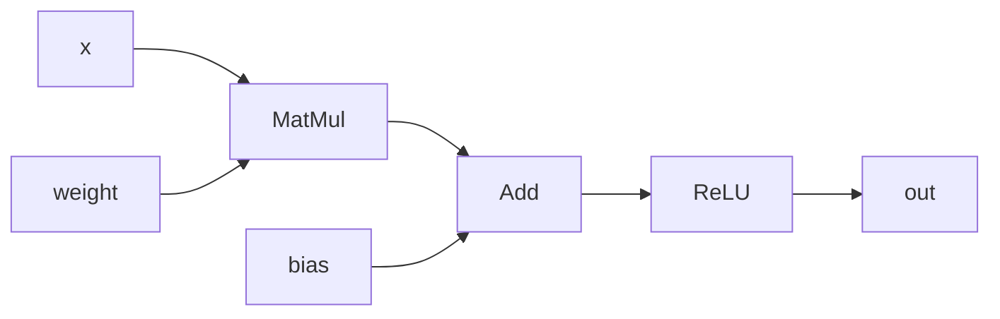
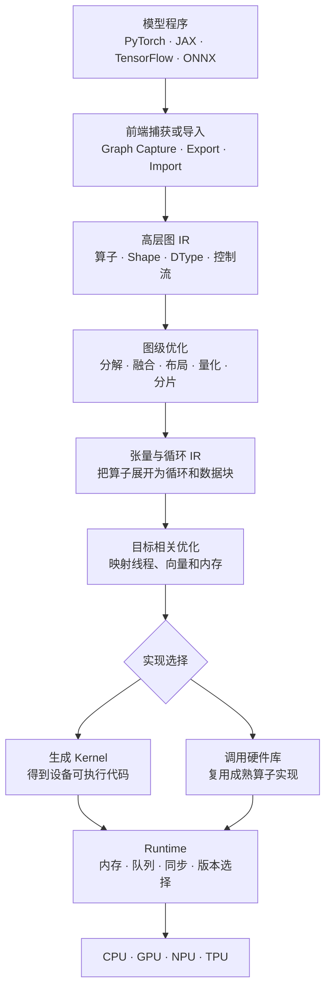
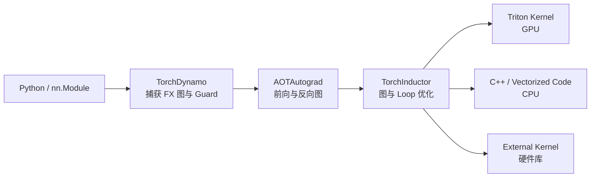

# AI Compiler：从计算图到硬件执行

神经网络最终也是一段程序。它接收 Tensor，执行矩阵乘法、加法、归一化和激活函数，再得到新的 Tensor。框架可以逐个执行这些运算，AI Compiler 则会先观察一段完整计算，再决定哪些运算应该合并、使用哪个硬件实现，以及数据应怎样存放和传递。

例如下面三行 PyTorch 代码：

```python
y = x @ weight
z = y + bias
out = torch.relu(z)
```

直接执行时，框架可能依次启动矩阵乘法、加法和 ReLU。编译后则可能调用一个带 Bias 的高性能矩阵乘法实现，再把 ReLU 合入同一段设备程序，减少中间结果写回显存和重复启动 GPU 的成本。编译器必须保证结果语义不变；至于是否融合、怎样融合，要根据 Shape、数据类型和硬件决定。

这就是 AI Compiler 最核心的工作：

> 把“模型要计算什么”逐步变成“目标硬件具体怎样执行”。

本文先沿这个小例子建立完整主线，再解释各阶段的内部机制，最后比较当前常见技术栈。第一次阅读可以先完成第 1～4 章，再根据需要进入后面的动态 Shape、图优化、Kernel、Runtime 和具体项目。

---

# 1. 用一个 `Linear + ReLU` 走完整条链路

## 1.1 从 Tensor 和 Operator 开始

假设输入和参数的 Shape 是：

```text
x      : [32, 1024]
weight : [1024, 4096]
bias   : [4096]
```

Shape 是 Tensor 每个维度的长度。这里一次处理 32 个样本，每个样本有 1024 个输入特征，Linear 输出 4096 个特征。

Tensor 可以先理解为带有 Shape 和元素类型的多维数组。元素类型也称 DType（Data Type），例如 FP32 表示 32 位浮点数，FP16 表示 16 位浮点数。Shape 决定“有多少元素以及怎样分维度”，DType 决定“每个元素怎样表示”。

源程序可以写成：

```python
def linear_relu(x, weight, bias):
    y = x @ weight
    z = y + bias
    return torch.relu(z)
```

`MatMul`、`Add` 和 `ReLU` 都是 Operator，也就是“做什么计算”的描述。Operator 不规定 GPU 用多少线程，也不规定结果暂存在寄存器还是显存。

## 1.2 Eager Execution 怎样运行

Eager Execution 表示程序走到一条框架语句时，立即调度相应运算。可以把它简化成：

```text
x, weight
    ↓
MatMul Kernel
    ↓ 写出 y
Add Kernel + bias
    ↓ 写出 z
ReLU Kernel
    ↓
out
```

Kernel 是 CPU、GPU 或其他设备真正执行的一段函数。上面的执行方式容易理解和调试，但每个 Kernel 都可能产生一次调度开销，`y` 和 `z` 还可能需要写入显存后再被下一个 Kernel 读出。

“可能”很重要：框架或硬件库本身也可能已有融合实现，实际执行不能仅凭 Python 行数判断，应以捕获图和性能分析工具（Profiler）观察到的结果为准。

## 1.3 编译器先把计算变成 Graph

Graph（计算图）用节点表示 Operator，用边表示 Tensor 的流向：



拿到 Graph 后，编译器不再只能一次观察一条语句。它可以知道 MatMul 的结果只流向 Add，Add 的结果只流向 ReLU，于是判断它们是否适合组成一个融合区域（Fusion Region），也就是准备一起优化和生成实现的一组节点。

## 1.4 Graph 怎样变成设备执行

一种可能的编译结果是：

```text
Graph：MatMul → Add → ReLU
  ↓ 形状和类型检查
确认矩阵尺寸、FP16/FP32 等数据类型
  ↓ 图优化
选择 MatMul 实现，并尝试融合 Bias 和 ReLU
  ↓ Kernel 生成或硬件库选择
得到目标 GPU/CPU 能执行的函数
  ↓ Runtime
分配 Buffer、选择编译版本、提交 Kernel
  ↓
硬件执行并返回 out
```

这里第一次出现的几个词分别表示：

| 名词 | 在这个例子中的含义 |
|---|---|
| Tensor | 模型处理的多维数组，例如 Shape 为 `[32, 1024]` 的输入 `x` |
| Shape | Tensor 各维度的长度 |
| DType | Tensor 元素的表示类型，例如 FP32、FP16 或 INT8 |
| Operator | MatMul、Add、ReLU 等计算语义 |
| Graph | `MatMul → Add → ReLU` 及其 Tensor 依赖 |
| IR | 编译器内部保存 Graph、循环或设备指令的表示形式 |
| Pass | 对 IR 做一次分析或改写的编译器步骤 |
| Fusion | 让多个 Operator 在同一个执行区域中计算 |
| Kernel | 设备最终执行的函数 |
| Buffer | 存放输入、输出或中间 Tensor 的内存区域 |
| Layout | Tensor 的逻辑下标怎样映射到内存地址 |
| Backend | 面向某类硬件生成代码或选择实现的部分 |
| Runtime | 加载编译结果、管理内存并向设备提交任务的部分 |

编译器的输出不一定是一个 Kernel。MatMul 可能调用 cuBLAS 这类由 NVIDIA 提供的高性能线性代数库，ReLU 可能成为矩阵乘法末尾的后处理阶段（Epilogue），也可能由于 Shape、数据类型或算子支持限制而保留为独立 Kernel。AI Compiler 的职责是从合法方案中选择合适实现，而不是强制把整张模型图合成一个函数。

## 1.5 把完整系统放回这条主线

大模型会把上面的三个节点扩大成成千上万个节点，但主要阶段没有改变：



前端负责拿到程序，IR 保存每一阶段仍需保留的信息，优化 Pass 改写 IR，Backend 生成目标代码或选择硬件库，Runtime 最终在真实设备上执行。后续章节只是逐层放大这张图。

CPU 以少量复杂核心执行通用程序，GPU 以大量并行执行单元处理规则计算，NPU/TPU 则更强调张量和矩阵运算。它们的线程组织、指令和内存层级不同，所以同一 Graph 需要不同 Backend。

---

# 2. 再区分几个容易混在一起的层次

## 2.1 Operator 与 Kernel 不是一一对应

第 1 章已经看到，一个 Operator 可以选择多种 Kernel，一个 Kernel 也可以实现多个融合后的 Operator。例如：

```text
同一个 MatMul Operator
├── 很小的矩阵：专用小尺寸 Kernel
├── 常规矩阵：cuBLAS（NVIDIA GPU）/ oneDNN（CPU 等）
├── 适合 Tensor Core：MMA Kernel
└── 特殊布局或融合：编译器生成的 Kernel
```

Tensor Core 是 GPU 中专门加速矩阵运算的单元，MMA 是 Matrix Multiply-Accumulate（矩阵乘加）指令。反过来，`MatMul + Bias + GELU` 也可能被融合为一个 Kernel，从寄存器中的 MatMul 结果直接计算 Bias 和 GELU 激活函数，避免把中间 Tensor 写入显存后再读回。

## 2.2 图编译器与 Kernel 编译器

图编译器观察多个算子之间的关系，负责形状传播、算子分解、融合、布局传播、设备划分和内存规划。Kernel 编译器观察一个计算区域内部的循环、并行层次和访存，负责分块（Tiling）、线程映射、向量化、矩阵指令选择及机器码生成。

```text
模型图
  │  图编译器：跨算子优化
  ▼
若干 Fusion / Dispatch Region（交给后端的一组计算）
  │  Kernel 编译器：区域内部优化
  ▼
设备 Kernel
```

TorchInductor、XLA 和 TVM 能覆盖图到 Kernel 的较长链路；Triton 更接近 Kernel 语言与 Kernel 编译器。二者经常组合，而不是互斥。

## 2.3 编译器与 Runtime

编译器可以提前算出依赖关系、内存需求和候选 Kernel，Runtime 则面对实际输入和设备状态：

- 当前输入的 Shape 是什么；
- 应选择哪个已编译版本；
- Buffer 何时分配、复用和释放；
- Kernel 提交到哪个 Stream 或 Queue，也就是哪条设备工作队列；
- 拷贝、计算和集合通信如何同步；
- 编译缓存未命中时是触发 JIT，还是进入回退路径。

TensorRT、IREE 和 TVM 都包含 Runtime；ONNX Runtime 的名字虽然带 Runtime，也会做图优化和子图编译。项目名称不能代替分层分析。

## 2.4 编译器、硬件库与推理服务

高性能库保存经过专家调优的实现，例如 GEMM（通用矩阵乘法）、Convolution（卷积）、Attention 或 Collective（多个设备共同参与的通信操作）。编译器可能直接调用它们，也可能为更好的融合机会自行生成 Kernel。

推理服务还要处理请求队列、动态批处理、优先级、模型副本、保存历史 Key/Value 的 KV Cache，以及网络协议。这些不是传统代码生成问题，但会改变最优 Shape 和 Kernel。端到端系统通常是：

```text
推理服务
  ↓ 请求调度与批处理
模型 Runtime
  ↓ 图执行与资源管理
编译器产物
  ↓ Kernel 与库调用
驱动和硬件
```

## 2.5 JIT、AOT 与混合模式

JIT（Just-In-Time）在运行过程中根据真实输入编译，容易利用具体 Shape，却会带来冷启动和重编译开销。AOT（Ahead-Of-Time）在部署前生成产物，启动稳定、便于发布，但必须提前覆盖目标硬件和输入范围。

实际系统经常采用混合模式：AOT 生成主体，Runtime 对少量热点 Shape 做特化；或者先运行通用版本，同时在后台生成更快版本。不能只比较稳定执行时间，还要把编译时间、缓存命中率和产物大小计入总成本。

---

# 3. 为什么普通编译流程还不够

## 3.1 模型语义远高于标量指令

传统编译器看到循环、指针和标量运算后，可以完成常量传播、循环优化、向量化和指令选择；但在过早降低后，它很难重新识别：

```text
这是一整个 MatMul
这个维度是 Reduction 轴，也就是被求和或求最大值消去的维度
这段 Transpose 只是在改变逻辑布局
这几个算子可以共享中间结果
```

AI Compiler 会在高层保留张量形状、广播、Reduction、布局和精度等语义，在选择好全局策略后再降低为循环和指令。

## 3.2 性能往往受数据移动支配

FLOPs 表示执行了多少浮点运算。模型的 FLOPs 很多，但执行时间不只由算术指令数决定：

$$
T_{total}\approx T_{compute}+T_{memory}+T_{launch}+T_{sync}+T_{communication}
$$

各项含义是：

| 部分 | 含义 |
|---|---|
| Compute | 执行矩阵乘法、加法等计算 |
| Memory | 在寄存器、Cache、显存等存储层级之间移动数据 |
| Launch | Host（CPU 侧程序）向 GPU 等设备提交一个 Kernel |
| Sync | 等待其他线程、Kernel 或设备完成 |
| Communication | 多个设备之间传输 Tensor |

这些部分可能重叠，因此上式不是精确相加公式，而是一张定位清单。HBM（High Bandwidth Memory）通常是 GPU 的全局显存；算子融合可以减少 HBM 往返和 Kernel Launch，Tiling（分块）提升局部性，流水化尝试重叠拷贝与计算，分片策略则在计算量、显存和跨设备通信之间取舍。

## 3.3 同一计算存在大量合法实现

矩阵乘法的结果相同，并不表示实现相同。编译器还要选择：

- Tile 的 $M/N/K$ 尺寸；
- 一个 Block 负责多大区域；
- 使用多少 Warp；
- 数据放寄存器、Shared Memory 还是 Cache；
- 是否使用 Tensor Core；
- 是否拆分 Reduction；
- 是否融合前后处理；
- 调库还是自行生成代码。

这里 $M$ 和 $N$ 通常表示输出矩阵的两个维度，$K$ 是需要累加的 Reduction 维度。Tile 是从大矩阵中切出的一小块；Block 和 Warp 是 GPU 的线程组织层次；Shared Memory 是同一线程块共享的片上存储。第 9 章会逐项展开它们。

选择空间离散、庞大且依赖硬件，静态规则、成本模型、实测自动调优通常需要共同工作。

## 3.4 Shape、精度和设备都可能变化

固定的 `batch=1, seq=128` 与变化的批量、序列长度不是同一个编译问题。FP32、BF16、FP8 和 INT8 是不同的浮点或整数 DType，它们可使用的指令、累加精度、对齐要求也不同；同一代 GPU 的不同型号还可能拥有不同数量的 SM（执行线程块的计算单元）和不同的 Shared Memory 上限。

因此“支持某个模型”至少还要继续问：

```text
支持哪些 Shape 范围？
支持哪些 DType 和量化方式？
在哪些设备变体上？
不满足条件时怎样回退？
```

---

# 4. 先亲手运行一次 `torch.compile`

理解完整实现之前，可以先观察 AI Compiler 在框架里的使用方式。下面仍然编译前面的 MatMul、Bias 和 ReLU：

```python
import torch


def linear_relu(x, weight, bias):
    return torch.relu(x @ weight + bias)


device = "cuda" if torch.cuda.is_available() else "cpu"
x = torch.randn(32, 1024, device=device)
weight = torch.randn(1024, 4096, device=device)
bias = torch.randn(4096, device=device)

compiled = torch.compile(linear_relu)

expected = linear_relu(x, weight, bias)
actual = compiled(x, weight, bias)
torch.testing.assert_close(actual, expected)
```

`torch.compile` 返回一个仍可像普通 Python 函数一样调用的对象。第一次调用大致会经历：

```text
执行 Python 函数
  ↓
TorchDynamo（PyTorch 的图捕获组件）捕获 Tensor 运算并建立 Guard（复用条件）
  ↓
Backend 编译捕获到的 Graph
  ↓
执行编译结果，并写入缓存
```

之后使用相同 Shape、DType 和其他必要条件调用时，可以命中 Guard 并复用缓存。这里的“编译”发生在第一次调用，而不是执行 `torch.compile(...)` 那一行时全部完成。

## 4.1 为什么第一次调用通常更慢

第一次调用除了真正计算，还包括 Graph 捕获、优化、生成代码和加载 Kernel。后续调用才主要体现稳定执行成本：

```text
首次调用时间 = 捕获 + 编译 + 加载 + 执行
后续调用时间 = Guard 检查 + 缓存命中 + 执行
```

这只是帮助理解的分解，实际阶段可能异步或互相重叠。只测第一次调用会低估稳定性能，只测热缓存又会忽略短生命周期程序的冷启动成本。

## 4.2 一个区分首次调用和稳定调用的示例

```python
import time

import torch


class MLP(torch.nn.Module):
    def __init__(self, width: int):
        super().__init__()
        self.linear = torch.nn.Linear(width, width, bias=True)

    def forward(self, x):
        return torch.nn.functional.gelu(self.linear(x))


device = "cuda" if torch.cuda.is_available() else "cpu"
model = MLP(1024).eval().to(device)
x = torch.randn(32, 1024, device=device)
compiled = torch.compile(model)


def sync():
    if device == "cuda":
        torch.cuda.synchronize()


with torch.inference_mode():
    reference = model(x)

    sync()
    begin = time.perf_counter()
    first = compiled(x)
    sync()
    first_ms = (time.perf_counter() - begin) * 1000

    for _ in range(10):
        compiled(x)
    sync()

    repeat = 100
    begin = time.perf_counter()
    for _ in range(repeat):
        result = compiled(x)
    sync()
    steady_ms = (time.perf_counter() - begin) * 1000 / repeat

torch.testing.assert_close(first, reference)
torch.testing.assert_close(result, reference)

print(f"device: {device}")
print(f"compiled first call: {first_ms:.3f} ms")
print(f"compiled steady call: {steady_ms:.3f} ms")
```

GPU Kernel 通常异步执行，因此计时前后需要同步；否则 Host 侧测到的可能只是提交任务的时间。这个示例用于观察编译生命周期，不足以证明模型一定加速：严谨比较还要分别预热 Eager 和编译版本、交替测量多轮，并报告延迟分布。

## 4.3 观察 Graph Break、Guard 和重编译

可以打开 PyTorch 日志：

```bash
TORCH_LOGS="graph_breaks,recompiles,guards" python demo.py
```

现在不必立即理解每条日志，只需先建立三个对应关系：

| 日志 | 表示什么 |
|---|---|
| Graph Break | 当前 Graph 在这里中断，后面的代码重新捕获或回到 Eager |
| Guard | 复用当前编译结果必须满足的条件 |
| Recompile | 旧版本不再适用，编译器又生成了一个版本 |

如果不同输入尺寸持续触发重编译，应先判断它们能否由一个动态版本覆盖，再考虑 Shape 特化或分桶。简单提高缓存上限只会延后问题。

## 4.4 接下来怎样阅读

- 只想先建立整体认识：读完第 1～4 章后，可以直接查看第 12 章的技术栈地图和第 19 章的易混淆结论；
- 想理解编译器为什么这样设计：继续阅读第 5～10 章的捕获、IR、Shape、图优化、Kernel 和 Runtime；
- 关注训练、LLM 或多设备：阅读第 11 章；
- 想运行、分析或实现系统：继续阅读第 13～18 章。

---

# 5. 从模型程序得到可优化的图

## 5.1 导入静态模型

ONNX、StableHLO 等格式把模型表示为带类型和属性的算子图，适合跨框架或跨编译器传递。Opset 是某个版本中可用的 Operator 集合及其语义约定。导入器要完成：

- Opset 与语义校验；
- 权重和常量读取；
- Shape 与 DType 推导；
- 框架算子向内部算子的合法化；
- 不支持算子的诊断或自定义扩展。

导入成功只代表语法和基本语义可接受，不代表每个算子都能在目标设备上高效执行。自定义算子、动态控制流、稀疏格式和量化语义经常成为可移植边界。

## 5.2 捕获动态框架程序

PyTorch 一类 Eager 框架允许普通 Python 控制流、容器、对象属性和副作用。编译器前端需要从正在执行的程序中提取张量计算区域：Tracing 记录一次执行经过的运算，字节码分析观察 Python Frame 中即将执行的指令，符号执行用“只记录关系、不立刻计算真实结果”的值推演程序，Export 则生成带有明确约束、可交给后续系统的图。

```python
def f(x, flag):
    if flag:
        return x.sin() + x.cos()
    print("side effect")
    return x * 2
```

这里不只有张量算子，还出现 Python 布尔值和输出副作用。前端可能：

- 为 `flag=True/False` 分别生成版本；
- 在无法继续捕获的位置产生 Graph Break；
- 要求用户把数据依赖控制流改写为框架支持的结构化控制流；
- 将无法编译的区域交回 Eager 执行。

Graph Break 不一定导致错误，但会把一个大图切成小图，增加框架往返、同步和中间张量物化。强制 Full Graph 模式适合暴露捕获缺口，不代表任意 Python 都能被编译。

## 5.3 Guard 为什么会出现

捕获时观察到的事实可能只对当前调用成立，例如：

```text
x.rank == 2
x.dtype == float16
x.shape[1] % 16 == 0
module.training == false
某个 Python 全局量仍等于 4
```

编译器把这些前提保存为 Guard。下一次调用满足 Guard 时复用产物；不满足时重新编译、选择其他版本或回退。

Guard 不是普通的模型输入校验，而是“这份优化代码保持正确所依赖的条件”。Guard 过弱会造成错误结果，过强会造成编译版本爆炸和抖动。

## 5.4 原地修改、Alias 与副作用

Mutation 表示修改已经存在的对象；Alias 表示两个值引用同一块或互相重叠的底层存储。若两个 Tensor 存在 Alias，原地更新一个 Tensor 可能改变另一个 Tensor 观察到的值：

```python
y = x.view(-1)
x.add_(1)
return y
```

编译器不能把这段代码当成三个互不相关的纯算子。常见处理包括把原地操作改写成“输入旧值、返回新值”的函数形式，或使用依赖边和 Token 明确记录副作用顺序；无法证明安全时，则保守地阻止重排或退出编译区域。这里的 Token 不是模型文本 Token，而是一种只用于串联执行顺序的 IR 值。

随机数、Host 回调、I/O、设备同步和集合通信也有顺序语义。删除重复计算、删除无用计算和融合等优化只有在不改变这些可观察行为时才合法。

## 5.5 训练图还需要处理反向传播

训练不仅编译产生模型结果的前向计算（Forward），还要处理计算梯度的反向传播（Backward）、保存供反向使用的中间量、参数更新和可能的集合通信。Autograd 根据前向运算自动构造求梯度的反向运算；AOT Autograd（Ahead-Of-Time Autograd）先把前向和反向都捕获成图，使编译器能够优化两部分，但仍需保证：

- 梯度累加和别名语义正确；
- 保存张量与重计算的取舍合理；
- 混合精度缩放和溢出检测不被破坏；
- Collective 与计算的依赖和顺序正确。

---

# 6. 多层 IR：为什么不能一步降到机器码

IR（Intermediate Representation，中间表示）保存特定抽象层级上仍然重要的信息。AI Compiler 通常需要多层 IR，因为不同优化需要不同视角：

| 层级 | 主要信息 | 适合的工作 |
|---|---|---|
| 框架/图 IR | Operator、模块结构、控制流、参数 | 捕获、分解、自动微分、全局融合 |
| 张量 IR | Shape、DType、Layout、Reduction | 形状推导、布局传播、结构化 Tiling |
| 循环/调度 IR | 迭代空间、循环、Buffer、线程绑定 | Tiling、Fusion、向量化、内存提升 |
| 设备 IR | Warp/Workgroup、Shared Memory、MMA | GPU/NPU 特化、同步和流水化 |
| 低层 IR | 指针、标量、调用约定、指令 | LLVM 优化、寄存器分配和机器码生成 |

如果过早把高层 `MatMul` 变成任意循环和指针，后续 Pass 需要通过脆弱的模式匹配猜回矩阵乘法；如果一直停留在 MatMul，又无法表达非标准 Tile、Shared Memory 和目标指令。渐进式 Lowering 的目标是在“完成依赖该信息的优化之后”再丢掉这一层抽象。

## 6.1 一条抽象 Lowering 路径

```text
Linear + Bias + GELU
        ↓ 算子分解与融合
Fusion(MatMul, Add, GELU)
        ↓ 结构化张量 Lowering
并行 M/N 循环 + K Reduction
        ↓ Schedule
M/N/K Tiling + Cache/Shared Memory
        ↓ 设备映射
Block/Thread/Warp + MMA
        ↓ 低层代码生成
LLVM IR / PTX / SPIR-V / 目标 ISA
```

Lowering 不是每一步都“优化”。有些步骤只改变表示；有些步骤把隐含语义变为显式循环和 Buffer；真正的性能取决于选择了什么 Schedule，也就是循环、分块、并行和存储的具体执行方案。

## 6.2 MLIR、Dialect 与具体编译器

MLIR 是构建多层 IR 和 Pass Pipeline 的基础设施，不是一条固定的 AI 编译流程。StableHLO、Linalg、Tensor、GPU、LLVM 等 Dialect 可以表达不同层次；IREE、部分 OpenXLA 组件及其他编译器会选择其中一部分并加入自己的 Dialect。

因此：

```text
MLIR = 可扩展的编译器基础设施
Dialect = 某一语义领域的 IR 词汇
IREE / 其他项目 = 使用这些基础设施构建的具体系统
```

Operation、Region、Dialect Conversion、Bufferization 和 Transform Dialect 的细节见[MLIR：多层中间表示与渐进式 Lowering](post.html?slug=mlir)。

## 6.3 StableHLO 与内部 HLO

StableHLO 更接近框架和编译器之间的稳定交换契约，强调版本化算子语义和可移植产物。XLA 内部 HLO 则可以随编译器实现演进，承载内部优化需要的信息。

“格式稳定”不等于“任意后端性能相同”，也不等于“所有扩展算子都可移植”。目标设备仍可能不支持某种 DType、动态行为或算子组合。

## 6.4 Tensor 与 Buffer

高层 Tensor 常采用值语义，适合推理等价改写；底层设备最终需要地址、大小、布局和生命周期明确的存储。Bufferization 把 Tensor 计算转换为 Buffer 读写，并决定：

- 结果能否原地复用输入；
- 何时必须复制；
- 使用什么物理布局和地址空间；
- Buffer 在哪里分配和释放；
- 别名是否允许两个值共享存储。

错误地原地复用会破坏语义；过于保守地复制又会增加显存流量。Bufferization 不是简单把 `tensor` 改名为指针。

---

# 7. Shape 系统与动态形状

## 7.1 三种常见 Shape 信息

```text
Static Shape
  tensor<1x128x768xf16>

Symbolic Shape
  tensor<BxSx768xf16>，并带有 S % 16 == 0 等约束

Runtime Shape
  直到执行时才知道维度值
```

静态 Shape 能直接决定循环边界、Tile、内存大小和库算法；符号 Shape 可以让一份程序覆盖多个尺寸，但优化器必须保留并传播约束；完全运行期 Shape 最通用，也会限制常量折叠、内存规划和指令选择。

## 7.2 特化、通用化与分桶

处理动态 Shape 常见三种策略：

- 特化：为具体 Shape 生成最快代码；收益高，但版本多、编译和缓存成本高；
- 通用 Kernel：用运行期边界和 Mask 覆盖范围；版本少，但可能降低向量化和 Tensor Core 利用率；
- Bucket：把相近 Shape 归入若干区间，在版本数量和性能之间折中。

例如序列长度可生成 `<=128`、`<=512` 和通用三个版本。Bucket 上界带来的 Padding 也会执行无效计算，因此边界应来自真实输入分布，而不是平均划分。

## 7.3 动态 Shape 的正确性边界

一份版本只对其 Guard 覆盖的范围合法。除了维度值，还可能依赖：

- Stride 与连续性；
- 地址对齐；
- Reduction 长度是否为零；
- 维度能否被向量宽度整除；
- 索引计算是否溢出；
- 输出大小是否数据相关。

如果动态输出大小取决于数据内容，仅知道输入 Shape 仍不足以提前完成精确内存规划，可能需要两阶段计算、上界分配或 Runtime 扩容。

---

# 8. 图级优化及其边界

## 8.1 Canonicalization、Constant Folding、CSE 与 DCE

Canonicalization 把等价表达统一为稳定形式，为后续匹配创造条件。Constant Folding 提前计算纯常量子图；CSE 合并等价且无副作用的计算；DCE 删除结果不可达且无副作用的节点。

这些优化看似基础，边界仍然重要：

- 随机数、I/O、状态更新和同步操作不能仅因结果未使用就删除；
- 浮点重结合可能改变舍入、NaN 和 Inf 行为；
- 合并两个大常量可能延长生命周期，反而增加峰值内存；
- 动态 Shape 计算若会触发错误，不能随意改变其执行条件。

## 8.2 算子分解与重新组合

Decomposition 把复杂 Operator 展开为较小的基础算子，例如把某种归一化拆成 Reduction、减法、乘法和开方。好处是减少后端需要原生支持的算子数量，并暴露融合机会。

但过早分解也可能丢失高层语义，使编译器无法调用一个成熟的专用库。实际 Pipeline 常在两条路径之间选择：

```text
高层 Operator ──→ 专用库或专用 Kernel
       │
       └────────→ 基础算子分解 ──→ 融合与通用代码生成
```

## 8.3 Operator Fusion

融合最直接的收益是减少中间 Buffer 和 Kernel Launch：

```text
未融合：A → Kernel 1 → HBM 临时张量 → Kernel 2 → B
已融合：A → 一个 Kernel，在寄存器或片上存储传递中间值 → B
```

融合并非越大越好。边界包括：

- 活跃值过多可能装不进寄存器，被迫溢出（Spill）到更慢的内存；
- Shared Memory 占用过高，会减少一个 SM 上可同时驻留的线程块数量，也就是降低 Occupancy；
- 不同算子的最佳 Tile 或并行映射不兼容；
- 融合后失去调用高度优化库的机会；
- 一个大 Kernel 的长尾和编译时间增加；
- 一个产生结果的 Producer 被多个使用结果的 Consumer 共享时，分别融合可能导致重复计算；
- Reduction、同步和设备边界可能阻断融合。

因此融合通常由合法性检查、模式规则和成本模型共同决定，而不是把所有相邻节点合并。

## 8.4 Layout Propagation

Layout 决定逻辑坐标怎样映射到物理地址，例如 NCHW、NHWC、Blocked Layout 或为 Tensor Core 准备的特定排列。Layout Propagation 尝试让一组算子共享有利布局，减少显式 Transpose/Copy。

局部选择最快 Layout 不一定得到全图最优解：一次 MatMul 的理想输出布局可能迫使三个 Consumer 各做一次转换。编译器需要比较布局转换成本、融合机会、库接口要求和后续算子访问方式。

## 8.5 混合精度与量化

降低精度可以减少带宽和存储，并使用更高吞吐的矩阵指令。完整转换不仅是把类型名称从 FP32 改成 INT8，还包含：

```text
校准或量化参数
→ 插入/传播 Quantize 与 Dequantize
→ 选择 Per-Tensor 或 Per-Channel Scale
→ 确定累加类型
→ 融合相邻转换
→ 验证误差
```

Reduction、Softmax、归一化和累加常需要更高精度。量化还要处理零点、饱和、舍入、异常值和硬件支持；理论上更低的位宽若触发频繁格式转换或回退，端到端反而可能变慢。

## 8.6 分片与集合通信

当一个设备放不下模型或算力不足时，编译器可按设备 Mesh 对 Tensor 分片，并插入 AllReduce、AllGather、ReduceScatter、AllToAll 等 Collective。分片不仅改变存储位置，也改变算子局部 Shape 和通信依赖。

合法的分片策略很多，成本取决于：

- 计算/通信比；
- 链路拓扑与带宽；
- 是否能将通信与计算重叠；
- 每设备显存峰值；
- Collective 的启动开销；
- 不均匀 Shape 和最后一个分片。

只最小化通信字节不一定最优；一个通信量略大但能充分重叠的方案可能更快。

---

# 9. 从张量计算到高性能 Kernel

## 9.1 Algorithm 与 Schedule

Algorithm 描述结果怎样计算，Schedule 描述计算以什么顺序和层次执行。以矩阵乘法为例：

$$
C_{ij}=\sum_k A_{ik}B_{kj}
$$

它只说明数学关系，没有决定 Tile、循环顺序、线程映射和存储位置。Schedule 可以改变执行组织，但必须保持 Reduction 和依赖语义。

```text
同一个 MatMul Algorithm
├── CPU：多级 Cache Tiling + SIMD + 多线程
├── GPU：CTA（Thread Block）/Warp Tiling + Shared Memory + Tensor Core
└── NPU：映射到片上 SRAM、DMA 与矩阵计算单元
```

## 9.2 Tiling

Tiling 把大迭代空间分成小块，使工作集适配寄存器、Cache 或片上 SRAM。通常不只有一层：

```text
完整矩阵
  ↓ 设备或线程块 Tile
Shared Memory / L2 工作块
  ↓ Warp 或向量 Tile
寄存器工作块
  ↓ 指令 Tile
MMA / SIMD 指令
```

Tile 太小会增加循环与 Launch 开销、降低数据复用；太大可能超出寄存器或 Shared Memory，降低并发度。边缘 Tile 还需要 Mask、Padding 或单独的尾部 Kernel。

## 9.3 并行映射

编译器把并行循环映射到 CPU 线程、GPU Grid/Block/Warp/Thread 或加速器阵列。映射时要满足：

- 不同执行实例不会产生未同步的数据竞争；
- Reduction 使用合法的树形归约、原子操作或分阶段 Kernel；
- 并行粒度足以填满设备；
- 每个实例的资源占用不会压垮 Occupancy；
- Barrier 只同步其实际覆盖的作用域。

把循环标记为并行并不会自动得到高性能：粒度太细会被调度开销吞没，粒度太粗又会留下空闲核心。

## 9.4 Memory Promotion 与流水化

Memory Promotion 把经常复用的数据从全局内存搬到更快的片上存储。GPU MatMul 常将 A/B Tile 搬到 Shared Memory，再由多个 Warp 重用；CPU 则依靠寄存器 Block 和 Cache 层次。

流水化会让第 $t+1$ 个 Tile 的加载与第 $t$ 个 Tile 的计算重叠：

```text
时间 ─────────────────────────────→
Buffer 0: Load tile 0 | Compute 0 | Load 2 | Compute 2
Buffer 1:             | Load 1    | Compute 1 | Load 3
```

双缓冲需要额外片上空间，并且异步拷贝、Barrier 和 Buffer 复用顺序必须正确。计算太短或内存已不是瓶颈时，额外流水阶段可能只增加资源压力。

## 9.5 Vector、Warp 与 Tensor 指令

低层代码生成要把逻辑向量和矩阵片段匹配到目标指令：CPU SIMD、GPU Warp 级 MMA 或 NPU 矩阵单元。合法性常依赖 DType、对齐、Shape 倍数、Layout 和累加精度。

当输入不满足约束时，编译器可以 Padding、生成尾部路径、改用较窄向量，或选择标量/普通 FMA Kernel。强行使用宽向量或 Tensor Core 而没有满足布局和对齐契约，会产生错误访问或低效转换。

## 9.6 库调用、模板 Kernel 与代码生成

一个成熟后端通常同时保留三类路径：

| 路径 | 适合场景 | 主要限制 |
|---|---|---|
| 硬件库调用 | 标准 GEMM、Conv、Attention 等成熟算子 | 算子边界固定，复杂融合受限 |
| 模板或预编译 Kernel | 常见 Shape 和 DType，启动稳定 | 覆盖组合有限，产物体积可能增加 |
| 自动代码生成 | 特殊融合、布局和动态组合 | 编译成本高，质量依赖调度与成本模型 |

回退路径是正确性设计的一部分。新生成器不可能从第一天覆盖所有算子、DType、Shape 和设备，可靠系统必须明确“不支持时交给谁”，并记录跨设备 Copy 和同步成本。

## 9.7 成本模型与自动调优

合法候选可能成百上千，成本模型用于提前排除明显较差方案，自动调优再在少量候选上实测。常见搜索参数包括：

```text
Tile size
Loop order
Vector width
Warp / Thread 数量
Pipeline stage
Split-K（把 K 轴归约拆给多个工作单元后再合并）
Library tactic
Fusion boundary
```

纯静态模型难以精确预测 Cache、Bank Conflict、寄存器 Spill 和驱动行为；纯实测搜索又会带来长时间编译。工程上常用规则缩小空间、模型排序、实测确认，并把结果按设备、Shape、DType、布局和编译器版本写入缓存。

调优时必须在目标设备上测量。为一种 GPU 选出的配置不应无条件复用于另一种设备，即使两者都能执行相同 ISA。

GPU 编程模型与体系结构见[CUDA 执行与内存模型](post.html?slug=cuda_execution_model)；Tiling、融合和矩阵乘法的实现见[GPU Kernel 编译与 Lowering](post.html?slug=gpu_kernel_lowering)；Cost Model 与版本选择见[GPU Compiler 工程实践](post.html?slug=gpu_compiler_engineering)。

---

# 10. Runtime 才把编译结果变成一次真实执行

## 10.1 Buffer Planning

图中间值具有生命周期：从 Producer 写完开始，到最后一个 Consumer 读完结束。互不重叠的生命周期可以复用同一块内存：

```text
时间 ─────────────────────────────→
A: [====== live ======]
B:           [=== live ===]
C:                         [===]

A 与 C 可复用同一 Buffer，A 与 B 不可直接复用。
```

这类似区间分配，但还要处理别名、原地更新、异步执行和不同地址空间。Host 已经提交完 Kernel 不代表设备已经完成访问；若没有等待正确的 Fence/Event（表示设备工作进度的同步标记）就复用 Buffer，会形成设备侧 use-after-free，也就是 Buffer 仍在使用时便被回收或改作他用。

## 10.2 Dispatch、Queue 与同步

Runtime 把 Kernel、库调用和 Copy 提交到设备 Queue/Stream，并根据数据依赖插入 Event、Semaphore 或 Barrier。多个 Stream 可以重叠计算和传输，但只有真实无依赖的工作才能并行。

过度同步会串行化流水线；缺少同步会读到未完成的数据。编译器负责构造静态依赖，Runtime 还要把它映射到具体驱动 API 和设备队列。

## 10.3 版本选择与编译缓存

缓存键通常不只是模型名称，还可能包含：

```text
图或函数身份
Shape / DType / Stride
Guard 集合
目标架构与硬件特性
编译选项
驱动、库和编译器版本
```

缓存键缺少语义相关字段可能错误复用；包含过多偶然字段又会降低命中率。编译产物能否跨机器使用必须遵守对应 Runtime 的兼容性契约，不能把 GPU Engine 当成与硬件无关的普通模型文件。

## 10.4 Runtime 与设备抽象

PJRT、IREE HAL、ONNX Runtime Execution Provider 都在解决“让上层通过统一接口使用不同设备”的问题，但抽象边界不同：

- PJRT 面向框架与编译后设备执行，管理设备、Buffer、Executable 和分布式能力；
- IREE HAL 把设备、Buffer、Executable、Command Buffer 和同步原语纳入编译/运行时接口；
- ONNX Runtime EP 让硬件后端声明能接管的节点或子图，并负责这些分区的执行。

统一接口不代表不同后端行为完全一致。异步语义、动态 Shape、内存类型、设备互操作和算子覆盖仍需逐项确认。

## 10.5 Runtime 与 Serving 的边界

Runtime 执行一个编译程序；Serving 系统管理来自多个用户的请求。连续批处理、请求抢占、KV Cache 分页、模型路由和服务级超时主要属于 Serving/LLM Runtime，但会反向影响编译器：

- Batch 和序列长度不断变化，需要动态 Shape 或 Bucket；
- Paged KV Cache 决定 Attention Kernel 的地址访问方式；
- Tensor/Pipeline/Expert Parallel 决定 Collective 插入位置；
- Decode 阶段矩阵 Shape 与 Prefill 不同，需要不同 Kernel。

因此端到端性能不能只看某个离线 Kernel 峰值。

---

# 11. 训练、普通推理与大模型推理的侧重点

## 11.1 训练

训练链路通常包含 Forward、Backward、Optimizer 和跨设备同步，重点包括：

- 自动微分后的图捕获与联合优化；
- Activation 保存、释放与重计算；
- 梯度累加和混合精度；
- Data/Tensor/Pipeline/Expert Parallel；
- Collective 与计算重叠；
- 长时间运行下的编译缓存稳定性。

只优化 Forward 可能对总训练步时间帮助有限；重计算减少显存却会增加 FLOPs；更大的融合也可能延长关键路径。

## 11.2 普通模型推理

推理不需要构建梯度，适合冻结参数、常量折叠、算子融合、静态内存规划和低精度量化。部署时还需关注：

- 冷启动和 Engine 构建时间；
- Batch 对延迟与吞吐的影响；
- 动态输入范围；
- 模型产物与目标机器兼容性；
- 不支持算子的回退是否产生设备往返。

## 11.3 LLM Prefill 与 Decode

Prefill 一次处理较长 Prompt，矩阵规模较大，通常更容易发挥并行计算吞吐；Decode 每步只生成少量 Token，频繁读取 KV Cache，更容易受内存带宽、Launch 和调度影响。

```text
Prefill：较大的 GEMM / Attention，偏吞吐
Decode ：小批量逐步执行，偏带宽、延迟与调度
```

LLM 栈还会处理 Paged Attention、连续批处理、量化、投机解码和 MoE 路由。其中一些是 Kernel 编译问题，一些是 Runtime 数据结构或服务调度问题。把它们统称为“图融合”会掩盖真实瓶颈。

## 11.4 多设备编译

单设备编译决定一个设备内部如何执行；多设备编译还要决定 Tensor 放在哪里、算子在哪运行、何时通信。一个典型闭环是：

```text
逻辑模型图
  ↓ Sharding Propagation
每设备局部图 + Collective
  ↓ 单设备图优化
Fusion / Layout / Buffer Planning
  ↓ 各设备 Kernel 编译
Executable + 通信调度
```

拓扑必须进入成本模型。在 NVLink 内部有效的策略，跨 PCIe 或跨节点网络后可能完全不同。

---

# 12. 当前主流技术栈怎样分层

下面的项目不是同一种产品。它们分别覆盖框架捕获、交换 IR、图优化、Kernel 生成、部署 Runtime 或硬件库中的一部分。比较时应先对齐层级。

第一次看到这些名称时，可以先用下面这张表定位，不必立即记住每个内部组件：

| 类别 | 回答的问题 | 常见例子 |
|---|---|---|
| 框架捕获与导出 | 怎样把用户模型变成 Graph | TorchDynamo、`torch.export`、JAX Tracing |
| 模型或编译器交换表示 | 不同框架和编译器怎样传递计算语义 | ONNX、StableHLO |
| 图与张量编译器 | 怎样优化 Graph 并形成可执行区域 | TorchInductor、XLA、TVM、IREE |
| Kernel 语言与低层编译器 | 怎样把一个计算区域变成设备代码 | Triton、LLVM、MLIR GPU 相关 Dialect |
| 部署 Runtime 与厂商栈 | 怎样加载、分区和执行模型 | TensorRT、ONNX Runtime、OpenVINO、IREE Runtime |
| 硬件库 | 怎样提供已调优的常见算子实现 | cuBLAS、cuDNN、oneDNN |

一个项目可能横跨多行。例如 IREE 同时包含编译器和 Runtime，TensorRT 同时完成图优化、实现选择和 Engine 执行。表格表示职责，不是互斥分类。

## 12.1 基础层：LLVM、MLIR、设备 IR 与硬件库

LLVM 负责低层优化和 CPU/GPU 目标代码生成；MLIR 提供可扩展的多层 IR、Rewrite 和 Dialect Conversion 机制。LLVM 的 NVPTX/AMDGPU 后端、PTX/AMDGCN 指令集与 SPIR-V 等承接不同设备路径；cuBLAS/cuDNN、rocBLAS/MIOpen、oneDNN 等库提供成熟算子实现。

这些组件通常是其他 AI Compiler 的组成部分，不直接等价于“导入一个完整模型并部署”。

## 12.2 PyTorch 2 编译栈

PyTorch 当前编译主线可以概括为：



`torch.compile` 负责从用户入口协调捕获与 Backend，默认 Backend 是 Inductor。TorchDynamo 在 Python Frame 执行期间捕获可编译区域并建立 Guard；AOTAutograd 将反向传播也提前捕获；Inductor 生成或选择后端代码，在 NVIDIA、AMD、Intel GPU 路径中会使用 Triton 作为关键组成。

它的优势是与 Eager PyTorch 紧密结合，也意味着 Python 动态行为、Graph Break、Guard 失败和重编译是日常问题。`torch.export` 更适合得到约束更明确、用于后续转换或部署的图；它与 `torch.compile` 的“在当前程序中透明加速”目的不同。

## 12.3 OpenXLA：StableHLO、XLA、Shardy 与 PJRT

OpenXLA 生态把接口分成几个清晰部分：

```text
JAX / TensorFlow / PyTorch-XLA 等前端
                 ↓
             StableHLO
        可版本化的交换语义
                 ↓
              XLA HLO
       图优化、融合、布局、分片
                 ↓
        CPU / GPU / TPU Backend
       LLVM、Triton emitter、硬件库
                 ↓
               PJRT
      设备、Buffer 与 Executable 接口
```

StableHLO 用于框架与编译器之间的可移植表示；XLA 进行目标无关和目标相关优化。XLA:GPU 会在硬件库、LLVM 直接代码生成和 Triton 代码生成之间选择。Shardy 负责表达和传播张量分片；PJRT 则向框架提供设备执行接口。

这里也不能把 StableHLO 当成性能方案本身：它规定计算语义和兼容边界，性能来自消费它的编译器、后端和 Runtime。

## 12.4 Apache TVM

TVM 以跨层优化和可调度 Tensor 程序为核心：

```text
模型导入
  ↓
Relax：高层图、动态 Shape、控制流
  ↓ Legalize / Fuse / Library Dispatch
TensorIR：低层张量计算与 Buffer 程序
  ↓ DLight / Schedule / MetaSchedule
LLVM / CUDA 等目标代码
  ↓
Relax VM / Runtime / Disco
```

Relax 负责图级表示与变换，TensorIR 负责低层计算；Schedule 显式控制 Tiling、重排、向量化和线程绑定；DLight 提供规则调度，MetaSchedule 使用搜索和测量选择实现。Relax VM 将图控制与编译后的本地 Kernel 打包执行，Disco 面向分布式执行。

TVM 新版源码与文档正在把原先广义的 `tir` 组件进一步拆成 `tirx` 与可调度的 `s_tir`；较早资料仍普遍使用 TIR/TensorIR 统称。阅读代码时应以所用版本的目录和 API 为准，概念层仍可按 Relax 与 TensorIR 两层理解。

## 12.5 MLIR 与 IREE

MLIR 本身提供基础设施，IREE 则给出从模型到部署 Runtime 的具体实现：

```text
StableHLO / TOSA / Linalg 等输入
          ↓
Flow：形成可调度 Dispatch
          ↓
Stream：资源生命周期与异步执行
          ↓
HAL：设备、Buffer、Executable、Command Buffer
          ↓
CPU / CUDA / ROCm / Vulkan / Metal 等后端
          ↓
VM bytecode 或其他可部署产物
```

IREE 的特点是把调度、资源生命周期和多后端设备抽象也纳入编译链，适合需要较小 Runtime、跨平台或嵌入式部署的场景。使用 MLIR 并不会自动获得 IREE 的完整 Runtime；选择 Dialect 和 Pass Pipeline 仍然是具体编译器的职责。

## 12.6 NVIDIA TensorRT 与 TensorRT-LLM

TensorRT 面向 NVIDIA GPU 推理。Builder 导入或构造网络，完成图优化并为目标 GPU 选择 Kernel/Tactic，生成序列化 Engine；Runtime 加载 Engine，并通过 Execution Context 执行。

```text
PyTorch（经 Torch-TensorRT）/ ONNX / Network API
          ↓
TensorRT Builder
图优化 + 精度选择 + Tactic / Plugin
          ↓
Serialized Engine
          ↓
TensorRT Runtime + Execution Context
          ↓
NVIDIA GPU
```

Engine 带有目标相关的已编译状态，默认不能假定跨 TensorRT 版本、GPU 型号、操作系统或 CPU 架构通用；需要按官方兼容选项和支持矩阵设计发布流程。Plugin 可以补充自定义层，但也把兼容性、序列化和正确性责任带入部署。

TensorRT-LLM 在 TensorRT 之上提供 LLM 模型构建 API、优化组件及 Python/C++ Runtime，覆盖量化、KV Cache、批处理和多 GPU 等 LLM 专用路径。它不是通用训练编译器。

## 12.7 ONNX Runtime

ONNX Runtime 先做与设备无关的图优化，再按优先级询问 Execution Provider 能接管哪些节点或子图：

```text
ONNX Graph
  ↓ 通用图优化
Graph Partition
  ├── TensorRT EP 子图
  ├── CUDA / ROCm / OpenVINO / CoreML / QNN 等 EP 子图
  └── CPU EP 回退子图
```

EP 可以调用硬件库、内部编译子图或直接执行 Kernel。ONNX Runtime 的核心价值之一是异构分区和统一应用接口，不代表 ORT 核心为每种设备自行生成所有 Kernel。

分区过碎可能在 Provider 边界产生 Copy、布局转换和同步；“某 EP 支持模型中的大多数算子”也不等于端到端一定更快，应检查实际分区图。

## 12.8 OpenVINO

OpenVINO 面向部署工作流，可从 PyTorch、TensorFlow、ONNX、JAX/Flax 等来源转换模型，通过 Runtime Plugin 在 Intel CPU、GPU、NPU 等设备上编译和执行，并提供动态 Shape、异构执行、自动设备选择、模型缓存及 NNCF 量化/压缩能力。

它更接近模型转换、优化和部署 Runtime 的完整产品栈。若经 ONNX Runtime 的 OpenVINO EP 使用，还会多一层 ORT 图分区；两层图优化的开关和边界需要按官方建议配置，不能假定重复优化一定更好。

## 12.9 Triton

Triton 是面向并行计算 Kernel 的语言和编译器。程序员以 Blocked Program 描述一个 Program Instance 处理的张量块，编译器再完成合并访存、线程映射、Shared Memory、向量化和目标指令等工作。

```python
import triton
import triton.language as tl


@triton.jit
def add_kernel(x, y, out, n_elements, BLOCK_SIZE: tl.constexpr):
    offsets = tl.program_id(0) * BLOCK_SIZE + tl.arange(0, BLOCK_SIZE)
    mask = offsets < n_elements
    tl.store(out + offsets,
             tl.load(x + offsets, mask=mask) +
             tl.load(y + offsets, mask=mask),
             mask=mask)
```

它降低了手写 CUDA 的门槛，但仍要求设计 Block 大小、并行分解和算法结构。Triton 不负责完整模型导入、请求调度或跨设备图执行；TorchInductor 和 XLA:GPU 可以把 Fusion 降到 Triton，再由 Triton 生成 GPU Kernel。

## 12.10 各栈的覆盖范围

| 技术栈 | 典型输入 | 主要覆盖层 | 常见目标 |
|---|---|---|---|
| PyTorch 2 Compiler | Python / FX / ATen | 动态捕获、训练图、图优化、Kernel 生成 | CPU 与多类 GPU |
| OpenXLA | StableHLO | 图优化、分片、Buffer、后端与设备接口 | CPU、GPU、TPU 及 PJRT Plugin |
| TVM | 多框架模型 / Relax | 图、TensorIR、调度搜索与 Runtime | CPU、GPU、嵌入式及定制后端 |
| MLIR | 多层 Dialect | IR 与编译器基础设施 | 由具体项目决定 |
| IREE | StableHLO/TOSA 等 | 图、Dispatch、资源调度、后端与轻量 Runtime | CPU、CUDA、ROCm、Vulkan、Metal 等 |
| TensorRT | ONNX/网络 API 等 | NVIDIA 推理图优化、Tactic、Engine Runtime | NVIDIA GPU |
| TensorRT-LLM | LLM 定义与权重 | LLM Kernel、Engine 与推理 Runtime | NVIDIA GPU |
| ONNX Runtime | ONNX | 图优化、异构分区、统一 Runtime | 取决于 Execution Provider |
| OpenVINO | 多框架模型 / OpenVINO IR | 转换、优化、Plugin 与部署 Runtime | Intel CPU、GPU、NPU 等 |
| Triton | Blocked Kernel Program | Kernel 编译 | NVIDIA、AMD、Intel GPU 等受支持后端 |

这张表描述项目边界，不是性能排名。最终选择还取决于算子覆盖、目标硬件、动态 Shape、训练或推理、冷启动、可部署环境和维护成本。

---

# 13. 四条常见的端到端路径

## 13.1 在 PyTorch 程序内透明编译

```text
nn.Module / Python function
        ↓ torch.compile
TorchDynamo 捕获区域并生成 Guard
        ↓
AOTAutograd 生成前向/反向图
        ↓
TorchInductor 融合并选择实现
        ↓
Triton / C++ / External Kernel
        ↓
在原 Python 程序中执行与缓存
```

这条路径适合尽量保留原有 PyTorch 编程体验。首先检查 Graph Break 和 Recompile，再看生成 Kernel；如果捕获阶段已经把图切碎，直接调 Tile 通常解决不了端到端开销。

## 13.2 JAX 经过 OpenXLA

```text
JAX function
  ↓ tracing / jaxpr
StableHLO
  ↓ XLA HLO optimization
Fusion + Layout + Sharding + Buffer Assignment
  ↓ Backend
LLVM / Triton emitter / Vendor Library
  ↓ PJRT
Device Executable
```

JAX 的函数式风格便于追踪，但 Shape、静态参数和副作用仍决定是否需要重新编译。多设备程序还要同时观察局部计算和 Collective，不能只比较单设备 Kernel。

## 13.3 可移植模型经 ONNX Runtime

```text
Framework
  ↓ Export
ONNX Model
  ↓ ORT graph optimization
Execution Provider partition
  ↓
各 Provider 编译或执行子图
  ↓
ORT 统一调度与 CPU fallback
```

这条路径适合应用希望保持统一 API，并按部署环境选择不同硬件 Provider。验证时应输出分区结果，确认关键子图是否整体进入目标 EP，以及边界是否引入额外 Copy。

## 13.4 面向固定 NVIDIA 环境构建 Engine

```text
Model / ONNX
  ↓ TensorRT build
Shape Profile + Precision + Tactic + Plugin
  ↓
Serialized Engine
  ↓ deployment
Runtime + Execution Context
  ↓
NVIDIA GPU
```

构建环境需要提供目标 Shape Profile 和精度约束。固定 Engine 能减少线上优化工作，但构建时间、兼容性和多 Shape 覆盖都必须纳入发布设计。

---

# 14. 怎样选择技术栈

## 14.1 先按目标选择入口

| 目标 | 通常优先考察 | 仍需验证 |
|---|---|---|
| 保留 PyTorch 训练/推理代码并加速 | `torch.compile` / Inductor | Graph Break、重编译、算子覆盖 |
| JAX、TPU 或 OpenXLA 生态 | StableHLO + XLA + PJRT | 动态 Shape、分片和目标 Plugin |
| 研究跨层优化与自动调度 | TVM | 前端导入、目标支持、调优成本 |
| 构建基于多层 IR 的编译器 | MLIR | 需要自行选择 Dialect、Pipeline 和 Runtime |
| 跨平台、嵌入式和轻量部署 | IREE | 输入模型覆盖与对应 HAL Backend |
| NVIDIA GPU 推理 | TensorRT | Engine 兼容性、动态 Profile、Plugin |
| NVIDIA LLM 推理 | TensorRT-LLM | 模型支持、显存、并行和服务集成 |
| 用统一 API 部署 ONNX 到多类硬件 | ONNX Runtime | EP 分区、Fallback 和边界 Copy |
| Intel CPU/GPU/NPU 部署 | OpenVINO | 设备 Plugin、Shape 与精度支持 |
| 编写或生成自定义 GPU Kernel | Triton | 算法、Tile、资源占用与目标支持 |

“支持某框架”常常只是导入入口；“支持某设备”也可能依赖额外 Plugin。选型前应拿真实模型和 Shape 做最小验证，而不是只比较项目功能列表。

## 14.2 用五个问题检查一条栈

```text
1. Frontend 能否稳定捕获或导入我的模型？
2. 不支持的算子、Shape 和 DType 怎样回退？
3. 生成代码、库调用和 Runtime 的边界在哪里？
4. 编译时间、缓存和产物兼容性怎样管理？
5. 端到端正确性、延迟、吞吐与显存怎样验证？
```

如果这五项说不清，即使某个单 Kernel 很快，也还不能形成可维护的部署方案。

---

# 15. 性能分析要沿编译链逐层排查

## 15.1 前端捕获层

先看：

- 是否发生 Graph Break；
- 同一函数是否反复 Recompile；
- Guard 为什么失败；
- 是否有算子落回 Eager；
- 输入 Stride、DType 和 Shape 是否意外变化。

这一层的问题会表现为 CPU 开销、同步和大量小 Kernel。此时只用设备 Profiler 看某个 Kernel，容易错过真正原因。

## 15.2 图与分区层

检查：

- Fusion Group 是否符合预期；
- 关键子图是否进入目标 Backend/EP；
- 是否存在重复 Layout Conversion；
- 是否产生过大的临时 Tensor；
- Collective 是否位于关键路径；
- 不同 Provider 之间是否频繁搬运数据。

图节点变少不必然更快。应同时看中间张量字节数、Launch 数量、并行度和库调用质量。

## 15.3 Kernel 层

设备 Profiler 重点观察：

- Kernel 时间与调用次数；
- 实际内存带宽和计算吞吐；
- Occupancy 与限制因素；
- 寄存器数量和 Spill；
- Shared Memory 使用；
- 访存合并与 Bank Conflict；
- Tensor/Core SIMD 指令利用率；
- 尾部 Mask 和负载不均衡。

低 Occupancy 不一定是问题：如果 Kernel 已接近计算或带宽上限，进一步追求 Occupancy 可能没有收益。Roofline 和瓶颈归因比单看一个百分比可靠。

## 15.4 Runtime 层

检查 Host 与设备时间线：

- 是否存在无意义同步；
- H2D/D2H Copy 能否避免或重叠；
- Kernel Launch 间是否有 CPU 空洞；
- 内存分配是否进入热路径；
- 多 Stream 是否真的并行；
- 首次 JIT 与稳定执行是否分开统计；
- 缓存命中后 P50/P90/P99 是否稳定。

GPU 操作通常异步。只在 Host 端围绕调用记录时间而不做 Event 或正确同步，得到的可能只是提交时间。

## 15.5 端到端层

最终指标应匹配真实目标：训练看 Step Time、样本吞吐和峰值显存；在线推理看首 Token、Token 间隔、P99 和吞吐；端侧应用还要看冷启动、包体、功耗和内存。

单算子 Microbenchmark 是定位工具，不能代替端到端结论。

---

# 16. 正确性边界

## 16.1 数值等价不总是逐位相等

改变 Reduction 顺序、使用 FMA、降低精度或启用近似数学函数都可能产生浮点差异。验证应根据 DType 和模型容忍度设置 `rtol/atol`，同时保留 NaN、Inf、极值和空维度测试。

允许误差不等于忽略异常。若误差随层数快速累积、只在某些 Shape 出现或改变 Top-k 结果，需要定位具体 Pass 和 Kernel。

## 16.2 优化必须保留副作用和并发语义

随机数状态、原地更新、Atomic、Barrier、Collective、Host Callback 和设备同步都有顺序约束。一个代数上等价的改写可能改变可观察行为。

特别是跨线程 Reduction 和共享 Buffer，必须同时证明读写不冲突及同步作用域正确。只在单线程 Reference 上比较数值，无法覆盖竞态。

## 16.3 差分测试与分阶段二分

可靠流程通常包括：

```text
框架 Eager 结果
  ↕
捕获图解释执行
  ↕
图优化后结果
  ↕
Lowering 后 CPU Reference
  ↕
目标 Kernel 结果
```

一旦结果首次分叉，就在对应 Pass Pipeline 中二分。只比较最初模型和最终 Engine，会让问题定位跨越太多层。

## 16.4 版本化和回退也要测试

至少覆盖：

- Guard 命中和失败；
- Bucket 边界内外；
- 对齐与非对齐地址；
- 最小、最大和零长度维度；
- 缓存冷启动与热启动；
- 不支持算子的回退；
- 多设备拓扑和单设备降级；
- 序列化产物的兼容性检查。

快路径正确但回退路径错误，仍然是编译器错误。

---

# 17. 如果自己实现一条最小 AI Compiler 链路

不要从完整 ONNX、自动微分和所有 GPU 算子同时开始。一个可验证的最小闭环可以是：

```text
输入：Elementwise + MatMul 的小型图
  ↓
自定义图 IR：Value、Operator、Shape、DType
  ↓
Shape Inference + Verifier
  ↓
Constant Folding + DCE + 简单 Fusion
  ↓
Lowering 到循环或 Linalg
  ↓
CPU LLVM 或一个 Triton Kernel
  ↓
Runtime 分配 Buffer 并执行
  ↓
与 NumPy / PyTorch 做差分测试
```

## 17.1 第一步先保证 IR 契约

每个 Operation 至少回答：

- Operand 和 Result 的类型是什么；
- Shape 如何推导，哪些维度允许动态；
- 是否有副作用和别名；
- 哪些属性参与语义；
- Verify 失败怎样给出诊断；
- 怎样序列化和版本化。

没有明确 IR 契约，优化 Pass 只能依赖偶然结构。

## 17.2 第二步分开合法性与收益

每个优化先证明：

```text
Can transform：语义上是否允许？
```

再判断：

```text
Should transform：在目标设备上是否值得？
```

例如两个 Elementwise 算子通常可以融合，但若 Producer 还有多个 Consumer，是否融合需要比较重复计算与中间 Buffer 成本。

## 17.3 第三步保留 Reference 和回退

为每个算子保留简单、明显正确的 Reference 实现。新优化路径出现不支持的 Shape 时进入 Reference/库回退，而不是生成行为未定义的代码。

Reference 不追求最快，但要覆盖完整语义，作为差分测试和调试基线。

## 17.4 第四步再加入动态 Shape 和自动调优

静态版本闭环稳定后，再加入符号 Shape、Guard、多版本缓存和调优数据库。它们会同时影响 IR、Runtime、缓存键、测试矩阵和发布兼容性，不只是多写一个 Pass。

---

# 18. 一条由浅入深的学习路径

1. 先理解 Operator、Kernel、计算图、Shape、DType、Layout 和 Runtime 的边界。
2. 用 `torch.compile` 观察 Graph Break、Guard、Recompile、Fusion 和生成代码。
3. 学习 SSA、CFG、数据流、循环、别名分析和 LLVM Pass，理解通用编译器基础。
4. 学习 MLIR Operation、Dialect、Rewrite、Conversion、Linalg 与 Bufferization。
5. 写一个 CPU Elementwise/MatMul Lowering，建立从 Tensor 到 Buffer 和机器码的闭环。
6. 学习 GPU Grid/Block/Warp、内存层级、Tiling、Coalescing、Bank Conflict 和 Tensor Core。
7. 写 Triton Kernel，并用 Profiler 解释每次调参为什么有效或无效。
8. 阅读 PyTorch Inductor、XLA、TVM 或 IREE 中一条真实 Pipeline，追踪一个算子从输入 IR 到 Runtime。
9. 最后进入动态 Shape、自动调优、量化和多设备分片，因为这些都横跨多个层级。

通用编译算法见[编译器与高性能系统算法](post.html?slug=compiler_algorithms)，张量布局与融合见[张量计算、融合与性能算法](post.html?slug=tensor_compiler_algorithms)，GPU 优化见[GPU Kernel 编译与 Lowering](post.html?slug=gpu_kernel_lowering)；多层 IR 的实现方法见[MLIR：多层中间表示与渐进式 Lowering](post.html?slug=mlir)；模型算子、Attention、MoE、量化和 KV Cache 的语义背景见[大模型之火](post.html?slug=fuck_ai)。

---

# 19. 容易混淆的结论

## 19.1 AI Compiler 是否只是算子融合

不是。融合只是图优化之一，完整链路还包含捕获、Shape、布局、精度、Tiling、Kernel 生成、库选择、内存规划、设备调度、缓存和回退。

## 19.2 MLIR 是否等于 AI Compiler

不是。MLIR 提供构建多层 IR 的基础设施；具体项目还要定义 Dialect、Pass Pipeline、后端和 Runtime。

## 19.3 Triton 是否替代 CUDA 和完整图编译器

Triton 提供更高层的 GPU Kernel 编程和编译能力，底层仍要进入设备工具链；它也不负责完整模型图与 Serving。图编译器可以把 Fusion 生成 Triton Kernel。

## 19.4 ONNX 是否自带高性能执行

ONNX 主要定义模型交换格式与算子语义。真正的图优化、分区、Kernel 和 Runtime 来自 ONNX Runtime、TensorRT、OpenVINO 或其他消费者。

## 19.5 静态 Shape 是否一定比动态 Shape 快

静态 Shape 提供更多特化机会，但若真实请求分布很分散，过多特化会增加编译、缓存和冷启动成本。设计目标应是端到端成本，而不是单个 Shape 的峰值。

## 19.6 更大的 Fusion 是否一定更快

不一定。它可能增加寄存器和 Shared Memory 压力、降低并行度、重复计算，或失去成熟库 Kernel。合法性和收益必须分别判断。

## 19.7 FLOPs 更少是否一定更快

不一定。布局转换、非合并访存、Launch、同步和通信可能主导时间。也存在用少量重复计算换取更少显存读写的优化。

## 19.8 Kernel 快是否代表模型快

不一定。Graph Break、Provider 边界 Copy、编译缓存未命中、Host 调度和请求排队都可能淹没 Kernel 收益。

---

# 20. 官方资料

- [PyTorch `torch.compile`][torch-compile]
- [PyTorch Compiler 组件说明][pytorch-compiler]
- [PyTorch `torch.export` 编程模型][torch-export]
- [OpenXLA 架构][xla-architecture]
- [XLA:GPU 架构与代码生成路径][xla-gpu]
- [StableHLO 兼容性][stablehlo-compat]
- [Shardy 分片传播][shardy-propagation]
- [Apache TVM 架构][tvm-architecture]
- [TVM MetaSchedule][tvm-meta-schedule]
- [TVM Relax VM][tvm-relax-vm]
- [IREE Developer Overview][iree-overview]
- [IREE VM][iree-vm]
- [TensorRT 工作方式][tensorrt]
- [TensorRT-LLM 文档][tensorrt-llm]
- [ONNX Runtime 架构][ort-architecture]
- [ONNX Runtime Execution Provider][ort-ep]
- [OpenVINO 推理工作流][openvino-runtime]
- [OpenVINO 支持的设备][openvino-devices]
- [Triton 编程模型][triton-intro]

[torch-compile]: https://docs.pytorch.org/docs/stable/generated/torch.compile
[pytorch-compiler]: https://docs.pytorch.org/docs/stable/user_guide/torch_compiler/torch.compiler.html
[torch-export]: https://docs.pytorch.org/docs/main/user_guide/torch_compiler/export/programming_model.html
[xla-architecture]: https://openxla.org/xla/architecture
[xla-gpu]: https://openxla.org/xla/gpu_architecture
[stablehlo-compat]: https://openxla.org/stablehlo/compatibility
[shardy-propagation]: https://openxla.org/shardy/propagation
[tvm-architecture]: https://tvm.apache.org/docs/arch/
[tvm-meta-schedule]: https://tvm.apache.org/docs/deep_dive/tensor_ir/tutorials/meta_schedule.html
[tvm-relax-vm]: https://tvm.apache.org/docs/arch/relax_vm.html
[iree-overview]: https://iree.dev/developers/general/developer-overview/
[iree-vm]: https://iree.dev/developers/design-docs/vm/
[tensorrt]: https://docs.nvidia.com/deeplearning/tensorrt/latest/architecture/how-trt-works.html
[tensorrt-llm]: https://docs.nvidia.com/tensorrt-llm/
[ort-architecture]: https://onnxruntime.ai/docs/reference/high-level-design.html
[ort-ep]: https://onnxruntime.ai/docs/execution-providers/
[openvino-runtime]: https://docs.openvino.ai/2026/openvino-workflow/running-inference.html
[openvino-devices]: https://docs.openvino.ai/2026/documentation/compatibility-and-support/supported-devices.html
[triton-intro]: https://triton-lang.org/main/programming-guide/chapter-1/introduction.html
