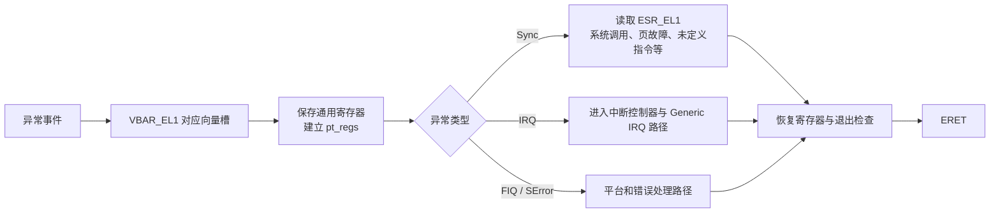
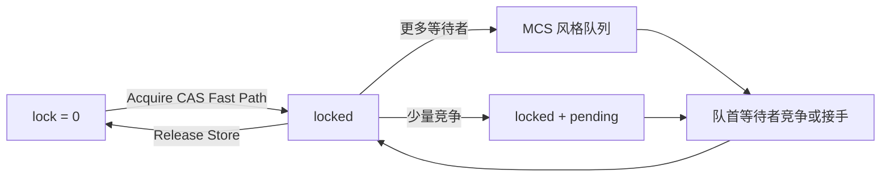
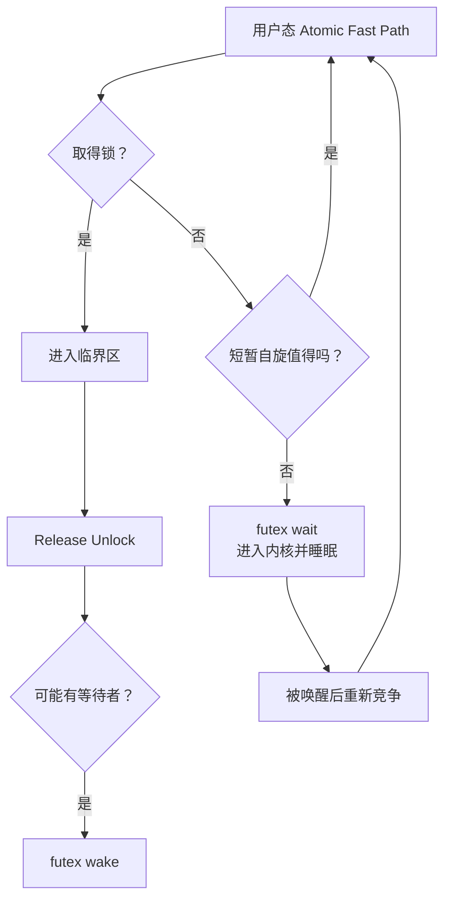

# ARM64 异常、中断、内存序与锁

异常入口、内存屏障、原子指令和锁看起来是四类知识，实际共同解决两个问题：CPU 何时改变执行流，以及多个执行者怎样安全地共享状态。

```text
设备或指令产生事件
        ↓
Exception Vector 把控制流带进内核
        ↓
IRQ / Fault / System Call Handler 访问共享状态
        ↓
内存序规定读写能以什么顺序被观察
        ↓
原子指令保证一次状态转换不可被并发拆开
        ↓
锁在原子状态之上增加互斥、排队、休眠和唤醒
```

本文以 AArch64 和 Linux 为主。汇编片段用于解释架构机制，不应直接替代 Linux 内核、C++ 标准库或 pthread 已经提供的同步原语。

---

# 1. 先区分异常、中断和系统调用

在 Arm 架构术语中，**Exception 是改变正常控制流并进入某个 Exception Level 的总称**。它不仅包含程序错误，也包含系统调用和外部中断。

| 类型 | 与当前指令的关系 | 常见来源 | 是否容易定位到某条指令 |
|---|---|---|---|
| Synchronous Exception | 由当前执行的指令同步产生 | `svc`、页表翻译失败、权限错误、未定义指令、断点 | 是 |
| IRQ | 异步 | 定时器、网卡、存储设备、IPI | 否 |
| FIQ | 异步，可作为与普通 IRQ 分离的路由类别 | 平台固件或特殊中断配置 | 否 |
| SError | 异步系统错误 | 总线或内存系统报告的错误 | 未必能精确归因到当前指令 |

因此，下面三句话含义不同：

- 页故障是同步异常，不是外设“缺页中断”；
- 设备 IRQ 是异步异常，不由当前指令直接造成；
- `svc #0` 是程序主动执行指令产生的同步异常，Linux 用它从 EL0 进入系统调用路径。

## 1.1 Exception Level

AArch64 常见权限层级为：

```text
EL0  用户程序
EL1  操作系统内核
EL2  Hypervisor
EL3  Secure Monitor（平台实现时）
```

数字更大表示更高的特权层，不表示每次异常都要逐级经过所有层。普通 Linux 用户程序执行 `svc` 时通常从 EL0 直接进入 EL1；虚拟机中的异常是否先进入 EL2，则由虚拟化配置和异常路由决定。

---

# 2. AArch64 异常入口保存了什么

以从 EL0 进入 EL1 为例，硬件完成的核心状态转换可以概括为：

```text
当前 PSTATE  ───────────────→ SPSR_EL1
异常返回地址 ───────────────→ ELR_EL1
同步异常原因 ───────────────→ ESR_EL1
相关故障地址（若有效）──────→ FAR_EL1
VBAR_EL1 + 对应槽位 ────────→ 新 PC
```

- `ELR_EL1`：异常处理结束时应返回到的地址；
- `SPSR_EL1`：异常发生前的 PSTATE，包括原执行级别和屏蔽状态；
- `ESR_EL1`：Exception Syndrome，主要用来分类同步异常并携带原因字段；
- `FAR_EL1`：对 Data Abort、Instruction Abort 等异常保存相关虚拟地址，但必须先检查 syndrome 是否说明该值有效；
- `VBAR_EL1`：EL1 异常向量表的基地址。

处理结束后，`ERET` 根据 `SPSR_EL1` 恢复执行状态，并从 `ELR_EL1` 指定的位置继续执行。普通 `ret` 只从通用寄存器取返回地址，不能完成 Exception Level 和 PSTATE 的恢复。

## 2.1 向量表不是一张函数指针表

AArch64 的向量表由 16 个固定槽位组成，每个槽位占 128 字节，整个表按 2 KiB 对齐。处理器根据来源和类型直接跳到对应偏移：

| 异常来源 | Sync | IRQ | FIQ | SError |
|---|---:|---:|---:|---:|
| 当前 EL，使用 SP0 | `0x000` | `0x080` | `0x100` | `0x180` |
| 当前 EL，使用 SPx | `0x200` | `0x280` | `0x300` | `0x380` |
| 较低 EL，AArch64 | `0x400` | `0x480` | `0x500` | `0x580` |
| 较低 EL，AArch32 | `0x600` | `0x680` | `0x700` | `0x780` |

每个槽位通常只放短小的汇编入口：保存寄存器、切换到合适的栈和上下文，再跳到公共处理代码。Linux ARM64 源码中的 `arch/arm64/kernel/entry.S` 负责这层低级入口，`entry-common.c` 再把保存好的 `pt_regs` 分派给同步异常、IRQ、FIQ 或错误处理路径。



## 2.2 Data Abort 示例

假设 EL0 执行：

```asm
ldr w0, [x1]
```

若 `x1` 指向的虚拟地址没有有效映射，可能发生下列过程：

1. MMU 页表遍历发现 Translation Fault；
2. CPU 选择“来自较低 EL、AArch64、同步异常”的向量槽；
3. `ELR_EL1` 保存相关返回位置，`ESR_EL1` 描述 Data Abort 和 fault status；
4. 若有效，`FAR_EL1` 保存产生访问错误的虚拟地址；
5. Linux 建立 `pt_regs` 并进入页故障处理；
6. 若只是尚未建立的合法匿名页或文件页，内核补齐映射后返回并重试访问；
7. 若访问非法，内核通常给进程生成 `SIGSEGV`，而不是“修复所有 Page Fault”。

同一条 Data Abort 路径既可能对应正常的按需分页，也可能对应真正的非法访问。异常类型只告诉内核发生了什么，最终策略还取决于 VMA、权限、页表状态和访问类型。

---

# 3. 外设中断怎样到达 Linux 驱动

以常见 GICv3 系统为例，中断路径可以概括为：

```mermaid
flowchart LR
    DEV["设备<br/>IRQ line 或 MSI"] --> GIC["GIC<br/>路由、优先级、屏蔽"]
    GIC --> CPU["目标 CPU 的 IRQ Exception"]
    CPU --> VEC["ARM64 IRQ Vector"]
    VEC --> CHIP["irqchip / GIC 驱动<br/>读取并确认 INTID"]
    CHIP --> DOMAIN["irq_domain<br/>hwirq → Linux IRQ"]
    DOMAIN --> FLOW["Generic IRQ flow handler"]
    FLOW --> TOP["驱动 hardirq handler"]
    TOP --> DEFER["threaded IRQ / workqueue / NAPI 等延后处理"]
    DEFER --> DONE["清状态、EOI/Deactivate、恢复执行"]
```



GIC Distributor 主要管理共享外设中断的全局配置和路由；Redistributor 处理每个处理器附近的 SGI、PPI 等状态；CPU Interface 负责 CPU 侧确认、优先级屏蔽和完成协议。MSI 设备还可能通过 ITS 把消息翻译成 LPI。具体路径取决于 GIC 版本、设备类型和平台配置。

## 3.1 驱动为什么要把工作拆成两部分

HardIRQ Handler 处在受限上下文中，应尽快完成：

- 判断是否为本设备产生的中断；
- 读取并清除必要状态；
- 在硬件协议要求时屏蔽或确认设备；
- 保存最小的设备状态并唤起延后处理。

可能睡眠、耗时不可控或需要复杂锁的工作应放到 Threaded IRQ、Workqueue 或子系统提供的延后机制中。网络驱动常用 NAPI，在高负载时从“每包触发中断”切换为有预算的轮询，以减少中断风暴。

## 3.2 Edge、Level 与 EOI 顺序

Edge Triggered 中断表示一次状态变化，若软件没有及时保存事件，可能丢失边沿；Level Triggered 中断在设备条件仍成立时会持续有效，如果驱动没有清除根因，返回后可能立刻再次进入。

所以不能机械地写成统一顺序：

```text
ack → handler → EOI
```

Linux Generic IRQ 根据 irqchip 和触发类型选择 `handle_edge_irq()`、`handle_level_irq()`、`handle_fasteoi_irq()` 等 Flow Handler。驱动还必须遵循设备手册规定的寄存器读取、状态清除、Mask 和 EOI/Deactivate 顺序。

---

# 4. DAIF：屏蔽本地异常不等于加锁

AArch64 PSTATE 中的 `DAIF` 位分别屏蔽：

```text
D  Debug Exception
A  SError
I  IRQ
F  FIQ
```

概念上，下面的指令保存原状态、屏蔽当前 CPU 的 IRQ，最后恢复原状态：

```asm
mrs x9, daif       // 保存调用前的 DAIF
msr daifset, #2    // 设置 I 位，本地 IRQ 被屏蔽
// 极短且不允许本地 IRQ 重入的区域
msr daif, x9       // 恢复调用前状态，而不是无条件打开 IRQ
```

内核代码不应自行散落这些汇编，而应使用 `local_irq_save()` / `local_irq_restore()` 或与锁配套的接口，让嵌套状态、跟踪和架构差异得到正确处理。

屏蔽 IRQ 只解决“当前 CPU 是否能被普通 IRQ 入口打断”，它不提供以下保证：

- 不能阻止其他 CPU 同时访问共享数据；
- 不能代替跨 CPU 的原子操作或自旋锁；
- 不能自动保证设备 MMIO 和普通内存按所需顺序到达；
- 不能让当前上下文变成允许睡眠的上下文；
- 普通 IRQ Mask 也不等于屏蔽所有 FIQ、SError 或伪 NMI 路径。

Linux 内存屏障文档还特别指出：本地 IRQ Disable/Enable 主要提供编译器层面的边界，不能把它当成通用 CPU 或 I/O Memory Barrier。

---

# 5. 为什么 ARM64 需要认真处理内存序

源代码顺序、编译器生成的指令顺序、CPU 执行顺序和其他观察者看到的顺序不是同一件事。

```text
C/C++ 源代码
   ↓ 编译器优化
AArch64 指令序列
   ↓ 乱序执行、Store Buffer、Cache 与互连
其他 CPU 或设备观察到的内存操作
```

Cache Coherence 主要回答“各 CPU 最终是否对一个 Cache Line 的值达成一致”，Memory Ordering 回答“不同位置的读写以什么先后关系被观察”。有一致性不表示跨地址操作会自动保持源码顺序。

## 5.1 编译器屏障、CPU 屏障和设备屏障

三层约束不能混用：

| 层次 | 解决的问题 | 不能保证什么 |
|---|---|---|
| Compiler Barrier | 阻止编译器跨边界移动特定内存操作 | 不一定生成 CPU 屏障指令 |
| CPU Memory Barrier | 约束 CPU/内存系统对访问的排序或完成 | 不自动构造互斥和业务协议 |
| I/O Accessor / DMA API | 按内核和设备契约访问 MMIO、同步 DMA | 不能被普通 C 指针读写随意替代 |

Linux 驱动应优先使用 `readl()`、`writel()`、`dma_wmb()`、`dma_rmb()` 和 DMA Mapping API，而不是看到乱序问题就手写 `dmb sy`。这些 API 同时表达访问类型、作用范围和平台要求。

---

# 6. DMB、DSB 与 ISB 分别解决什么

## 6.1 DMB：约束数据访问顺序

Data Memory Barrier 保证指定 Domain 和访问类型中的前序内存访问，相对于后序访问按要求被观察。它强调 **Ordering**，不表示所有前序操作都已在整个系统彻底完成。

常见参数包括：

| 指令 | 直观含义 |
|---|---|
| `dmb ish` | Inner Shareable Domain，约束 Load 和 Store |
| `dmb ishst` | Inner Shareable Domain，只要求 Store 方向的顺序 |
| `dmb ishld` | Inner Shareable Domain，Load 方向约束 |
| `dmb sy` | System Domain 的更强数据访问顺序 |

作用域越强、约束越多，潜在成本通常越高。应从参与者所在 Shareability Domain 和同步协议选择，不应一律使用 `dmb sy`。

## 6.2 DSB：等待同步完成

Data Synchronization Barrier 不仅提供相应排序，还等待指定范围内的前序操作达到架构要求的完成点，才允许后续执行继续越过。它常出现在：

- Cache/TLB Maintenance 序列；
- 修改页表或系统控制状态后的同步；
- 设备、电源和异常控制要求完成而不仅是排序的地方。

DSB 比 DMB 更强并不意味着日常线程同步都应该用 DSB。发布普通共享数据通常只需要 Acquire/Release 或适当的 DMB；无差别使用 DSB 会加入不必要的等待。

## 6.3 ISB：让后续指令使用新上下文

Instruction Synchronization Barrier 让后续指令重新取指并在更新后的执行上下文中解释。它常用于：

- 修改会影响取指、权限或执行行为的系统寄存器；
- TLB、Cache 或页表维护序列的末端；
- 更新异常屏蔽或执行状态后，架构明确要求 Context Synchronization 的地方。

ISB 不是普通数据读写的“超级内存屏障”。自修改代码还需要正确的 D-Cache Clean、I-Cache Invalidate 和 DSB/ISB 序列，单独一个 ISB 不会替你完成 Cache Maintenance。

## 6.4 一个页表更新序列为什么三者都可能出现

下面只表示思路，不是可以绕过 Linux 页表 API 的代码：

```text
写入或清除 PTE
      ↓
DSB ISHST：让页表写入在 TLB 操作前达到要求
      ↓
TLBI：失效旧的地址转换缓存
      ↓
DSB ISH：等待失效操作完成
      ↓
ISB：让后续指令在新转换上下文中执行
```

改变有效映射还可能受 Break-Before-Make、ASID、范围 TLB Invalidate 和并发 Page Table Walker 等规则约束。这个例子用于区分“数据排序”“完成”和“刷新执行上下文”，不是完整页表修改算法。

---

# 7. Acquire / Release：比全屏障更贴近同步意图

消息发布可以用一对 Release/Acquire 表达：

```cpp
int data;
std::atomic<int> ready{0};

void producer() {
    data = 42;
    ready.store(1, std::memory_order_release);
}

void consumer() {
    while (ready.load(std::memory_order_acquire) == 0) {
    }
    use(data);
}
```

一种便于理解的 AArch64 指令形状是：

```asm
// x0 = &ready, x1 = &data
producer:
    mov  w2, #42
    str  w2, [x1]       // 普通数据写入
    mov  w2, #1
    stlr w2, [x0]       // Release 发布 ready
    ret

consumer:
1:  ldar w2, [x0]       // Acquire 读取 ready
    cbz  w2, 1b
    ldr  w0, [x1]       // 看到 ready 后再读取 data
    ret
```

若 `LDAR` 读到了 `STLR` 发布的值，Release 之前的 `data = 42` 会对 Acquire 之后的读取可见。这是同步关系，不是“等待一段时间 Cache 自然刷新”。

边界也必须说清：

- Release 只约束它之前的操作不能越过发布点，不是双向 Full Barrier；
- Acquire 只约束它之后的操作不能越过获取点；
- 如果 Consumer 没有读到 Producer 发布的那个值，就不能凭空建立这条同步关系；
- `volatile` 不能替代原子变量和内存序；
- C++ 编译器可以根据目标特性生成不同但语义等价的序列，不能把上面的汇编当成标准规定的唯一输出。

---

# 8. 原子操作先解决“不可分割”

下面的普通代码不是原子递增：

```asm
ldr x1, [x0]
add x1, x1, #1
str x1, [x0]
```

两个 CPU 可以同时读到旧值，各自加一后又写回相同结果，造成 Lost Update。需要对“读取旧值并写入新值”建立不可被其他竞争者插入的 Read-Modify-Write。

还要区分：对满足架构对齐和类型要求的普通单次 Load/Store，硬件可以提供 Single-Copy Atomicity；这并不使由 Load、Add、Store 三条指令组成的复合操作自动成为原子 RMW，也不自动建立跨地址的内存顺序。

---

# 9. LL/SC：LDXR 与 STXR 怎样组成原子更新

AArch64 可以用 Load-Exclusive / Store-Exclusive 循环完成原子更新：

```asm
// x0 = &counter
atomic_inc_acq_rel:
1:  ldaxr x1, [x0]      // Exclusive Load + Acquire
    add   x1, x1, #1
    stlxr w2, x1, [x0]  // Exclusive Store + Release
    cbnz  w2, 1b         // w2 != 0 表示写回失败，必须重试
    ret
```

逻辑过程为：

```text
LDAXR 读取 counter，并为本 PE 建立 Exclusive Monitor 状态
       ↓
计算新值
       ↓
STLXR 检查 Exclusive 状态
       ├── 成功：写入新值，状态寄存器返回 0
       └── 失败：不写入，状态寄存器返回非 0，重新读取再计算
```

其他 CPU 对相关 Exclusive Granule 的写入、异常、上下文切换或实现允许的其他事件，都可能让 Store-Exclusive 失败。失败不是程序异常，而是协议的一部分，所以循环必须能安全重算。

LL/SC 循环的边界包括：

- `STXR` 可能无竞争也失败，代码必须重试；
- 不能把一次旧值计算放到循环外，否则失败重试会写入过时结果；
- Exclusive Load 后若放弃 Store，应在需要时用 `CLREX` 清理本地 Exclusive 状态；
- 循环应保持短小，不能在其中调用会睡眠、切换上下文或产生任意副作用的操作；
- 原子成功不代表高竞争下性能良好，反复失败仍会产生 Cache Line 流量。

`LDXR/STXR` 本身不附带 Acquire/Release；`LDAXR` 增加 Acquire，`STLXR` 增加 Release。应根据上层内存序选择，而不是看到原子操作就一律使用最强版本。

---

# 10. LSE：把原子 RMW 交给单条指令

FEAT_LSE 为 AArch64 增加了 `CAS`、`SWP`、`LDADD` 等原子指令及 Acquire/Release 变体。原子加一可以表现为：

```asm
// x0 = &counter
mov     x1, #1
ldaddal x1, x2, [x0]    // counter += 1，x2 接收旧值，Acquire + Release
```

Compare-and-Swap 可以表现为：

```asm
// x0 = &value, x1 = expected, x2 = desired
casal x1, x2, [x0]
// 指令结束后 x1 保存内存中观察到的旧值；等于原 expected 才表示交换成功
```

LSE 和 LL/SC 都能实现上层原子语义，但进展与竞争特性不同：

| LL/SC | LSE |
|---|---|
| 由软件循环重试 | 一条架构原子 RMW 指令完成操作 |
| Store-Exclusive 可以失败 | 不暴露 Exclusive Store 重试循环 |
| 适配没有 LSE 的 AArch64 CPU | 需要 CPU 支持相应 Feature |
| 循环内可组合计算，但必须可安全重试 | 指令集合提供固定的 RMW 形状 |

Linux ARM64 不会因为“编译内核的机器支持 LSE”就假定所有目标机器都支持。内核会结合 CPU Feature 探测和 Alternative 机制，为实际 CPU 选择 LL/SC 或 LSE 实现。用户程序则可能由编译选项、最低目标架构、运行库或 Out-of-line Atomic Helper 决定具体路径。

---

# 11. 从原子操作构造一把最小自旋锁

下面是一把用于讲解的 32 位锁：`0` 表示空闲，`1` 表示持有。它不是完整生产实现。

```asm
// x0 = &lock_word
spin_lock_demo:
    mov   w3, #1
1:  ldaxr w1, [x0]      // 尝试读取，成功获取后提供 Acquire
    cbnz  w1, 3f        // 已锁定，转到只读等待
    stxr  w2, w3, [x0]  // 尝试 0 -> 1
    cbnz  w2, 1b        // Exclusive Store 失败，重试
    ret

3:  clrex               // 本次不准备 Store-Exclusive
2:  ldr   w1, [x0]      // TTAS：占用期间只读轮询
    cbz   w1, 1b
    yield                // Hint，不会替你调度或保证公平
    b     2b

spin_unlock_demo:
    stlr  wzr, [x0]     // Release：临界区写入先于 lock_word = 0
    ret
```

为什么需要 Acquire/Release：

```text
CPU 0 在临界区修改 protected_data
        ↓
STLR 解锁并发布这些写入
        ↓
CPU 1 用 LDAXR-Acquire 成功取得锁
        ↓
CPU 1 才能按同步协议观察 protected_data
```

如果只有锁字的原子 `0 → 1`，却没有正确的获取/释放顺序，互斥可能成立，但受保护数据的访问仍可能越过锁边界。

这把演示锁还缺少：公平性、排队、抢占控制、IRQ 语义、调试信息、Lockdep、PREEMPT_RT 适配、虚拟化优化和功耗友好的等待策略。业务代码不应复制它。

## 11.1 为什么使用 TTAS

若所有等待者都不断执行原子交换，每次尝试都要争夺锁字 Cache Line 的写权限。TTAS 在观察到锁被占用时先用普通 Load 轮询，只有看到空闲才进入原子 RMW 路径，可以减少持锁期间的一致性写流量。

它仍无法解决解锁瞬间多个等待者同时竞争、持有者被抢占或远端 NUMA/多插槽流量。高竞争锁通常需要排队结构，而不是继续堆叠更强的屏障。

---

# 12. 为什么中断上下文取得同一把锁会死锁

考虑同一 CPU：

```text
进程上下文取得 spinlock
        ↓
尚未解锁时发生设备 IRQ
        ↓
IRQ Handler 尝试取得同一 spinlock
        ↓
IRQ 一直自旋
        ↓
被中断的原持有者无法恢复执行并解锁
```

这不是多 CPU 环形等待，而是当前 CPU 的重入自死锁。若同一状态会被进程上下文和 HardIRQ 共同访问，典型写法是：

```c
unsigned long flags;

spin_lock_irqsave(&state->lock, flags);
/* 极短、不可睡眠的临界区 */
spin_unlock_irqrestore(&state->lock, flags);
```

取得锁前先保存并屏蔽本地 IRQ，避免同 CPU 的 IRQ 重入；Spinlock 本身负责阻止其他 CPU 并发进入。解锁时恢复的是调用前状态，而不是无条件打开 IRQ。

不同上下文常见选择：

| 共享者 | 常见接口 | 目的 |
|---|---|---|
| 仅普通进程上下文 | `spin_lock()` | SMP 互斥；非 RT 内核还会配合抢占规则 |
| 进程上下文与 SoftIRQ | `spin_lock_bh()` | 额外禁止本地 Bottom Half |
| 进程上下文与 HardIRQ | `spin_lock_irqsave()` | 额外保存并屏蔽本地 IRQ |
| 必须保留严格自旋语义的底层路径 | `raw_spin_lock*()` | 避开 PREEMPT_RT 对部分锁语义的转换 |

HardIRQ 中不能取得普通 Mutex，因为竞争时 Mutex 可能调用调度器睡眠。是否能在某个中断路径使用某类锁，要同时检查执行上下文、PREEMPT_RT 配置、所有访问者和锁嵌套关系。

---

# 13. Linux ARM64 为什么使用 qspinlock

演示锁让所有等待者观察同一个锁字；CPU 数量和竞争增加时，Cache Line 容易来回抖动。当前 Linux ARM64 选择 Generic Queued Spinlock，把常见状态压进一个 32 位值：

```text
locked    当前是否被持有
pending   浅竞争接手状态
tail      队列尾部编码
```



- 无竞争 Fast Path 使用带 Acquire 语义的 Compare-and-Exchange；
- 浅竞争路径用 Pending 状态避免立即建立完整队列；
- 高竞争时使用 Per-CPU MCS 风格节点，使等待者主要轮询各自节点；
- 解锁使用 Release Store，使临界区数据先于锁重新可用。

ARM64 下，这些上层操作再由架构原子层映射为 LSE 或 LL/SC。换句话说：

```text
qspinlock 排队协议
        ↓
Linux atomic / cmpxchg API
        ↓
LSE，或 LDXR/STXR 循环
        ↓
Cache Coherence 与内存系统
```

不能把 qspinlock 简化成“ARM64 的某一条锁指令”。AArch64 提供的是原子与顺序原语；排队、公平性和上下文规则由软件锁算法建立。

---

# 14. Mutex 为什么还需要 Futex 和调度器

自旋锁等待时持续占用 CPU。用户态 Mutex 通常把路径拆成：



ARM64 原子指令可以高效改变用户空间锁字，却不能自己完成：

- 把线程挂入内核等待队列；
- 将任务状态改为睡眠并让出 CPU；
- 处理超时、信号、优先级继承和 Owner Death；
- 唤醒任务并重新参与调度。

因此 Futex 的分工是：无竞争时不进入内核；需要睡眠和唤醒时才由内核协调。真实 pthread Mutex 还要处理等待者标记、丢失唤醒、Barging、公平性、Robust 和 PI 等问题，不能由一个 `CAS + futex_wait` 的短例子完整表达。

---

# 15. 从 C++ 原子到 ARM64 指令

例如：

```cpp
#include <atomic>

bool publish(std::atomic<int>& state) {
    int expected = 0;
    return state.compare_exchange_strong(
        expected,
        1,
        std::memory_order_acq_rel,
        std::memory_order_acquire);
}
```

可以用 Clang 观察目标相关输出：

```bash
clang++ --target=aarch64-linux-gnu -O2 -S atomic.cpp -o atomic-armv8.s
clang++ --target=aarch64-linux-gnu -march=armv8.1-a+lse \
  -O2 -S atomic.cpp -o atomic-lse.s
```

第一个目标可能使用 LL/SC、Outline Atomics 或 Runtime Helper；显式允许 LSE 后，编译器更可能使用 `CAS*` 等指令。最终结果还受编译器版本、ABI、目标特性和链接选项影响。

不要从一次汇编输出推出错误结论：

- `relaxed` 仍保证单个原子对象的原子访问，只是不建立额外跨对象顺序；
- `compare_exchange` 的成功与失败内存序可以不同；
- Weak CAS 允许 Spurious Failure，通常放在循环中；Strong CAS 也不保证无竞争或无 Cache Line 流量；
- Lock-Free 是进展保证，不等于 Wait-Free，也不等于更快；
- 原子对象的生命周期、对齐和 Memory Reclamation 仍必须正确。

---

# 16. 五个容易混淆的边界

## 16.1 IRQ Mask 不是 Memory Barrier

屏蔽本地 IRQ 防止当前 CPU 进入普通 IRQ Handler，但其他 CPU 和设备仍可并发访问。若数据发布或 MMIO 协议需要顺序，仍要使用锁、Atomic、I/O Accessor 或 DMA Barrier。

## 16.2 Memory Barrier 不是 Cache Flush

Barrier 规定顺序或完成点；Cache Clean/Invalidate 改变缓存维护状态；Coherence 维持参与者的数据一致视图。三者相关但不能互相替代。

## 16.3 Atomic 不等于有序

一个 Relaxed Atomic RMW 可以保证这次更新不丢失，却不保证其他普通数据已按业务协议发布。原子性和内存序是两个维度。

## 16.4 锁不等于关闭中断

普通 Spinlock 解决其他 CPU 的互斥，但若本地 IRQ 能重入并取得同一锁，还需要匹配的 IRQ-Safe 形式。反过来，只关本地 IRQ 又挡不住其他 CPU。

## 16.5 WFE/SEV 不是锁协议本身

`WFE` 可以让等待循环更节能，`SEV` 可以发送事件，但事件只是等待提示。锁的正确性仍来自原子状态转换、Acquire/Release、队列和唤醒协议，不能只靠“收到一次事件”。

---

# 17. 阅读 Linux 源码的顺序

按下面顺序阅读，比直接从驱动 Handler 跳到汇编更容易建立对应关系：

1. `arch/arm64/kernel/entry.S`：向量槽和低级寄存器保存；
2. `arch/arm64/kernel/entry-common.c`：同步异常、IRQ、FIQ 的 C 层分派；
3. GIC irqchip 驱动与 `handle_arch_irq`：取得硬件中断号；
4. Generic IRQ 与 irq_domain：把硬件 IRQ 映射到 Linux IRQ 和 Flow Handler；
5. 具体设备驱动的 Top Half 与延后处理；
6. `arch/arm64/include/asm/barrier.h`：ARM64 的 Linux Barrier 映射；
7. `arch/arm64/include/asm/atomic_ll_sc.h` 和 LSE 相关实现：原子后端；
8. `include/asm-generic/qspinlock.h` 与 `kernel/locking/qspinlock.c`：排队自旋锁；
9. `kernel/futex/` 与 pthread 实现：用户态 Mutex 的 Slow Path。

调试时则沿事件方向反过来检查：

```text
设备状态是否真的产生事件
  → GIC 是否 Pending、路由和 Unmask
  → CPU 是否屏蔽 IRQ
  → Linux IRQ 计数是否增长
  → Handler 是否清除正确状态
  → 延后工作是否被调度
  → 锁是否形成自死锁或长期竞争
  → DMA / MMIO 顺序是否满足设备协议
```

---

# 18. 参考资料

- [Arm：Exception Model](https://developer.arm.com/-/media/Arm%20Developer%20Community/PDF/Learn%20the%20Architecture/Exception%20model.pdf)
- [Arm：Memory Access Ordering in the Arm Architecture](https://developer.arm.com/community/arm-community-blogs/b/architectures-and-processors-blog/posts/memory-access-ordering-part-3---memory-access-ordering-in-the-arm-architecture)
- [Arm：Armv8 Sequential Consistency and Atomics](https://developer.arm.com/community/arm-community-blogs/b/tools-software-ides-blog/posts/armv8-sequential-consistency)
- [Linux Kernel：Memory Barriers](https://docs.kernel.org/core-api/wrappers/memory-barriers.html)
- [Linux Kernel：Generic IRQ](https://docs.kernel.org/core-api/genericirq.html)
- [Linux Kernel：Lock Types and Their Rules](https://docs.kernel.org/locking/locktypes.html)
- [Linux ARM64 Source：entry.S](https://github.com/torvalds/linux/blob/master/arch/arm64/kernel/entry.S)
- [Linux ARM64 Source：entry-common.c](https://github.com/torvalds/linux/blob/master/arch/arm64/kernel/entry-common.c)
- [Linux ARM64 Source：LL/SC Atomics](https://github.com/torvalds/linux/blob/master/arch/arm64/include/asm/atomic_ll_sc.h)
- [Linux Source：Generic qspinlock](https://github.com/torvalds/linux/blob/master/include/asm-generic/qspinlock.h)

具体寄存器、Barrier Domain、异常路由和中断完成协议必须结合目标 Arm Architecture Reference Manual、GIC Architecture Specification、SoC 手册以及正在运行的 Linux 版本确认。
