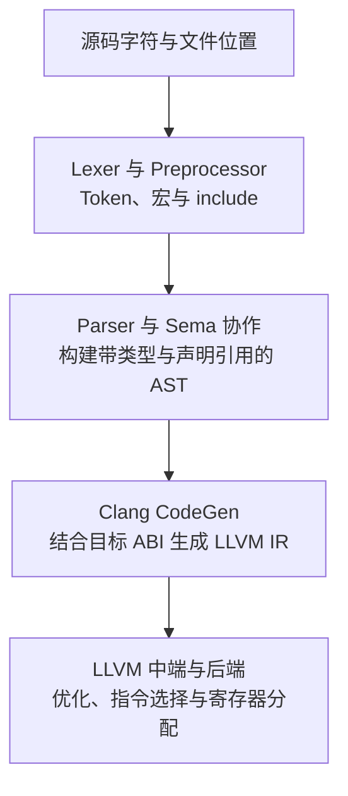

# Clang 前端：从源码、语法分析到 LLVM IR

# 1. 跟着一段 C 代码观察编译过程

保存为 `frontend.c`：

```c
#define SCALE 3

int scaled_sum(int a, int b) {
    int sum = a + SCALE * b;
    return sum;
}
```

这段程序中的字符、变量名、表达式和机器寄存器并不是同一层对象。Clang 先理解 C 的语法与类型，再生成 LLVM IR；LLVM 中端和后端接着优化、选择机器指令并分配寄存器。



- Token 是词法单元，例如标识符 `sum`、关键字 `int`、运算符 `+`，不是任意单个字符。
- AST 是 Abstract Syntax Tree，抽象语法树，描述声明、表达式和语句之间的关系。
- Sema 是语义分析组件，负责名字查找、类型检查、隐式转换和重载决议等工作。
- ABI 是 Application Binary Interface，约定参数如何传递、对象如何布局、符号如何命名。生成 LLVM IR 时就已经需要部分目标 ABI 信息，并非所有平台差异都推迟到后端。

Clang 的 Parser 从 Preprocessor 拉取 Token，并在解析过程中调用 Sema；图中的阶段是理解上的分工，不是“先把整个文件纯语法解析完，再统一检查类型”。[Clang 前端内部文档](https://clang.llvm.org/docs/InternalsManual.html)

## 1.1 观察每一层的命令

以下命令假定 `clang` 和 `opt` 来自匹配的 LLVM 工具链：

```bash
# 宏展开后的源码；-P 去掉预处理输出中的行标记
clang -E -P frontend.c

# 原始 Token 与预处理后的 Token；Token dump 通常写到 stderr
clang -Xclang -dump-raw-tokens -fsyntax-only frontend.c
clang -Xclang -dump-tokens -fsyntax-only frontend.c

# 带类型的 AST
clang -Xclang -ast-dump -fsyntax-only frontend.c

# 保留简单的未优化 IR，但去掉会阻止 opt 优化的 optnone 属性
clang -O0 -Xclang -disable-O0-optnone -S -emit-llvm frontend.c -o frontend.ll
opt -S -passes=mem2reg frontend.ll -o frontend.ssa.ll
```

`-Xclang` 把下一项参数传给 Clang 内部前端；这些调试参数和 AST 文本输出可能随版本变化，不适合作为长期稳定的数据交换格式。`-fsyntax-only` 不生成目标文件，但仍会进行语义检查。

在预处理输出中，`SCALE` 变成 `3`；在 AST 中，`*` 是 `+` 的子表达式；未优化 IR 中可以看到局部变量对应的 `alloca/load/store`；运行 mem2reg 后，可提升的栈槽被 SSA 值替换。mem2reg 不会顺便完成所有算术优化，也不意味着 IR 值已经被分配到物理寄存器。

# 2. 词法分析：字符如何变成 Token

## 2.1 正则表达式、NFA 与 DFA

一个教学语言可以用下面的规则描述部分 Token：

```text
标识符： [A-Za-z_][A-Za-z0-9_]*
十进制整数： [0-9]+
空白： [ \t\r\n]+
```

`[...]` 表示一个字符集合，`*` 表示前面的模式重复零次或多次，`+` 表示重复一次或多次。因此标识符首字符不能是数字，后续却可以包含数字。

正则表达式描述哪些字符序列属于一种 Token。NFA，Nondeterministic Finite Automaton，非确定有限自动机，允许一个状态对同一输入存在多个后继，也可以有不消耗字符的 ε 边。DFA，Deterministic Finite Automaton，确定有限自动机，对一个状态和一个输入只有一个确定的后继。

词法生成器可以把正则规则转成 NFA，再用子集构造把“一组可能的 NFA 状态”作为一个 DFA 状态。运行 DFA 时只需维护当前状态，逐字符转移；某个接受状态表示已经读到一个合法 Token。最小化可以合并行为等价的状态，减小表的规模。

以整数规则为例：读到第一个数字进入接受状态，后续数字继续留在该状态，遇到非数字结束。`123abc` 在这套教学规则下会被拆成整数 `123` 和标识符 `abc`；真实 C/C++ 预处理 Token 中有更宽松的 pp-number 规则，不能直接照搬这个结果。

这条理论链路用于理解词法识别，不代表 Clang 会在编译每个源文件时生成 NFA/DFA。Clang Lexer 是手写实现，还要处理注释、字符串、转义、Unicode 和源文件位置等规则。词法有限状态机也不负责识别任意深度嵌套的语法结构。

## 2.2 最长匹配与规则优先级

对 `>=`，不能看到 `>` 就立即结束，否则会丢失更长的合法运算符。常见策略是继续扫描，并记录最后一个可接受的位置，最终选择最长匹配。

最长匹配后仍要判断类别：`int` 满足标识符形状，但在 C 中是关键字。`a+++b` 通常分成 `a`、`++`、`+`、`b`，不是根据程序员想要的算术意义拆分。C++ 模板中的 `>>` 等场景还需要语言规定的上下文处理，不能把最长匹配理解成后续阶段永远不可调整的绝对规则。

## 2.3 预处理不是普通字符串替换

```c
#define TWICE(x) ((x) + (x))
#define TEXT(x) #x

int value = TWICE(4);
const char *name = TEXT(hello);
```

宏展开基于预处理 Token，支持参数替换、字符串化 `#`、Token 拼接 `##` 和重新扫描。`#include` 会引入其他文件，条件编译决定哪些 Token 继续交给 Parser。

`TWICE(i++)` 会产生两次自增，并且在这个展开式中对同一标量的修改没有所需的定序关系，具有未定义行为。宏不是“类型安全的内联函数”；名字作用域、求值次数和运算符优先级都需要由宏作者负责。

Clang 会保存宏展开位置与 Token 原始拼写位置。诊断指向宏调用处还是宏定义处，重构工具能否安全修改宏中的文本，都依赖这些位置关系，不能只保留一份展开后的字符串。

# 3. 语法分析：优先级、结合性与语法树

## 3.1 文法与左递归

上下文无关文法用产生式描述结构。下面是只支持加法、乘法、标识符、数字和括号的表达式文法：

```text
Expr   → Term ExprTail
ExprTail → + Term ExprTail | ε
Term   → Factor TermTail
TermTail → * Factor TermTail | ε
Factor → identifier | number | ( Expr )
```

`Expr`、`Term`、`Factor` 是非终结符，需要继续展开；`+`、`identifier` 等是终结符，最终对应输入 Token；ε 表示空串。

若写成 `Expr → Expr + Term | Term`，一个直接照着产生式递归调用的 `parseExpr()` 会先调用自身，还没有消费 Token 就再次进入 `parseExpr()`，形成无限递归。上面的文法消除了这种直接左递归；实现时可以用循环连续解析 `+ Term`，并把新节点接到已有树上。

若进一步加入左结合的减法，可以对比两种 AST 形状：

```text
解析 a + 3 * b：             解析 a - b - c 时的左结合：

          +                              -
         / \                            / \
        a   *                          -   c
           / \                        / \
          3   b                      a   b
```

左结合不是重新结合优化的许可。`(a - b) - c` 不能改成 `a - (b - c)`；浮点加法的重结合也需要额外的浮点语义条件。

## 3.2 FIRST、FOLLOW 与 LL(1)

FIRST(X) 是从 X 推导出的串可能以哪些终结符开头；X 能推导空串时还包含 ε。FOLLOW(X) 是 X 在句型中后面可能出现的终结符集合，输入结束通常记作 `$`。

对上一节文法：

计算 FIRST 时，查看每条产生式右侧的开头；如果前面的符号可以推导 ε，就继续查看后面的符号。计算 FOLLOW 时，把右侧后续串的 FIRST 中非 ε 的终结符加入当前非终结符的 FOLLOW；后续串可以为空时，再传播产生式左侧的 FOLLOW。开始符号的 FOLLOW 含 `$`，这些集合反复传播到不再变化。

| 非终结符 | FIRST | FOLLOW |
|---|---|---|
| Expr | identifier、number、`(` | `)`、`$` |
| ExprTail | `+`、ε | `)`、`$` |
| Term | identifier、number、`(` | `+`、`)`、`$` |
| TermTail | `*`、ε | `+`、`)`、`$` |
| Factor | identifier、number、`(` | `*`、`+`、`)`、`$` |

例如解析 ExprTail 时，看见 `+` 就选择 `+ Term ExprTail`；看见 `)` 或输入结束就选择 ε；看见其他 Token 则报错。不能把“当前不是 `+`”一律当成可以返回，否则 `a b` 等错误输入可能被悄悄接受。

LL(1) 从左到右读输入，构造最左推导，用一个前瞻 Token 选择产生式。若两个候选的 FIRST 相交，或者含 ε 的候选与 FOLLOW 导致同一个表项对应多个产生式，就存在选择冲突，需要改写文法、增加前瞻或换解析策略。递归下降是一种实现方式，并不自动意味着文法是 LL(1)。

### 3.2.1 用 FIRST/FOLLOW 建立预测表

沿用上一节文法，把 Expr、ExprTail、Term、TermTail、Factor 分别简写成 `E`、`E′`、`T`、`T′`、`F`，标识符和数字 Token 简写成 `id`、`num`：

```text
E  → T E′
E′ → + T E′ | ε
T  → F T′
T′ → * F T′ | ε
F  → id | num | ( E )
```

预测表 `M[非终结符, 前瞻 Token]` 决定应该使用哪条产生式。对 `A → α`，先把它填到 FIRST(α) 中非 ε 的 Token 列；如果 α 可以推导为空，再填到 FOLLOW(A) 的列：

| 非终结符 | `id` | `num` | `(` | `+` | `*` | `)` | `$` |
| --- | --- | --- | --- | --- | --- | --- | --- |
| E | E → T E′ | E → T E′ | E → T E′ | — | — | — | — |
| E′ | — | — | — | E′ → + T E′ | — | E′ → ε | E′ → ε |
| T | T → F T′ | T → F T′ | T → F T′ | — | — | — | — |
| T′ | — | — | — | T′ → ε | T′ → * F T′ | T′ → ε | T′ → ε |
| F | F → id | F → num | F → ( E ) | — | — | — | — |

`—` 是报错项，不是“随便选一条产生式”。例如 T′ 看见 `*` 时继续解析乘法；看见 `+` 时选择 ε，让当前 Term 结束，把 `+` 留给外层 E′。因为 FOLLOW(T′) 包含 `+`、`)`、`$`，这三个位置可以填 ε；看见另一个 `id` 则不能这样结束。

这张表的每个单元格至多包含一条产生式，所以该文法可以用 LL(1) 预测分析。表格按 Token 类别选择规则，`abc` 是一个 id Token，`123` 是一个 num Token；“看一个 Token”不是“只看一个字符”。

### 3.2.2 逐步解析 `a + 3 * b`

词法分析先给出 `id(a)`、`+`、`num(3)`、`*`、`id(b)`，末尾附加表示输入结束的 `$`。分析栈最初是 `E $`，此处约定栈顶在左：

- 栈顶是非终结符：查预测表，用产生式右侧替换它，不消费输入。
- 栈顶是终结符：必须与当前 Token 类别一致，匹配后弹栈并消费该 Token。
- 选择 ε：只弹出相应非终结符，输入位置不动。
- 栈顶与输入都到达 `$`：接受完整输入。

每一行展示执行本步动作之前的栈与输入，动作结果体现在下一行：

| 步骤 | 分析栈，栈顶在左 | 尚未消费的输入 | 本步动作 |
| --- | --- | --- | --- |
| 0 | `E $` | `a + 3 * b $` | E → T E′ |
| 1 | `T E′ $` | `a + 3 * b $` | T → F T′ |
| 2 | `F T′ E′ $` | `a + 3 * b $` | F → id |
| 3 | `id T′ E′ $` | `a + 3 * b $` | 匹配 a，消费一个 Token |
| 4 | `T′ E′ $` | `+ 3 * b $` | T′ → ε |
| 5 | `E′ $` | `+ 3 * b $` | E′ → + T E′ |
| 6 | `+ T E′ $` | `+ 3 * b $` | 匹配 +，消费一个 Token |
| 7 | `T E′ $` | `3 * b $` | T → F T′ |
| 8 | `F T′ E′ $` | `3 * b $` | F → num |
| 9 | `num T′ E′ $` | `3 * b $` | 匹配 3，消费一个 Token |
| 10 | `T′ E′ $` | `* b $` | T′ → * F T′ |
| 11 | `* F T′ E′ $` | `* b $` | 匹配 *，消费一个 Token |
| 12 | `F T′ E′ $` | `b $` | F → id |
| 13 | `id T′ E′ $` | `b $` | 匹配 b，消费一个 Token |
| 14 | `T′ E′ $` | `$` | T′ → ε |
| 15 | `E′ $` | `$` | E′ → ε |
| 16 | `$` | `$` | 接受 |

第 4 步没有吞掉 `+`，只是结束第一个 Term；第 10 步看到 `*`，继续构造第二个 Term，因此 `3 * b` 会作为一个整体参与加法。优先级由文法分层体现，不是解析到最后再凭运算符名字重新排序。

### 3.2.3 从预测过程构造 AST，并识别错误输入

分析栈保存的是“接下来期待什么”，它本身不是 AST。建立语法树时，展开产生式可以创建子节点；建立 AST 时，还需要语义动作，把 Factor 的叶子和 Term/Expr 的运算关系组合起来，省略 E′、T′ 等语法辅助节点。

例如识别 3 和 b 后，乘法的语义动作创建 `Mul(3, b)`；第二个 Term 完成后，加法的语义动作创建 `Add(a, Mul(3, b))`。

这份文法的 E′ 在形式上是右递归，但不意味着必须生成右结合 AST。解析连续加法时，可以维护已有的左侧节点，每识别一个 `+ Term` 就更新为 `Add(已有节点, 新 Term)`；这样 `a + b + c` 得到 `Add(Add(a, b), c)`。文法改写消除左递归时，要同时保留原来的结合性。

如果输入是 `(a + 3) * b`，第一个 F 看见 `(`，选择 `F → ( E )`，递归解析括号内的 E。看见 `)` 时，内层 T′、E′ 通过 ε 结束，但不消费 `)`；F 随后匹配这个右括号，外层 T′ 再处理 `* b`，得到 `Mul(Add(a, 3), b)`。

换成错误输入 `a b`，匹配 a 后栈顶是 T′，前瞻是 id；预测表 `M[T′, id]` 为空，立即报错。换成 `a + * b`，匹配 `+` 后需要一个 Term，但 `M[T, *]` 为空，同样报错。仅判断“现在不是乘号就返回”或“已经解析完一个表达式就接受”，都可能放过多余 Token 或缺失操作数。

## 3.3 LR 的 Shift / Reduce

LR 同样从左到右读取，但采用自底向上的归约过程：

- Shift：把一个 Token 压入解析栈，并进入相应状态。
- Reduce：栈顶已匹配某条产生式右侧，把它替换为左侧非终结符。
- Accept：完整输入被归约为开始符号。

状态和前瞻 Token 决定 ACTION，归约后的状态转移由 GOTO 决定。读到 `a + b * c` 时，不能在 `*` 前错误地先归约整个加法；文法结构或优先级规则要让乘法先组成子树。

一个 LR item，项目，在产生式中用点标记已经识别的位置。例如 `Expr → Term · ExprTail` 表示已识别 Term，接下来期待 ExprTail。一个解析状态汇集一组项目：Closure 为点后期待的非终结符补入其产生式，GOTO 在识别一个符号后把点向右移动，并计算新的闭包。点移到产生式末尾表示可能归约，但究竟在哪些前瞻 Token 上归约，取决于所选 LR 算法。

SLR 使用 LR(0) 项目集和 FOLLOW 集决定归约；规范 LR(1) 把前瞻信息放进项目；LALR 合并相同核心的 LR(1) 状态以缩小表，但合并可能引入冲突。Shift/reduce conflict 是同一个表项既可移进又可归约，reduce/reduce conflict 是可以按两个不同产生式归约。它们是解析决策冲突，不是运行时的数据竞争。[GNU Bison：LR 解析与冲突](https://www.gnu.org/software/bison/manual/bison.html#Algorithm)

### 3.3.1 用 SLR(1) 解析同一个表达式

下面选用 SLR(1) 作为 LR 方法的具体例子。它同样只需要一个前瞻 Token，但把已识别的输入压栈，逐步归约成更大的结构，而不是从 E 开始展开“接下来期待什么”。

采用等价的表达式文法，并给产生式编号：

```text
(0) S′ → E           // 增广开始产生式，只用于判定接受
(1) E  → E + T
(2) E  → T
(3) T  → T * F
(4) T  → F
(5) F  → ( E )
(6) F  → atom
```

为缩小表格，这里把标识符和数字统称为 atom，仍保留 a、3、b 各自的语义值。这是教学文法的简化，不是说 Clang 把数字和标识符当成同一种 Token。

这份文法包含左递归；LR 自底向上处理已经读入的符号，不会因 `E → E + T` 像直接递归下降那样在消费输入之前无限调用自身。但“有左递归”不意味着任意文法都能无冲突地进行 LR 分析。

### 3.3.2 解析状态怎样得到

状态 0 的 Closure，闭包，从 `S′ → · E` 出发，补入点后期待的非终结符对应的产生式：

```text
状态 0：
S′ → · E
E  → · E + T
E  → · T
T  → · T * F
T  → · F
F  → · ( E )
F  → · atom
```

读入 atom 后，把对应项目的点右移，得到状态 5 中的 `F → atom ·`，表示可以考虑按规则 6 归约。但是否此时归约，还要看前瞻：SLR 只在 FOLLOW(F) 的 Token 上填入这一归约动作。

这份文法中，FOLLOW(E) 是 `+`、`)`、`$`；FOLLOW(T) 和 FOLLOW(F) 都是 `+`、`*`、`)`、`$`。

状态 0 识别 E 后进入状态 1，其中包含 `S′ → E ·` 和 `E → E · + T`。如果接着移进 `+`，就进入以 `E → E + · T` 为核心的状态 6；闭包补入 T、F 的产生式，使它能够继续识别右侧操作数。状态 6 识别 T 后，便得到下面的状态 9。

两处关键状态是：

```text
状态 2：                   状态 9：
E → T ·                    E → E + T ·
T → T · * F                T → T · * F
```

状态 2 表示识别了一个 T，既可能把它归约成 E，也可能继续乘法；状态 9 表示识别了 E + T，也既可能结束加法，又可能让右侧 T 继续接 `* F`。因此，只看“栈顶长得像某个产生式右侧”还不足以立刻归约。

状态号只是给项目集起的编号，没有“9 比 2 优先级高”的意义。生成器使用不同编号很正常，重要的是项目内容与转移关系一致。

### 3.3.3 ACTION 与 GOTO 表怎样使用

ACTION 用“当前栈顶状态 + 前瞻 Token”查询移进、归约或接受；GOTO 用“归约并弹栈后的状态 + 新非终结符”查询下一状态。下表中 atom 到 `$` 是 ACTION 部分，E、T、F 是 GOTO 部分：

- `s5`：shift，把当前 Token 压入符号栈，把状态 5 压入状态栈，并消费该 Token。
- `r6`：reduce，按编号 6 的产生式归约；前瞻 Token 不会因此被消费。
- `acc`：accept，接受完整输入。
- `—`：没有合法动作，报语法错误。

| 状态 | `atom` | `+` | `*` | `(` | `)` | `$` | E | T | F |
| --- | --- | --- | --- | --- | --- | --- | --- | --- | --- |
| 0 | s5 | — | — | s4 | — | — | 1 | 2 | 3 |
| 1 | — | s6 | — | — | — | acc | — | — | — |
| 2 | — | r2 | s7 | — | r2 | r2 | — | — | — |
| 3 | — | r4 | r4 | — | r4 | r4 | — | — | — |
| 4 | s5 | — | — | s4 | — | — | 8 | 2 | 3 |
| 5 | — | r6 | r6 | — | r6 | r6 | — | — | — |
| 6 | s5 | — | — | s4 | — | — | — | 9 | 3 |
| 7 | s5 | — | — | s4 | — | — | — | — | 10 |
| 8 | — | s6 | — | — | s11 | — | — | — | — |
| 9 | — | r1 | s7 | — | r1 | r1 | — | — | — |
| 10 | — | r3 | r3 | — | r3 | r3 | — | — | — |
| 11 | — | r5 | r5 | — | r5 | r5 | — | — | — |

例如在状态 9 看见 `*`，查到的是 s7，不是 r1：`*` 不在 FOLLOW(E) 中，因此这里不能把 E + T 归约成 E；需要移进 `*`，让 T 继续组成乘法。看见 `$` 则查到 r1，可以结束加法。此文法的优先级通过结构和表项自然体现，不需要靠冲突时“默认优先移进”来补救。[LR 的前瞻与归约](https://www.gnu.org/software/bison/manual/html_node/Lookahead.html)

假设按 `T → T * F` 归约，右侧有三个符号：弹出三个符号及三个对应状态，读取剩下的栈顶状态 s，再推入 T 和 `GOTO[s, T]`。不是把被弹出的最后一个状态留下来，也不是归约后一律回到状态 0。状态栈与符号栈的这种对应关系使解析器可以恢复归约前的上下文。[LR 状态栈](https://www.gnu.org/software/bison/manual/html_node/Parser-States.html)

### 3.3.4 完整的移进、归约过程

下面把状态栈和符号栈分别列出，栈顶均在右。初始状态栈只有 0，因此状态数量始终比符号数量多一个；每行仍展示本步动作之前的状态。

| 步骤 | 状态栈 | 符号栈 | 尚未消费的输入 | 本步动作 |
| --- | --- | --- | --- | --- |
| 0 | `0` | 空 | `a + 3 * b $` | s5：移进 |
| 1 | `0 5` | `atom` | `+ 3 * b $` | r6：F → atom |
| 2 | `0 3` | `F` | `+ 3 * b $` | r4：T → F |
| 3 | `0 2` | `T` | `+ 3 * b $` | r2：E → T |
| 4 | `0 1` | `E` | `+ 3 * b $` | s6：移进 |
| 5 | `0 1 6` | `E +` | `3 * b $` | s5：移进 |
| 6 | `0 1 6 5` | `E + atom` | `* b $` | r6：F → atom |
| 7 | `0 1 6 3` | `E + F` | `* b $` | r4：T → F |
| 8 | `0 1 6 9` | `E + T` | `* b $` | s7：移进 |
| 9 | `0 1 6 9 7` | `E + T *` | `b $` | s5：移进 |
| 10 | `0 1 6 9 7 5` | `E + T * atom` | `$` | r6：F → atom |
| 11 | `0 1 6 9 7 10` | `E + T * F` | `$` | r3：T → T * F |
| 12 | `0 1 6 9` | `E + T` | `$` | r1：E → E + T |
| 13 | `0 1` | `E` | `$` | 接受 |

第 1～3 步连续三次归约，前瞻始终是 `+`，它直到第 4 步才被消费。第 6～7 步先把 3 归约为 F、再归约为 T，但第 8 步不会把 `a + 3` 当成完成的 E：状态 9 看见 `*`，必须继续移进。

第 11 步把 `T * F` 归约成一个 T，也就是把 `3 * b` 作为整体。弹出状态 9、7、10 后，剩下栈顶 6，再查 `GOTO[6, T] = 9`。第 12 步才把 `E + T` 归约为 E，弹出状态 1、6、9，查 `GOTO[0, E] = 1`，最后在状态 1 看见 `$` 接受。

### 3.3.5 归约怎样生成 AST，错误又在哪里发现

除语法符号和状态，LR 解析器还会保存语义值。例如 atom(a) 携带名字 a，atom(3) 携带数字 3；这些值可以是 AST 节点指针，而不只是计算出的整数结果。

按规则 6、4、2 归约时，可以直接向上传递同一个叶子节点；按规则 3 归约时，创建 `Mul(左侧 T 的节点, 右侧 F 的节点)`；按规则 1 归约时，创建 `Add(左侧 E 的节点, 右侧 T 的节点)`。本例的教学 AST 省略括号节点，所以规则 5 只把中间 E 的节点向上传递；Clang 的实际 AST 则通常保留 ParenExpr 等源码结构。

因此第 11 步得到 `Mul(3, b)`，第 12 步得到 `Add(a, Mul(3, b))`，与 LL(1) 示例构造的 AST 相同。表格描述的是编译时的语法识别过程，并不是用户程序运行时拿着状态栈计算乘法。

对 `a + b + c`，第一次形成 `E + T` 后位于状态 9，前瞻是第二个 `+`，查到 r1，先把 `a + b` 归约成 E，再移进第二个 `+`，因此生成左结合的 `Add(Add(a, b), c)`。同样的状态看见 `*` 却要移进，正好说明结合性与优先级如何同时体现在表项中。

对 `a + * b`，移进 `+` 后到达状态 6，前瞻是 `*`，`ACTION[6, *]` 为空，因此报错。对 `a b`，读入第一个 atom 后到达状态 5，前瞻仍是 atom，也没有合法表项。即使栈上已经出现 E，也只有在正确的接受状态和输入结束条件下才能接受，不能忽略尚未消费的输入。

两种方法的区别可以对应到刚才的同一个输入：LL(1) 从 E 出发，逐步展开出预期的结构；LR 从 atom 出发，逐步归约出 F、T、E。它们都可以使用一个前瞻 Token，区别不在于“谁读得更远”，而在于使用什么状态表示已经识别或仍然期待的结构，以及如何决定下一步。

## 3.4 Clang 为什么不是一张简单的 LL/LR 表

Clang 采用递归下降解析，二元表达式使用优先级驱动的解析。其源码入口包括 `clang/lib/Parse/ParseExpr.cpp` 中的 `ParseRHSOfBinaryExpression`；概念上，先解析操作数，再根据运算符优先级决定继续递归解析右侧，还是完成当前节点。[Clang 表达式解析源码](https://github.com/llvm/llvm-project/blob/main/clang/lib/Parse/ParseExpr.cpp)

LLVM 的 Kaleidoscope 教程也演示了递归下降与二元运算符优先级解析，但它是教学语言前端，不是 Clang 对完整 C++ 的实现。[LLVM Parser 与 AST 教程](https://llvm.org/docs/tutorial/MyFirstLanguageFrontend/LangImpl02.html)

在 C++ 中，Token 长得相同也未必代表相同语法：

```cpp
using T = int;
void declaration() {
    T *p;                   // T 是类型，声明指针 p
}

void expression(int T, int p) {
    T * p;                  // T 是变量，乘法表达式
}
```

Parser 需要名字是否表示类型的信息，还会使用有限的试探解析处理歧义。模板中的依赖名、`typename`、`template`、重载等进一步使纯 Token 表无法独立完成所有判断。不要把 Clang 描述成使用 Flex/Bison 生成的解析器，也不要把整个 C++ 文法简单归为 LL(1)。

# 4. 名字、类型与 AST

## 4.1 符号表与作用域

符号表建立名字到声明的关系。查找局部名字时，通常从当前作用域向外寻找；遮蔽意味着内层同名声明隐藏外层声明，并不是覆盖外层对象。

```cpp
int value = 10;

int read_value() {
    int value = 20;
    return value;           // 引用局部 VarDecl，不是全局 VarDecl
}
```

在 AST 中，使用名字的 `DeclRefExpr` 引用已经解析出的声明。因此两个都叫 `value` 的节点，可以绑定到两个不同的 `VarDecl`。Clang 通过 Scope、DeclContext 和名字查找等机制表达词法作用域、声明归属与语言规则，不是所有名字简单放进一个全局 `unordered_map`。

C++ 还需要考虑重载集合、类成员查找、命名空间和 ADL。ADL，Argument-Dependent Lookup，实参依赖查找，会按实参类型相关的类或命名空间寻找候选函数；“最近作用域里找到一个同名函数”不等于重载决议已经完成。

## 4.2 语法合法不等于语义合法

```cpp
int bad() {
    int *p = 7;             // 结构像初始化，但类型不兼容
    return p + 1;           // 结果是指针，不能隐式作为 int 返回
}
```

语义分析会检查声明是否可见、表达式类型、访问权限、转换是否合法、候选函数是否可行。重载决议先形成候选集合、检查可行性，再比较转换等规则；并不是“哪个函数最先声明就用哪个”。模板中依赖模板参数的部分判断可能延迟到实例化时，不能要求所有模板定义中的表达式立刻得到最终具体类型。

## 4.3 隐式转换也会出现在 AST 中

```cpp
double promote(int x) {
    return x + 0.5;
}
```

运行 `clang++ -Xclang -ast-dump -fsyntax-only promote.cpp`，重点观察：

```text
ReturnStmt
└── BinaryOperator '+' : double
    ├── ImplicitCastExpr IntegralToFloating : double
    │   └── ImplicitCastExpr LValueToRValue : int
    │       └── DeclRefExpr x : int lvalue
    └── FloatingLiteral 0.5 : double
```

`LValueToRValue` 读取对象中保存的值；`IntegralToFloating` 把读取的整数转换成参与运算的 double。源码没有显式写出这些转换，AST 仍然要记录，CodeGen 才能按正确语义生成代码。AST 通常保留括号、源位置和隐式节点，不是一棵删掉所有细节的“最小运算树”。[Clang AST 简介](https://clang.llvm.org/docs/IntroductionToTheClangAST.html)

# 5. 从 AST 生成 LLVM IR

第 1 章的算术主体在提升局部栈槽后，可以用以下片段理解；真实输出还包含目标信息、属性、对齐和元数据：

```llvm
define i32 @scaled_sum(i32 %a, i32 %b) {
entry:
  %product = mul nsw i32 %b, 3
  %result = add nsw i32 %a, %product
  ret i32 %result
}
```

AST 中的变量、表达式节点转成 IR 的参数、指令和 SSA 值。`nsw` 是 no signed wrap：对应这里 C 的有符号运算语义，溢出会产生 poison，不能理解为运行时自动检查溢出，也不能不加区别地用于无符号或明确要求回绕的运算。

对条件分支和循环，CodeGen 需要建立基本块与跳转，变量值在控制流汇合处可能需要 PHI。常见前端先把可变局部变量放入栈槽，再由 mem2reg/SROA 提升；这不是唯一正确的 SSA 构建策略。

函数调用还要按 ABI 决定参数展开、聚合返回和调用约定。C++ CodeGen 还要生成构造析构、异常清理和动态分派相关代码。语法树上的一次调用，不保证最终机器码中仍然存在一次 `call`：内联、去虚拟化和常量传播都可能改变它。

后续的 SSA、PHI、mem2reg、调用约定和后端流程见 [LLVM 基础与优化](post.html?slug=llvm_review)。

# 6. 修改与调试 Clang 前端时的入口

| 想解决的问题 | 先观察什么 | 常见源码位置 |
|---|---|---|
| 宏展开或 Token 不对 | `-E`、Token dump、拼写与展开位置 | `clang/lib/Lex` |
| 声明/表达式被解析错 | Token 流、前瞻与试探解析 | `clang/lib/Parse` |
| 类型、重载或模板诊断不对 | 声明绑定、AST、具体实例化上下文 | `clang/lib/Sema` |
| AST 正确而 IR 不对 | 最小未优化 IR、目标 triple 与 ABI | `clang/lib/CodeGen` |
| 只需查找或重构源码结构 | AST Matchers / RecursiveASTVisitor | `clang/ASTMatchers`、`clang/AST` |

AST Matchers 用声明式条件筛选节点；RecursiveASTVisitor 用 C++ 遍历函数访问节点。LibTooling 提供独立工具入口，可从 `compile_commands.json` 获得每个源文件的编译参数。该文件是构建系统生成的编译数据库，记录工作目录、源文件和实际命令，不是 AST 缓存。[LibTooling 使用入口](https://clang.llvm.org/docs/LibTooling.html)

同一个头文件在不同宏、include 路径、语言标准和 target 下可能得到不同 AST。静态检查时必须复现真实编译参数；不能把“工具默认参数下解析成功”当成它理解了项目的实际构建。

结构匹配适合检查某类调用或编码规则；若要判断跨分支的空指针、资源状态和数据来源，还需要 [Clang 静态分析：数据流与符号执行](post.html?slug=clang_static_analysis)。
