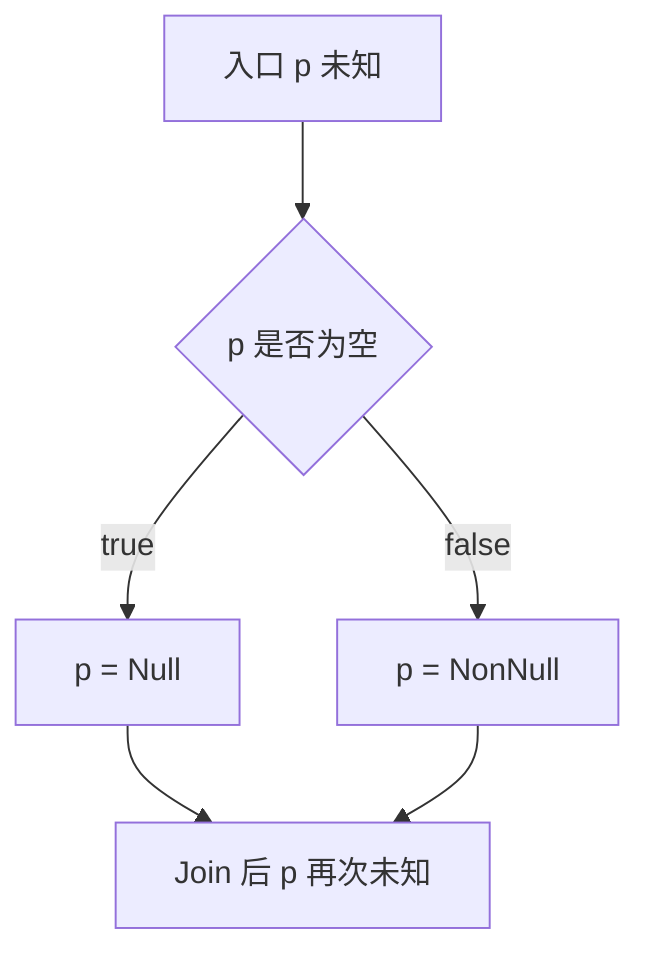
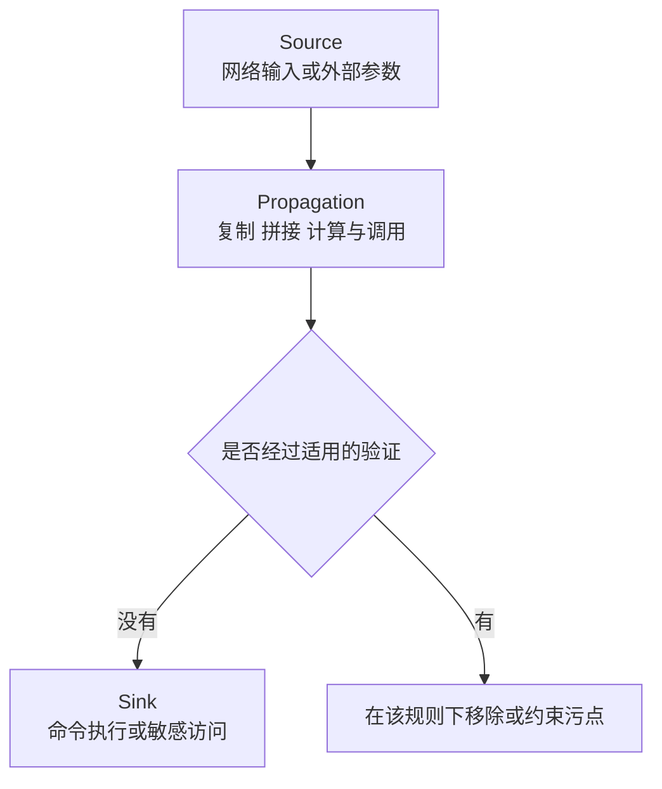

# Clang 静态分析：数据流、抽象解释与符号执行

# 1. 不运行程序，怎样发现一条错误路径

保存为 `analyzer.c`：

```c
int read_or_zero(int *p, int take) {
    if (take && p == 0)
        return *p;
    return 0;
}

int safe_read(int *p) {
    if (p == 0)
        return 0;
    return *p;
}
```

运行 Clang Static Analyzer：

```bash
clang --analyze -Xanalyzer -analyzer-output=text analyzer.c
```

第一段存在 `take != 0` 且 `p == 0` 的路径，随后发生空指针解引用；第二段在解引用路径上已经排除了 `p == 0`。分析器不必真的创建线程或运行测试输入，而是沿控制流推导状态，并在存在问题的路径上报告诊断。

普通 `-Wall -Wextra` 编译警告、`clang-tidy`、Clang Static Analyzer 和 AddressSanitizer 并不是同一个东西：

| 工具或机制 | 主要观察对象 | 边界 |
|---|---|---|
| 编译警告 | 语法、类型、部分数据流与语言规则 | 开启警告不等于开启所有路径分析 |
| clang-tidy | 可配置检查，很多基于 AST，也可使用数据流或 Analyzer 检查 | 必须指定检查集合和真实编译参数 |
| Clang Static Analyzer | 路径敏感的符号状态与缺陷检查 | 受预算、模型和检查器能力限制 |
| AddressSanitizer 等 Sanitizer | 插桩后真实执行中的错误 | 没执行到的路径通常检测不到 |

分析器没有报告不代表证明程序没有问题；一条报告也可能依赖错误的 API 模型或缺失的前置条件，需要复核路径。[Clang Static Analyzer](https://clang.llvm.org/docs/ClangStaticAnalyzer.html)

# 2. 从具体状态到抽象状态

## 2.1 抽象解释与 Domain

具体程序状态可能包含每个变量的值、所有内存对象和调用栈。完整枚举往往不可行，所以分析器用较小的抽象状态概括一批具体状态，这种解释程序的方式称为 Abstract Interpretation，抽象解释。

例如判断指针能否解引用，不一定需要知道它的数值地址，可以选择一个空值域：

| 抽象值 | 表示的具体情况 |
|---|---|
| ⊥，bottom | 无可行状态，例如矛盾条件后的不可达路径 |
| Null | 只可能为空 |
| NonNull | 只可能非空 |
| ⊤，top | 既可能为空，也可能非空，尚不能区分 |

Domain，抽象域，规定状态能表达什么事实。上表只追踪空值，无法证明指针是否悬空、是否越界、是否指向有效类型。NonNull 不等于“安全可解引用”。

保守的 may 分析用抽象状态覆盖所有可能具体状态：宁可把“可能为空”当成风险，也不能把未知指针武断归为 NonNull。优化需要的是可靠的合法性证明；缺陷检查还涉及是否存在错误路径以及告警策略，两者不能仅凭同一个“保守”词混为一谈。

## 2.2 Lattice、Join 与 Transfer

Lattice，格，描述抽象状态的信息关系。本例采用“可能状态集合的包含关系”：⊥ 在底部，Null 和 NonNull 不可互相比较，⊤ 在顶部。越接近 ⊤，覆盖的情况越多，但知道的事实越少。

Join，合并，给出能覆盖两条路径的最小上界。例如一条路径是 Null，另一条是 NonNull，合并后得到 ⊤。Transfer function，传递函数，规定一条语句如何更新状态，例如 `p = 0` 把 p 更新为 Null。



分支条件也会细化状态：`if (p != 0)` 的 true 边排除 Null；不满足约束的边可以变成 ⊥。前向数据流把这些状态沿 CFG 传播，循环则需要反复迭代直到固定点。位集合上的活跃变量、到达定义分析也是静态分析，只是选择了不同的 Domain。[Clang 数据流分析介绍](https://clang.llvm.org/docs/DataFlowAnalysisIntro.html)

实现 Worklist、may/must 分析和固定点的算法见 [编译器与高性能系统算法，第 5～6 章](post.html?slug=compiler_algorithms)。LLVM 的 AA、SCEV、MemorySSA 则服务不同的内存或循环推理问题，不是只能使用 Clang Analyzer 才算静态分析。

# 3. 区间分析、Widening 与 Narrowing

## 3.1 Interval Domain 能推导哪些范围

Interval Domain，区间域，用 `[下界, 上界]` 表示变量可能取值。例如 x 在 `[2, 4]`，执行 `y = x + 3` 后，y 在 `[5, 7]`。两条路径分别得到 `[0, 2]` 和 `[8, 10]`，Join 是 `[0, 10]`，其中也包含实际未出现的 3～7。

```c
int bounded(int x) {
    if (x < 0 || x > 7)
        return -1;
    return x + 1;           // 此路径上 x ∈ [0, 7]，结果 ∈ [1, 8]
}
```

这种信息可以帮助证明数组下标范围或算术是否溢出。区间只记录单个变量的上下界，会丢失变量间关系：即使程序始终满足 `x == y`，独立保存两个 `[0, 10]` 也无法证明 `x - y == 0`。关系型 Domain 可以保留更多约束，但状态和求解成本也更高。

上面的区间加法是在不会溢出的条件下理解的。真实 C/C++ 的有符号溢出、无符号回绕、整数提升和截断转换必须按语言语义建模；不能用数学整数区间直接替代机器整数。Clang Analyzer 也不等于一个只使用此区间域的分析器，这里是在解释可选的分析设计。

## 3.2 为什么循环需要 Widening

考虑下面的循环：

```c
int count_to_ten(void) {
    int i = 0;
    while (i < 10)
        ++i;
    return i;
}
```

在循环头合并入口和回边，普通区间迭代可能依次得到 `[0, 0]`、`[0, 1]`、`[0, 2]`……最终 `[0, 10]`。这个例子能终止，但未知或极大的边界会让逐步增长十分昂贵；数学整数区间还可以构成无限上升链。

Widening，拓宽，主动把持续向外增长的边界放宽。例如旧区间 `[0, 1]`，新候选 `[0, 2]`，一个简单拓宽策略把上界直接变成 `+∞`，得到 `[0, +∞]`；下界持续减小时同理放到 `-∞`。

它以精度换取迭代终止，不是在发现程序“运行到了无穷大”。工程上可以延迟拓宽，或使用 10、数组长度等阈值，避免过早丢掉重要边界。固定宽度整数域即便理论上有限，也可能高得无法逐层迭代，仍然需要加速收敛。

## 3.3 Narrowing 怎样恢复部分精度

Narrowing，缩窄，在拓宽获得保守不变式后，用传递函数和条件重新收紧可恢复的界限。

本例在循环头暂时得到 `[0, +∞]`，进入循环体前由 `i < 10` 约束到 `[0, 9]`，自增后是 `[1, 10]`，与入口 `[0, 0]` 合并得到 `[0, 10]`。适当的缩窄可以恢复这个范围，退出时再与 `i >= 10` 相交，得到 `[10, 10]`。

缩窄不是保证回到最精确解的逆运算，也不能无限运行。必须使用保持可靠性的缩窄策略，并在结束时维持所需不变式；随意取一个更小区间可能漏掉真实执行。抽象解释的可靠性、固定点与拓宽理论见 [Cousot 的抽象解释资料](https://www.di.ens.fr/~cousot/AI/)。

# 4. 路径敏感与符号执行

## 4.1 合流时丢失相关性

```c
int correlated(int flag) {
    int x;
    int y;
    if (flag) {
        x = 1;
        y = 1;
    } else {
        x = 0;
        y = 0;
    }
    if (x != y) {
        int *p = 0;
        return *p;         // 实际不可达的空指针解引用
    }
    return 0;
}
```

路径不敏感的独立区间合并后得到 x、y 都在 `[0, 1]`，丢掉了 `x == y` 的事实。路径敏感分析可以保留两份状态：`flag != 0, x = y = 1` 和 `flag == 0, x = y = 0`，于是发现后面的错误分支不可达。关系型 Domain 也可能在合并状态后保留 `x == y`，所以“保留路径”和“增强 Domain”是两条不同的精度提升路线。

## 4.2 符号值、路径约束与可行性

Symbolic Execution，符号执行，用符号代表尚不确定的输入。例如 p 是符号指针 P，take 是符号整数 T；第 1 章错误分支的路径条件是 `T != 0 ∧ P == 0`。条件有可行解，而 `*P` 要求 P 不能为空，检查器据此报告问题。

探索一个 `if` 时，分析器分别假设条件成立和不成立；矛盾状态可以丢弃。状态不仅包含路径约束，还包括变量、对象区域和资源状态。Clang Analyzer 的重要实现对象包括：

- ProgramState：不可变的抽象程序状态，包含表达式值、内存 Store 和检查器保存的额外信息。
- MemRegion：对变量、字段、元素等内存区域的表示，不是进程中的真实地址。
- ExplodedGraph：节点记录程序位置与状态，同一源码位置可以有多种不同状态。
- Checker：在调用、分支、访存等事件处检查或更新状态，例如追踪一次分配是否已经释放。

可以从 `clang/lib/StaticAnalyzer/Core` 和 `clang/lib/StaticAnalyzer/Checkers` 跟踪这些实现。[Analyzer 开发者文档](https://clang.llvm.org/docs/analyzer/developer-docs.html)、[RegionStore 内存模型](https://clang.llvm.org/docs/analyzer/developer-docs/RegionStore.html)

SMT，Satisfiability Modulo Theories，模理论可满足性，能求解包含整数、位向量等理论的约束，但“符号执行”不等于每一步都交给完整 SMT 求解器。Analyzer 的约束管理能力、可选求解器和配置都有边界；复杂非线性算术、指针与外部函数模型不一定能精确处理。

## 4.3 路径爆炸与分析预算

n 个独立条件可能产生约 2ⁿ 条组合路径。循环、递归、动态分派和复杂库调用还会继续放大状态数量。因此实际工具会限制路径长度、节点数量、调用深度，合并状态或使用函数模型。

截断探索与理论上覆盖全部执行的保守分析不是同一回事。实际 Analyzer 可能因为预算、未启用的 Checker 或不完整模型漏报；不能把“本次探索无告警”写成安全证明。分析时也不应随意假设未知调用不会改写内存，否则路径推理可能依赖错误的状态。

# 5. 跨函数分析与上下文敏感

## 5.1 函数摘要与分析内联

Interprocedural Analysis，过程间分析，把信息跨函数调用传播。只有过程内分析时，调用往往只是一个保守边界；跨函数分析可以进入被调函数，也可以使用 Summary，函数摘要，用“输入条件、返回事实、副作用”概括其行为。

```c
static int identity(int x) { return x; }

int use_identity(void) {
    int a = identity(0);
    int b = identity(1);
    return b / (a + 1);     // 两次调用的结果不能混为一谈
}
```

Context Sensitivity，上下文敏感，区分不同调用点或调用栈上的分析状态。若把 identity 的输入合并成 `[0, 1]`，再把同一份摘要结果粗略赋给 a 和 b，就会丢失 a=0、b=1；使用参数化摘要或在两个调用上下文中分别分析，则可以保留这些事实。

Call Graph，调用图，以函数为节点、可能的调用关系为边。函数指针和虚函数可能有多个目标；递归形成调用图中的环，常用 SCC，强连通分量，把互相递归的函数作为一组迭代处理。直接相信一个猜测的调用目标会遗漏其他实际路径。

Clang Analyzer 的分析内联是在分析过程中进入可见函数体，不是优化器把函数体复制进最终 IR。它会考虑调用深度和分析成本，也可能退回到不内联的模型。[Analyzer 的过程间分析](https://clang.llvm.org/docs/analyzer/developer-docs/IPA.html)

## 5.2 Translation Unit 与 CTU

Translation Unit，翻译单元，是源文件经过预处理并引入头文件后的编译单元。函数定义若只存在于另一个 `.c/.cpp` 文件中，普通单翻译单元分析不一定能看到其函数体。

CTU，Cross Translation Unit，跨翻译单元分析，通过索引和导入其他单元的定义扩大可见范围。它不等于自动分析整个最终可执行文件；宏、目标、编译参数和库模型仍然必须匹配，导入与预算也有成本。[Clang CTU 使用说明](https://clang.llvm.org/docs/analyzer/user-docs/CrossTranslationUnit.html)

# 6. 污点分析：追踪数据从哪里来

Taint Analysis，污点分析，把不可信来源的数据标记为 tainted，追踪其传播，并检查它是否未经必要处理就进入敏感操作。



- Source 是引入不可信数据的来源，例如网络报文或命令行参数。
- Propagation 是传播规则，例如复制、字符串拼接和函数的输入输出关系。
- Sink 是需要防护的使用点，例如命令执行、SQL 拼接或敏感文件访问。
- Sanitizer / Filter 是适用的验证或处理步骤；这里的 sanitizer 是污点规则中的净化概念，不是 AddressSanitizer 插桩工具。

污点不代表值必然非法，非污点也不代表绝对安全。验证数字范围不能自动消除 Shell 注入风险；对 SQL 有效的处理也未必适用于路径穿越。是否移除污点必须对应具体 Sink 的安全要求，最好使用参数化 API 避免危险解释。

Clang 有可配置的污点检查器，可定义函数级来源、传播、过滤和危险使用规则；具体支持范围由所用 LLVM 版本、启用的 Checker 和配置决定，不会自动理解所有业务 API 的安全契约。[Clang 污点分析配置](https://clang.llvm.org/docs/analyzer/user-docs/TaintAnalysisConfiguration.html)

# 7. 把分析放进真实项目

## 7.1 检查完整构建而不是随意解析单个文件

对 CMake 项目可以生成编译数据库，再使用项目实际构建命令进行分析，例如：

```bash
cmake -S . -B build -DCMAKE_EXPORT_COMPILE_COMMANDS=ON
scan-build cmake --build build --clean-first
```

`scan-build` 通过包装编译器观察构建，并运行 Analyzer；它需要实际发生编译，只有增量构建的“无事可做”不会重新检查所有源文件。`compile_commands.json` 更常供 clang-tidy、LibTooling 或 CodeChecker 等工具复现编译命令，它与 scan-build 的构建包装机制不是同一种入口。工具是否随发行包安装需要单独确认。[scan-build 与 CodeChecker](https://clang.llvm.org/docs/analyzer/user-docs/CommandLineUsage.html)

## 7.2 判断一条报告是否可信

先沿报告路径检查：输入约束是否可满足，调用模型是否符合实际 API，资源所有权是否由其他层管理，宏与目标配置是否正确。若缺少前置条件，优先把条件写成可见的检查或提供准确模型，不要直接把“看起来不可能”当成抑制理由。

误报是报告了不真实的错误，漏报是没有发现真实错误。增强 Domain、保留调用上下文可能减少误报，却增加时间和内存；为了预算限制路径，又可能增加漏报。静态分析、Sanitizer、单元测试和模糊测试互相补充，不存在一个配置开关替代所有验证。

与 LLVM 优化相关的 AA、SCEV、MemorySSA，以及修改 IR 后的分析失效和维护，见 [LLVM 基础与优化，第 7 章](post.html?slug=llvm_review)。
