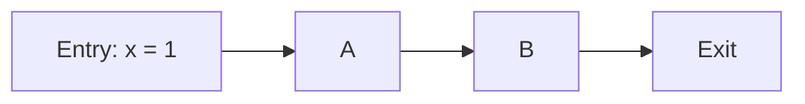
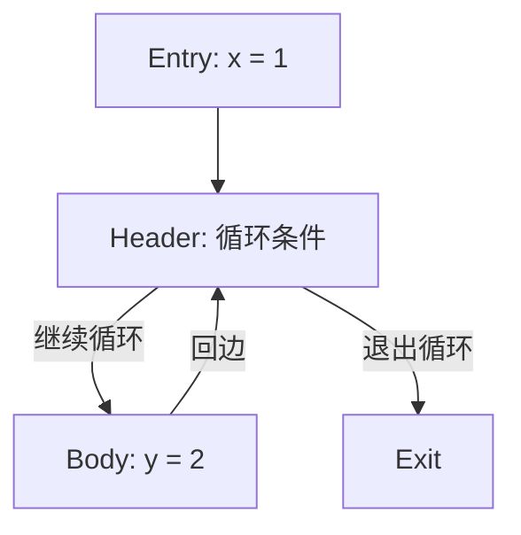
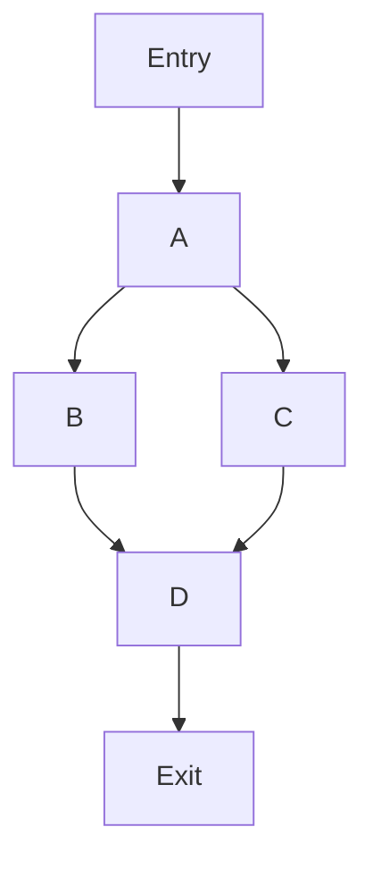

# 编译器与高性能系统中的算法

# 1. 编译器问题如何映射为算法

| 编译器问题 | 常见抽象 | 典型算法或数据结构 |
|---|---|---|
| CFG 可达性、死块删除 | 有向图 | DFS、BFS、RPO |
| 循环与递归调用关系 | 有向图中的环 | SCC、Dominator、Natural Loop |
| 活跃变量、到达定值 | 集合方程 | BitSet、Worklist、Fixed Point |
| SSA 构造 | 支配树上的定义传播 | Dominance Frontier、栈式重命名 |
| 常量传播 | 值格与可执行边 | Lattice、SCCP、Worklist |
| 寄存器分配 | 区间或冲突图 | Linear Scan、Graph Coloring |
| 指令调度 | 带延迟和资源的 DAG | Topological Sort、List Scheduling |
| 模式匹配 | 树或 DAG | Tree DP、Rewrite、E-graph |
| 张量布局 | 多维索引映射 | Affine Map、Stride、整数约束 |
| 算子融合 | 依赖图与成本权衡 | DAG Partition、Cost Model |
| Buffer 复用 | 生命周期冲突 | Interval Allocation、Coloring |
| GPU Kernel 映射 | 层次化并行索引空间 | Tiling、Grid/Workgroup Mapping、Predication |
| GPU Memory Promotion | 跨存储层的数据复用 | Cooperative Copy、Barrier、Double Buffering |
| 矩阵指令选择 | Tile、Layout 与数据类型约束 | MMA Matching、Layout Conversion、Fallback |
| 并行归约 | 结合运算 | Tree Reduction、Scan |
| 自动调优 | 离散搜索空间 | 枚举、剪枝、贝叶斯或学习模型 |

分析这类问题的第一步，是把“编译器术语”还原成算法问题。例如：

> “求 LiveIn/LiveOut”不是背公式，而是在有限格上求一组单调方程的最小不动点；BitSet 是状态表示，worklist 是求解策略，RPO 或 loop-aware order 是收敛优化。

## 1.1 三层正确性

编译器算法需要同时区分：

1. **算法正确性**：图遍历、集合方程或调度算法本身是否正确；
2. **变换合法性**：是否保持源程序在语言与 IR 语义下允许观察到的行为；
3. **变换收益**：合法不代表更快，还要考虑代码大小、寄存器压力、缓存和目标硬件。

例如把循环不变量移出循环：

- 操作数是否在新位置可用；
- 指令是否可能 trap；
- 内存访问是否与循环中的 store alias；
- 移动是否改变 poison、异常、volatile 或 atomic 语义；
- hoist 后是否增加寄存器压力并造成 spill。

---

# 2. CFG、遍历顺序与可达性

## 2.1 CFG 表示

Control-Flow Graph 中：

- 节点是 Basic Block；
- 边表示可能的控制转移；
- 入口块通常唯一；
- return、unreachable 等块可能没有后继；
- CFG 可以有环，也可能包含从入口不可达的块。

```cpp
#include <cstddef>
#include <optional>
#include <utility>
#include <vector>

using BlockId = std::size_t;

struct ControlFlowGraph {
    std::vector<std::vector<BlockId>> successors;
    std::vector<std::vector<BlockId>> predecessors;
};

std::optional<ControlFlowGraph>
build_cfg(std::vector<std::vector<BlockId>> successors) {
    ControlFlowGraph cfg;
    cfg.successors = std::move(successors);
    cfg.predecessors.resize(cfg.successors.size());

    for (BlockId from = 0; from < cfg.successors.size(); ++from) {
        for (const BlockId to : cfg.successors[from]) {
            if (to >= cfg.successors.size()) return std::nullopt;
            cfg.predecessors[to].push_back(from);
        }
    }
    return cfg;
}
```

生产实现可能还要处理：

- 重边是否保留；
- 异常边、间接跳转和未知调用；
- CFG 修改后的 analysis invalidation；
- Block 对象地址稳定性；
- 并发读取与 Pass 修改的所有权边界。

## 2.2 可达性

从入口做 DFS 或 BFS 即可标记可达块。删除不可达块前还要同步修正：

- predecessor/successor 列表；
- PHI incoming edge；
- dominator、loop、frequency 等分析；
- 调试信息和 block address 引用。

仅仅从容器里擦除节点远远不够。

## 2.3 DFS 的三种顺序

- Preorder：第一次进入节点时记录；
- Postorder：所有后继处理完成后记录；
- Reverse Postorder，RPO：把 postorder 反转。

```cpp
#include <algorithm>
#include <stdexcept>

void dfs_postorder(const ControlFlowGraph& cfg,
                   BlockId block,
                   std::vector<bool>& visited,
                   std::vector<BlockId>& order) {
    visited[block] = true;
    for (const BlockId next : cfg.successors[block]) {
        if (!visited[next]) dfs_postorder(cfg, next, visited, order);
    }
    order.push_back(block);
}

std::vector<BlockId> reverse_postorder(const ControlFlowGraph& cfg,
                                       BlockId entry) {
    if (entry >= cfg.successors.size()) {
        throw std::out_of_range("invalid CFG entry");
    }
    std::vector<bool> visited(cfg.successors.size(), false);
    std::vector<BlockId> order;
    dfs_postorder(cfg, entry, visited, order);
    std::reverse(order.begin(), order.end());
    return order;
}
```

示例使用递归便于表达；恶意或极深 CFG 应改成显式栈。

## 2.4 RPO 为什么有用

对于从入口可达的无环子图，RPO 是一种拓扑序。带环 CFG 中它不是严格拓扑序，但通常会让信息沿前向边快速传播，因此前向数据流分析用 RPO 往往比任意顺序更快收敛。

先看一个没有环的 CFG：



DFS 从 Entry 出发，依次进入 A、B、Exit；返回时才记录节点，所以 postorder 是 `Exit → B → A → Entry`，反转后得到 RPO：`Entry → A → B → Exit`。每条边的来源都排在目标前面，因此这个 RPO 也是拓扑序。

用一个简化的到达定值分析观察信息传播：`OUT(b)` 表示离开基本块 b 时可能到达的定义集合。把 `x = 1` 这条定义记作 `d0`，初始 `OUT(Entry) = {d0}`，其余块的 `OUT` 都为空。A、B 和 Exit 没有新的赋值，只把前驱的定义集合向后传递。这里每一轮按指定顺序处理所有块，每处理一个块就立即写回结果，后面的块可以读到本轮已经更新的信息。

按 RPO 处理时，A 先从 Entry 得到 `{d0}`，B 随即从 A 得到 `{d0}`，Exit 再从 B 得到 `{d0}`；一轮就能把入口信息传到出口。

如果改成 `Entry → Exit → B → A`，Exit 和 B 被处理得太早，只能读到尚未更新的前驱结果：

| 扫描轮次 | OUT(A) | OUT(B) | OUT(Exit) |
|---|---|---|---|
| 初始 | 空集 | 空集 | 空集 |
| 第 1 轮 | `{d0}` | 空集 | 空集 |
| 第 2 轮 | `{d0}` | `{d0}` | 空集 |
| 第 3 轮 | `{d0}` | `{d0}` | `{d0}` |

同一组方程、同一个最终结果，处理顺序却让信息多等了两轮。这依赖“更新立即可见”的求解方式；如果每轮都只读取上一轮的快照，调整本轮访问顺序就没有这个效果。

再看一个带回边的 CFG：



假设 DFS 在 Header 处先访问 Exit，再访问 Body，则 postorder 是 `Exit → Body → Header → Entry`，RPO 是 `Entry → Header → Body → Exit`。Header 排在 Body 前面，有利于沿 `Header → Body` 传播信息；但 `Body → Header` 指向顺序中更早的节点，因此这个顺序不是拓扑序。实际上，环同时要求 Header 在 Body 前、Body 又在 Header 前，任何线性顺序都无法满足。

把 Body 中另一个变量的定义 `y = 2` 记作 `d1`。这里只追踪 `d0`、`d1`，每个块合并前驱 `OUT` 的并集，再加入本块产生的定义。仍从 `OUT(Entry) = {d0}`、其余块为空开始，按上述 RPO 扫描：

| 扫描轮次 | OUT(Header) | OUT(Body) | OUT(Exit) |
|---|---|---|---|
| 第 1 轮 | `{d0}` | `{d0, d1}` | `{d0}` |
| 第 2 轮 | `{d0, d1}` | `{d0, d1}` | `{d0, d1}` |

第一轮处理 Header 时，Body 还没有产生 `d1`；Body 随后产生的信息只能等 Header 再次处理时，沿回边传回来。第二轮 Header 接收到 `d1`，再把它传播到 Exit，得到最终结果。求解器仍要按停止条件确认状态不再变化。Exit 中的 `{d0, d1}` 表示这两个定义都**可能**到达这里，并不表示运行时循环一定执行过：到达定值分析使用并集，保留各条路径上的可能性。

实际实现可以只重新处理受影响的块，而不是每轮扫描整个 CFG。例如 Clang 的 [ForwardDataflowWorklist](https://clang.llvm.org/doxygen/structclang_1_1ForwardDataflowWorklist.html) 按 RPO 优先级取出待处理块。RPO 能减少许多不必要的重复处理，但不能保证带环分析一轮结束，也不保证对所有 CFG 和分析都是最快顺序；更复杂的循环还可以结合 SCC 等方式组织迭代。

反向数据流分析常考虑 postorder，例如 Clang 的 [BackwardDataflowWorklist](https://clang.llvm.org/doxygen/structclang_1_1BackwardDataflowWorklist.html)。在初始化正确、有限单调并且所有受影响的块最终都会被处理的前提下，遍历顺序影响收敛速度，不改变最终 fixed point。前面的 `reverse_postorder` 只覆盖入口可达块，不可达块需要另外处理。

## 2.5 边分类

相对于 DFS 树可区分：

- Tree edge：第一次发现节点；
- Back edge：指向当前 DFS 祖先；
- Forward edge：指向后代但不是树边；
- Cross edge：其他已访问节点。

DFS back edge 可用于普通有向图环检测，但编译器中的 **natural loop back edge** 通常要求目标 header 支配来源 latch，条件更强。

---

# 3. 强连通分量与循环

## 3.1 SCC 的意义

Strongly Connected Component 中任意两点互相可达。把每个 SCC 收缩为一个节点后得到 condensation DAG。

应用：

- 调用图递归分量；
- 循环与不可约控制流；
- 模块依赖循环；
- 分量级别的自底向上分析；
- 在环内部迭代、在分量之间拓扑传播。

## 3.2 Tarjan 算法

Tarjan 用一次 DFS 求 SCC：

- `index[v]`：首次访问次序；
- `lowlink[v]`：从 v 经 DFS 树边和允许的回边能到达的最小 index；
- 栈保存当前尚未归属 SCC 的节点；
- 若 `lowlink[v] == index[v]`，v 是一个 SCC 的根。

```cpp
#include <algorithm>
#include <stdexcept>

class TarjanScc {
public:
    explicit TarjanScc(const std::vector<std::vector<BlockId>>& graph)
        : graph_(graph),
          index_(graph.size(), -1),
          lowlink_(graph.size(), -1),
          on_stack_(graph.size(), false) {
        for (const auto& edges : graph_) {
            for (const BlockId to : edges) {
                if (to >= graph_.size()) {
                    throw std::out_of_range("invalid graph edge");
                }
            }
        }
    }

    std::vector<std::vector<BlockId>> run() {
        for (BlockId node = 0; node < graph_.size(); ++node) {
            if (index_[node] == -1) strong_connect(node);
        }
        return components_;
    }

private:
    void strong_connect(BlockId node) {
        index_[node] = next_index_;
        lowlink_[node] = next_index_;
        ++next_index_;
        stack_.push_back(node);
        on_stack_[node] = true;

        for (const BlockId next : graph_[node]) {
            if (index_[next] == -1) {
                strong_connect(next);
                lowlink_[node] = std::min(lowlink_[node], lowlink_[next]);
            } else if (on_stack_[next]) {
                lowlink_[node] = std::min(lowlink_[node], index_[next]);
            }
        }

        if (lowlink_[node] != index_[node]) return;

        std::vector<BlockId> component;
        while (true) {
            const BlockId current = stack_.back();
            stack_.pop_back();
            on_stack_[current] = false;
            component.push_back(current);
            if (current == node) break;
        }
        components_.push_back(std::move(component));
    }

    const std::vector<std::vector<BlockId>>& graph_;
    std::vector<int> index_;
    std::vector<int> lowlink_;
    std::vector<bool> on_stack_;
    std::vector<BlockId> stack_;
    std::vector<std::vector<BlockId>> components_;
    int next_index_ = 0;
};
```

时间复杂度 `O(V + E)`，额外空间 `O(V)`，但递归 DFS 仍有栈深风险。

## 3.3 Natural Loop

若 CFG 边 `latch -> header` 中，`header` 支配 `latch`，这是一条 back edge。该边对应 natural loop：

1. 把 `header` 和 `latch` 放入集合；
2. 从 `latch` 沿 predecessor 反向遍历；
3. 直到所有能在不越过 header 的情况下到达 latch 的节点都加入。

Natural loop 有单一 header。若一个强连通区域有多个外部入口，它是不可约控制流，不能简单当作单 header 自然循环处理。

## 3.4 循环树并非天然存在于任意 SCC

结构化程序常形成嵌套循环，但任意 CFG 中循环可能重叠或不可约。编译器 LoopInfo 一般依赖 dominance 定义 natural loop，再组织 loop forest。

讨论时不要把以下概念混为一谈：

- DFS 发现 back edge；
- SCC 表示互相可达区域；
- natural loop 依赖“header 支配 latch”；
- loop nesting forest 依赖特定循环定义。

---

# 4. 支配关系与 Dominance Frontier

## 4.1 定义

在入口可达 CFG 中，如果从入口到 B 的每条路径都经过 A，则 A **dominate** B。

性质：

- 每个可达节点支配自身；
- 入口支配所有可达节点；
- 除入口外，每个可达节点有唯一 immediate dominator；
- immediate dominator 关系构成 dominator tree。

不可达块的 dominance 语义必须由具体 API 约定，分析前通常先限定入口可达子图。

## 4.2 集合方程

教学用迭代算法：

```text
Dom(entry) = {entry}
Dom(b) = {b} union intersection(Dom(p) for p in predecessors(b))
```

初始化除入口外的可达节点为“所有可达节点”，反复应用方程直到不再变化。



在该图中：

```text
Dom(D) = {Entry, A, D}
```

B 和 C 都不支配 D，因为存在绕过它们的另一条路径。

## 4.3 真实算法

集合迭代容易理解，但在大型 CFG 上成本高。常见实现路线：

- Cooper-Harvey-Kennedy：按 RPO 迭代 immediate dominator，工程实现简单；
- Lengauer-Tarjan：接近线性复杂度，适合大型图；
- CFG 增量更新：局部修改后避免完全重算，但实现与失效管理更复杂。

实际学习不必一开始就手写 Lengauer-Tarjan，但应能清楚解释集合方程、idom 和支配树用途。

## 4.4 Dominance Frontier

节点 A 的 dominance frontier 包含这样的节点 B：

- A 支配 B 的至少一个前驱；
- A 不严格支配 B。

直觉上，它是“A 的定义沿不同控制流路径传播后可能发生合流”的边界。

用 immediate dominator 计算的一种经典方法：

```text
for each block b with at least two predecessors:
    for each predecessor p of b:
        runner = p
        while runner != idom[b]:
            DF[runner].insert(b)
            runner = idom[runner]
```

## 4.5 用途

- SSA 中决定 PHI 候选位置；
- 控制依赖分析使用 post-dominance frontier；
- 判断代码移动位置；
- 构建 MemorySSA 等结构。

支配关系回答的是“所有从入口来的路径”；post-dominance 则反向回答“所有到出口的路径”。多出口 CFG 通常可引入虚拟统一出口以便分析。

---

# 5. 数据流分析与 Worklist

## 5.1 数据流问题的组成

一个经典数据流分析包含：

- Domain：每个程序点保存什么状态；
- Lattice：状态如何排序、合并；
- Transfer function：指令或基本块如何改变状态；
- Direction：前向还是后向；
- Meet：来自多条边的信息如何合并；
- Boundary condition：入口或出口初值；
- Fixed point：反复传播直到状态不再变化。

常见问题：

| 分析 | 方向 | 合并 | 直观含义 |
|---|---|---|---|
| Reaching Definitions | 前向 | Union | 可能到达此处的定义 |
| Available Expressions | 前向 | Intersection | 所有路径上都已计算且未失效 |
| Live Variables | 后向 | Union | 后续某条路径可能使用的值 |
| Very Busy Expressions | 后向 | Intersection | 所有路径上都会先被求值 |

Union 常对应 may analysis，intersection 常对应 must analysis，但仍应根据具体 domain 和偏序定义判断。

## 5.2 为什么会收敛

经典框架通常要求：

- 格高度有限，或使用 widening 等机制保证终止；
- transfer function 单调；
- 每次更新沿偏序单调前进。

在有限 BitSet domain 中，每个位通常只会从 0 变 1，或按对偶方向从 1 变 0，所以最终会到 fixed point。

如果 transfer 非单调、状态无限增长或浮点近似更新无终止条件，就不能仅凭“有 worklist”保证收敛。

## 5.3 通用 Worklist 思路

```text
初始化每个节点的 IN/OUT
把可能需要处理的节点放入 worklist

while worklist 非空:
    b = pop(worklist)
    old = state[b]
    merged = meet(state[p] for p in neighbors)
    state[b] = transfer(b, merged)
    if state[b] changed:
        把可能受影响的邻居加入 worklist
```

关键工程问题：

- 节点是否已在队列中，避免无限重复入队；
- FIFO、LIFO、RPO 或优先队列会影响收敛速度；
- 只在状态真正变化时传播；
- block transfer 是否按指令逐条计算；
- CFG 改变后分析结果是否全部失效；
- 稠密 BitSet 和稀疏集合怎样选择。

## 5.4 Must Analysis 的初始化

Intersection 分析不能把所有节点随意初始化为空集，否则可能永远得到过小结果。常见做法是：

- 边界节点按语义初始化；
- 其他节点初始化为 lattice top；
- 再通过 intersection 向下收敛。

具体的 top/bottom 含义取决于偏序定义，不能机械记忆“全 1 就是 top”。

## 5.5 MOP 与 MFP

- MOP，Meet Over all Paths：理论上枚举所有路径后合并；有环时路径无限；
- MFP，Maximum Fixed Point 或相应固定点解：通过数据流方程迭代获得；
- 对 distributive transfer function，经典框架下 MFP 与 MOP 可以一致；
- 仅单调但不 distributive 时，固定点结果可能比理想路径解更保守。

理解“保守”方向非常重要：优化不能因为分析过度乐观而改变语义，但可以因为分析保守而错过优化。

区间域怎样表达数值范围，widening/narrowing 怎样处理循环，以及路径敏感、符号执行和跨函数分析怎样扩展这些框架，见 [Clang 静态分析](post.html?slug=clang_static_analysis)。本文接着实现位集合与活跃变量传播，避免把分析原理与具体工具混为一层。

---

# 6. BitSet、活跃变量与到达定值

## 6.1 为什么编译器爱用 BitSet

若 universe 中对象可以编号为 `[0, N)`，BitSet 能把集合操作变为 word 级位运算：

```text
Union        A | B
Intersection A & B
Difference   A & ~B
Membership   word[index / 64] 的某一位
```

复杂度是 `O(N / word_bits)`，连续内存也利于缓存和 SIMD。

## 6.2 一个最小动态 BitSet

```cpp
#include <algorithm>
#include <cstdint>
#include <stdexcept>
#include <vector>

class DynamicBitSet {
public:
    explicit DynamicBitSet(std::size_t bit_count = 0, bool value = false)
        : bit_count_(bit_count),
          words_((bit_count + kWordBits - 1) / kWordBits,
                 value ? ~Word{0} : Word{0}) {
        clear_unused_high_bits();
    }

    std::size_t size() const noexcept { return bit_count_; }

    bool test(std::size_t bit) const {
        check_index(bit);
        return (words_[word_index(bit)] & bit_mask(bit)) != 0;
    }

    void set(std::size_t bit) {
        check_index(bit);
        words_[word_index(bit)] |= bit_mask(bit);
    }

    void reset(std::size_t bit) {
        check_index(bit);
        words_[word_index(bit)] &= ~bit_mask(bit);
    }

    bool union_with(const DynamicBitSet& other) {
        check_compatible(other);
        bool changed = false;
        for (std::size_t i = 0; i < words_.size(); ++i) {
            const Word merged = words_[i] | other.words_[i];
            changed |= merged != words_[i];
            words_[i] = merged;
        }
        return changed;
    }

    bool intersect_with(const DynamicBitSet& other) {
        check_compatible(other);
        bool changed = false;
        for (std::size_t i = 0; i < words_.size(); ++i) {
            const Word merged = words_[i] & other.words_[i];
            changed |= merged != words_[i];
            words_[i] = merged;
        }
        return changed;
    }

    void subtract(const DynamicBitSet& other) {
        check_compatible(other);
        for (std::size_t i = 0; i < words_.size(); ++i) {
            words_[i] &= ~other.words_[i];
        }
        clear_unused_high_bits();
    }

    std::size_t count() const noexcept {
        std::size_t result = 0;
        for (Word word : words_) {
            while (word != 0) {
                word &= word - 1;
                ++result;
            }
        }
        return result;
    }

    friend bool operator==(const DynamicBitSet& a, const DynamicBitSet& b) {
        return a.bit_count_ == b.bit_count_ && a.words_ == b.words_;
    }

    friend bool operator!=(const DynamicBitSet& a, const DynamicBitSet& b) {
        return !(a == b);
    }

private:
    using Word = std::uint64_t;
    static constexpr std::size_t kWordBits = 64;

    static std::size_t word_index(std::size_t bit) noexcept {
        return bit / kWordBits;
    }

    static Word bit_mask(std::size_t bit) noexcept {
        return Word{1} << (bit % kWordBits);
    }

    void check_index(std::size_t bit) const {
        if (bit >= bit_count_) throw std::out_of_range("bit index");
    }

    void check_compatible(const DynamicBitSet& other) const {
        if (bit_count_ != other.bit_count_) {
            throw std::invalid_argument("incompatible bitsets");
        }
    }

    void clear_unused_high_bits() noexcept {
        if (words_.empty() || bit_count_ % kWordBits == 0) return;
        const std::size_t used = bit_count_ % kWordBits;
        words_.back() &= (Word{1} << used) - 1;
    }

    std::size_t bit_count_{};
    std::vector<Word> words_;
};
```

生产级实现还会提供 find-first-set、迭代置位元素、SmallBitVector 优化、SIMD word 操作和分配器控制。

## 6.3 Dense 还是 Sparse

| 条件 | 更可能适合 |
|---|---|
| universe 小、集合较密、频繁交并 | Dense BitSet |
| universe 巨大、集合只有少数元素 | Sparse Set / sorted vector |
| 小集合很多 | SmallVector / inline storage |
| 集合密度动态变化 | Hybrid / adaptive representation |

不要只比较算法阶数。一个含百万位但只置三位的 BitSet，每次 union 都扫描全部 words，可能远慢于三个整数的有序数组。

## 6.4 活跃变量方程

对每个基本块 B：

```text
LiveOut[B] = Union(LiveIn[S] for S in successors(B))
LiveIn[B]  = Use[B] union (LiveOut[B] - Def[B])
```

其中：

- `Use[B]`：在块内首次定义前被使用的变量；
- `Def[B]`：块内定义的变量；
- 这是后向 may analysis；
- 通常从出口方向传播。

## 6.5 Worklist 实现

```cpp
#include <deque>

struct LivenessResult {
    std::vector<DynamicBitSet> live_in;
    std::vector<DynamicBitSet> live_out;
};

LivenessResult compute_liveness(const ControlFlowGraph& cfg,
                                 const std::vector<DynamicBitSet>& use,
                                 const std::vector<DynamicBitSet>& def,
                                 std::size_t value_count) {
    const std::size_t block_count = cfg.successors.size();
    if (use.size() != block_count || def.size() != block_count) {
        throw std::invalid_argument("liveness input size mismatch");
    }

    LivenessResult result{
        std::vector<DynamicBitSet>(block_count, DynamicBitSet(value_count)),
        std::vector<DynamicBitSet>(block_count, DynamicBitSet(value_count))};

    std::deque<BlockId> worklist;
    std::vector<bool> queued(block_count, true);
    for (BlockId block = 0; block < block_count; ++block) {
        worklist.push_back(block);
    }

    while (!worklist.empty()) {
        const BlockId block = worklist.front();
        worklist.pop_front();
        queued[block] = false;

        DynamicBitSet new_out(value_count);
        for (const BlockId successor : cfg.successors[block]) {
            new_out.union_with(result.live_in[successor]);
        }

        DynamicBitSet new_in = new_out;
        new_in.subtract(def[block]);
        new_in.union_with(use[block]);

        if (new_out == result.live_out[block] &&
            new_in == result.live_in[block]) {
            continue;
        }

        result.live_out[block] = std::move(new_out);
        result.live_in[block] = std::move(new_in);
        for (const BlockId predecessor : cfg.predecessors[block]) {
            if (!queued[predecessor]) {
                queued[predecessor] = true;
                worklist.push_back(predecessor);
            }
        }
    }
    return result;
}
```

这段代码按 block 粒度计算。真实寄存器分配还需要沿 block 内指令反向扫描，以获得每条指令位置的 kill、dead、live range 和 PHI edge use。

## 6.6 PHI 的边语义

SSA PHI 的输入使用发生在对应 predecessor edge 上，而不是普通地发生在 PHI 所在块开头。做 liveness 时若忽略这一点，会把值错误地认为在所有前驱上都活跃。

常见处理：

- 把 PHI operand 计入对应 predecessor 的 LiveOut；
- PHI result 在当前块入口定义；
- critical edge split 后边语义会更容易表达，但不能假设所有 IR 都已拆边。

## 6.7 到达定值

令每个定义有唯一编号：

```text
ReachIn[B]  = Union(ReachOut[P] for P in predecessors(B))
ReachOut[B] = Gen[B] union (ReachIn[B] - Kill[B])
```

这是前向 may analysis。`Kill[B]` 通常包含对同一变量的其他定义；SSA 中每个虚拟值只定义一次，很多 def-use 查询可以转为稀疏传播，不再需要传统 dense reaching-definitions。

---

# 7. SSA 与稀疏传播

## 7.1 SSA 解决什么

Static Single Assignment 要求每个 SSA value 只定义一次。控制流合并处使用 PHI 表达“值来自哪条前驱边”：

```llvm
entry:
  br i1 %cond, label %left, label %right

left:
  %x.left = add i32 %a, 1
  br label %merge

right:
  %x.right = sub i32 %a, 1
  br label %merge

merge:
  %x = phi i32 [ %x.left, %left ], [ %x.right, %right ]
```

优势：

- def-use 链明确；
- 常量传播、DCE、GVN 等可直接沿 use 传播；
- 每个 value 不需要传统“同名变量的多个 reaching definitions”；
- 仍需 MemorySSA 或 alias analysis 处理内存状态。

## 7.2 PHI 放置

Cytron 算法的核心是 iterated dominance frontier：

```text
worklist = 定义变量 v 的所有 block
has_phi = empty

while worklist 非空:
    x = pop(worklist)
    for y in DF[x]:
        if y 尚未为 v 放 PHI:
            在 y 放置 v 的 PHI
            if y 原本不定义 v:
                push y
```

为什么 PHI 自身也可能继续加入 worklist？因为 PHI 是一个新定义，它的值继续流向后续合流点。

## 7.3 Minimal、Pruned 与 Semi-pruned SSA

- Minimal SSA：只避免明显多余的 PHI，但可能在变量不活跃处放 PHI；
- Pruned SSA：结合 liveness，只在变量 live-in 的合流点放 PHI；
- Semi-pruned SSA：用较便宜的近似减少部分无用 PHI。

因此 dominance frontier 给出候选位置，liveness 决定很多候选是否真的需要。

## 7.4 重命名

沿 dominator tree 做 DFS，为每个源变量维护一个定义栈：

```text
rename(block):
    记录当前栈高度

    为 block 中的 PHI result 分配新版本并压栈
    按指令顺序:
        每个 use 替换为对应变量栈顶版本
        每个 def 分配新版本并压栈

    对每条 block -> successor 边:
        填写 successor PHI 中属于该边的 operand

    for child in dominator_tree_children(block):
        rename(child)

    恢复进入 block 前的栈高度
```

关键点：遍历的是 dominator tree，不是普通 CFG DFS。支配树保证当前栈顶是沿所有到达当前定义域路径都合法的最近定义。

## 7.5 从 SSA 退出

机器后端通常不能直接执行 PHI。PHI elimination 会在 predecessor edge 上插入 parallel copy，再把 parallel copy 顺序化。

若边是 critical edge：

```text
predecessor 有多个 successor
且 successor 有多个 predecessor
```

直接把 copy 放在任一端都可能在错误路径执行，通常需要 split critical edge 或使用目标后端能表达的边级操作。

Parallel copy 顺序化还要处理环：

```text
a <- b
b <- a
```

必须借助临时值，不能逐条直接覆盖。

## 7.6 稀疏条件常量传播 SCCP

SCCP 同时传播：

- 哪些 CFG edge 可执行；
- SSA value 的格状态。

简化值格：

```text
Unknown / Undef
      ↓
Constant(c)
      ↓
Overdefined
```

合并规则示例：

- Unknown 与 Constant(3) 合并为 Constant(3)；
- Constant(3) 与 Constant(3) 仍为 Constant(3)；
- Constant(3) 与 Constant(4) 合并为 Overdefined；
- Overdefined 与任何状态合并仍为 Overdefined。

如果分支条件成为常量，只标记实际分支边可执行；不可执行前驱不参与 PHI 合并。这比普通常量传播更精确。

LLVM 中还要严格区分 `undef`、poison、`freeze`、trap 和 UB。教学格里的 Unknown 不能不加说明地等同于 LLVM `undef`。

## 7.7 Worklist 的稀疏化

传统 dense 分析反复扫描 block 集合；SSA 上可以沿 def-use edge 只通知真正依赖该值的用户。常见两个队列：

- CFG worklist：新发现可执行的 block/edge；
- SSA worklist：值状态变化后需要重新求值的 user。

稀疏传播减少无关节点扫描，但维护 def-use、边可执行状态和删除指令时的失效也更复杂。

---

# 8. Live Interval 与寄存器分配

## 8.1 从 Liveness 到冲突

若两个虚拟寄存器在某程序点同时活跃，它们不能占用同一个物理寄存器。可以表示为：

- Interference Graph：节点是虚拟寄存器，边表示冲突；
- Live Interval：在线性化程序位置上的活跃范围；
- Live Range：可能由多个不连续 segment 组成，单一 `[start, end)` 只是近似。

真实后端还要考虑：

- register class / bank；
- fixed physical register；
- caller-saved / callee-saved；
- subregister 与 lane mask；
- early-clobber、tied operand；
- call clobber、inline asm；
- spill slot、rematerialization 和 debug value。

## 8.2 区间操作

半开区间 `[start, end)` 的合并：

```cpp
#include <algorithm>
#include <utility>
#include <vector>

using Segment = std::pair<std::size_t, std::size_t>;

std::vector<Segment> merge_segments(std::vector<Segment> segments) {
    segments.erase(
        std::remove_if(segments.begin(), segments.end(),
                       [](const Segment& segment) {
                           return segment.first >= segment.second;
                       }),
        segments.end());
    std::sort(segments.begin(), segments.end());

    std::vector<Segment> merged;
    for (const auto& [start, end] : segments) {
        if (merged.empty() || merged.back().second < start) {
            merged.push_back({start, end});
        } else {
            merged.back().second = std::max(merged.back().second, end);
        }
    }
    return merged;
}
```

这里把首尾相接的 `[a,b)` 与 `[b,c)` 合并，因为它们并集连续。判断寄存器冲突时，端点相接本身不重叠，但还要结合指令 use/def 发生在位置的前半还是后半等 slot index 语义。

## 8.3 Linear Scan

Linear Scan 按 interval 起点排序，维护当前活跃集合：

1. 过期 interval 释放寄存器；
2. 有空闲寄存器则分配；
3. 否则选择当前或某个 active interval spill；
4. 必要时切分 live range。

教学版实现：

```cpp
#include <algorithm>
#include <limits>
#include <numeric>

struct LiveInterval {
    std::size_t vreg{};
    std::size_t start{};
    std::size_t end{}; // 半开区间
    int physical_register = -1;
    bool spilled = false;
};

void linear_scan_allocate(std::vector<LiveInterval>& intervals,
                          int register_count) {
    if (register_count < 0) {
        throw std::invalid_argument("negative register count");
    }

    std::sort(intervals.begin(), intervals.end(),
              [](const LiveInterval& a, const LiveInterval& b) {
                  if (a.start != b.start) return a.start < b.start;
                  return a.end < b.end;
              });

    std::vector<int> free_registers(static_cast<std::size_t>(register_count));
    std::iota(free_registers.begin(), free_registers.end(), 0);
    std::vector<LiveInterval*> active;

    auto sort_active = [&] {
        std::sort(active.begin(), active.end(),
                  [](const LiveInterval* a, const LiveInterval* b) {
                      return a->end < b->end;
                  });
    };

    for (LiveInterval& current : intervals) {
        if (current.start >= current.end) continue;

        auto first_live = active.begin();
        while (first_live != active.end() &&
               (*first_live)->end <= current.start) {
            free_registers.push_back((*first_live)->physical_register);
            ++first_live;
        }
        active.erase(active.begin(), first_live);

        if (!free_registers.empty()) {
            current.physical_register = free_registers.back();
            free_registers.pop_back();
            active.push_back(&current);
            sort_active();
            continue;
        }

        if (active.empty()) {
            current.spilled = true;
            continue;
        }

        LiveInterval* spill_candidate = active.back();
        if (spill_candidate->end > current.end) {
            current.physical_register = spill_candidate->physical_register;
            spill_candidate->physical_register = -1;
            spill_candidate->spilled = true;
            active.back() = &current;
            sort_active();
        } else {
            current.spilled = true;
        }
    }
}
```

这个版本只处理单段 interval 和同质寄存器，目的是展示核心策略。真实分配器绝不能直接照搬。

## 8.4 为什么选择结束最晚者 spill

如果 active 中某 interval 结束得比 current 更晚，让 current 使用它的寄存器可以更早释放资源。这是局部启发式，不等于全局最优。

更真实的 spill cost 会考虑：

- use/def 频率与 block frequency；
- loop depth；
- reload 是否能被 fold；
- rematerialization 是否比 load 便宜；
- spill 对其他 register class 的影响；
- live range splitting 位置。

## 8.5 Graph Coloring

构建冲突图后，K 个物理寄存器对应 K-coloring：

1. Simplify：反复移除度数小于 K 的节点并压栈；
2. Coalesce：尝试合并 copy 两端，消除 move；
3. Freeze：放弃某些 coalesce 候选；
4. Spill：没有低度节点时选择潜在 spill；
5. Select：逆序弹栈并选择不与邻居冲突的颜色；
6. Rewrite：插入 spill/reload 后重新分析。

一般图着色是 NP-complete，所以工业分配器使用启发式。Coalescing 能减少 copy，却可能增加节点度数和 spill 风险。

## 8.6 SSA-based Allocation

SSA live range 在很多条件下具有 chordal graph 性质，可利用支配关系获得更高效着色。但 PHI、寄存器约束、SSA destruction、copy coalescing 和目标机器细节仍会使生产实现复杂。

---

# 9. 依赖 DAG 与指令调度

## 9.1 依赖类型

构建调度 DAG 时至少有：

- RAW，Read After Write：真实数据依赖；
- WAR，Write After Read：反依赖；
- WAW，Write After Write：输出依赖；
- Memory dependency：可能 alias 的 load/store；
- Control dependency；
- 隐式寄存器、flags、barrier、call 等目标约束。

寄存器重命名可以消除 WAR/WAW，但不能消除 RAW。Alias analysis 越保守，内存依赖边越多，可调度空间越小。

## 9.2 Critical Path

在 DAG 上，从节点到出口的最长延迟可作为调度优先级：

```text
height(node) = latency(node) + max(height(successor))
```

先调度关键路径上的节点通常有助于缩短总执行时间，但还要考虑资源端口和寄存器压力。

```cpp
#include <queue>

struct SchedulingDag {
    std::vector<std::vector<std::size_t>> successors;
    std::vector<int> latency;
};

std::optional<std::vector<int>> compute_critical_heights(
    const SchedulingDag& dag) {
    const std::size_t n = dag.successors.size();
    if (dag.latency.size() != n) return std::nullopt;

    std::vector<std::size_t> indegree(n, 0);
    for (const auto& edges : dag.successors) {
        for (const std::size_t to : edges) {
            if (to >= n) return std::nullopt;
            ++indegree[to];
        }
    }

    std::queue<std::size_t> ready;
    for (std::size_t node = 0; node < n; ++node) {
        if (indegree[node] == 0) ready.push(node);
    }

    std::vector<std::size_t> topo;
    while (!ready.empty()) {
        const std::size_t node = ready.front();
        ready.pop();
        topo.push_back(node);
        for (const std::size_t next : dag.successors[node]) {
            if (--indegree[next] == 0) ready.push(next);
        }
    }
    if (topo.size() != n) return std::nullopt;

    std::vector<int> height(n, 0);
    for (auto it = topo.rbegin(); it != topo.rend(); ++it) {
        int successor_height = 0;
        for (const std::size_t next : dag.successors[*it]) {
            successor_height = std::max(successor_height, height[next]);
        }
        height[*it] = dag.latency[*it] + successor_height;
    }
    return height;
}
```

## 9.3 List Scheduling

基本算法：

```text
计算每个节点未满足前驱数
ready = 所有前驱均已完成的节点

for each cycle:
    从 ready 中按优先级选节点
    检查功能单元、issue width、数据 ready time
    发射可用节点
    更新资源占用和后继
```

优先级可以综合：

- critical path height；
- block frequency；
- latency hiding；
- resource pressure；
- register pressure；
- load 提前量；
- 代码大小。

## 9.4 资源约束

仅有拓扑序还不够。若一周期只有两个 issue slot、一个 load port 和一个 vector ALU，就必须建模：

- 指令占用哪些资源；
- 资源占用多少周期；
- operand 何时 ready；
- 多条指令是否能同周期发射；
- target itinerary / scheduling model。

这是资源受限项目调度问题的一种形式，最优求解通常困难，工程上使用启发式。

## 9.5 Pre-RA 与 Post-RA

- Pre-RA：虚拟寄存器尚未映射，移动自由度大，但要估计寄存器压力；
- Post-RA：看到真实物理寄存器和 hazard，移动空间较小；
- 过度提前计算会延长 live range，引发 spill；
- 调度和寄存器分配具有天然耦合，不能孤立优化。

## 9.6 GPU 调度差异

GPU 通过大量 warp 切换隐藏 latency，但编译器仍需考虑：

- 每线程寄存器数影响 occupancy；
- memory pipeline 与 compute pipeline 平衡；
- barrier 限制跨区域移动；
- divergence 让同 warp 路径串行化；
- software pipelining 和 double buffering；
- Tensor Core 指令的数据布局和依赖距离。

---

# 10. 指针分析与 Points-to 约束

Alias Analysis 查询两个访问是否重叠，Points-to Analysis，指向分析，则描述一个指针值
可能指向哪些抽象对象。前者不要求必须先运行某个全程序指针分析，LLVM 的 BasicAA 也能
利用 GEP、对象来源等结构信息作判断；但要理解复杂别名和跨函数状态传播，指向集合是
很直观的中间表示。

## 10.1 指针值与对象内容是两层关系

下面的 `slot` 是存储指针的内存位置，p、q、r、s 是指针值：

```text
p = &x
q = &slot
*q = p
r = *q
s = r
p = &y
```

记 `Pt(p)` 为 p 的指向集合，`Pt(slot)` 为 slot 中可能保存的指针所指向的对象。
`Pt(q) = {slot}` 与 `Pt(slot) = {x}` 是两件事，不能在读取 `*q` 时直接把 slot 当成
最终读出的 x。

## 10.2 从语句建立包含约束

| 语句 | 需要满足的关系 | 传播动作 |
|---|---|---|
| `p = &x` | x 属于 `Pt(p)` | 把对象 x 加入 p |
| `p = q` | `Pt(q)` 包含于 `Pt(p)` | 复制来源的所有可能目标 |
| `p = *q` | 对每个 o 属于 `Pt(q)`，`Pt(o)` 包含于 `Pt(p)` | 读取每个候选对象中的指向集合 |
| `*p = q` | 对每个 o 属于 `Pt(p)`，`Pt(q)` 包含于 `Pt(o)` | 向每个候选对象合入来源集合 |

这是包含式、流不敏感分析的基本形式。后续才发现新的指向目标时，原先的 Load/Store
约束也可能需要重新执行；只按源码扫描一次不一定得到固定点。

本例把最后的 `p = &y` 与先前的 `p = &x` 合并，所以最终得到：

```text
p -> x y
q -> slot
r -> x y
s -> x y
slot -> x y
```

源码按顺序运行时，写入 slot 的是第一次 p 的值；流不敏感分析却还把后来的 y 传播到
了 slot。这个额外可能性是选择抽象方式带来的精度损失，并不是程序真实执行了第二次
Store。[指针约束与包含式分析](https://cs.au.dk/~amoeller/spa/spa.pdf)

## 10.3 一个有限集合上的求解器

完整 C++ 实现在 [points_to.cpp](../tools/compiler-lab/pointer/points_to.cpp)。代码使用
`std::set` 表达对象集合，反复扫描全部约束，直到没有集合增长：

```cpp
do {
    changed = false;
    for (auto constraint : constraints)
        changed |= propagate(constraint, points_to);
} while (changed);
```

这段展示循环结构；源文件中的 `propagate` 对应四种约束的实际 `switch` 分支。
对象全集有限、集合只增不减，因此所有“指针到对象”的关系最多加入有限次，迭代能
终止。更高效的实现可以维护约束依赖和 Worklist，只重算受变化影响的节点；Load/Store
还会随目标集合变化引入新的传播关系，不能只建立一次静态 Copy 图就停止更新。

```bash
clang++ -std=c++17 tools/compiler-lab/pointer/points_to.cpp -o /tmp/points-to
/tmp/points-to
```

这是算法模型，不解析 C++ 源码，不包含指针算术、未知外部调用、生命周期或完整的堆
对象模型。把这些情况直接忽略，并不能得到对真实程序保守的指针分析；工程实现需要
未知对象、逃逸和内存失效等规则来覆盖无法精确识别的目标。

## 10.4 从对象集合回到别名查询

在抽象对象互不重叠且模型完整的前提下，两个指向集合不相交，可以帮助证明它们来自
不同对象；集合相交通常只说明可能别名，不代表两个运行期地址一定相同。同一对象内部
不同字段还要比较偏移和访问大小，不能仅看到对象相同就判定所有访问完全重叠。

堆对象按分配位置归纳、结构体字段合并、数组下标不区分，都可能制造额外相交。反过来，
漏掉一个实际目标会把 MayAlias 错判成 NoAlias，进而使 Load 复用或指令移动发生错误。
强/弱更新、字段敏感与未知调用的联系见
[静态分析中的内存建模](post.html?slug=clang_static_analysis)。
