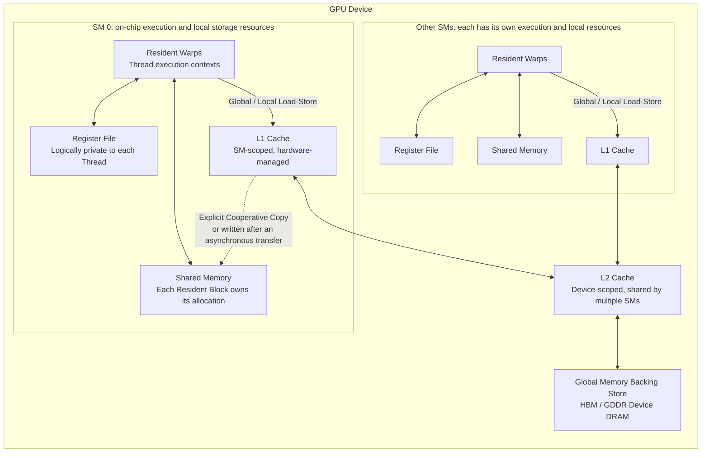

# CUDA Execution and Memory Model

If you have not written a CUDA kernel before, first run the vector-addition example in [CUDA Programming Model](post.html?slug=cuda_programming). This article goes on to explain the thread hierarchy, synchronization boundaries, SM execution, and the memory hierarchy; algorithms such as reduction and scan are covered in [CUDA Parallel Primitives and Performance Analysis](post.html?slug=cuda_parallel_primitives).

The easiest mistake to make in GPU programming is to focus immediately on `threadIdx.x`, `__syncthreads()`, or a particular Tensor Core instruction without first establishing a complete execution model.

For a classic CUDA SIMT kernel, begin by compressing the entire model into one chain:

```text
Host CPU
   │
   │ Kernel Launch
   ▼
Grid
   │
   ├── Thread Block / CTA
   │       │
   │       ├── Warp
   │       │    └── Thread
   │       │
   │       └── Shared Memory / Block Barrier
   │
   ├── Thread Block / CTA
   │
   └── ...
```

From the hardware execution perspective, one more layer is needed:

```text
CUDA Programming Model                GPU Hardware

Grid
 │
 ├── Block ──────────────┐
 ├── Block ───────────┐  │
 ├── Block ────────┐  │  │
 └── ...           │  │  │
                   ▼  ▼  ▼
              ┌──────────────┐
              │      SM      │
              │              │
              │ Block        │
              │  └─ Warp     │
              │      └Thread │
              │              │
              └──────────────┘
```

Keep these two distinct levels in mind:

```text
The thread hierarchy exposed to CUDA programmers:

Grid → Block → Thread
```

and:

```text
The hierarchy used to reason about NVIDIA GPU execution and performance:

Grid → Block → Warp → Thread
             │
             └── Blocks are scheduled onto SMs
```

A `Warp` is not a level explicitly specified at kernel launch. It is an important hardware execution granularity formed when the GPU executes a thread block.

In current CUDA devices:

```text
1 Warp = 32 Threads
```

Terms used in the diagrams:

- Host: the CPU side running the program; it configures the grid and blocks, allocates device memory, and submits kernels.
- Kernel: a function written to execute on the GPU and marked with `__global__`. It is not a complete program, but an entry point for parallel work.
- Kernel Launch: the host action that schedules the same kernel over many parallel tasks, commonly written as `kernel<<<grid, block>>>(...)`.
- Grid: the complete set of work for one launch; think of it as the full list of blocks to execute.
- Block (CTA): one of the smallest scheduling units. Threads within it can cooperate through shared memory and barriers.
- Thread: the smallest execution unit inside a block.
- CTA: short for **Cooperative Thread Array**, normally synonymous with Thread Block.
- Warp: a hardware group of 32 threads from a block that executes as a batch.
- SM (Streaming Multiprocessor): the GPU hardware unit that executes blocks; a block resides on an SM while it runs.
- Shared Memory: fast on-chip memory scoped to a block. It is declared explicitly with `__shared__`, lives as long as the block, is commonly indexed with values such as `threadIdx`, and is normally paired with `__syncthreads()` for visibility. It can be viewed as a manually managed high-speed workspace.
- Block Barrier, such as `__syncthreads`: all threads in a block must arrive before any may proceed, commonly ensuring correct ordering of shared data.
- Global Memory: device-wide memory accessible to all blocks, but with higher latency and bandwidth pressure.
- Register: per-thread register storage. Excessive use directly reduces occupancy.

---

# 1. Host / Device and Kernel Launch

CUDA is a heterogeneous programming model.

Typically:

```text
CPU
│
└── Host Code
      │
      ├── Allocate Device Memory
      ├── Prepare Data
      ├── Configure Grid / Block
      ├── Launch Kernel
      └── Manage Stream / Event / Synchronization

GPU
│
└── Device Code
      │
      └── Kernel
```

The corresponding concepts are:

- Stream: a CUDA execution queue. Kernels, copies, and synchronization primitives submitted to one stream execute in its defined order.
- Event: a timestamp-like marker used to measure latency or wait for a stage to finish.
- The host-side kernel launch syntax `<<<...>>>` submits the grid and block dimensions to the GPU.
- Device: the GPU-side execution environment, as opposed to the CPU host.

The simplest CUDA kernel is:

```cpp
__global__ void vector_add(
    const float* a,
    const float* b,
    float* c,
    int n) {

    int i =
        blockIdx.x * blockDim.x
        + threadIdx.x;

    if (i < n) {
        c[i] = a[i] + b[i];
    }
}
```

On the host:

```cpp
int threads = 256;
int blocks =
    (n + threads - 1) / threads;

vector_add<<<blocks, threads>>>(
    a, b, c, n);
```

Here:

```text
vector_add<<<blocks, threads>>>
                  │       │
                  │       └── Number of threads in each block
                  │
                  └────────── Number of blocks in the grid
```

For the one-dimensional case:

```text
gridDim.x  = blocks
blockDim.x = threads
```

One distinction is essential:

> `gridDim` describes the logical number of blocks in the grid, not how many blocks the GPU can execute simultaneously.

For example:

```cpp
kernel<<<100000, 256>>>();
```

means:

```text
The grid contains 100000 logical blocks
```

It does not mean that 100000 blocks reside on the GPU at once.

The number of simultaneously resident blocks depends on:

- the number of SMs in the GPU;
- the number of threads in each block;
- the registers used by the kernel;
- the shared memory used by the kernel;
- the per-SM hardware limits on blocks, warps, and threads.

Logical execution space and physical concurrency must therefore be kept separate.

---

# 2. Grid, Block, and Thread

After a CUDA kernel is launched, one grid contains many thread blocks.

```text
Grid

├── Block 0
│   ├── Thread 0
│   ├── Thread 1
│   ├── ...
│   └── Thread N
│
├── Block 1
│   ├── Thread 0
│   ├── Thread 1
│   └── ...
│
└── ...
```

Both grids and blocks may be one-, two-, or three-dimensional.

For a two-dimensional matrix:

```cpp
dim3 block(16, 16);

dim3 grid(
    (N + block.x - 1) / block.x,
    (M + block.y - 1) / block.y);

kernel<<<grid, block>>>(...);
```

Inside the kernel:

```cpp
int row =
    blockIdx.y * blockDim.y
    + threadIdx.y;

int col =
    blockIdx.x * blockDim.x
    + threadIdx.x;
```

Thus:

```text
Problem Space

        ↓ Partition into grid tiles

┌────────┬────────┬────────┐
│ Block  │ Block  │ Block  │
├────────┼────────┼────────┤
│ Block  │ Block  │ Block  │
├────────┼────────┼────────┤
│ Block  │ Block  │ Block  │
└────────┴────────┴────────┘

        ↓ Partition again inside each block

Thread → One element or a small tile
```

This is what a GPU compiler calls:

```text
Parallel Mapping
```

In practice, it constructs the correspondence between:

```text
Problem Index
      ↕
Grid / Block / Thread ID
```

---

# 3. Global Index and Grid-Stride Loop

The most common one-dimensional index is:

```cpp
int i =
    blockIdx.x * blockDim.x
    + threadIdx.x;
```

It can be understood as:

```text
Block 0

threadIdx
0 1 2 3 ... 255

global index
0 1 2 3 ... 255


Block 1

threadIdx
0   1   2   ... 255

global index
256 257 258 ... 511
```

CUDA does not, however, require:

```text
1 Thread = 1 Element
```

Another common pattern is the grid-stride loop:

```cpp
for (std::size_t i =
         blockIdx.x * blockDim.x
         + threadIdx.x;
     i < n;
     i += blockDim.x * gridDim.x) {

    process(input[i]);
}
```

In this form:

```text
Thread 0
    │
    ├── element 0
    ├── element stride
    ├── element 2 * stride
    └── ...

Thread 1
    │
    ├── element 1
    ├── element stride + 1
    └── ...
```

This has two important advantages:

1. The number of blocks does not need to match the problem size one for one.
2. A fixed-size grid can repeatedly consume a large data set.

From the compiler's perspective, this is equivalent to:

```text
Parallel Outer Mapping
+
Sequential Inner Loop
```

---

# 4. Thread Block: The Primary Cooperation Boundary

A thread block is more than a container for many threads.

Above all, it defines CUDA's most important local cooperation scope.

Threads in the same block:

- execute on the same SM;
- can access the same shared memory;
- can use a **block-level barrier**: every thread in the block reaches a synchronization point before any proceeds, commonly through `__syncthreads()`; this makes shared-memory writes visible to the next phase;
- can cooperate through **Cooperative Groups within the block**: `cooperative_groups` organizes threads into named groups for structured intra-group synchronization and communication, such as group-scoped `sync` and similar collectives, while remaining within the block.

Algorithm design therefore often assigns:

```text
1 Block
   ↓
Processes 1 Tile
```

For matrix multiplication:

```text
C Matrix

┌─────────────┬─────────────┐
│             │             │
│   Block 0   │   Block 1   │
│   C Tile    │   C Tile    │
│             │             │
├─────────────┼─────────────┤
│             │             │
│   Block 2   │   Block 3   │
│   C Tile    │   C Tile    │
│             │             │
└─────────────┴─────────────┘
```

One block may perform the following sequence:

```text
Identify its C tile
       ↓
Cooperatively load A / B tiles
       ↓
Write them to shared memory
       ↓
Block synchronization
       ↓
Compute together
       ↓
Write the C tile
```

Consequently:

> CUDA block partitioning usually determines not only parallelism, but also data reuse, synchronization scope, and shared-memory lifetime.

This is why GPU compilers often need to consider the following decisions together:

```text
Tiling
+
Thread Block Mapping
+
Memory Promotion
```

---

# 5. How Blocks Map to SMs

A GPU contains multiple:

```text
Streaming Multiprocessors
```

abbreviated as:

```text
SMs
```

Blocks in a grid are scheduled onto these SMs.

For example:

```text
Grid

B0 B1 B2 B3 B4 B5 B6 B7 ...
│  │  │  │
│  │  │  └──────────┐
│  │  └───────┐     │
│  └────┐     │     │
▼       ▼     ▼     ▼

SM0     SM1   SM2   SM3
```

If an SM has enough resources, multiple blocks can reside on it at the same time:

```text
SM

├── Block A
│   ├── Warp
│   ├── Warp
│   └── ...
│
├── Block B
│   ├── Warp
│   └── ...
│
└── Block C
```

Those blocks jointly consume the SM's:

```text
Register File
Shared Memory
Warp Slots
Thread Slots
Block Slots
```

Therefore:

```text
A larger block
```

does not automatically imply:

```text
Higher GPU utilization
```

A larger block can also consume more resources and reduce the number of blocks that can reside concurrently on the same SM.

Another property must always be remembered:

> The ordinary CUDA programming model provides no guarantee about the execution order of different blocks.

Two blocks may execute:

```text
In parallel
```

or in an order such as:

```text
B7 first
then B2
then B3
```

or, at the extreme, effectively:

```text
Serially
```

The algorithm must remain correct in every case.

An ordinary CUDA kernel therefore cannot encode an implicit cross-block dependency such as:

```text
Block 0 produces a result first
Block 1 is assumed to read it afterward
```

Global phase dependencies across blocks should normally be expressed as:

```text
Kernel A
   ↓
Kernel Boundary / Stream Dependency
   ↓
Kernel B
```

---

# 6. Warp: An Important GPU Execution Granularity

After a block reaches an SM, it is further partitioned into warps.

In CUDA:

```text
Warp Size = 32 Threads
```

For example:

```text
Block = 256 Threads

Warp 0 : Thread   0 ~  31
Warp 1 : Thread  32 ~  63
Warp 2 : Thread  64 ~  95
Warp 3 : Thread  96 ~ 127
Warp 4 : Thread 128 ~ 159
Warp 5 : Thread 160 ~ 191
Warp 6 : Thread 192 ~ 223
Warp 7 : Thread 224 ~ 255
```

If the block size is not a multiple of 32:

```text
Block = 100 Threads
```

the hardware still needs:

```text
ceil(100 / 32) = 4 Warps
```

Only some lanes of the final warp contain real threads:

```text
Warp 3:

Thread 96
Thread 97
Thread 98
Thread 99

The remaining lanes have no active thread
```

Block sizes are therefore commonly chosen as multiples of 32.

This is only a basic heuristic, however; it does not mean that:

```text
256 threads
```

is always better than:

```text
192 threads
```

The final result still depends on resources and kernel behavior.

---

# 7. SIMT and SIMD

CUDA uses:

```text
SIMT
Single Instruction, Multiple Threads
```

From the programmer's perspective:

```cpp
float x = input[i];

if (x > 0.0f)
    output[i] = x * x;
else
    output[i] = 0.0f;
```

Every thread has its own:

```text
Thread ID
Register State
Local Variables
Control-Flow State
```

The programmer therefore writes a:

```text
Thread Program
```

rather than explicitly writing a:

```text
Vector Lane Program
```

---

## 7.1 SIMD

Traditional SIMD is closer to:

```text
Vector Register

Lane 0
Lane 1
Lane 2
Lane 3
...
```

One vector instruction operates on multiple data elements:

```text
VADD
│
├── lane0
├── lane1
├── lane2
└── lane3
```

Control flow is normally organized around a single vector instruction stream.

---

## 7.2 SIMT

SIMT instead groups:

```text
Thread 0
Thread 1
Thread 2
...
Thread 31
```

into one warp.

These threads execute the same kernel program, but individual threads may encounter different control-flow outcomes.

Thus:

```text
SIMD:

One explicit Vector Instruction
+
Multiple Lanes
```

whereas:

```text
SIMT:

Multiple logical Threads
+
Hardware organizes them into a Warp
```

This is why:

```cpp
if (threadIdx.x & 1)
```

is a valid and natural CUDA thread program, even though it may create a performance problem.

---

# 8. Independent Thread Scheduling

There is an important historical distinction to understand when reasoning about warps.

On early NVIDIA GPUs, threads in a warp had a stronger lockstep execution behavior. This led many older CUDA programs to use what is known as:

```text
warp-synchronous programming
```

in other words:

```text
“They belong to the same warp anyway,
so explicit synchronization is unnecessary.”
```

This reasoning must not be used as a correctness argument in modern CUDA.

Starting with Volta, or compute capability 7.0, GPUs introduced:

```text
Independent Thread Scheduling
```

The hardware can maintain thread execution state at a finer granularity and permit divergence and reconvergence below the full-warp level.
Compute capability is the architecture version identifier of a CUDA device, such as 9.0 or 12.0. Different versions determine which instructions, SM features, and compiler assumptions are available.

Therefore:

> Never assume that two threads have a sufficient synchronization relationship merely because they belong to the same warp.

When threads in a warp explicitly exchange data or depend on one another, use the appropriate synchronization semantics, such as:

```cpp
__syncwarp(mask);
```

and warp collectives with synchronization semantics:

```cpp
__shfl_sync(...)
__ballot_sync(...)
__any_sync(...)
__all_sync(...)
```

The correct modern understanding of a warp is:

```text
Warp
│
├── Remains an important hardware execution granularity
├── Still affects divergence
├── Still affects memory coalescing
├── Still provides warp collectives
│
└── But “every instruction always executes in implicit lockstep”
    cannot be used to prove program correctness
```

---

# 9. Warp Divergence

Consider:

```cpp
if ((threadIdx.x & 1) == 0) {
    y = x * x;
} else {
    y = -x;
}
```

Within one warp:

```text
Lane:

0 1 2 3 4 5 6 7 ...

Condition:

T F T F T F T F ...
```

Different threads take different paths.

Under the SIMT mental model, this can be understood as:

```text
Path A

Active Mask:
1 0 1 0 1 0 1 0 ...

        ↓

Path B

Active Mask:
0 1 0 1 0 1 0 1 ...
```

Lanes that do not participate in the current path perform no useful work.

The central cost of divergence is therefore not:

```text
“The if instruction itself is slow”
```

but rather:

```text
The compute resources of one warp
do not continuously serve all useful threads
```

For example:

```text
32 Threads

16 execute A
16 execute B
```

If both A and B perform substantial work, the effective utilization of the warp may fall significantly.

---

## 9.1 Which Branches Are Actually Worth Optimizing

The presence of an:

```cpp
if
```

does not by itself mean the branch must be removed.

For example, a condition may be uniform across an entire warp:

```cpp
if (blockIdx.x < split)
```

and behave as:

```text
Warp 0: all true
Warp 1: all true
Warp 2: all false
```

This introduces almost no intra-warp divergence.

The dangerous cases are conditions closely tied to lane IDs:

```cpp
if (threadIdx.x & 1)
```

or loops whose iteration counts vary greatly among threads:

```cpp
while (work[threadIdx.x] != done) {
    ...
}
```

The first principle of divergence optimization is therefore:

> Examine whether conditions differ within the same warp, not merely whether the source code contains a branch.

---

## 9.2 Common Optimization Methods

### Regrouping Data

Preprocess:

```text
A B A B A B A B
```

into:

```text
A A A A B B B B
```

so that one warp processes more uniform data.

---

### Predication

A simple condition may sometimes be converted into predicated execution.

For example:

```cpp
if (cond)
    x = a;
else
    x = b;
```

may be transformed into something like:

```text
x = select(cond, a, b)
```

If both sides require substantial computation, however, forced predication may execute even more useless instructions.

---

### Splitting the Kernel

If two paths are entirely different:

```text
Path A: extensive matrix computation
Path B: complex sparse processing
```

consider:

```text
Partition
   ├── Kernel A
   └── Kernel B
```

The costs are:

```text
Additional data reorganization
+
Additional Kernel Launches
```

Whether this is worthwhile must therefore be decided through profiling.

---

# 10. Warp-Level Primitives

Threads within a warp can exchange information directly without always writing to shared memory first.

Common primitives include:

```text
Shuffle
Vote
Ballot
Match
Warp Synchronization
```

---

## 10.1 Shuffle

For example:

```cpp
float other =
    __shfl_down_sync(
        mask,
        value,
        offset);
```

This obtains a register value from another lane in the warp.

Thus:

```text
Lane 0 register ─┐
Lane 1 register ─┤
Lane 2 register ─┼── Warp Shuffle Network
Lane 3 register ─┤
...              │
Lane31 register ─┘
```

Threads can exchange data at the register level.

This is important for:

```text
Reduction
Scan
Broadcast
Warp-level GEMM
```

---

## 10.2 Vote / Ballot

For example:

```cpp
unsigned mask =
    __ballot_sync(
        active_mask,
        predicate);
```

reports:

```text
Which lanes have a true predicate
```

as a bit mask.

For example:

```text
Lane:
0 1 2 3 4 5 6 7

predicate:
T F F T T F T F

mask:
1 0 0 1 1 0 1 0
```

This is the basis of many warp-level algorithms.

---

# 11. Synchronization: Execution Barriers and Memory Visibility Are Not the Same

In a GPU parallel program, “synchronization” must be separated into at least three concepts:

| Concept | What it solves |
|---|---|
| Control Barrier | Waits for the other participating threads to arrive |
| Memory Ordering / Fence | Constrains the order and visibility of memory accesses |
| Atomic Operation | Performs an atomic read-modify-write on a shared location |

They cannot replace one another.

---

## 11.1 `__syncthreads()`

The most common block barrier is:

```cpp
__syncthreads();
```

It can be understood as:

```text
Thread 0 ──────┐
Thread 1 ───┐  │
Thread 2 ──────┤
Thread 3 ─┐    │
          ▼    ▼
      __syncthreads
          │
          ▼
      All proceed
```

A typical shared-memory pattern is:

```cpp
shared[threadIdx.x] = input[i];

__syncthreads();

float value =
    shared[some_other_index];
```

The barrier guarantees this phase order:

```text
Producer Phase
      ↓
All participating threads complete it
      ↓
Consumer Phase
```

---

## 11.2 A Barrier Cannot Be Placed Arbitrarily in a Divergent Branch

This is an incorrect pattern:

```cpp
if (i < n) {
    shared[threadIdx.x] = input[i];

    __syncthreads();

    consume(shared);
}
```

If:

```text
Thread 0: i < n
Thread 1: i < n
Thread 2: i >= n
```

then:

```text
Thread 0 → Barrier
Thread 1 → Barrier
Thread 2 → Skip
```

The program violates the participation requirements of the block barrier.

A safer structure is:

```cpp
bool active = i < n;

shared[threadIdx.x] =
    active ? input[i] : 0.0f;

__syncthreads();

if (active) {
    consume(shared);
}
```

The central idea is:

```text
Predicate the data,
not a required barrier arbitrarily
```

---

## 11.3 Warp Barrier

At warp scope, use:

```cpp
__syncwarp(mask);
```

especially when there are shared-data dependencies inside a warp.

The:

```text
mask
```

is itself part of the semantics: it states which lanes participate in the cooperation.

---

## 11.4 Memory Fence

A:

```text
Thread Fence
```

addresses memory ordering and visibility. It does not mean:

```text
“Wait until all threads reach this point”
```

Therefore:

```text
Fence != Barrier
```

This distinction is fundamental in concurrent programming.

---

## 11.5 Atomic

For example:

```cpp
atomicAdd(&counter, 1);
```

guarantees that the update to:

```text
counter
```

is atomic.

It does not imply that:

```text
All other memory accesses in the entire kernel
automatically acquire a total order
```

Thus:

```text
Barrier
Fence
Atomic
```

solve three different classes of problem.

---

# 12. Thread Block Cluster

The traditional primary cooperation boundary in CUDA is the:

```text
Thread Block
```

On devices with compute capability 9.0 and later, CUDA also provides the optional:

```text
Thread Block Cluster
```

level.

The complete hierarchy can be represented as:

```text
Grid
 │
 ├── Cluster
 │    │
 │    ├── Block
 │    │    └── Warp
 │    │         └── Thread
 │    │
 │    ├── Block
 │    └── Block
 │
 └── Cluster
```

Blocks in a cluster gain stronger cooperation capabilities.

For example:

```text
Cluster-level Synchronization
```

and:

```text
Distributed Shared Memory
```

That is:

```text
Block A Shared Memory
Block B Shared Memory
Block C Shared Memory
        │
        └──── Cooperatively accessible within the cluster
```

It extends traditional:

```text
Block Local Shared Memory
```

into:

```text
Cluster Cooperative Shared Memory
```

One caution remains:

> Clusters are an advanced facility. They should not replace the basic Grid → Block → Warp → Thread model when first learning CUDA.

Most CUDA algorithms should first be understood and made correct within the:

```text
Block
```

cooperation scope before considering whether a larger scope is worthwhile.

---

# 13. CUDA Memory Hierarchy

To reason about CUDA performance, consider both who can access a resource and where it is stored in the GPU:



The register file physically belongs to an SM, but the programming model treats allocated registers as private to each thread. Shared memory is also on-chip storage in the SM, yet it is partitioned among resident blocks: one block cannot directly access another block's ordinary shared memory. When a block finishes, its shared-memory and register allocation can be reused by later blocks.

Global memory is the device memory address space accessible to all blocks. It is generally backed by HBM or GDDR DRAM, and accesses pass through the cache paths supported by the target architecture. L2 is normally shared by multiple SMs across the GPU, while L1 is normally closer to an individual SM. The diagram shows “L1 + Shared Memory” as logical responsibilities, not as a guarantee that every GPU has an identical physical organization. On some NVIDIA architectures, they share or can configure a portion of the same on-chip capacity; consult the target-device documentation for the exact split and paths.

| Name | Visibility in the programming model | Typical physical location | Lifetime / management |
| --- | --- | --- | --- |
| Register | One Thread | SM Register File | Part of the Thread execution context; allocated by the compiler |
| Shared Memory | One Block/CTA | On-chip SRAM in the SM | Exists while the Block is resident; explicitly accessed and synchronized by the program |
| L1 Cache | Usually near one SM | On-chip Cache resource in the SM | Hardware-managed; a program cannot address a Cache Line as a Shared array |
| L2 Cache | Shared at Device scope | Shared Cache on the GPU chip | Hardware-managed; one common level through which multiple SMs access device memory |
| Global Memory | Addressable by threads across the Device | HBM/GDDR Device DRAM | Lifetime determined by allocation and deallocation; can persist across Kernels |
| Local Memory | Semantically private to one Thread | Usually backed by Device DRAM and accessed through Caches | Local arrays and Register Spills may be placed here |
| Constant Memory | Device-wide read-only address space | Device DRAM with a dedicated or unified Cache path | Written by the Host and read by Kernels; well suited to broadcast when a Warp reads one address |
| Texture / Read-only Path | Device-wide read-only access | Device DRAM with texture/read-only Cache and sampling units | Suited to spatial locality or data requiring texture-sampling semantics |

Constant memory and textures are not shown as new capacity levels outside DRAM: they are better understood as special address spaces or access paths. Their data still has corresponding device-memory backing, and exact cache organization varies by architecture. Unified Memory is not an additional level of fast storage either. It provides unified addressing and page migration or mapping; placement, migration faults, and coherence costs between host and device still require separate analysis.

The diagram also explains why shared memory is not an ordinary cache. A kernel allocates it explicitly with `__shared__` and indexes it directly; the program decides when data is loaded, how it is reused, and when synchronization occurs. L1 and L2 are populated and replaced automatically by the hardware according to access addresses. Shared memory is a “software-managed on-chip workspace,” not a renamed region of global memory that the hardware caches automatically.

Do not read vertical position in the diagram as a fixed latency number. A register spill can turn an apparently ordinary local variable into a local-memory access; shared memory is subject to bank conflicts; and a cached global-memory access can be much faster than a miss. Final performance also depends on coalescing, reuse, occupancy, synchronization, and architecture version.

The following distinction is essential:

```text
CUDA Address Space
```

versus:

```text
Concrete physical storage location
```

They are not identical concepts.

---

# 14. Registers

Ordinary local scalar values in a thread should normally be placed in registers.

For example:

```cpp
float accumulator = 0.0f;
```

If the value can remain in a register throughout its lifetime:

```text
Thread
  │
  └── Register
```

access is very cheap.

A GEMM accumulator:

```cpp
acc += a * b;
```

is particularly well suited to remaining in registers for a long time.

Register capacity is not unlimited, however.

As:

```text
Registers / Thread
```

increases:

```text
Registers / Block
```

also increases.

This may reduce:

```text
Resident Blocks / SM
Resident Warps / SM
```

and may even cause:

```text
Register Spill
```

The compiler must therefore continually balance:

```text
More Registers
      ↓
Larger Tiles / more local reuse

          VS

Higher Register Pressure
      ↓
Lower Occupancy / Spill
```

---

# 15. Local Memory Is Not Fast On-Chip Memory

CUDA has a concept whose name is easily misunderstood:

```text
Local Memory
```

It denotes a:

```text
Thread-private Address Space
```

but does not mean:

```text
“Fast SRAM physically located next to the Thread”
```

For example:

```cpp
float temporary[128];
```

If the compiler cannot scalarize it effectively and allocate it to registers, the array may be placed in local memory.

A register spill may also use local memory.

Therefore:

```text
Private
   ≠
Register
```

A GPU compiler must keep two different concepts separate:

```text
Semantic Scope
```

and:

```text
Physical Placement
```

---

# 16. Shared Memory

Shared memory has:

```text
Scope = Thread Block
```

Threads in one block can jointly access:

```cpp
__shared__ float tile[256];
```

The classic pattern is:

```text
Global Memory
      ↓
Cooperative Load
      ↓
Shared Memory
      ↓
Reuse Many Times
      ↓
Compute
```

For GEMM:

```text
A Global Tile
      │
      ▼
Shared A

B Global Tile
      │
      ▼
Shared B

Shared A × Shared B
      │
      ▼
Register Accumulator
```

Its central value is:

> One global-memory transfer enables repeated reuse within the block.

Shared memory is not free.

It introduces:

```text
Capacity consumption
+
Load / Store Instructions
+
Synchronization
+
Bank Conflict Risk
```

Thus:

```text
Global → Shared
```

is worthwhile only when the benefit from reuse is large enough.

---

# 17. Global Memory Coalescing

Global memory coalescing is one of the most important concepts in CUDA performance.

Suppose one warp contains:

```text
Lane

0 1 2 3 4 ... 31
```

and reads:

```text
A[i + 0]
A[i + 1]
A[i + 2]
A[i + 3]
...
A[i + 31]
```

The addresses lie in a small number of contiguous memory regions:

```text
Memory

[A0][A1][A2][A3][A4]...[A31]
 ↑   ↑   ↑   ↑
 t0  t1  t2  t3
```

The GPU can organize these warp accesses into fewer memory transactions.

---

## 17.1 Examine the Entire Warp

Do not ask only:

```text
“Does one Thread access memory sequentially?”
```

The more important question is:

```text
“Which addresses does one Warp access
for the same Load / Store instruction?”
```

For example:

```cpp
input[base + threadIdx.x]
```

normally produces:

```text
Lane 0  → base + 0
Lane 1  → base + 1
Lane 2  → base + 2
...
```

This is a classic coalesced pattern.

By contrast:

```cpp
input[threadIdx.x * stride]
```

with a large `stride` gives:

```text
Lane 0  ↓
        [x]

Lane 1                ↓
                     [x]

Lane 2                              ↓
                                   [x]
```

The addresses of the warp spread across more memory regions and require more transactions.

---

## 17.2 Do Not Equate Address Order with Coalescing

What matters more for:

```text
Coalescing
```

is:

```text
How many memory-transaction regions cover the Warp's addresses
```

It does not require lanes to map strictly as:

```text
0 → address 0
1 → address 1
2 → address 2
```

Some reversed accesses that still remain within the same contiguous region may also coalesce well.

The patterns that are usually dangerous are:

```text
Large Stride
Scatter
Poor Alignment
Sparse Random Access
```

A more precise method is therefore:

> Observe how many real memory transactions one warp memory instruction generates, rather than merely checking whether source-level indices increase.

---

# 18. SoA and AoS

Suppose:

```cpp
struct Particle {
    float x;
    float y;
    float z;
};
```

An array of structures, or AoS, is laid out as:

```text
x0 y0 z0 | x1 y1 z1 | x2 y2 z2 | ...
```

If a warp computes only:

```cpp
particles[i].x
```

the actual addresses are:

```text
x0      x1      x2      x3
│       │       │       │
x y z | x y z | x y z | x y z
```

with other fields interleaved between them.

With a structure of arrays, or SoA:

```cpp
struct Particles {
    float* x;
    float* y;
    float* z;
};
```

the memory layout is:

```text
x0 x1 x2 x3 x4 ...
y0 y1 y2 y3 y4 ...
z0 z1 z2 z3 z4 ...
```

When a warp reads `x`:

```text
Lane0 → x0
Lane1 → x1
Lane2 → x2
Lane3 → x3
```

the accesses more naturally form a contiguous pattern.

For cases where:

```text
Multiple Threads access the same Field simultaneously
```

an:

```text
SoA
```

layout generally makes an ideal global-memory access pattern easier to achieve than AoS.

This is not an absolute rule.

If the algorithm always has:

```text
One Thread read one complete Particle at a time
```

then AoS may be more natural.

The final decision should still be based on the:

```text
Warp Access Pattern
```

---

# 19. Shared Memory Bank Conflicts

Shared memory is not storage where:

```text
“Every address can be accessed in parallel without limit”
```

It is organized into multiple:

```text
Banks
```

For current CUDA GPUs, a useful mental model normally has:

```text
32 Banks
```

For consecutive 32-bit elements:

```text
Element 0  → Bank 0
Element 1  → Bank 1
Element 2  → Bank 2
...
Element31  → Bank31
Element32  → Bank 0
```

A warp accessing:

```text
Lane 0 → Bank 0
Lane 1 → Bank 1
...
Lane31 → Bank31
```

can therefore execute very efficiently in parallel.

---

## 19.1 Bank Conflict

If:

```text
Lane 0 → Bank 0, Address A
Lane 1 → Bank 0, Address B
Lane 2 → Bank 0, Address C
```

different threads access:

```text
The same Bank
+
Different addresses
```

a bank conflict occurs.

One shared-memory operation may need to be split into multiple rounds.

Therefore:

```text
Global Memory
```

is analyzed in terms of:

```text
Coalescing
```

whereas:

```text
Shared Memory
```

is analyzed primarily in terms of:

```text
Bank Mapping
```

---

## 19.2 Padding

A classic matrix transpose uses:

```cpp
__shared__ float tile[32][32];
```

Under some column-access patterns, thread addresses repeatedly map to the same bank.

A common technique is:

```cpp
__shared__ float tile[32][33];
```

The additional padding column changes the address stride:

```text
stride = 32
     ↓
Highly repetitive Bank Pattern

stride = 33
     ↓
Bank Mapping rotates
```

and thereby eliminates or reduces conflicts.

This is also why a GPU compiler performing shared-memory promotion cannot ask only:

```text
“Was the data moved into Shared Memory?”
```

It must also ask:

```text
“What is the Shared Layout?”
```

---

# 20. A Unified View of Global Coalescing, Bank Conflicts, and Divergence

These three concepts appear entirely different:

```text
Global Memory Coalescing
Shared Memory Bank Conflict
Warp Divergence
```

but they can all be understood through one question:

> Can one warp make the hardware resources serve many lanes efficiently?

---

## Coalescing

Ideal:

```text
32 Lanes
  ↓
A small number of Memory Transactions
```

Poor:

```text
32 Lanes
  ↓
Many scattered Transactions
```

---

## Bank Conflict

Ideal:

```text
32 Lanes
  ↓
32 independent Banks
```

Poor:

```text
Many Lanes
  ↓
The same Bank
  ↓
Serialization
```

---

## Divergence

Ideal:

```text
32 Lanes
  ↓
All perform useful work
```

Poor:

```text
32 Lanes
  ↓
Only some Lanes are Active
```

Many CUDA optimizations are therefore different forms of the same goal:

```text
Increase the fraction of hardware resources
doing useful work on every Warp issue
```

---

For reduction, scan, histogram, and softmax built on this execution model, see [CUDA Parallel Primitives and Performance Analysis](post.html?slug=cuda_parallel_primitives). Consult the [CUDA Programming Guide](https://docs.nvidia.com/cuda/cuda-programming-guide/) and the target-device documentation for exact hardware rules.
