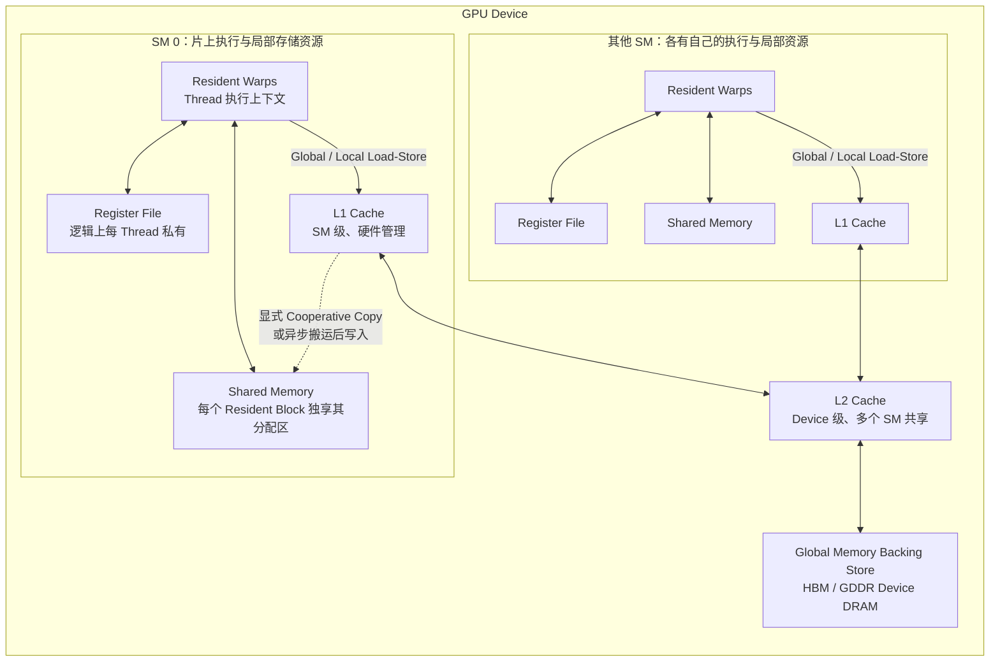

# CUDA 执行与内存模型

若还没有写过 CUDA Kernel，可先运行[CUDA 编程模型](post.html?slug=cuda_programming)中的向量加法。本文进一步解释线程层级、同步边界、SM 执行与存储层次；Reduction、Scan 等算法放在[CUDA 并行原语与性能分析](post.html?slug=cuda_parallel_primitives)。

GPU 编程最容易犯的错误，是一开始就把注意力放在 `threadIdx.x`、`__syncthreads()` 或某条 Tensor Core 指令上，却没有先建立完整的执行模型。

对于经典 CUDA SIMT Kernel，可以先把整个模型压缩成一条链：

```text
Host CPU
   │
   │ Kernel Launch
   ▼
Grid
   │
   ├── Thread Block / CTA
   │       │
   │       ├── Warp
   │       │    └── Thread
   │       │
   │       └── Shared Memory / Block Barrier
   │
   ├── Thread Block / CTA
   │
   └── ...
```

从硬件执行角度，还要再补上一层：

```text
CUDA Programming Model                GPU Hardware

Grid
 │
 ├── Block ──────────────┐
 ├── Block ───────────┐  │
 ├── Block ────────┐  │  │
 └── ...           │  │  │
                   ▼  ▼  ▼
              ┌──────────────┐
              │      SM      │
              │              │
              │ Block        │
              │  └─ Warp     │
              │      └Thread │
              │              │
              └──────────────┘
```

因此可以先记住两个不同层次：

```text
CUDA 暴露给程序员的线程层次：

Grid → Block → Thread
```

以及：

```text
理解 NVIDIA GPU 执行与性能时：

Grid → Block → Warp → Thread
             │
             └── Block 被调度到 SM
```

`Warp` 并不是 Kernel Launch 时显式指定的层级，而是 GPU 执行一个 Thread Block 时形成的重要硬件执行粒度。

当前 CUDA 中：

```text
1 Warp = 32 Threads
```

图里术语：

- Host：运行这段程序的 CPU 端；负责配置 Grid/Block、分配设备内存、提交 Kernel。
- Kernel：编写在 GPU 上执行的函数（用 `__global__` 标记），它本身不是“一个程序”，而是一个“并行工作入口”。
- Kernel Launch：从主机把同一个 Kernel 调度给很多并行任务的动作，语法上常见 `kernel<<<grid, block>>>(...)`。
- Grid：本次启动的整体任务集合；可以理解为“要做多少个 Block 的总清单”。
- Block（CTA）：一个 Block 是最小调度单位之一，内部线程可做协作（共享内存、Barrier）。
- Thread：Block 内最小执行单元。
- CTA：**Cooperative Thread Array** 的缩写，通常等价于 Thread Block。
- Warp：硬件把 Block 的线程按 32 个一组执行，组成 Warp（同一时刻执行同一批指令的线程组）。
- SM（Streaming Multiprocessor）：GPU 上负责执行 Block 的硬件核心单元，Block 在 SM 上驻留并运行。
- Shared Memory：Block 级别的片上高速内存，按 `__shared__` 显式声明，生命周期随 Block，线程通常通过 `threadIdx` 等索引访问，并常配合 `__syncthreads()` 处理可见性；可以把它看作“手工高速工作区”。
- Block Barrier（如 `__syncthreads`）：Block 内所有线程到达后才允许继续，常用于保证共享数据的时序正确。
- Global Memory：全局显存（设备内存），可被所有 Block 访问，但有更高延迟与带宽压力。
- Register：每个线程独占的寄存器资源，过量会直接压低 occupancy。

---

# 1. Host / Device 与 Kernel Launch

CUDA 是一个异构编程模型。

通常：

```text
CPU
│
└── Host Code
      │
      ├── 分配 Device Memory
      ├── 准备数据
      ├── 配置 Grid / Block
      ├── Launch Kernel
      └── 管理 Stream / Event / Synchronization

GPU
│
└── Device Code
      │
      └── Kernel
```

对应概念说明：

- Stream：同一条 CUDA 执行队列，按提交顺序在一个通道上执行 Kernel / 拷贝 / 同步原语。
- Event：用来打点的时间标记，可用于测延迟和等待某个阶段完成。
- Host 侧 Kernel Launch 语法 `<<<...>>>` 用来把网格规模和 block 规模提交给 GPU。
- Device：指 GPU 端执行空间，不同于 CPU Host。

最简单的 CUDA Kernel：

```cpp
__global__ void vector_add(
    const float* a,
    const float* b,
    float* c,
    int n) {

    int i =
        blockIdx.x * blockDim.x
        + threadIdx.x;

    if (i < n) {
        c[i] = a[i] + b[i];
    }
}
```

Host 侧：

```cpp
int threads = 256;
int blocks =
    (n + threads - 1) / threads;

vector_add<<<blocks, threads>>>(
    a, b, c, n);
```

其中：

```text
vector_add<<<blocks, threads>>>
                  │       │
                  │       └── 每个 Block 的线程数量
                  │
                  └────────── Grid 中 Block 的数量
```

对于一维情况：

```text
gridDim.x  = blocks
blockDim.x = threads
```

需要特别注意：

> `gridDim` 描述的是 Grid 中逻辑 Block 的数量，而不是 GPU 某一时刻能够同时执行多少个 Block。

例如：

```cpp
kernel<<<100000, 256>>>();
```

表示：

```text
Grid 中存在 100000 个逻辑 Block
```

并不意味着 GPU 同时驻留 100000 个 Block。

真正同时运行多少 Block，要取决于：

- GPU 有多少 SM；
- 每个 Block 有多少线程；
- Kernel 使用多少寄存器；
- Kernel 使用多少 Shared Memory；
- 每个 SM 的 Block / Warp / Thread 硬件上限。

因此逻辑执行空间和物理并发度一定要区分开。

---

# 2. Grid、Block 与 Thread

CUDA Kernel 启动之后，一个 Grid 包含很多 Thread Block。

```text
Grid

├── Block 0
│   ├── Thread 0
│   ├── Thread 1
│   ├── ...
│   └── Thread N
│
├── Block 1
│   ├── Thread 0
│   ├── Thread 1
│   └── ...
│
└── ...
```

Grid 和 Block 都可以是一维、二维或三维。

例如处理二维矩阵时：

```cpp
dim3 block(16, 16);

dim3 grid(
    (N + block.x - 1) / block.x,
    (M + block.y - 1) / block.y);

kernel<<<grid, block>>>(...);
```

Kernel 中：

```cpp
int row =
    blockIdx.y * blockDim.y
    + threadIdx.y;

int col =
    blockIdx.x * blockDim.x
    + threadIdx.x;
```

于是：

```text
Problem Space

        ↓ Grid 切块

┌────────┬────────┬────────┐
│ Block  │ Block  │ Block  │
├────────┼────────┼────────┤
│ Block  │ Block  │ Block  │
├────────┼────────┼────────┤
│ Block  │ Block  │ Block  │
└────────┴────────┴────────┘

        ↓ Block 内继续切分

Thread → 单个元素或小 Tile
```

这就是 GPU 编译器所谓的：

```text
Parallel Mapping
```

它实际上是在构造：

```text
Problem Index
      ↕
Grid / Block / Thread ID
```

之间的对应关系。

---

# 3. Global Index 与 Grid-Stride Loop

最常见的一维索引：

```cpp
int i =
    blockIdx.x * blockDim.x
    + threadIdx.x;
```

可以理解成：

```text
Block 0

threadIdx
0 1 2 3 ... 255

global index
0 1 2 3 ... 255


Block 1

threadIdx
0   1   2   ... 255

global index
256 257 258 ... 511
```

但并不要求：

```text
1 Thread = 1 Element
```

CUDA 中非常常见的另一种写法是 Grid-Stride Loop：

```cpp
for (std::size_t i =
         blockIdx.x * blockDim.x
         + threadIdx.x;
     i < n;
     i += blockDim.x * gridDim.x) {

    process(input[i]);
}
```

此时：

```text
Thread 0
    │
    ├── element 0
    ├── element stride
    ├── element 2 * stride
    └── ...

Thread 1
    │
    ├── element 1
    ├── element stride + 1
    └── ...
```

这样做有两个重要好处：

1. Grid 数量不必和问题规模一一对应；
2. 可以让一个固定规模的 Grid 重复消费大量数据。

从编译器角度看，这等价于：

```text
Parallel Outer Mapping
+
Sequential Inner Loop
```

---

# 4. Thread Block：最重要的协作边界

Thread Block 不只是“把很多线程装在一起”。

它首先定义了 CUDA 中最重要的局部协作范围。

同一个 Block 中的线程：

- 在同一个 SM 上执行；
- 可以访问同一个 Shared Memory；
- 可以进行 **Block 级 Barrier**：`Block` 内所有线程可在某个同步点齐头并进到达后再继续（常见于 `__syncthreads()`）；它保证共享内存写入在下一阶段可见。
- 可以进行 **Block 内 Cooperative Groups 协作**：通过 `cooperative_groups` 把 `thread` 组成可命名群组，做更有结构的组内同步与通信（例如按群组维度做 `sync`、`sync`-like 集合操作），仍然只在 Block 内有效。

因此算法设计里常常有：

```text
1 Block
   ↓
负责 1 个 Tile
```

例如矩阵乘法：

```text
C Matrix

┌─────────────┬─────────────┐
│             │             │
│   Block 0   │   Block 1   │
│   C Tile    │   C Tile    │
│             │             │
├─────────────┼─────────────┤
│             │             │
│   Block 2   │   Block 3   │
│   C Tile    │   C Tile    │
│             │             │
└─────────────┴─────────────┘
```

一个 Block 可能执行：

```text
确定自己的 C Tile
       ↓
协作读取 A / B Tile
       ↓
写入 Shared Memory
       ↓
Block Synchronization
       ↓
共同计算
       ↓
输出 C Tile
```

所以：

> CUDA 的 Block 划分通常不仅决定“并行度”，还决定数据复用、同步范围和 Shared Memory 生命周期。

这也是 GPU Compiler 中：

```text
Tiling
+
Thread Block Mapping
+
Memory Promotion
```

经常必须联合考虑的原因。

---

# 5. Block 如何映射到 SM

GPU 包含多个：

```text
Streaming Multiprocessor
```

简称：

```text
SM
```

Grid 中的 Block 会被调度到这些 SM。

例如：

```text
Grid

B0 B1 B2 B3 B4 B5 B6 B7 ...
│  │  │  │
│  │  │  └──────────┐
│  │  └───────┐     │
│  └────┐     │     │
▼       ▼     ▼     ▼

SM0     SM1   SM2   SM3
```

如果一个 SM 有足够资源，它可以同时驻留多个 Block：

```text
SM

├── Block A
│   ├── Warp
│   ├── Warp
│   └── ...
│
├── Block B
│   ├── Warp
│   └── ...
│
└── Block C
```

但这些 Block 会共同消耗该 SM 的：

```text
Register File
Shared Memory
Warp Slots
Thread Slots
Block Slots
```

因此：

```text
Block 越大
```

并不自动等于：

```text
GPU 利用率越高
```

因为更大的 Block 也可能占用更多资源，导致同一个 SM 能够同时驻留的 Block 数量下降。

另一个必须牢记的性质是：

> 普通 CUDA 编程模型不能依赖不同 Block 的执行顺序。

两个 Block 可能：

```text
并行执行
```

也可能：

```text
先 B7
再 B2
再 B3
```

甚至在极端意义上：

```text
串行执行
```

算法都必须保持正确。

因此普通 CUDA Kernel 中不能写出类似：

```text
Block 0 先产生结果
Block 1 默认一定随后读取
```

这种隐式跨 Block 依赖。

跨 Block 的全局阶段依赖通常应该通过：

```text
Kernel A
   ↓
Kernel Boundary / Stream Dependency
   ↓
Kernel B
```

来表达。

---

# 6. Warp：GPU 实际执行的重要粒度

一个 Block 到达 SM 后，会被进一步划分成 Warp。

CUDA 中：

```text
Warp Size = 32 Threads
```

例如：

```text
Block = 256 Threads

Warp 0 : Thread   0 ~  31
Warp 1 : Thread  32 ~  63
Warp 2 : Thread  64 ~  95
Warp 3 : Thread  96 ~ 127
Warp 4 : Thread 128 ~ 159
Warp 5 : Thread 160 ~ 191
Warp 6 : Thread 192 ~ 223
Warp 7 : Thread 224 ~ 255
```

如果 Block 线程数量不是 32 的整数倍：

```text
Block = 100 Threads
```

硬件仍然需要：

```text
ceil(100 / 32) = 4 Warps
```

最后一个 Warp 只有部分 Lane 有实际线程：

```text
Warp 3:

Thread 96
Thread 97
Thread 98
Thread 99

其余 Lane 无有效线程
```

因此 Block 线程数通常倾向于选择 32 的整数倍。

但这只是一个基础启发式，并不意味着：

```text
256 threads
```

永远优于：

```text
192 threads
```

最终仍然取决于资源和 Kernel 行为。

---

# 7. SIMT 与 SIMD

CUDA 使用：

```text
SIMT
Single Instruction, Multiple Threads
```

从程序员视角：

```cpp
float x = input[i];

if (x > 0.0f)
    output[i] = x * x;
else
    output[i] = 0.0f;
```

每个 Thread 都有自己的：

```text
Thread ID
Register State
Local Variables
Control-Flow State
```

因此程序员写的是：

```text
Thread Program
```

而不是显式写：

```text
Vector Lane Program
```

---

## 7.1 SIMD

传统 SIMD 更接近：

```text
Vector Register

Lane 0
Lane 1
Lane 2
Lane 3
...
```

一条向量指令操作多个数据元素：

```text
VADD
│
├── lane0
├── lane1
├── lane2
└── lane3
```

控制流通常围绕一个向量指令流展开。

---

## 7.2 SIMT

SIMT 则把：

```text
Thread 0
Thread 1
Thread 2
...
Thread 31
```

组成一个 Warp。

这些线程运行同一份 Kernel 程序，但不同线程允许遇到不同控制流结果。

因此：

```text
SIMD：

一条显式 Vector Instruction
+
多个 Lane
```

而：

```text
SIMT：

多个逻辑 Thread
+
硬件把它们组织成 Warp
```

这也是为什么：

```cpp
if (threadIdx.x & 1)
```

在 CUDA 中是合法且自然的线程程序，只是可能引入性能问题。

---

# 8. Independent Thread Scheduling

理解 Warp 时有一个非常重要的历史区别。

早期 NVIDIA GPU 上，一个 Warp 的线程共享更强的锁步执行行为，因此很多老 CUDA 程序写出了所谓：

```text
warp-synchronous programming
```

即：

```text
“反正大家属于同一个 Warp，
所以不用显式同步。”
```

这种思想在现代 CUDA 中不能作为正确性依据。

从 Volta，也就是 Compute Capability 7.0 开始，GPU 引入：

```text
Independent Thread Scheduling
```

硬件可以维护更细粒度的线程执行状态，并允许线程在子 Warp 粒度发生 divergence 和 reconvergence。
Compute Capability 是 CUDA 设备的架构版本标识（如 9.0、12.0），不同版本会决定指令、SM 特性和一些编译器假设是否可用。

因此：

> 不要因为两个线程属于同一个 Warp，就假设它们之间天然存在足够的同步关系。

如果 Warp 内存在显式数据交换和依赖，应使用对应同步语义，例如：

```cpp
__syncwarp(mask);
```

以及带同步语义的 Warp Collective：

```cpp
__shfl_sync(...)
__ballot_sync(...)
__any_sync(...)
__all_sync(...)
```

这也是现代 CUDA 中理解 Warp 的正确方式：

```text
Warp
│
├── 仍然是重要硬件执行粒度
├── 仍然影响 divergence
├── 仍然影响 memory coalescing
├── 仍然提供 warp collectives
│
└── 但不能依赖“每条指令永远隐式锁步”
    来证明程序正确性
```

---

# 9. Warp Divergence

考虑：

```cpp
if ((threadIdx.x & 1) == 0) {
    y = x * x;
} else {
    y = -x;
}
```

一个 Warp：

```text
Lane:

0 1 2 3 4 5 6 7 ...

Condition:

T F T F T F T F ...
```

不同线程走不同路径。

从 SIMT 心智模型看，可以理解为：

```text
Path A

Active Mask:
1 0 1 0 1 0 1 0 ...

        ↓

Path B

Active Mask:
0 1 0 1 0 1 0 1 ...
```

没有参与当前路径的 Lane 不做有用计算。

因此 divergence 的核心问题不是：

```text
“if 指令本身很慢”
```

而是：

```text
同一个 Warp 的计算资源
没有一直服务于全部有效线程
```

例如：

```text
32 Threads

16 个执行 A
16 个执行 B
```

如果 A 和 B 都有大量计算，Warp 的有效利用率就可能明显下降。

---

## 9.1 哪些分支真正值得优化

不是看到：

```cpp
if
```

就必须消除。

例如整个 Warp 条件一致：

```cpp
if (blockIdx.x < split)
```

可能表现为：

```text
Warp 0：全部 true
Warp 1：全部 true
Warp 2：全部 false
```

这种分支几乎没有 Warp 内 divergence。

真正危险的是条件和 Lane 强相关：

```cpp
if (threadIdx.x & 1)
```

或者不同线程循环次数差异很大：

```cpp
while (work[threadIdx.x] != done) {
    ...
}
```

因此优化 divergence 的第一原则是：

> 看同一个 Warp 中条件是否不同，而不是看源代码里有没有 branch。

---

## 9.2 常见优化方法

### 数据重新分组

把：

```text
A B A B A B A B
```

预处理成：

```text
A A A A B B B B
```

让同一 Warp 处理更加一致的数据。

---

### Predication

简单条件有时可以转换成谓词执行。

例如：

```cpp
if (cond)
    x = a;
else
    x = b;
```

可能被转换成类似：

```text
x = select(cond, a, b)
```

但如果两边计算量都很大，强行 predication 可能反而执行更多无用指令。

---

### 拆分 Kernel

如果两个路径完全不同：

```text
Path A：大量矩阵运算
Path B：复杂稀疏处理
```

可以考虑：

```text
Partition
   ├── Kernel A
   └── Kernel B
```

代价则是：

```text
额外的数据整理
+
额外 Kernel Launch
```

因此是否值得必须通过 profile 判断。

---

# 10. Warp-Level Primitive

Warp 内线程之间可以直接交换信息，而不一定先写 Shared Memory。

常见原语包括：

```text
Shuffle
Vote
Ballot
Match
Warp Synchronization
```

---

## 10.1 Shuffle

例如：

```cpp
float other =
    __shfl_down_sync(
        mask,
        value,
        offset);
```

表示从 Warp 中另一个 Lane 取得寄存器值。

于是：

```text
Lane 0 register ─┐
Lane 1 register ─┤
Lane 2 register ─┼── Warp Shuffle Network
Lane 3 register ─┤
...              │
Lane31 register ─┘
```

线程之间可以在寄存器层进行数据交换。

这对于：

```text
Reduction
Scan
Broadcast
Warp-level GEMM
```

非常重要。

---

## 10.2 Vote / Ballot

例如：

```cpp
unsigned mask =
    __ballot_sync(
        active_mask,
        predicate);
```

可以得到：

```text
哪些 Lane 的 predicate 为 true
```

形成一个 bit mask。

例如：

```text
Lane:
0 1 2 3 4 5 6 7

predicate:
T F F T T F T F

mask:
1 0 0 1 1 0 1 0
```

这是很多 Warp-level 算法的基础。

---

# 11. Synchronization：同步和内存可见性不是一回事

GPU 并行程序里，“同步”至少要拆成三个概念：

| 概念 | 解决什么 |
|---|---|
| Control Barrier | 等待其他参与线程到达 |
| Memory Ordering / Fence | 约束内存访问的顺序和可见性 |
| Atomic Operation | 对某个共享位置执行原子的读改写 |

它们不能互相替代。

---

## 11.1 `__syncthreads()`

最常见的 Block Barrier：

```cpp
__syncthreads();
```

可以理解成：

```text
Thread 0 ──────┐
Thread 1 ───┐  │
Thread 2 ──────┤
Thread 3 ─┐    │
          ▼    ▼
      __syncthreads
          │
          ▼
      全部继续
```

典型 Shared Memory 模式：

```cpp
shared[threadIdx.x] = input[i];

__syncthreads();

float value =
    shared[some_other_index];
```

Barrier 的作用是保证：

```text
Producer Phase
      ↓
所有参与线程完成
      ↓
Consumer Phase
```

---

## 11.2 Barrier 不能随意放在 divergent branch 里

错误模式：

```cpp
if (i < n) {
    shared[threadIdx.x] = input[i];

    __syncthreads();

    consume(shared);
}
```

如果：

```text
Thread 0：i < n
Thread 1：i < n
Thread 2：i >= n
```

那么：

```text
Thread 0 → Barrier
Thread 1 → Barrier
Thread 2 → Skip
```

此时程序就违反了 Block Barrier 的参与要求。

更稳妥的结构：

```cpp
bool active = i < n;

shared[threadIdx.x] =
    active ? input[i] : 0.0f;

__syncthreads();

if (active) {
    consume(shared);
}
```

核心思想：

```text
Predicate 数据
而不是随意 Predicate 必需的 Barrier
```

---

## 11.3 Warp Barrier

Warp 范围可以使用：

```cpp
__syncwarp(mask);
```

尤其是存在 Warp 内共享数据依赖时。

注意这里的：

```text
mask
```

本身也是语义的一部分，它说明哪些 Lane 被认为参与这次协作。

---

## 11.4 Memory Fence

类似：

```text
Thread Fence
```

解决的是内存顺序和可见性问题，而不是：

```text
“等所有线程执行到这里”
```

所以：

```text
Fence != Barrier
```

这是并发编程里非常重要的区别。

---

## 11.5 Atomic

例如：

```cpp
atomicAdd(&counter, 1);
```

保证对：

```text
counter
```

这个共享位置的更新是原子的。

但是它不意味着：

```text
整个 Kernel 的其他所有内存
都自动形成全序关系
```

因此：

```text
Barrier
Fence
Atomic
```

解决的是三个不同层次的问题。

---

# 12. Thread Block Cluster

传统 CUDA 最重要的协作边界是：

```text
Thread Block
```

在 Compute Capability 9.0 及之后的设备中，CUDA 还提供了可选的：

```text
Thread Block Cluster
```

层级。

完整结构可以表示成：

```text
Grid
 │
 ├── Cluster
 │    │
 │    ├── Block
 │    │    └── Warp
 │    │         └── Thread
 │    │
 │    ├── Block
 │    └── Block
 │
 └── Cluster
```

Cluster 中的 Block 可以获得更强的协作能力。

例如：

```text
Cluster-level Synchronization
```

以及：

```text
Distributed Shared Memory
```

即：

```text
Block A Shared Memory
Block B Shared Memory
Block C Shared Memory
        │
        └──── Cluster 内可协作访问
```

它把传统：

```text
Block Local Shared Memory
```

进一步扩展成：

```text
Cluster Cooperative Shared Memory
```

但需要注意：

> Cluster 是进阶能力，不应该替代初学 CUDA 时对 Grid → Block → Warp → Thread 的基本理解。

大多数 CUDA 算法首先应该在：

```text
Block
```

这个协作范围内理解正确，再考虑是否值得扩大协作层级。

---

# 13. CUDA 的 Memory Hierarchy

理解 CUDA 性能时，既要看“谁可以访问”，也要看存储在 GPU 的什么位置：



图中的 Register File 物理上属于 SM，但编程模型把已分配的寄存器视为每个 Thread 私有；
Shared Memory 也位于 SM 片上，却按 Resident Block 划分，一个 Block 不能直接访问另一个
Block 的普通 Shared Memory。Block 结束后，它占用的 Shared Memory 和寄存器资源即可被
后续 Block 复用。

Global Memory 是所有 Block 都能通过地址访问的设备内存空间，通常由 HBM/GDDR DRAM 提供
后备存储，访问会经过目标架构允许的 Cache 路径。L2 通常由整个 GPU 的多个 SM 共享；L1
通常更接近单个 SM。图中画出的“L1 + Shared Memory”是逻辑职责，不代表所有 GPU 都使用
完全相同的物理结构：在一些 NVIDIA 架构上两者会共享或可配置部分片上容量，具体比例和路径
要查询目标设备。

| 名称 | 编程模型中的可见范围 | 常见物理位置 | 生命周期 / 管理方式 |
| --- | --- | --- | --- |
| Register | 单个 Thread | SM Register File | 随 Thread 执行上下文，由编译器分配 |
| Shared Memory | 单个 Block/CTA | SM 片上 SRAM | 随 Block 驻留，程序显式读写和同步 |
| L1 Cache | 通常靠近单个 SM | SM 片上 Cache 资源 | 硬件管理，程序不能把 Cache Line 当作 Shared 数组寻址 |
| L2 Cache | Device 级共享 | GPU 芯片上的共享 Cache | 硬件管理，是多个 SM 访问设备内存的公共层之一 |
| Global Memory | Device 上的线程均可寻址 | HBM/GDDR Device DRAM | 由分配与释放决定，可跨 Kernel 保留 |
| Local Memory | 语义上单个 Thread 私有 | 通常仍由 Device DRAM 后备并经过 Cache | 局部数组或 Register Spill 可能落入这里 |
| Constant Memory | Device 级只读地址空间 | Device DRAM 后备和专用/统一 Cache 路径 | Host 写入、Kernel 读取；Warp 读取同一地址时适合广播 |
| Texture / Read-only Path | Device 级只读访问 | Device DRAM 后备和纹理/只读 Cache、采样单元 | 适合具有空间局部性或需要纹理采样语义的数据 |

Constant Memory 和 Texture 在图中没有被画成 DRAM 之外的新“容量层”：它们更接近特殊地址
空间或访问路径，底层数据仍有相应的设备内存后备，具体 Cache 组织随架构变化。Unified
Memory 也不是额外的一级高速存储；它提供统一地址与页迁移/映射机制，数据在 Host 和 Device
之间的位置、迁移缺页和一致性成本仍然需要单独分析。

这张图也解释了 Shared Memory 为什么不是普通 Cache：它由 Kernel 使用
`__shared__` 显式分配和索引，数据何时装入、怎样复用以及何时同步都由程序决定；
L1/L2 则根据访问地址由硬件自动填充和替换。Shared Memory 是“软件管理的片上工作区”，
不是把 Global Memory 的某段地址自动缓存后换了一个名字。

不要把图的上下位置机械理解成固定延迟数字。Register Spill 会把看似普通的局部变量变成
Local Memory 访问；Shared Memory 会受到 Bank Conflict；Global Memory 命中 Cache 时也
可能远快于未命中。最终性能还取决于 Coalescing、复用次数、Occupancy、同步和架构版本。

这里必须区分：

```text
CUDA Address Space
```

和：

```text
具体物理存储位置
```

两者不是完全相同的概念。

---

# 14. Register

线程中的普通局部标量通常希望放在 Register 中。

例如：

```cpp
float accumulator = 0.0f;
```

如果整个生命周期都能保存在寄存器：

```text
Thread
  │
  └── Register
```

访问成本很低。

GEMM 中的 accumulator：

```cpp
acc += a * b;
```

尤其适合长期驻留在寄存器。

但寄存器数量不是无限的。

当：

```text
Registers / Thread
```

越来越多时：

```text
Registers / Block
```

也随之增大。

这可能降低：

```text
Resident Blocks / SM
Resident Warps / SM
```

甚至出现：

```text
Register Spill
```

因此编译器必须不断权衡：

```text
更多 Register
      ↓
更大的 Tile / 更多局部复用

          VS

更高 Register Pressure
      ↓
更低 Occupancy / Spill
```

---

# 15. Local Memory 不是快速片上内存

CUDA 中有一个非常容易被名字误导的概念：

```text
Local Memory
```

它表示：

```text
Thread-private Address Space
```

但不意味着：

```text
“物理上就在 Thread 旁边的快速 SRAM”
```

例如：

```cpp
float temporary[128];
```

如果编译器无法把它合理标量化并分配到寄存器，就可能放入 Local Memory。

寄存器不足产生 spill 时也可能使用 Local Memory。

因此：

```text
Private
   ≠
Register
```

这是 GPU 编译器必须明确区分的两种概念：

```text
Semantic Scope
```

和：

```text
Physical Placement
```

---

# 16. Shared Memory

Shared Memory：

```text
Scope = Thread Block
```

一个 Block 中的线程可以共同访问：

```cpp
__shared__ float tile[256];
```

经典用途是：

```text
Global Memory
      ↓
Cooperative Load
      ↓
Shared Memory
      ↓
Reuse Many Times
      ↓
Compute
```

例如 GEMM：

```text
A Global Tile
      │
      ▼
Shared A

B Global Tile
      │
      ▼
Shared B

Shared A × Shared B
      │
      ▼
Register Accumulator
```

其核心价值是：

> 用一次 Global Memory 搬运换取 Block 内多次数据复用。

但 Shared Memory 不是免费的。

它会带来：

```text
容量占用
+
Load / Store Instructions
+
Synchronization
+
Bank Conflict Risk
```

所以：

```text
Global → Shared
```

只有在复用收益足够大时才值得做。

---

# 17. Global Memory Coalescing

Global Memory Coalescing 是 CUDA 性能中最重要的概念之一。

假设一个 Warp：

```text
Lane

0 1 2 3 4 ... 31
```

读取：

```text
A[i + 0]
A[i + 1]
A[i + 2]
A[i + 3]
...
A[i + 31]
```

地址集中在少量连续内存区域：

```text
Memory

[A0][A1][A2][A3][A4]...[A31]
 ↑   ↑   ↑   ↑
 t0  t1  t2  t3
```

GPU 可以把 Warp 中这些访问组织成较少的内存事务。

---

## 17.1 真正应该看的是整个 Warp

不要只问：

```text
“一个 Thread 是不是顺序访问？”
```

更重要的问题是：

```text
“一个 Warp 在同一条 Load / Store 指令上
访问了哪些地址？”
```

例如：

```cpp
input[base + threadIdx.x]
```

通常形成：

```text
Lane 0  → base + 0
Lane 1  → base + 1
Lane 2  → base + 2
...
```

这是非常典型的 coalesced pattern。

而：

```cpp
input[threadIdx.x * stride]
```

如果 `stride` 很大：

```text
Lane 0  ↓
        [x]

Lane 1                ↓
                     [x]

Lane 2                              ↓
                                   [x]
```

Warp 的地址会分散到更多内存区域，导致更多事务。

---

## 17.2 不要把“地址顺序”简单等同于 Coalescing

需要注意：

```text
Coalescing
```

更关心的是：

```text
Warp 地址落入多少内存事务覆盖区域
```

而不是要求 Lane 必须严格：

```text
0 → address 0
1 → address 1
2 → address 2
```

例如某些反向但仍集中在相同连续区域的访问，也可能保持较好的合并效果。

真正危险的通常是：

```text
Large Stride
Scatter
Poor Alignment
Sparse Random Access
```

因此更精确的判断方式是：

> 观察一条 Warp memory instruction 产生多少实际 memory transactions，而不是只观察源码索引是否递增。

---

# 18. SoA 与 AoS

假设：

```cpp
struct Particle {
    float x;
    float y;
    float z;
};
```

AoS：

```text
x0 y0 z0 | x1 y1 z1 | x2 y2 z2 | ...
```

如果一个 Warp 同时只计算：

```cpp
particles[i].x
```

实际地址是：

```text
x0      x1      x2      x3
│       │       │       │
x y z | x y z | x y z | x y z
```

中间存在其他字段。

如果改成 SoA：

```cpp
struct Particles {
    float* x;
    float* y;
    float* z;
};
```

内存：

```text
x0 x1 x2 x3 x4 ...
y0 y1 y2 y3 y4 ...
z0 z1 z2 z3 z4 ...
```

Warp 同时读取 `x`：

```text
Lane0 → x0
Lane1 → x1
Lane2 → x2
Lane3 → x3
```

通常更容易形成连续访问。

因此对于：

```text
多个 Thread 同时访问同一个 Field
```

的场景：

```text
SoA
```

通常比 AoS 更容易形成理想的 Global Memory access pattern。

但这并不是绝对规则。

如果算法本身总是：

```text
一个 Thread 一次读取完整 Particle
```

那么 AoS 也可能更加自然。

最终仍应该根据：

```text
Warp Access Pattern
```

判断。

---

# 19. Shared Memory Bank Conflict

Shared Memory 并不是一个真正意义上的：

```text
“所有地址都能无限并行访问”
```

的存储。

它被组织成多个：

```text
Bank
```

当前 CUDA GPU 中通常可以建立：

```text
32 Banks
```

的心智模型。

例如连续的 32-bit 数据：

```text
Element 0  → Bank 0
Element 1  → Bank 1
Element 2  → Bank 2
...
Element31  → Bank31
Element32  → Bank 0
```

因此一个 Warp：

```text
Lane 0 → Bank 0
Lane 1 → Bank 1
...
Lane31 → Bank31
```

可以非常高效地并行访问。

---

## 19.1 Bank Conflict

如果：

```text
Lane 0 → Bank 0, Address A
Lane 1 → Bank 0, Address B
Lane 2 → Bank 0, Address C
```

不同线程访问：

```text
同一个 Bank
+
不同地址
```

会发生 Bank Conflict。

一次 Shared Memory 操作可能被拆成多轮完成。

因此：

```text
Global Memory
```

关注：

```text
Coalescing
```

而：

```text
Shared Memory
```

重点关注：

```text
Bank Mapping
```

---

## 19.2 Padding

经典矩阵转置：

```cpp
__shared__ float tile[32][32];
```

按某些列模式读取时，线程地址可能反复映射到相同 Bank。

常见技巧：

```cpp
__shared__ float tile[32][33];
```

多出来的一列 Padding 会改变地址步长：

```text
stride = 32
     ↓
Bank Pattern 高度重复

stride = 33
     ↓
Bank Mapping 发生旋转
```

从而消除或降低冲突。

这也是为什么 GPU Compiler 做 Shared Memory Promotion 时不能只问：

```text
“数据有没有进 Shared？”
```

还必须问：

```text
Shared Layout 是什么？
```

---

# 20. Global Coalescing、Bank Conflict 与 Divergence 的统一理解

这三个概念表面完全不同：

```text
Global Memory Coalescing
Shared Memory Bank Conflict
Warp Divergence
```

但本质上都可以理解成：

> 一个 Warp 是否能够让硬件资源高效地服务大量 Lane。

---

## Coalescing

理想：

```text
32 Lane
  ↓
少量 Memory Transactions
```

差：

```text
32 Lane
  ↓
大量分散 Transactions
```

---

## Bank Conflict

理想：

```text
32 Lane
  ↓
32 个独立 Bank
```

差：

```text
很多 Lane
  ↓
同一 Bank
  ↓
序列化
```

---

## Divergence

理想：

```text
32 Lane
  ↓
全部执行有用工作
```

差：

```text
32 Lane
  ↓
只有部分 Lane Active
```

因此很多 CUDA 优化其实都在做同一件事情：

```text
提高 Warp 每次执行时
有效使用硬件资源的比例
```

---

在此执行模型上构造 Reduction、Scan、Histogram 和 Softmax，见[CUDA 并行原语与性能分析](post.html?slug=cuda_parallel_primitives)。具体硬件规则应以 [CUDA Programming Guide](https://docs.nvidia.com/cuda/cuda-programming-guide/) 和目标设备文档为准。
