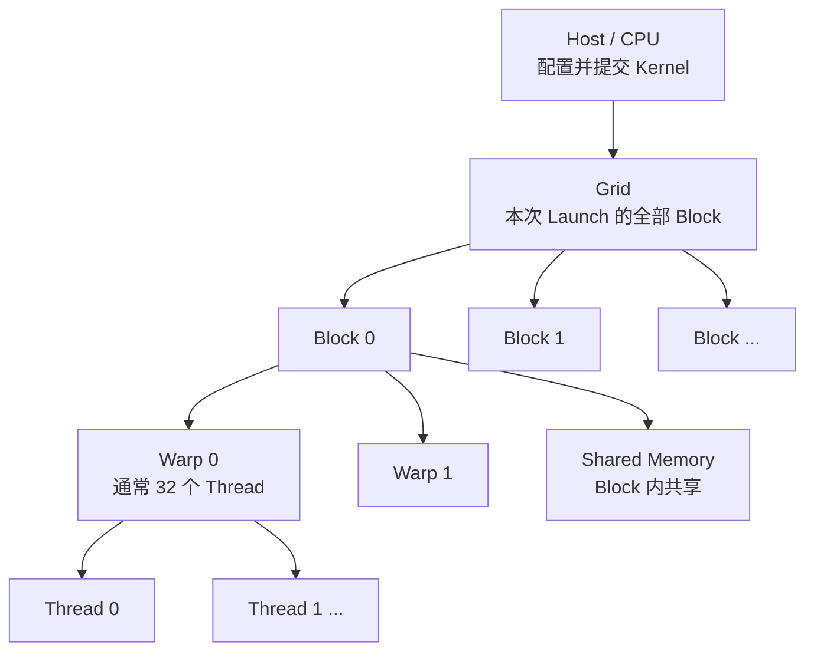
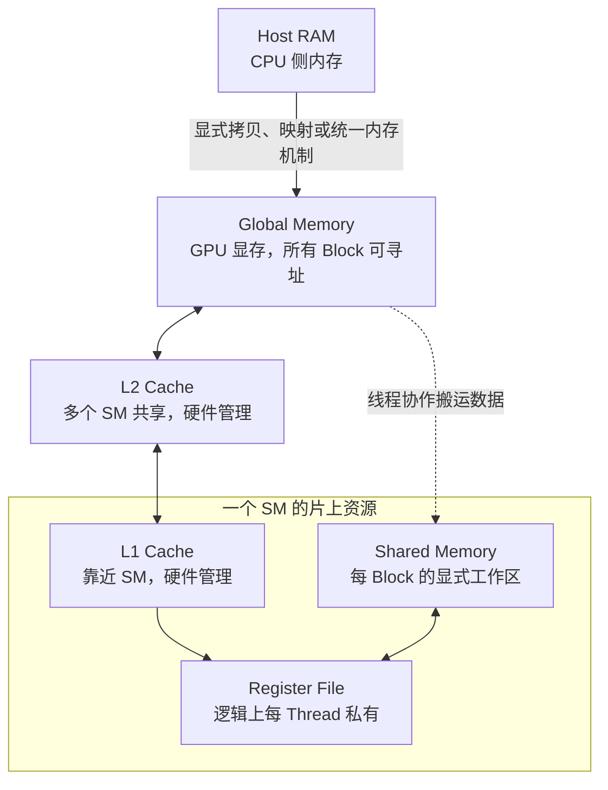

# CUDA 编程模型：从向量加法到线程、内存与并行协作

CUDA 让 CPU 程序把适合大规模并行的工作交给 NVIDIA GPU。先看一个问题：给定两个长度为 `N` 的数组，计算 `c[i] = a[i] + b[i]`。CPU 可以用一个循环完成；CUDA 的基本做法是启动许多 GPU 线程，每个线程负责一个或多个元素。

本篇先让这段程序运行起来，再沿着它依次解释 Host/Device、Kernel、Grid/Block/Thread、Warp、内存、同步、Stream 和性能。读完可到[CUDA 执行与内存模型](post.html?slug=cuda_execution_model)深入理解硬件执行，再到[GPU Kernel 编译与 Lowering](post.html?slug=gpu_kernel_lowering)了解编译器如何生成 Kernel。

---

# 1. 第一个完整程序：向量加法

把下列代码保存为 `vector_add.cu`：

```cpp
#include <cuda_runtime.h>

#include <cstddef>
#include <cstdio>
#include <cstdlib>

#define CUDA_CHECK(call)                                                     \
    do {                                                                     \
        const cudaError_t error = (call);                                    \
        if (error != cudaSuccess) {                                          \
            std::fprintf(stderr, "%s:%d: %s\n", __FILE__, __LINE__,        \
                         cudaGetErrorString(error));                         \
            std::exit(EXIT_FAILURE);                                        \
        }                                                                    \
    } while (false)

__global__ void vector_add(const float* a, const float* b, float* c, int n) {
    const int i = blockIdx.x * blockDim.x + threadIdx.x;
    if (i < n) {
        c[i] = a[i] + b[i];
    }
}

int main() {
    constexpr int n = 1000;
    constexpr int threads_per_block = 256;
    constexpr std::size_t bytes = static_cast<std::size_t>(n) * sizeof(float);

    float *a = nullptr, *b = nullptr, *c = nullptr;
    CUDA_CHECK(cudaMallocManaged(&a, bytes));
    CUDA_CHECK(cudaMallocManaged(&b, bytes));
    CUDA_CHECK(cudaMallocManaged(&c, bytes));

    for (int i = 0; i < n; ++i) {
        a[i] = static_cast<float>(i);
        b[i] = static_cast<float>(2 * i);
    }

    const int blocks = (n + threads_per_block - 1) / threads_per_block;
    vector_add<<<blocks, threads_per_block>>>(a, b, c, n);
    CUDA_CHECK(cudaGetLastError());
    CUDA_CHECK(cudaDeviceSynchronize());

    for (int i = 0; i < n; ++i) {
        if (c[i] != static_cast<float>(3 * i)) {
            std::fprintf(stderr, "wrong result at %d\n", i);
            return EXIT_FAILURE;
        }
    }

    CUDA_CHECK(cudaFree(a));
    CUDA_CHECK(cudaFree(b));
    CUDA_CHECK(cudaFree(c));
    std::puts("vector addition passed");
    return EXIT_SUCCESS;
}
```

有 CUDA Toolkit 和受支持的 NVIDIA GPU 时，可以运行：

```bash
nvcc -std=c++17 -O2 vector_add.cu -o vector_add
./vector_add
```

程序用 `cudaMallocManaged` 分配 CPU 和 GPU 都能访问的 Managed Memory，省去了第一步就介绍显式拷贝。**统一地址不代表访问没有迁移成本**：在不同硬件和系统上，页面可能迁移或远程访问。第 5 章再换成 `cudaMalloc` 和 `cudaMemcpy`，明确看清数据流。

## 1.1 先看执行顺序

```text
CPU：分配和填充 a、b
  ↓
CPU：提交 vector_add Kernel
  ↓
GPU：许多线程并行计算 c[i]
  ↓
CPU：等待 GPU 完成
  ↓
CPU：读取 c 并检查结果
```

`__global__` 声明 GPU Kernel：函数入口由 Host（CPU 侧）发起，函数体由 Device（GPU 侧）的许多线程执行。`<<<blocks, threads_per_block>>>` 是 Kernel Launch 配置，前者指定 Grid 中有多少个 Block，后者指定每个 Block 有多少个 Thread。

`cudaGetLastError()` 检查 Launch 的即时错误，例如配置无效；Kernel 在设备上执行时出现的错误通常要在随后的同步或 CUDA API 调用处观察。只检查 Launch 而不等待执行，不能证明结果已经计算完成。

## 1.2 为什么最后一个 Block 需要边界检查

本例 `n=1000`，每个 Block 有 `256` 个线程，因此需要向上取整得到 `4` 个 Block，共启动 `1024` 个逻辑线程。最后 `24` 个线程没有对应的数组元素，必须被 `if (i < n)` 排除，否则会越界读写。

```text
Block 0：i =   0 ... 255
Block 1：i = 256 ... 511
Block 2：i = 512 ... 767
Block 3：i = 768 ... 1023，其中 1000 ... 1023 不访问数组
```

这也是多数一维 Kernel 的起点：先求全局索引，再做边界检查。

---

# 2. 线程层级：Grid、Block、Warp、Thread

一次 Kernel Launch 创建一个 Grid；Grid 包含多个 Block；Block 包含多个 Thread。GPU 又把 Block 内线程按 Warp 组织执行。



| 层级 | 程序中怎样看到它 | 主要作用 |
|---|---|---|
| Grid | `gridDim`、`blockIdx` | 表示本次 Launch 的整个逻辑工作范围 |
| Block / CTA | `blockDim`、`threadIdx` | 线程协作和 `__syncthreads()` 的基本边界 |
| Warp | 通常 32 个相邻线程 | GPU 发射指令的重要执行粒度 |
| Thread | 每份 Kernel 实例 | 拥有自己的局部变量和逻辑索引 |

CTA 是 Cooperative Thread Array，通常就是 Thread Block 的另一个名称。SM（Streaming Multiprocessor）是实际执行 Block 的硬件单元；一个 SM 可能同时驻留多个 Block，但并发数量受到线程、寄存器、Shared Memory 等资源限制。

**Grid 是逻辑工作清单，不是同时运行的 Block 数量。** Block 可以按任意顺序被安排到 SM，普通 Kernel 不能依赖 Block 0 一定先于 Block 1 执行，也不能用普通 `__syncthreads()` 同步不同 Block。

## 2.1 一维全局索引

```cpp
const int i = blockIdx.x * blockDim.x + threadIdx.x;
```

`blockIdx.x` 是当前 Block 在 Grid 中的编号；`blockDim.x` 是每个 Block 的线程数；`threadIdx.x` 是当前 Thread 在 Block 中的编号。例如 Block 2 的 Thread 7、每 Block 256 线程时，`i = 2 * 256 + 7 = 519`。

## 2.2 Grid-Stride Loop

一个线程不一定只能处理一个元素。数据量较大、想复用固定数量的 Block 时，可以让线程跨越整个 Grid 反复处理：

```cpp
__global__ void vector_add_stride(const float* a, const float* b,
                                  float* c, std::size_t n) {
    const std::size_t start =
        static_cast<std::size_t>(blockIdx.x) * blockDim.x + threadIdx.x;
    const std::size_t stride =
        static_cast<std::size_t>(gridDim.x) * blockDim.x;

    for (std::size_t i = start; i < n; i += stride) {
        c[i] = a[i] + b[i];
    }
}
```

不同线程仍处理不同索引；`stride` 是整个 Grid 的线程数。它便于对任意大的 `n` 使用有限 Grid，但每个线程处理多次循环可能增加寄存器需求和工作不均，不能仅因为“循环次数更多”就断言它更快。

## 2.3 二维数据映射

图像或矩阵有行和列，使用二维 Grid/Block 更直观：

```cpp
__global__ void add_image(const float* a, const float* b,
                          float* out, int width, int height) {
    const int x = blockIdx.x * blockDim.x + threadIdx.x;
    const int y = blockIdx.y * blockDim.y + threadIdx.y;
    if (x < width && y < height) {
        const std::size_t index =
            static_cast<std::size_t>(y) * width + x;
        out[index] = a[index] + b[index];
    }
}

void launch_add_image(const float* a, const float* b, float* out,
                      int width, int height) {
    dim3 block(16, 16);
    dim3 grid((width + block.x - 1) / block.x,
              (height + block.y - 1) / block.y);
    add_image<<<grid, block>>>(a, b, out, width, height);
    CUDA_CHECK(cudaGetLastError());
}
```

这里连续的 `x` 对应连续地址，通常有利于访存合并。二维维度只是索引表达方式；GPU 不会因为用了 `dim3` 就自动理解图像的语义。还要确认 `block.x * block.y` 不超过目标设备允许的每 Block 线程数。

---

# 3. Warp 与 SIMT：线程如何真正执行

CUDA 使用 SIMT（Single Instruction, Multiple Threads）模型：程序员写每个 Thread 的代码，硬件将 Warp 内当前活跃线程的指令一起执行。NVIDIA GPU 的 Warp 通常由 32 个 Thread 构成。

它与普通 SIMD 向量指令相似，但不是“一个线程持有 32 个数字”：CUDA Thread 有自己的索引、寄存器和控制流状态。理解性能时要同时看“每个线程做什么”和“同一个 Warp 的线程是否做相似的事”。

## 3.1 分支发散

```cpp
if (threadIdx.x % 2 == 0) {
    do_a();
} else {
    do_b();
}
```

同一个 Warp 的一半线程走 A，一半走 B。硬件会用活跃掩码（Active Mask）分别执行需要的路径，再在合适位置归并；不在当前路径上的线程暂时不参与。这叫 Divergence（分支发散）。

发散的代价取决于两条路径做了多少事。`if (i < n)` 只让最后一个 Warp 的少数线程不活跃，通常是必要且可接受的边界检查；为了消除这个 `if` 而越界访问绝对不行。

不同 Warp 走不同分支并不构成同一个 Warp 内的发散。现代 NVIDIA GPU 还有 Independent Thread Scheduling，不能把“同一 Warp 通常共同发射指令”误读成“线程之间可依赖隐式锁步同步”。共享数据时仍需合适的同步原语。

## 3.2 Warp 原语与适用范围

`__shfl_down_sync` 等 Shuffle 原语允许参与线程直接交换寄存器值，适合 Warp 内 Reduction；`__ballot_sync` 把各线程的布尔结果聚成位掩码。掩码必须与实际参与线程相符，参与线程还必须在符合 API 契约的控制流位置执行这些操作。

这些是**同一 Warp 内**的协作工具，不能替代 Block Barrier，也不能用于跨 Block 通信。初学时先正确使用 Block 级 Shared Memory 和 `__syncthreads()`，再进入 Warp 原语。

---

# 4. Host、Device 与 CUDA 函数限定符

普通 C++ 代码从 CPU 开始执行。Host 负责分配内存、准备输入、Launch Kernel、等待结果；Kernel 在 Device 上执行。

| 写法 | 通常从哪里调用 | 在哪里执行 |
|---|---|---|
| 普通 C++ 函数 / `__host__` | Host | Host |
| `__global__` | Host，或特定设备端动态并行场景 | Device，作为 Kernel 入口 |
| `__device__` | Device 代码 | Device，作为普通设备函数 |
| `__host__ __device__` | 依赖编译出的两个版本 | Host 或 Device |

例如：

```cpp
__device__ float square(float x) {
    return x * x;
}

__global__ void square_all(const float* input, float* output, int n) {
    const int i = blockIdx.x * blockDim.x + threadIdx.x;
    if (i < n) output[i] = square(input[i]);
}
```

`__device__` 不是“自动在 GPU 上启动一个任务”，它只是供设备代码调用的函数。`__global__` Kernel Launch 通常相对于 Host 异步：CPU 提交后继续往下走，不能立即读取尚未完成的 GPU 结果。具体同步点由后续 CUDA API 决定。

## 4.1 `nvcc` 编译了什么

`.cu` 文件同时包含 Host 和 Device 代码。`nvcc` 协调 Host 编译器与 CUDA 设备编译流程；设备代码可能以面向特定架构的二进制形式，或以供驱动 JIT 的 PTX 形式进入最终程序。

PTX 是 NVIDIA 定义的虚拟指令表示，不等于 GPU 最终执行的机器指令。`nvcc -arch=sm_XX` 中的 `XX` 必须换成目标 GPU 支持的 Compute Capability；不能把某个设备的架构编号当成通用常量。实际编译/部署还要关注 Toolkit、驱动和目标架构的兼容性。

---

# 5. 数据在哪里：显式拷贝与内存层级

第 1 章用 Managed Memory 简化了程序。要理解性能，仍需区分 Host RAM 与 GPU 可以直接用于 Kernel 的设备内存。一个典型显式数据流是：

```text
Host 数组 a、b
  ↓ cudaMemcpy HostToDevice
Device 数组 d_a、d_b
  ↓ Kernel
Device 数组 d_c
  ↓ cudaMemcpy DeviceToHost
Host 数组 c
```

对应的 Host 代码片段：

```cpp
float *d_a = nullptr, *d_b = nullptr, *d_c = nullptr;
CUDA_CHECK(cudaMalloc(&d_a, bytes));
CUDA_CHECK(cudaMalloc(&d_b, bytes));
CUDA_CHECK(cudaMalloc(&d_c, bytes));

CUDA_CHECK(cudaMemcpy(d_a, h_a, bytes, cudaMemcpyHostToDevice));
CUDA_CHECK(cudaMemcpy(d_b, h_b, bytes, cudaMemcpyHostToDevice));

vector_add<<<blocks, threads_per_block>>>(d_a, d_b, d_c, n);
CUDA_CHECK(cudaGetLastError());

CUDA_CHECK(cudaMemcpy(h_c, d_c, bytes, cudaMemcpyDeviceToHost));
// 这次阻塞式拷贝完成后，h_c 才能作为本次结果被 CPU 读取。

CUDA_CHECK(cudaFree(d_a));
CUDA_CHECK(cudaFree(d_b));
CUDA_CHECK(cudaFree(d_c));
```

这段是假设 `h_a/h_b/h_c`、`bytes`、`blocks` 已准备好的片段；三个设备指针不能传给普通 CPU 循环直接解引用。`cudaMemcpy` 是阻塞式拷贝；在默认 Stream 上按顺序提交时，上面的 Device-to-Host 拷贝会等待此前同一 Stream 的 Kernel 完成。若改用其他 Stream、异步拷贝或更复杂的依赖，必须显式检查顺序关系。

## 5.1 GPU 内存层级



图是理解用的逻辑结构，不代表每代 GPU 都使用相同的物理 Cache/L1/Shared 组织。

| 名称 | 谁能访问 | 谁负责管理 | 常见用途 |
|---|---|---|---|
| Register | 单 Thread | 编译器分配 | 累加器、索引、局部标量 |
| Shared Memory | 单 Block 的线程 | 程序显式读写 | 多线程复用同一数据 Tile |
| Global Memory | 设备上的线程 | 程序分配，Cache 由硬件管理 | 输入、输出、大型中间数组 |
| Local Memory | 语义上单 Thread 私有 | 编译器/设备内存系统 | 放不进寄存器的局部数据或 Spill |
| Constant Memory | Device 侧只读 | Host 准备，硬件缓存 | 多线程读取相同常量 |

“Local”表示访问范围私有，**不表示一定存放在片上**；它常由设备内存后备。Shared Memory 虽然同样靠近 SM，却不是自动 Cache：程序用 `__shared__` 定义工作区，自己决定何时写入、读取和同步；L1/L2 根据地址访问由硬件填充与替换。

## 5.2 Managed Memory 是什么，不是什么

`cudaMallocManaged` 返回 Host 和 Device 可访问的 Managed Memory。它可以让第一段程序不用显式写拷贝，但不承诺数据始终同时在 CPU 和 GPU 的高速位置；页迁移、远程访问和同步成本取决于设备与系统能力。

```text
同一个可用的指针值
≠ CPU 与 GPU 访问成本相同
≠ 不需要等待 GPU 写入完成
```

想研究数据传输开销时，先用 `cudaMalloc`/`cudaMemcpy` 把方向和次数写清楚；想减少代码复杂度或利用迁移机制时，再根据实际硬件考虑 Managed Memory 和 Prefetch。

## 5.3 Global Memory Coalescing

GPU 会将同一 Warp 某条加载/存储指令的地址请求合并为若干内存事务。相邻线程访问相邻 `float` 通常比较理想：

```cpp
const int i = blockIdx.x * blockDim.x + threadIdx.x;
float value = input[i];
```

若相邻线程改为访问 `input[i * 1024]`，地址分散，可能需要更多事务。Coalescing 不等于“必须严格按 0、1、2 顺序读取”，真正关键是一个 Warp 的请求落在哪些内存段、实际使用了传输字节的多少。第 1 章向量加法的访问模式很规整，通常更受全局内存带宽影响，而非浮点加法吞吐。

## 5.4 Shared Memory Bank Conflict

Shared Memory 通常被分成多个 Bank，便于并行服务不同地址。如果同一 Warp 的线程在同一次指令中访问映射到同一 Bank 的**不同地址**，可能被串行化；多个线程读取同一地址则可能走广播路径。给二维 Tile 增加 Padding 或改变索引映射，常能避免冲突：

```cpp
__shared__ float tile[32][33];  // 转置等场景中常见的 padding 形式
```

`[32][33]` 不是任何设备、任何访问模式都必然最优的魔法数字。先确认具体的 Warp 访问模式和目标架构，再看 Profiler 是否真的显示 Bank Conflict。

---

# 6. 线程如何协作：Shared Memory 与同步

向量加法中每个输出元素独立，不需要线程之间通信。Reduction 则不同：计算一段数组的和时，多个线程必须交换部分结果。

以下 Kernel 让**每个 Block 输出一个部分和**，假定 `blockDim.x == 256`：

```cpp
__global__ void partial_sum(const float* input, float* block_sums, int n) {
    __shared__ float values[256];

    const int lane = threadIdx.x;
    const int i = blockIdx.x * blockDim.x + lane;
    values[lane] = (i < n) ? input[i] : 0.0f;
    __syncthreads();

    for (int offset = 128; offset > 0; offset /= 2) {
        if (lane < offset) {
            values[lane] += values[lane + offset];
        }
        __syncthreads();
    }

    if (lane == 0) block_sums[blockIdx.x] = values[0];
}
```

第一个 Barrier 保证所有线程写完 `values` 再开始读别人写的值；每轮后的 Barrier 保证下一轮不会提前覆盖或读取尚未完成的部分和。`if (lane < offset)` 内部**没有** Barrier，因此每个仍参与 Block 的线程都会到达同一个 `__syncthreads()`。若在最前面写 `if (i >= n) return;`，最后一个 Block 部分线程会提前退出，破坏这个同步结构；这里改为给无效元素写 `0`。

`block_sums` 中还有多个部分和。若要得到整个数组的和，需再启动一次 Reduction Kernel，或把这些少量部分和拷回 CPU 求和。普通 Kernel 内的 Block 不能假定彼此按顺序完成。

## 6.1 `__syncthreads()` 的边界

`__syncthreads()` 是 Block Barrier，并为参与线程的相关内存操作建立所需的顺序关系；它不是整个 Grid 的 Barrier。只有同一 Block 的线程可以直接共享普通 Shared Memory。

需要跨 Block 处理时，常见方法是：

- 用多个 Kernel 分阶段执行；前一个 Kernel 完成后，后一个 Kernel 再读中间结果；
- 用适当作用域的 Atomic 合并结果；
- 在满足设备、Launch 和 Cooperative Groups 契约时使用更强的协作机制。

不能靠“Block 0 大概先执行”设计正确性，也不能用普通全局内存标志配合自旋等待来模拟 Grid Barrier：部分 Block 可能还没有机会驻留，造成死锁。

## 6.2 Atomic、Fence 和 Barrier 不同

Atomic 让多个线程对同一位置的读-改-写不可被彼此拆开，例如 `atomicAdd(&sum, value)`。它能避免丢失更新，但大量线程竞争一个地址会串行化，浮点加法的执行顺序也可能改变舍入结果。输出累加器要先初始化。

Memory Fence 约束一定作用域内的内存可见性/顺序，**不负责等待所有线程到齐**；Barrier 负责参与者会合及相应的内存顺序。具体作用域和并发正确性要按 CUDA 内存模型判断，不能把 `__threadfence()` 当成跨 Block 的 `__syncthreads()`。

---

# 7. Stream、Event 与异步执行

CUDA Stream 是向设备提交工作的有序队列。同一 Stream 中，先提交的操作按顺序完成其依赖；不同 Stream 的工作可能并发，但只有资源和依赖允许时才会真正重叠。

```text
Stream A：H2D 拷贝 → Kernel A → D2H 拷贝
Stream B：            Kernel B → Event
```

Host 端的 Kernel Launch 通常只表示“已提交”，不表示执行结束。需要等待时可以选择不同粒度：

| API / 机制 | 等待什么 | 典型用途 |
|---|---|---|
| `cudaDeviceSynchronize()` | 当前设备此前提交的工作 | 第一个示例、全设备结果检查 |
| `cudaStreamSynchronize(stream)` | 指定 Stream 的工作 | 只等待相关流水线 |
| `cudaEventRecord(event, stream)` | 在 Stream 中标记进度 | 计时、建立跨 Stream 依赖 |
| `cudaStreamWaitEvent(stream, event)` | 让一个 Stream 等待 Event | 跨 Stream 消费生产结果 |

例如两个 Stream 有数据依赖时，不能仅因为 Host 依次提交就假定它们按顺序执行：

```cpp
producer<<<grid, block, 0, stream_a>>>(data);
CUDA_CHECK(cudaGetLastError());
CUDA_CHECK(cudaEventRecord(ready, stream_a));
CUDA_CHECK(cudaStreamWaitEvent(stream_b, ready));
consumer<<<grid, block, 0, stream_b>>>(data);
CUDA_CHECK(cudaGetLastError());
```

这段假设 `stream_a`、`stream_b`、`ready` 已创建，`data` 在两边保持有效。实际程序还要销毁 Event/Stream，并在回收 `data` 前等待 Consumer 完成。

`cudaMemcpyAsync` 可以把传输排入 Stream；Host Buffer 若要真正实现异步 Host/Device 传输并与计算重叠，通常需使用 Page-Locked（Pinned）内存，例如 `cudaMallocHost`。即使这样，也不保证必然重叠：还取决于设备能力、队列依赖和资源占用。Legacy Default Stream 可能与普通 Blocking Stream 发生隐式同步；Per-Thread Default Stream 和 Non-Blocking Stream 语义不同，混用时需确认配置。

---

# 8. 正确性与性能：先测什么

## 8.1 先确认结果正确

最小测试矩阵至少覆盖 `n=1`、`n=255`、`n=256`、`n=257`、较大且不是 Block 大小倍数的 `n`，以及输入包含负数和非整数的情况。`n=0` 需要在 Host 侧避免无效的零 Block Launch，或明确让 API 对空输入走特殊路径。

Kernel Launch 后检查 `cudaGetLastError()`，需要结果时等待并检查同步 API；再与 CPU Reference 比较。浮点 Reduction 的顺序变化通常不保证逐位相同，需按误差容忍度验证；向量加法的简单整数可精确比较。

Compute Sanitizer 的 `memcheck`、`racecheck`、`initcheck` 和 `synccheck` 分别有助于定位非法访存、共享内存竞态、未初始化读和错误同步。通过普通样本测试不等于没有并发错误。

## 8.2 再区分测量范围

```text
端到端时间 = Host 准备 + 分配 + 拷贝 + Launch + Kernel + 同步 + 结果处理
Kernel 时间 = 设备执行一个或多个 Kernel 的时间
```

要比较两段 Kernel 的设备执行时间，可以把 CUDA Event 记录在同一 Stream 的前后，并在读取结果前同步结束 Event。Host 侧 `std::chrono` 在没有等待 GPU 时通常只量到提交时间。小 Kernel 的 Launch 开销可能主导端到端表现，单 Kernel 的峰值带宽不能代表整个应用。

## 8.3 一个实用的性能检查顺序

1. **工作量是否足够大**：非常小的数组可能比 CPU 循环还慢，因为 Launch 与拷贝成本占比高。
2. **传输了多少字节**：向量加法每个元素至少读两个 `float`、写一个 `float`，在理想情况下计算很少、内存流量较大。
3. **访问是否合并**：观察同一 Warp 的地址是否集中，是否浪费内存事务。
4. **并行度是否足够**：Block 数量是否足以让设备忙起来；是否存在大量不均匀尾部工作。
5. **资源是否限制驻留**：寄存器、Shared Memory 和每 Block 线程数是否让每 SM 可驻留的 Block 太少。
6. **同步与 Host 空洞**：是否频繁 `cudaDeviceSynchronize()`、分配或在 CPU/GPU 之间反复搬运。
7. **最后再调 Tile/Block**：配置必须在真实目标设备和输入分布上比较，不能只看单个尺寸。

Occupancy 是每 SM 已驻留 Warp 相对于硬件上限的比例或相关驻留度指标，受寄存器、Shared Memory、线程数等限制。更高 Occupancy 可以帮助隐藏延迟，但**不是最终目标**；如果有效吞吐已经很好，继续提高 Occupancy 甚至可能损失每线程的数据复用。

Nsight Systems 适合看 Host、拷贝和 Kernel 的时间线；Nsight Compute 适合分析单个 Kernel 的访存、指令、资源占用和 Warp 停顿。先用时间线确定瓶颈在何处，再深入单 Kernel。

---

# 9. 从这里继续扩展

向量加法提供的是“一线程处理一个独立输出”的模型。掌握它之后，可以按以下顺序逐渐增加协作和硬件约束：

| 下一步 | 在已有例子上增加什么 | 需要回答的关键问题 |
|---|---|---|
| Reduction | 多线程合并结果 | 哪些线程共享数据，在哪里 Barrier，怎样跨 Block 合并？ |
| Transpose | 改变二维访问方向 | Global Coalescing 与 Shared Bank Conflict 怎样同时处理？ |
| Tiled MatMul | 重用 A/B 的小块 | Tile 如何映射到 Block/Warp，Shared Memory 能装下吗？ |
| Softmax | Reduction + 逐元素归一化 | 如何保证数值稳定，是否值得融合？ |
| 多 Stream Pipeline | 拷贝和计算交叠 | Buffer 何时可复用，Event 依赖是否正确？ |
| Tensor Core Kernel | 设备矩阵指令 | DType、Layout、对齐和尾部 Shape 是否满足指令要求？ |

接下来可在[CUDA 执行与内存模型](post.html?slug=cuda_execution_model)深入理解线程与内存层级，在[CUDA 并行原语与性能分析](post.html?slug=cuda_parallel_primitives)学习 Reduction、Scan、Softmax 等模式，在[GPU Kernel 编译与 Lowering](post.html?slug=gpu_kernel_lowering)和[GPU Compiler 工程实践](post.html?slug=gpu_compiler_engineering)了解编译器如何生成、选择和验证 Kernel。若关注 PyTorch、Triton 或 XLA 如何生成和调用 Kernel，再读[AI Compiler：从计算图到硬件执行](post.html?slug=ai_compiler)；若关注 GPU Driver 与设备提交路径，可读[Linux GPU 驱动](post.html?slug=linux_gpu_driver)。

CUDA 目前也提供 Thread Block Cluster、Cooperative Groups、异步拷贝、CUDA Graph 和更高层的 Tile 编程接口。它们解决更复杂的协作、数据搬运或提交开销问题；初学时先稳固经典的 SIMT Kernel、内存层级和同步边界，再按目标 GPU 的 Compute Capability 和 API 文档逐项学习。

---

# 10. 官方资料

- [CUDA Programming Guide：编程模型](https://docs.nvidia.com/cuda/cuda-programming-guide/01-introduction/programming-model.html)
- [CUDA Programming Guide：CUDA C++ 入门与内存管理](https://docs.nvidia.com/cuda/cuda-programming-guide/02-basics/intro-to-cuda-cpp.html)
- [CUDA Programming Guide：SIMT Kernel 与设备内存](https://docs.nvidia.com/cuda/cuda-programming-guide/02-basics/writing-cuda-kernels.html)
- [CUDA Programming Guide：异步执行、Stream 与 Event](https://docs.nvidia.com/cuda/cuda-programming-guide/02-basics/asynchronous-execution.html)
- [CUDA Programming Guide：Warp 与 Independent Thread Scheduling](https://docs.nvidia.com/cuda/cuda-programming-guide/03-advanced/advanced-kernel-programming.html)
- [CUDA C++ 内存模型与线程作用域](https://docs.nvidia.com/cuda/cuda-programming-guide/05-appendices/cuda-cpp-memory-model.html)
- [Compute Sanitizer 文档](https://docs.nvidia.com/compute-sanitizer/ComputeSanitizer/)
- [Nsight Systems 文档](https://docs.nvidia.com/nsight-systems/)
- [Nsight Compute 文档](https://docs.nvidia.com/nsight-compute/)
