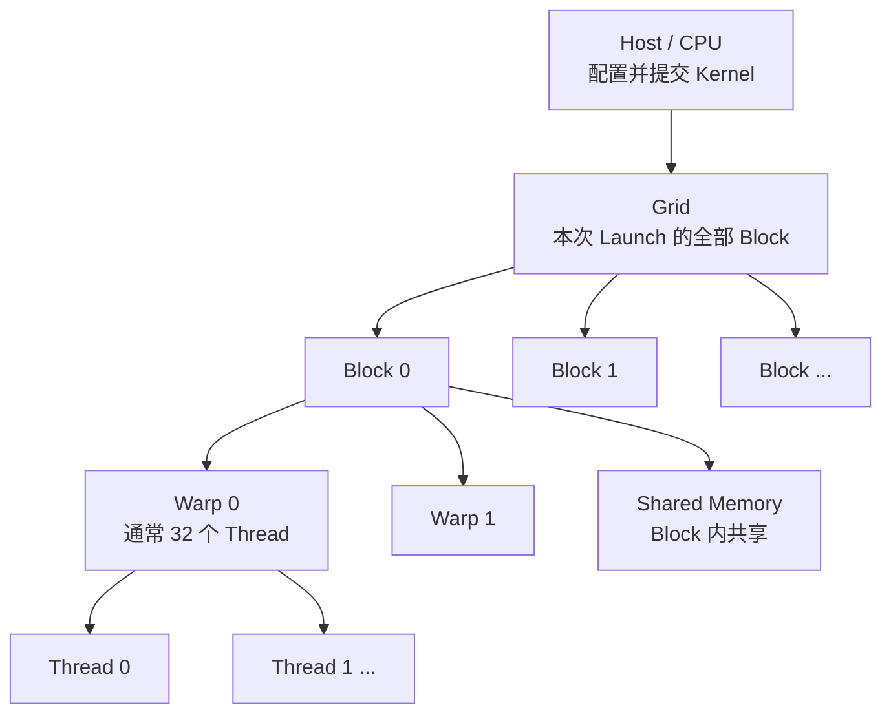
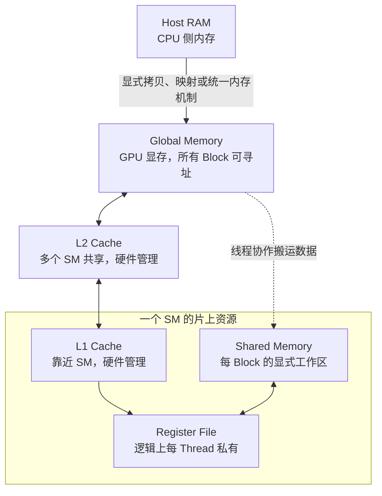
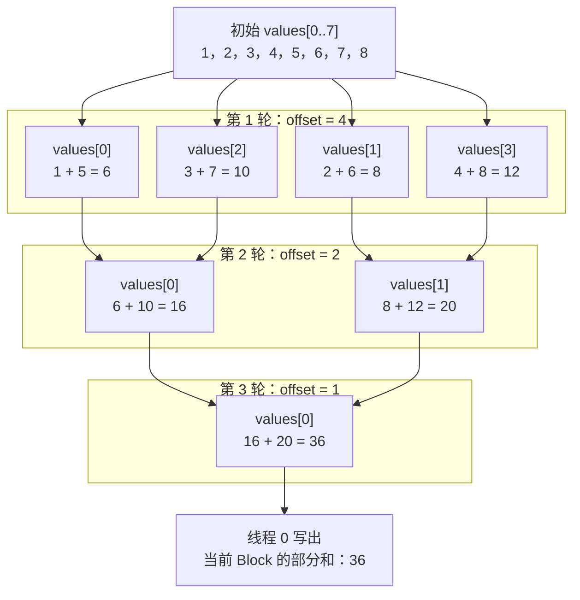
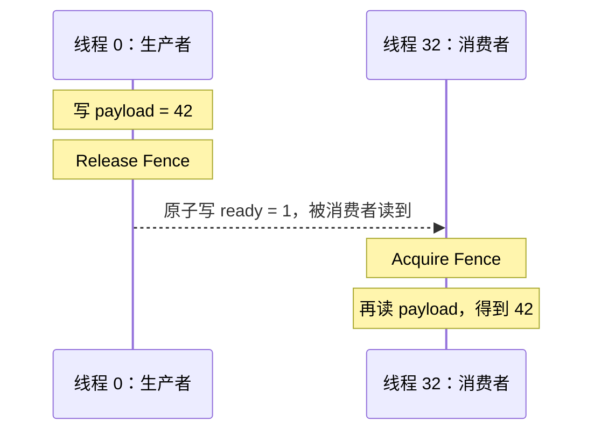
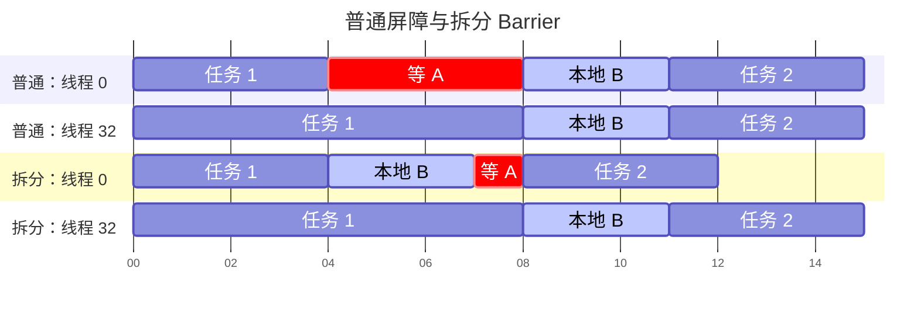
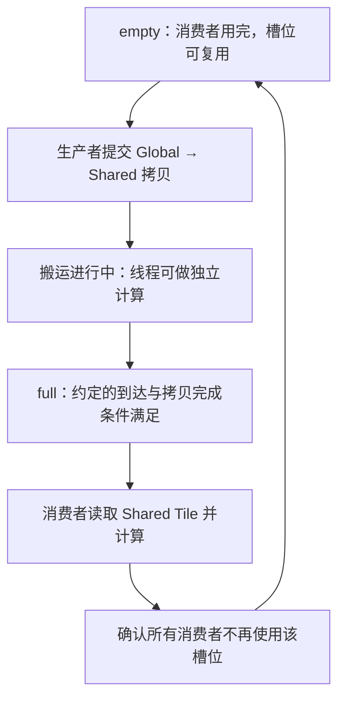
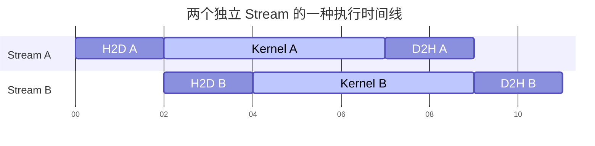
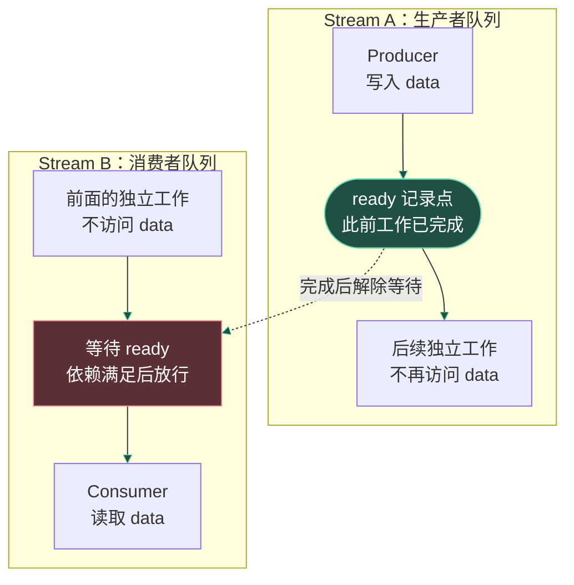
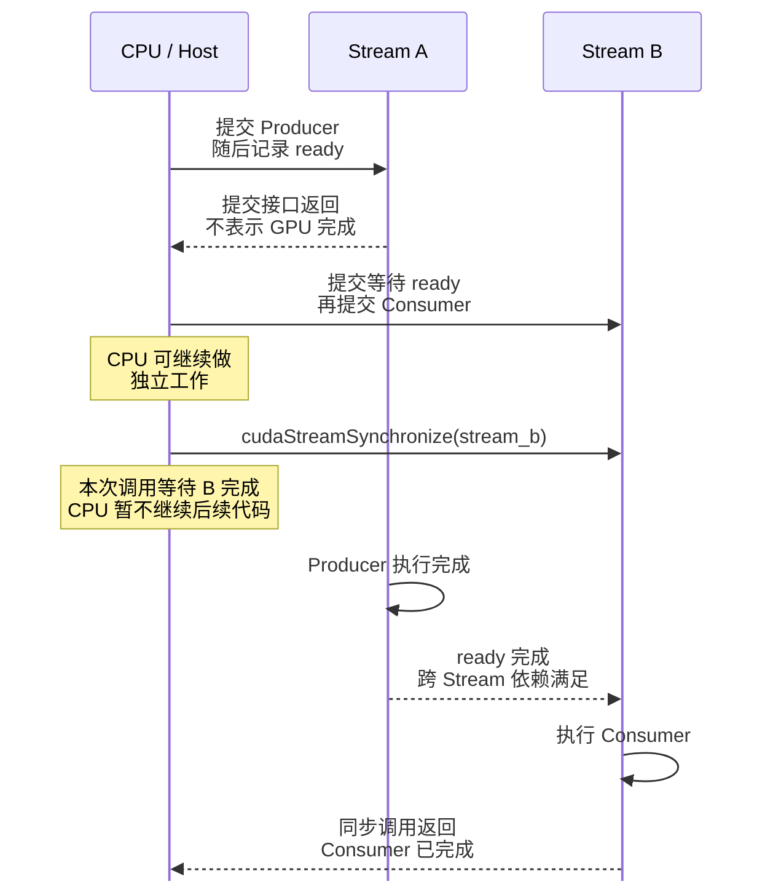

# CUDA 编程模型：从向量加法到线程、内存与并行协作

CUDA 让 CPU 程序把适合大规模并行的工作交给 NVIDIA GPU。先看一个问题：给定两个长度为 `N` 的数组，计算 `c[i] = a[i] + b[i]`。CPU 可以用一个循环完成；CUDA 的基本做法是启动许多 GPU 线程，每个线程负责一个或多个元素。

本篇先让这段程序运行起来，再沿着它依次解释 Host/Device、Kernel、Grid/Block/Thread、Warp、内存、同步、Stream 和性能。读完可到[CUDA 执行与内存模型](post.html?slug=cuda_execution_model)深入理解硬件执行，再到[GPU Kernel 编译与 Lowering](post.html?slug=gpu_kernel_lowering)了解编译器如何生成 Kernel。

---

# 1. 第一个完整程序：向量加法

把下列代码保存为 `vector_add.cu`：

```cpp
#include <cuda_runtime.h>

#include <cstddef>
#include <cstdio>
#include <cstdlib>

#define CUDA_CHECK(call)                                                     \
    do {                                                                     \
        const cudaError_t error = (call);                                    \
        if (error != cudaSuccess) {                                          \
            std::fprintf(stderr, "%s:%d: %s\n", __FILE__, __LINE__,        \
                         cudaGetErrorString(error));                         \
            std::exit(EXIT_FAILURE);                                        \
        }                                                                    \
    } while (false)

__global__ void vector_add(const float* a, const float* b, float* c, int n) {
    const int i = blockIdx.x * blockDim.x + threadIdx.x;
    if (i < n) {
        c[i] = a[i] + b[i];
    }
}

int main() {
    constexpr int n = 1000;
    constexpr int threads_per_block = 256;
    constexpr std::size_t bytes = static_cast<std::size_t>(n) * sizeof(float);

    float *a = nullptr, *b = nullptr, *c = nullptr;
    CUDA_CHECK(cudaMallocManaged(&a, bytes));
    CUDA_CHECK(cudaMallocManaged(&b, bytes));
    CUDA_CHECK(cudaMallocManaged(&c, bytes));

    for (int i = 0; i < n; ++i) {
        a[i] = static_cast<float>(i);
        b[i] = static_cast<float>(2 * i);
    }

    const int blocks = (n + threads_per_block - 1) / threads_per_block;
    vector_add<<<blocks, threads_per_block>>>(a, b, c, n);
    CUDA_CHECK(cudaGetLastError());
    CUDA_CHECK(cudaDeviceSynchronize());

    for (int i = 0; i < n; ++i) {
        if (c[i] != static_cast<float>(3 * i)) {
            std::fprintf(stderr, "wrong result at %d\n", i);
            return EXIT_FAILURE;
        }
    }

    CUDA_CHECK(cudaFree(a));
    CUDA_CHECK(cudaFree(b));
    CUDA_CHECK(cudaFree(c));
    std::puts("vector addition passed");
    return EXIT_SUCCESS;
}
```

有 CUDA Toolkit 和受支持的 NVIDIA GPU 时，可以运行：

```bash
nvcc -std=c++17 -O2 vector_add.cu -o vector_add
./vector_add
```

程序用 `cudaMallocManaged` 分配 CPU 和 GPU 都能访问的 Managed Memory，省去了第一步就介绍显式拷贝。**统一地址不代表访问没有迁移成本**：在不同硬件和系统上，页面可能迁移或远程访问。第 5 章再换成 `cudaMalloc` 和 `cudaMemcpy`，明确看清数据流。

## 1.1 先看执行顺序

```text
CPU：分配和填充 a、b
  ↓
CPU：提交 vector_add Kernel
  ↓
GPU：许多线程并行计算 c[i]
  ↓
CPU：等待 GPU 完成
  ↓
CPU：读取 c 并检查结果
```

`__global__` 声明 GPU Kernel：函数入口由 Host（CPU 侧）发起，函数体由 Device（GPU 侧）的许多线程执行。`<<<blocks, threads_per_block>>>` 是 Kernel Launch 配置，前者指定 Grid 中有多少个 Block，后者指定每个 Block 有多少个 Thread。

`cudaGetLastError()` 检查 Launch 的即时错误，例如配置无效；Kernel 在设备上执行时出现的错误通常要在随后的同步或 CUDA API 调用处观察。只检查 Launch 而不等待执行，不能证明结果已经计算完成。

## 1.2 为什么最后一个 Block 需要边界检查

本例 `n=1000`，每个 Block 有 `256` 个线程，因此需要向上取整得到 `4` 个 Block，共启动 `1024` 个逻辑线程。最后 `24` 个线程没有对应的数组元素，必须被 `if (i < n)` 排除，否则会越界读写。

```text
Block 0：i =   0 ... 255
Block 1：i = 256 ... 511
Block 2：i = 512 ... 767
Block 3：i = 768 ... 1023，其中 1000 ... 1023 不访问数组
```

这也是多数一维 Kernel 的起点：先求全局索引，再做边界检查。

---

# 2. 线程层级：Grid、Block、Warp、Thread

一次 Kernel Launch 创建一个 Grid；Grid 包含多个 Block；Block 包含多个 Thread。GPU 又把 Block 内线程按 Warp 组织执行。



| 层级 | 程序中怎样看到它 | 主要作用 |
|---|---|---|
| Grid | `gridDim`、`blockIdx` | 表示本次 Launch 的整个逻辑工作范围 |
| Block / CTA | `blockDim`、`threadIdx` | 线程协作和 `__syncthreads()` 的基本边界 |
| Warp | 通常 32 个相邻线程 | GPU 发射指令的重要执行粒度 |
| Thread | 每份 Kernel 实例 | 拥有自己的局部变量和逻辑索引 |

CTA 是 Cooperative Thread Array，通常就是 Thread Block 的另一个名称。SM（Streaming Multiprocessor）是实际执行 Block 的硬件单元；一个 SM 可能同时驻留多个 Block，但并发数量受到线程、寄存器、Shared Memory 等资源限制。

**Grid 是逻辑工作清单，不是同时运行的 Block 数量。** Block 可以按任意顺序被安排到 SM，普通 Kernel 不能依赖 Block 0 一定先于 Block 1 执行，也不能用普通 `__syncthreads()` 同步不同 Block。

## 2.1 一维全局索引

```cpp
const int i = blockIdx.x * blockDim.x + threadIdx.x;
```

`blockIdx.x` 是当前 Block 在 Grid 中的编号；`blockDim.x` 是每个 Block 的线程数；`threadIdx.x` 是当前 Thread 在 Block 中的编号。例如 Block 2 的 Thread 7、每 Block 256 线程时，`i = 2 * 256 + 7 = 519`。

## 2.2 Grid-Stride Loop

一个线程不一定只能处理一个元素。数据量较大、想复用固定数量的 Block 时，可以让线程跨越整个 Grid 反复处理：

```cpp
__global__ void vector_add_stride(const float* a, const float* b,
                                  float* c, std::size_t n) {
    const std::size_t start =
        static_cast<std::size_t>(blockIdx.x) * blockDim.x + threadIdx.x;
    const std::size_t stride =
        static_cast<std::size_t>(gridDim.x) * blockDim.x;

    for (std::size_t i = start; i < n; i += stride) {
        c[i] = a[i] + b[i];
    }
}
```

不同线程仍处理不同索引；`stride` 是整个 Grid 的线程数。它便于对任意大的 `n` 使用有限 Grid，但每个线程处理多次循环可能增加寄存器需求和工作不均，不能仅因为“循环次数更多”就断言它更快。

## 2.3 二维数据映射

图像或矩阵有行和列，使用二维 Grid/Block 更直观：

```cpp
__global__ void add_image(const float* a, const float* b,
                          float* out, int width, int height) {
    const int x = blockIdx.x * blockDim.x + threadIdx.x;
    const int y = blockIdx.y * blockDim.y + threadIdx.y;
    if (x < width && y < height) {
        const std::size_t index =
            static_cast<std::size_t>(y) * width + x;
        out[index] = a[index] + b[index];
    }
}

void launch_add_image(const float* a, const float* b, float* out,
                      int width, int height) {
    dim3 block(16, 16);
    dim3 grid((width + block.x - 1) / block.x,
              (height + block.y - 1) / block.y);
    add_image<<<grid, block>>>(a, b, out, width, height);
    CUDA_CHECK(cudaGetLastError());
}
```

这里连续的 `x` 对应连续地址，通常有利于访存合并。二维维度只是索引表达方式；GPU 不会因为用了 `dim3` 就自动理解图像的语义。还要确认 `block.x * block.y` 不超过目标设备允许的每 Block 线程数。

---

# 3. Warp 与 SIMT：线程如何真正执行

CUDA 使用 SIMT（Single Instruction, Multiple Threads）模型：程序员写每个 Thread 的代码，硬件将 Warp 内当前活跃线程的指令一起执行。NVIDIA GPU 的 Warp 通常由 32 个 Thread 构成。

它与普通 SIMD 向量指令相似，但不是“一个线程持有 32 个数字”：CUDA Thread 有自己的索引、寄存器和控制流状态。理解性能时要同时看“每个线程做什么”和“同一个 Warp 的线程是否做相似的事”。

寄存器是 GPU 执行指令时使用的片上高速存储，编译器通常把线程的索引、临时标量和累加结果放在其中；不同线程的同名局部变量仍是各自的一份。Warp 内线程的位置叫 Lane，编号为 `0..31`。对于一维 Block，Lane 编号是 `threadIdx.x % 32`，不一定等于整个 Block 内的线程编号。

## 3.1 分支发散

```cpp
if (threadIdx.x % 2 == 0) {
    do_a();
} else {
    do_b();
}
```

同一个 Warp 的一半线程走 A，一半走 B。硬件会用活跃掩码（Active Mask）分别执行需要的路径，再在合适位置归并；不在当前路径上的线程暂时不参与。这叫 Divergence（分支发散）。活跃掩码可以理解为 32 个开关：第 `k` 位为 `1`，表示 Lane `k` 当前参与这条指令；为 `0` 则表示它暂不参与，并不是这个线程已经被删除。

发散的代价取决于两条路径做了多少事。`if (i < n)` 只让最后一个 Warp 的少数线程不活跃，通常是必要且可接受的边界检查；为了消除这个 `if` 而越界访问绝对不行。

不同 Warp 走不同分支并不构成同一个 Warp 内的发散。现代 NVIDIA GPU 还有 Independent Thread Scheduling，不能把“同一 Warp 通常共同发射指令”误读成“线程之间可依赖隐式锁步同步”。共享数据时仍需合适的同步原语。

## 3.2 同一个 Warp，不等于共享局部变量

假设每个线程执行 `float value = threadIdx.x + 1.0f;`。第一个 Warp 的前四个线程分别持有 `1、2、3、4`，而不是共同持有一个 `value`：

| Lane | 自己的 `value` | 若要取得下一个 Lane 的值 |
|---|---|---|
| 0 | 1 | 需要读取 Lane 1 提供的 2 |
| 1 | 2 | 需要读取 Lane 2 提供的 3 |
| 2 | 3 | 需要读取 Lane 3 提供的 4 |

仅写 `value + 1` 是对自己的数字加一，并没有读取别人的变量。线程之间交换数据需要明确的通信机制：可以先把值写到 Block 共享的工作区，再同步后读取；也可以使用 Warp 内的专用指令直接传递局部值。第 6 章先展示前一种方式，再用具体代码解释后一种方式。

---

# 4. Host、Device 与 CUDA 函数限定符

普通 C++ 代码从 CPU 开始执行。Host 负责分配内存、准备输入、Launch Kernel、等待结果；Kernel 在 Device 上执行。

| 写法 | 通常从哪里调用 | 在哪里执行 |
|---|---|---|
| 普通 C++ 函数 / `__host__` | Host | Host |
| `__global__` | Host，或特定设备端动态并行场景 | Device，作为 Kernel 入口 |
| `__device__` | Device 代码 | Device，作为普通设备函数 |
| `__host__ __device__` | 依赖编译出的两个版本 | Host 或 Device |

例如：

```cpp
__device__ float square(float x) {
    return x * x;
}

__global__ void square_all(const float* input, float* output, int n) {
    const int i = blockIdx.x * blockDim.x + threadIdx.x;
    if (i < n) output[i] = square(input[i]);
}
```

`__device__` 不是“自动在 GPU 上启动一个任务”，它只是供设备代码调用的函数。`__global__` Kernel Launch 通常相对于 Host 异步：CPU 提交后继续往下走，不能立即读取尚未完成的 GPU 结果。具体同步点由后续 CUDA API 决定。

## 4.1 `nvcc` 编译了什么

`.cu` 文件同时包含 Host 和 Device 代码。`nvcc` 协调 Host 编译器与 CUDA 设备编译流程；设备代码可能以面向特定架构的二进制形式，或以供驱动 JIT 的 PTX 形式进入最终程序。

PTX 是 NVIDIA 定义的虚拟指令表示，不等于 GPU 最终执行的机器指令。`nvcc -arch=sm_XX` 中的 `XX` 必须换成目标 GPU 支持的 Compute Capability；不能把某个设备的架构编号当成通用常量。实际编译/部署还要关注 Toolkit、驱动和目标架构的兼容性。

---

# 5. 数据在哪里：显式拷贝与内存层级

第 1 章用 Managed Memory 简化了程序。要理解性能，仍需区分 Host RAM 与 GPU 可以直接用于 Kernel 的设备内存。一个典型显式数据流是：

```text
Host 数组 a、b
  ↓ cudaMemcpy HostToDevice
Device 数组 d_a、d_b
  ↓ Kernel
Device 数组 d_c
  ↓ cudaMemcpy DeviceToHost
Host 数组 c
```

对应的 Host 代码片段：

```cpp
float *d_a = nullptr, *d_b = nullptr, *d_c = nullptr;
CUDA_CHECK(cudaMalloc(&d_a, bytes));
CUDA_CHECK(cudaMalloc(&d_b, bytes));
CUDA_CHECK(cudaMalloc(&d_c, bytes));

CUDA_CHECK(cudaMemcpy(d_a, h_a, bytes, cudaMemcpyHostToDevice));
CUDA_CHECK(cudaMemcpy(d_b, h_b, bytes, cudaMemcpyHostToDevice));

vector_add<<<blocks, threads_per_block>>>(d_a, d_b, d_c, n);
CUDA_CHECK(cudaGetLastError());

CUDA_CHECK(cudaMemcpy(h_c, d_c, bytes, cudaMemcpyDeviceToHost));
// 这次阻塞式拷贝完成后，h_c 才能作为本次结果被 CPU 读取。

CUDA_CHECK(cudaFree(d_a));
CUDA_CHECK(cudaFree(d_b));
CUDA_CHECK(cudaFree(d_c));
```

这段是假设 `h_a/h_b/h_c`、`bytes`、`blocks` 已准备好的片段；三个设备指针不能传给普通 CPU 循环直接解引用。`cudaMemcpy` 是阻塞式拷贝；在默认 Stream 上按顺序提交时，上面的 Device-to-Host 拷贝会等待此前同一 Stream 的 Kernel 完成。若改用其他 Stream、异步拷贝或更复杂的依赖，必须显式检查顺序关系。

## 5.1 GPU 内存层级



图是理解用的逻辑结构，不代表每代 GPU 都使用相同的物理 Cache/L1/Shared 组织。

| 名称 | 谁能访问 | 谁负责管理 | 常见用途 |
|---|---|---|---|
| Register | 单 Thread | 编译器分配 | 累加器、索引、局部标量 |
| Shared Memory | 单 Block 的线程 | 程序显式读写 | 多线程复用同一数据 Tile |
| Global Memory | 设备上的线程 | 程序分配，Cache 由硬件管理 | 输入、输出、大型中间数组 |
| Local Memory | 语义上单 Thread 私有 | 编译器/设备内存系统 | 放不进寄存器的局部数据或 Spill |
| Constant Memory | Device 侧只读 | Host 准备，硬件缓存 | 多线程读取相同常量 |

“Local”表示访问范围私有，**不表示一定存放在片上**；它常由设备内存后备。Shared Memory 虽然同样靠近 SM，却不是自动 Cache：程序用 `__shared__` 定义工作区，自己决定何时写入、读取和同步；L1/L2 根据地址访问由硬件填充与替换。

## 5.2 Managed Memory 是什么，不是什么

`cudaMallocManaged` 返回 Host 和 Device 可访问的 Managed Memory。它可以让第一段程序不用显式写拷贝，但不承诺数据始终同时在 CPU 和 GPU 的高速位置；页迁移、远程访问和同步成本取决于设备与系统能力。

```text
同一个可用的指针值
≠ CPU 与 GPU 访问成本相同
≠ 不需要等待 GPU 写入完成
```

想研究数据传输开销时，先用 `cudaMalloc`/`cudaMemcpy` 把方向和次数写清楚；想减少代码复杂度或利用迁移机制时，再根据实际硬件考虑 Managed Memory 和 Prefetch。

## 5.3 Global Memory Coalescing

Coalescing（访存合并）发生在同一 Warp 执行同一条全局内存加载/存储指令时。每个活跃线程提供自己的地址，硬件根据这些地址覆盖的内存段组织请求，而不是为每个线程都单独搬运一次数据。它观察的是这一条指令中各线程的访问，不是把某个线程前后多次读取自动合成一次。

内存事务可以理解为内存系统服务请求的一次数据传送；传送有固定粒度，不会只为一个 `float` 搬运恰好 4 字节。以 Compute Capability 6.0 及以上设备的普通标量访问为例，可以按 32 字节对齐的内存段分析请求数量：一个段容纳 8 个 `float`。这里“32 字节对齐”表示段起始地址是 32 的整数倍。[NVIDIA 的访存合并说明](https://docs.nvidia.com/cuda/cuda-c-best-practices-guide/index.html#coalesced-access-to-global-memory)

假设一个完整 Warp 的 32 个线程各读一个 `float`，起始地址恰好位于段边界：

| 参与线程 | 访问元素 | 相对起点的字节范围 | 覆盖的内存段 |
|---|---|---|---|
| Lane 0..7 | `input[0..7]` | 0..31 | 第 0 段 |
| Lane 8..15 | `input[8..15]` | 32..63 | 第 1 段 |
| Lane 16..23 | `input[16..23]` | 64..95 | 第 2 段 |
| Lane 24..31 | `input[24..31]` | 96..127 | 第 3 段 |

32 次线程级读取因此覆盖 4 个段，所需的 128 字节都被利用了。合并不是“一个 Warp 一定只有一个事务”，而是尽量让少量内存段服务更多线程。第 1 章的向量加法就采用这种映射：

```cpp
const int i = blockIdx.x * blockDim.x + threadIdx.x;
float value = input[i];
```

对比几种访问方式。下表中 `lane` 为 `0..31`，`base` 是元素下标，`input + base` 按 32 字节对齐，所有下标都在数组范围内：

| 每个线程读取 | 覆盖段数 | 段总字节数 | 本次实际使用比例 |
|---|---|---|---|
| `input[base + lane]` | 4 | 128 | 100% |
| `input[base + 2 * lane]` | 8 | 256 | 50% |
| `input[base + 1024 * lane]` | 32 | 1024 | 12.5% |
| `input[base + lane + 1]` | 5 | 160 | 80% |
| `input[base + 31 - lane]` | 4 | 128 | 100% |

跨步为 2 时，每个段中的 8 个位置只读了 4 个；跨步为 1024 时，相邻线程的地址相差 4096 字节，每个线程分别落在不同段中。虽然线程实际仍只需要 128 字节，覆盖的段却增加了。

整体偏移一个元素时，访问字节范围从 `0..127` 变成 `4..131`，末尾多碰到一个段，所以需要 5 个段。`cudaMalloc` 返回的起始地址有足够的对齐保证，但对子数组加偏移后不能直接沿用这个结论。逆序读取则只是交换了“哪个线程读取哪个元素”，地址集合没有变化，仍覆盖同样的 4 个段；因此不要求 Lane 必须严格按地址递增顺序读取。

这些数字描述的是本次请求的段覆盖情况，不等于实际显存流量或运行时间比例。L1/L2 Cache 命中、相邻 Warp 重用已取回的数据、只有部分线程活跃等情况都会影响最终开销；32 字节请求段也不等于整条 Cache Line 的大小。

改善访问模式时，先让相邻 Lane 尽量处理内存中相邻的元素。行优先矩阵的元素地址是 `row * width + col`，让 Lane 改变 `col` 通常比改变 `row` 更容易合并；如果算法必须按列处理，可以先协作搬运一个小块，再在 Shared Memory 中改变访问方向。仅让每个线程在循环里连续读取自己的数据，并不保证同一时刻整个 Warp 的地址相邻。

大数组向量加法每个元素通常需要读取两个 `float`、写回一个 `float`，而只做一次加法，因而常受全局内存带宽限制。小数组还可能主要受 Kernel 提交等固定开销影响，合并良好不意味着所有规模都已达到带宽上限。

## 5.4 Shared Memory Bank Conflict

Bank 是 Shared Memory 内可并行服务访问的存储分区。以常见的 NVIDIA GPU 32 个 Bank、连续 32 位字交错映射的组织为例，连续的 `float` 分别落在 Bank 0、1、2、…、31，随后又从 Bank 0 开始；并不是把数组的前一大段全部放在 Bank 0、后一大段放在 Bank 1。[NVIDIA 的 Shared Memory 访问说明](https://docs.nvidia.com/cuda/cuda-programming-guide/02-basics/writing-cuda-kernels.html#shared-memory-access-patterns)

假设数组首元素映射到 Bank 0，对 `float` 数组可以这样计算：

`Bank 编号 = 元素下标 % 32`，也就是 `(字节偏移 / 4) % 32`。

| Bank | 存放的 `float` 元素下标 |
|---|---|
| 0 | 0、32、64、96、… |
| 1 | 1、33、65、97、… |
| 2 | 2、34、66、98、… |
| … | … |
| 31 | 31、63、95、127、… |

同一 Warp 的一条 Shared Memory 指令若访问不同 Bank，各 Bank 可以并行服务。若多个线程请求同一 Bank 中的不同 32 位字，硬件就要把请求拆成多轮无冲突访问，这叫 Bank Conflict（Bank 冲突）。它通常不会改变计算结果，但会降低这一轮访问的有效吞吐；冲突属于这次 Warp 访问，不是说两个 Warp 使用同一个 Bank 就自动构成这里的冲突。

看一个 `32 × 32` 的二维小块。Tile 就是程序一次协作处理的小块数据；C/C++ 二维数组按行连续存放，所以 `tile[row][col]` 的线性下标是 `row * 32 + col`：

```cpp
__shared__ float tile[32][32];
// 假设 tile 已写好，相关线程已完成必要同步。
// 对同一 Warp 的 lane = 0..31，分别分析以下读取：
// tile[0][lane]：读取一行，线性下标为 lane。
// tile[lane][0]：读取一列，线性下标为 lane * 32。
```

读一行时，Lane 0..31 分别访问 Bank 0..31，没有冲突。读一列时，下标为 `0、32、64、…、992`，对 32 取模全是 0：32 个线程都请求 Bank 0，却请求不同元素，形成 32 路冲突，需要分多轮服务，而不是一次并行完成。Bank 冲突的倍数不是整个 Kernel 必然变慢的倍数，其他指令和延迟隐藏仍会影响总时间。

Padding（填充）是在每行末尾增加不用来存放逻辑数据的位置，让下一行的起点错开一个 Bank：

```cpp
__shared__ float tile[32][33];
// 逻辑数据仍是 32 × 32，tile[row][32] 是填充列。
// tile[row][col] 的线性下标现在是 row * 33 + col。
```

此时同样读取 `tile[lane][0]`，Bank 编号变为 `(lane * 33) % 32 = lane`：

| Lane | 无填充：元素下标 → Bank | 加填充：元素下标 → Bank |
|---|---|---|
| 0 | 0 → 0 | 0 → 0 |
| 1 | 32 → 0 | 33 → 1 |
| 2 | 64 → 0 | 66 → 2 |
| … | … | … |
| 31 | 992 → 0 | 1023 → 31 |

数据没有变，但物理行间距从 32 个 `float` 变成 33 个，原先挤在一个 Bank 的列访问被分散到了 32 个 Bank。读取任意固定列 `c` 时，编号是 `(lane + c) % 32`，同样互不相同。

如果所有线程读取 `tile[0][0]`，虽然都访问 Bank 0，却是在读同一个值，可以通过广播把一次读取的结果送给多个线程，不是上述 32 路冲突。多个线程无同步地写同一位置则是另一回事：没有原子操作等正确性保证时会产生数据竞争，不能把“读取可广播”套用到写入。

实际优化还要留意这些边界：

- `[32][33]` 解决的是上述 `float` Tile 的行/列访问映射，不是所有访问模式的通用最优尺寸。`double`、向量化读写或专用矩阵指令可能跨多个 Bank，必须结合实际指令和硬件拆分方式分析，不能直接套用单个 `float` 的公式。
- 填充使这个 Tile 多占 32 个 `float`，即 128 字节。多个 Tile 累加后，更多 Shared Memory 可能减少同时驻留的 Block 数；避免冲突的收益要与资源成本一起看。
- 使用 `tile[row][col]` 时，编译器会采用新的行间距；若手写线性地址 `row * 32 + col`，也要同步改成正确间距，否则读写的就不是预期位置。
- 也可以重新安排线程访问方向，或用 Swizzle（按确定规则重排元素到物理地址的映射）分散 Bank 请求；写入和读取必须采用一致映射，不能只改一侧。

矩阵转置常同时遇到两类问题：按行读取 Global Memory 容易合并，交换行列后又需要按列读取 Shared Memory。填充让后一阶段也能高效访问，但数据在两个阶段之间仍需正确同步，第 6 章解释这个等待点。最后用 Nsight Compute 的 Shared Memory 冲突指标和 Kernel 耗时核实收益，不要仅凭数组尺寸判断优化完成。

---

# 6. 线程如何协作：Shared Memory 与同步

向量加法中每个输出元素独立，不需要线程之间通信。Reduction（归约）则是把多个输入合成少量结果，例如把 `1、2、3、4` 相加得到 `10`，或从一组数中取最大值。并行求和时，每个线程先持有一个数，再分轮合并部分和。

以下 Kernel 让**每个 Block 输出一个部分和**，假定 `blockDim.x == 256`：

```cpp
__global__ void partial_sum(const float* input, float* block_sums, int n) {
    __shared__ float values[256];

    const int tid = threadIdx.x;
    const int i = blockIdx.x * blockDim.x + tid;
    values[tid] = (i < n) ? input[i] : 0.0f;
    __syncthreads();

    for (int offset = 128; offset > 0; offset /= 2) {
        if (tid < offset) {
            values[tid] += values[tid + offset];
        }
        __syncthreads();
    }

    if (tid == 0) block_sums[blockIdx.x] = values[0];
}
```

`tid` 是 Block 内的线程编号 `0..255`，不是 Warp 内的 Lane。设这个 Block 的起点为 `b = blockIdx.x * 256`，初始化后，`values[t]` 保存 `input[b + t]`；尾部越界的位置保存 `0`。Shared Memory 中的这些槽位是所有线程共同使用的工作区，不是各线程私有的局部变量。

为了看清每一次加的是什么，先把同一个算法缩小到 8 个线程，输入取 `1..8`，步长相应改为 `4 → 2 → 1`。每轮都把后半部分加到前半部分；箭头表示上一轮的哪个部分和被用来计算下一轮：



例如 `offset = 2` 时，线程 0 执行的是 `values[0] += values[2]`，也就是 `(1 + 5) + (3 + 7)`；线程 1 同时计算 `(2 + 6) + (4 + 8)`。最终结果中每个输入恰好计入一次，后半部分旧槽位不会再作为下一轮独立的结果使用。

回到上面的 256 线程版本，配对方式完全相同，只是轮数更多：

| `offset` | 执行加法的 `tid` | 这一轮的配对 | 每个新部分和包含的初始槽位数 |
|---|---|---|---|
| 128 | 0..127 | `values[t] + values[t + 128]` | 2 |
| 64 | 0..63 | `values[t] + values[t + 64]` | 4 |
| 32 | 0..31 | `values[t] + values[t + 32]` | 8 |
| 16 | 0..15 | `values[t] + values[t + 16]` | 16 |
| 8 | 0..7 | `values[t] + values[t + 8]` | 32 |
| 4 | 0..3 | `values[t] + values[t + 4]` | 64 |
| 2 | 0..1 | `values[t] + values[t + 2]` | 128 |
| 1 | 0 | `values[0] + values[1]` | 256 |

第一轮后，`values[0]` 是 `input[b] + input[b + 128]`；第二轮再加上 `values[64]`，就包含下标 `b、b + 64、b + 128、b + 192` 的四个输入。最后 `values[0]` 包含这个 Block 对应的全部有效输入，其他 Block 各自完成同样的计算。

`__syncthreads()` 是 Block 级 Barrier（屏障）：参与线程在这里会合，且屏障前的 Shared Memory 写入对屏障后的读取可见。第一个 Barrier 保证所有线程写完 `values` 再开始读别人写的值；每轮后的 Barrier 保证下一轮读到完整的上一轮部分和。虽然每轮只有前半部分线程执行加法，所有线程仍执行循环末尾的屏障，不能把它移进 `if (tid < offset)`。

若在初始化前写 `if (i >= n) return;`，尾部线程对应的 `values` 就没有被赋值，后续配对仍可能读取这些槽位，得到错误结果；这里用 `0` 补齐，并保持统一的同步结构。这个固定写法只适用于一维、256 线程的 Block，不能直接把 Launch 改成任意线程数。浮点加法的合并顺序也与 CPU 顺序累加不同，结果可能有舍入差异。

`block_sums` 中还有多个部分和。若要得到整个数组的和，需再启动一次 Reduction Kernel，或把这些少量部分和拷回 CPU 求和。普通 Kernel 内的 Block 不能假定彼此按顺序完成。

## 6.1 Barrier：把并行工作分成有依赖的阶段

Barrier（屏障）是线程组的汇合点。一个阶段中，各线程可以先独立工作；到屏障处，先到的线程不能直接进入依赖其他线程结果的下一阶段。对 `__syncthreads()` 这样的 Block 屏障，参与线程到达同一屏障后才能继续，屏障前的相关内存操作也会对屏障后的访问建立顺序关系。

`__syncthreads()` 是 Barrier 的一种具体接口，而不是另一个与 Barrier 并列的概念。前面的归约每轮都需要它，是因为下一轮会读取其他线程在上一轮写出的部分和。

换一个更简单的例子：用一个 64 线程的 Block，反向输出 64 个整数。`input` 和 `output` 是两个不重叠、各有 64 个元素的设备数组，启动方式为 `reverse_block64<<<1, 64>>>(input, output)`：

```cpp
__global__ void reverse_block64(const int* input, int* output) {
    __shared__ int tile[64];
    const int tid = threadIdx.x;

    tile[tid] = input[tid];       // 阶段一：每个线程写自己的槽位
    __syncthreads();             // 等所有槽位准备好
    output[tid] = tile[63 - tid]; // 阶段二：读取另一个线程写的槽位
}
```

| 线程 | 屏障前写入 | 屏障后读取 |
|---|---|---|
| 0 | `tile[0] = input[0]` | `tile[63]`，由线程 63 写入 |
| 31 | `tile[31] = input[31]` | `tile[32]`，由线程 32 写入 |
| 32 | `tile[32] = input[32]` | `tile[31]`，由线程 31 写入 |
| 63 | `tile[63] = input[63]` | `tile[0]`，由线程 0 写入 |

线程 0 和线程 63 属于不同 Warp，没有屏障时，线程 0 可能在线程 63 还没写好时就读取 `tile[63]`。加上屏障后，“全部写入完成”在逻辑上先于“开始读取对方的槽位”。各线程写不同位置，不需要 Atomic；问题在于阶段依赖，而不是多人争抢同一个输出位置。

屏障不保证线程按 `0、1、2…` 的顺序执行，也不保证通过屏障后的线程严格同时发射指令；它保证的是不能跨过这个依赖边界。它更不是锁：通过后，线程仍可以并行运行。

同步范围必须覆盖通信双方：

| 接口或方式 | 参与者 | 适用场景 |
|---|---|---|
| `__syncwarp(mask)` | 同一 Warp 中掩码指定的线程 | Warp 内通过 Shared Memory 等交换数据 |
| `__syncthreads()` | 同一 Block 的线程 | 不同 Warp 共享 Block 工作区 |
| Cooperative Groups 的 `group.sync()` | 对应线程组的成员 | 用显式组表达协作范围 |
| 同一 Stream 上前后两个 Kernel | 前一个阶段完成后再执行后一个阶段 | 普通 Grid 的跨 Block 阶段依赖 |

例如一个完整的 32 线程 Block 内，可以先各自写 `tile[lane]`，调用 `__syncwarp(0xffffffffu)`，再读其他 Lane 写的槽位。它会为这些参与线程建立内存顺序，但不能保护上面 64 线程例子中的跨 Warp 读取。掩码中的未退出线程必须执行相应调用并使用一致掩码。

对 `__syncthreads()`，不要让仍在执行的部分线程走过屏障、另一部分线程跳过对应调用；放在条件中时，条件应对整个 Block 一致。循环中的参与线程也要到达对应轮次的屏障。提前退出还可能留下别人要读取的未初始化槽位，前面的归约因此用 `0` 补齐尾部。

普通 Block 屏障不能等待另一个 Block。若所有已驻留 Block 都自旋等待尚未调度的 Block，后者可能没有资源开始执行，最终死锁。跨 Block 首先考虑分成多个 Kernel；确实需要 Grid 内屏障时，再使用满足设备能力、Cooperative Launch 和驻留限制的 `grid.sync()`，不能把普通 Launch 下的 `this_grid()` 当成可直接同步整个 Grid 的保证。[Cooperative Groups 的同步与参与规则](https://docs.nvidia.com/cuda/cuda-programming-guide/04-special-topics/cooperative-groups.html#synchronization)

## 6.2 Atomic：多个线程安全更新同一个值

Atomic（原子操作）处理的是对同一个位置的并发访问。例如统计数组中正数的数量，每个命中的线程都想执行 `*count += 1`。这个表达式通常包含“读旧值、计算新值、写回”三个动作，不是天然不可分割的一次更新。

把普通更新拆开，可以看到一种丢失更新的交错：

| 顺序 | 线程 A | 线程 B | 内存中的 `count` |
|---|---|---|---|
| 1 | 读取 0 | | 0 |
| 2 | | 也读取 0 | 0 |
| 3 | 写回 `0 + 1` | | 1 |
| 4 | | 也写回 `0 + 1` | 1 |

两个线程都加过一，结果却只增加一次。这张表只用于解释风险：实际 CUDA 程序若存在未同步的普通读写竞争，就构成 Data Race（数据竞争），行为未定义，并不保证只出现表中的错误。

`atomicAdd(count, 1u)` 把读旧值、加一、写回作为一次原子读-改-写处理。在覆盖参与线程的作用域内，对同一计数器的原子更新不会彼此覆盖：某个线程把 `0` 改为 `1`，另一个线程再把 `1` 改为 `2`。哪一个线程先获得旧值不固定，但每次加一都保留。

```cpp
#include <cstddef>

__global__ void count_positive(const float* input, int n,
                               unsigned* count) {
    const std::size_t i =
        static_cast<std::size_t>(blockIdx.x) * blockDim.x + threadIdx.x;
    if (i < static_cast<std::size_t>(n) && input[i] > 0.0f) {
        atomicAdd(count, 1u);
    }
}
```

Host 侧先初始化计数器，再启动 Kernel，最后等待结果。下面假定 `d_input` 已保存 `n > 0` 个输入，使用默认 Stream，并沿用第 1 章的 `CUDA_CHECK`：

```cpp
unsigned* d_count = nullptr;
CUDA_CHECK(cudaMalloc(&d_count, sizeof(unsigned)));
CUDA_CHECK(cudaMemset(d_count, 0, sizeof(unsigned)));

const int blocks = (n - 1) / 256 + 1;
count_positive<<<blocks, 256>>>(d_input, n, d_count);
CUDA_CHECK(cudaGetLastError());

unsigned count = 0;
CUDA_CHECK(cudaMemcpy(&count, d_count, sizeof(count),
                      cudaMemcpyDeviceToHost));
CUDA_CHECK(cudaFree(d_count));
```

输入为 `[-2, 3, 0, 5, -1, 7, 4, -3]` 时，四个命中线程各加一次，最后得到 `4`。即使命中的线程分布在多个 Block，设备作用域的原子加也能保护这个 Global Memory 计数器。这里的阻塞式回传等待同一默认 Stream 中的 Kernel 完成，CPU 才能把结果当成最终计数。

不能在这个 Kernel 中让“全局线程 0”先写 `*count = 0`，再假定其他 Block 会晚些开始更新；没有 Grid 屏障，清零可能覆盖已发生的加一。初始化必须在并发更新开始前完成。

常见原子接口解决不同的单值更新问题：

| 接口 | 原子完成的动作 | 常见用途 |
|---|---|---|
| `atomicAdd(p, v)` | 把 `*p` 增加 `v`，返回更新前的旧值 | 计数、累加、预留输出下标 |
| `atomicExch(p, v)` | 替换 `*p`，返回旧值 | 更新一个状态值 |
| `atomicMin` / `atomicMax` | 与给定值比较并保留较小/较大值 | 合并极值 |
| `atomicCAS(p, expected, desired)` | 旧值等于 `expected` 时写入 `desired`；无论成功与否都返回旧值 | 条件更新、实现其他原子操作 |

例如 `atomicAdd(next_slot, 1u)` 返回的旧值可以作为输出槽位：计数器从 0 开始时，三个线程会得到互不相同的 `0、1、2`，但对应哪个线程不确定。计数增加并不代表这些槽位的数据也已经写完，不能仅凭这个计数器就让并发消费者读取未发布的数据。

传统原子函数的后缀还表达作用域：

| 写法 | 原子性需要覆盖的线程 |
|---|---|
| `atomicAdd_block` | 同一 Block |
| `atomicAdd` | 同一 Device |
| `atomicAdd_system` | 系统范围，可能包括 CPU 或其他 GPU；需要相应硬件和内存支持 |

作用域和存储位置是两回事：Global Memory 中的变量也可能只被某个 Block 使用，但若多个 Block 并发更新，就不能只给 Block 作用域。GPU/CPU 同时访问也不能只靠默认的 Device 作用域保证安全。

Atomic 的保证是具体原子操作的不可分割性，不是锁住整个函数，也不是多变量事务。两个 `atomicAdd` 之间仍可插入其他线程的操作；并发期间也不能随意混入对同一位置的普通读写。传统 `atomicAdd` 等接口采用 Relaxed 内存序，只保证原子更新，不自动发布旁边的其他数据。[传统原子接口的语义与作用域](https://docs.nvidia.com/cuda/cuda-programming-guide/05-appendices/cpp-language-extensions.html#legacy-atomic-functions)

大量线程竞争同一地址仍会限制吞吐。可以像前面的归约一样先在 Warp/Block 内合并，让少量线程更新全局结果。原子指令支持的类型、宽度和对齐依赖接口及目标架构；浮点累加即使用了 Atomic，也可能因加法顺序不同产生舍入差异。

## 6.3 Fence：让数据发布遵守先后关系

Memory Fence（内存栅栏）约束调用线程的内存操作如何在指定作用域内建立顺序。它不要求一组线程在同一个位置会合，也不等待某个生产者完成工作。

考虑一个生产者写 `payload = 42`，然后把 `ready` 设为 `1`；消费者看到 `ready == 1` 才读取 `payload`。目标不只是让 `ready` 的更新不可分割，还要让“数据已准备好”这个通知确实发布了此前的数据。CUDA 使用弱内存序，单凭源代码里的先后顺序，或者仅给 `ready` 使用 Relaxed 原子读写，都不能建立这条跨线程依赖；普通 `payload` 的并发读写仍可能发生数据竞争。

可以用 Release / Acquire 配对表达这个依赖：Release（发布）一侧把之前的数据写入放在发布动作之前；Acquire（获取）一侧在观察到对应发布后，再读取这些数据。只有接收方真正观察到这次发布，配对才成立；不是双方各自调用一次 Fence 就自动同步。

下面用一个 64 线程 Block，线程 0 发布数据，线程 32 尝试接收一次。启动 `fence_publish<<<1, 64>>>(d_result)`，`d_result` 指向一个有效的设备端 `int`，Host 在 Kernel 完成后读取它。示例使用 CUDA Toolkit 11.6+ 的 `<cuda/atomic>`，还需目标 GPU 受该 Toolkit 和 `cuda::atomic_ref` 支持：

```cpp
#include <cuda/atomic>

__global__ void fence_publish(int* result) {
    __shared__ int payload;
    __shared__ int ready;
    const int tid = threadIdx.x;

    if (tid == 0) {
        payload = 0;
        ready = 0;
    }
    __syncthreads(); // 先让所有线程看到完成初始化的工作区

    cuda::atomic_ref<int, cuda::thread_scope_block> flag(ready);

    if (tid == 0) {
        payload = 42;
        cuda::atomic_thread_fence(cuda::memory_order_release,
                                  cuda::thread_scope_block);
        flag.store(1, cuda::memory_order_relaxed);
    } else if (tid == 32) {
        const int observed = flag.load(cuda::memory_order_relaxed);
        if (observed == 1) {
            cuda::atomic_thread_fence(cuda::memory_order_acquire,
                                      cuda::thread_scope_block);
            *result = payload;
        } else {
            *result = -1; // 这次尚未观察到通知，不读取 payload
        }
    }
}
```

`cuda::atomic_ref<int, cuda::thread_scope_block>` 给已有的 `ready` 整数提供 Block 作用域的原子访问接口，并不另外创建一个独立标志。`store` 写入它，`load` 读取它；这里的 Relaxed 表示这些访问本身只保证标志的原子性，数据的发布顺序由两侧 Fence 建立。初始化在所有 `atomic_ref` 创建前完成，并发阶段对标志的访问都走同一作用域的原子接口。

当接收方读到了生产者写入的 `1`，依赖链如下：



生产者的 Release Fence 在标志写入之前，消费者的 Acquire Fence 在观察到标志之后。原子标志把两侧连接起来，使此前的 `payload` 写入先于之后的读取；这个模式不是“所有 Cache 都强制刷新一次”。如果消费者没读到 `1`，就没有建立此次发布对应的依赖，因此它不去读取 `payload`。[Fence 配对与消息发布的内存模型](https://docs.nvidia.com/cuda/cuda-programming-guide/05-appendices/cuda-cpp-memory-model.html#data-races)

这个 Kernel 的结果允许为 `42` 或 `-1`：消费者可能先运行，Fence 不会替它等待生产者。这里刻意只尝试一次，没有让线程自旋；若改成等待循环，还必须额外考虑调度能否保证生产者取得执行机会。多 Block 间仅把作用域改大，并不能解决驻留资源导致的死锁。

同一个发布模式也可以把顺序直接写在原子标志上，而不显式调用 Fence。保留上面 Kernel 的初始化和线程分工，把发布与接收两段改为：

```cpp
// 生产者：先写数据，再进行 Release 原子发布
payload = 42;
flag.store(1, cuda::memory_order_release);

// 消费者：用 Acquire 读取通知，再访问已发布的数据
if (flag.load(cuda::memory_order_acquire) == 1) {
    *result = payload;
} else {
    *result = -1;
}
```

这两段属于两个线程的分支，不是让一个线程依次执行全部代码。简单生产者/消费者通信通常用这种写法更容易检查；Fence 则可以把多个前后内存访问的顺序要求与原子通知分开表达。Release / Acquire 不是“让整个程序完全串行”，而是建立这个数据发布关系。

传统 Fence 接口与显式作用域的写法对应如下：

| 传统接口 | `cuda::atomic_thread_fence` 的对应参数 | 顺序约束覆盖的范围 |
|---|---|---|
| `__threadfence_block()` | `memory_order_seq_cst, thread_scope_block` | 同一 Block |
| `__threadfence()` | `memory_order_seq_cst, thread_scope_device` | 同一 Device |
| `__threadfence_system()` | `memory_order_seq_cst, thread_scope_system` | 系统范围 |

表中的 `seq_cst` 是 Sequentially Consistent（顺序一致性）内存序，提供比单独 Release 或 Acquire 更强的顺序约束；它仍不是 Barrier，也不能让原本的数据竞争自动变成合法访问。上述 Fence 作用域不等于内存区域：`__threadfence_block()` 也能约束同一 Block 对 Global Memory 的相关访问，不是只约束 Shared Memory。

用 Fence 时，要让原子通知和 Fence 的作用域都覆盖通信双方，并保证数据与标志的存储可被双方合法访问。系统作用域不会把一个普通 Device 指针自动变成 CPU 可解引用的指针；Host 读取已完成的 Kernel 结果时，仍使用合适的 CUDA 同步与拷贝接口。

Fence 不能防止两个线程同时执行普通 `count += 1` 时丢失更新，也不会等齐一个 Tile 的全部生产者。`volatile` 同样不提供原子性或完整的线程间同步关系，不能用普通 `volatile ready` 替代示例里的原子标志。[显式 Fence 接口](https://nvidia.github.io/cccl/unstable/libcudacxx/extended_api/synchronization_primitives/atomic/atomic_thread_fence.html)

## 6.4 拆分 Barrier 的到达与等待

`__syncthreads()` 把“我已完成当前阶段”和“等待其他线程”写在同一个调用中。如果线程宣布已完成之后，还有不依赖其他线程结果的工作，可以用 `cuda::barrier` 把这两个动作拆开。

Barrier 对象维护当前阶段的预计到达次数。`arrive()` 表示完成自己这一份工作，并返回对应阶段的 Token（到达凭据）；`wait(token)` 等待该阶段完成。Token 不是数据结果，只用于标识正在等待哪一轮屏障。

把屏障记作 A，两种写法都完成同样的三项工作：任务 1 写入共享数据，独立的本地工作 B 不读取其他线程的数据，任务 2 才消费大家写好的结果。普通屏障把 B 放在等待之后；拆分屏障则允许先做 B，真正需要共享结果时再等待。

下面只画线程 0 和线程 32，分别代表两个不同 Warp 的参与者；实际仍需要全部参与线程到达。假设其他线程最晚也在刻度 8 到达 A，横轴只是示意时间，不是实测耗时。



普通方式中，线程 0 在刻度 4 完成任务 1，进入 A 后必须等到刻度 8，才能开始 B。拆分方式中，它在刻度 4 调用 `arrive(A)` 并保存 Token，随后用刻度 4..7 做 B，再调用 `wait(token)`；这里只剩刻度 7..8 需要等待，刻度 8 就能进入任务 2。

线程 32 在刻度 8 才完成任务 1 并到达 A，使该阶段完成；拆分方式下它仍要做自己的 B，但刻度 11 调用 `wait(token)` 时，阶段已经完成，可以直接继续。**阶段完成不要求大家都已调用 `wait`，也不要求大家都已做完 B**。若某个线程做完 B 后 A 还没完成，`wait` 仍会阻塞；B 也不能提前读取其他线程的结果，或覆盖它们仍在使用的共享数据。

图里的等待表示该参与者暂时不能继续后续任务，不等于整个 GPU 的算力都被浪费：调度器仍可能执行其他就绪 Warp。这里特意选不同 Warp 的代表，不能把同一 Warp 的 Lane 当成能够任意独立调度的 CPU 线程。[Warp 调度与硬件多线程](https://docs.nvidia.com/cuda/cuda-programming-guide/03-advanced/advanced-kernel-programming.html#hardware-multithreading)

拆分的收益是让独立工作与其他参与者的任务 1 重叠，减少先到者的等待；图中最慢参与者的结束时刻并没有提前，因此整个 Kernel 是否更快仍需测量。

下面仍用一个 64 线程 Block，输入为整数 `0..63`，两个设备数组不重叠，调用 `split_barrier64<<<1, 64>>>(input, output)`。该例需要支持 `<cuda/barrier>` 的 Toolkit 和 Compute Capability 7.0+ 设备；Ampere 等较新架构可对 Block 级 Shared Memory Barrier 提供硬件加速。

```cpp
#include <cuda/barrier>
#include <cuda/std/utility>

__global__ void split_barrier64(const int* input, int* output) {
    __shared__ int tile[64];
    __shared__ cuda::barrier<cuda::thread_scope_block> phase;
    const int tid = threadIdx.x;

    if (tid == 0) {
        init(&phase, 64); // 当前阶段预计有 64 次 arrive
    }
    __syncthreads();      // 先完成 Barrier 对象本身的初始化

    tile[tid] = input[tid];
    auto token = phase.arrive();

    const int local_work = tid * tid; // 不依赖别人写入的 tile

    phase.wait(cuda::std::move(token));
    output[tid] = tile[63 - tid] + local_work;
}
```

线程先写自己的槽位，再调用 `arrive()`。先到的线程可以计算自己的 `tid * tid`，但要读取 `tile[63 - tid]`，就必须等待全部 64 次到达使阶段完成。`wait` 返回后，本轮到达之前的相关写入对随后的读取可见；不要求所有线程已经调用了 `wait`，要求的是对应阶段已经完成。

`init(&phase, 64)` 的 `64` 是到达次数，不是 Block 数量。不能少一个线程到达、让某个线程多到达一次，也不能把 Token 拿去等待任意另一轮；`cuda::std::move` 把到达凭据交给 `wait`，它不应重复使用。这里的首次 `__syncthreads()` 保护 Barrier 的初始化，不能因后面已经有 `phase.wait()` 就删掉。

Barrier 可以跨多个 Phase（阶段）重复使用，到达计数在阶段完成后重置，但 Tile 的数据不会自动重置。若下一轮要覆盖同一个 Tile，还必须确保上一轮所有消费者已读完，例如增加消费完成阶段；“写完后有一个 Barrier”不能单独保护循环中下一次覆盖的时机。独立工作与等待的拆分也不保证这个小例子必然更快，要结合实际计算量与编译器调度测量。[异步 Barrier 的初始化、阶段与等待规则](https://docs.nvidia.com/cuda/cuda-programming-guide/04-special-topics/async-barriers.html)

三个概念分别回答不同问题：

| 机制 | 解决的核心问题 | 不单独保证什么 |
|---|---|---|
| Atomic | 同一值的指定操作不被并发更新拆开 | 别的数据已发布、其他线程已完成 |
| Fence | 配合正确通知协议，建立数据访问的先后关系 | 线程全部到齐、普通更新互斥 |
| Barrier | 一个协作阶段完成后再消费其结果 | 屏障后所有共享变量可任意并发修改 |

### 6.4.1 异步拷贝：让数据搬运也参加这个阶段

前面的例子由线程执行 `tile[tid] = input[tid]`，写完之后才到达 Barrier。另一种方式是把 Global Memory 到 Shared Memory 的拷贝交给异步搬运机制：线程提交请求后先做独立工作，等真正需要 Tile 时再等待。

普通拷贝通常先把 Global Memory 中的值加载到线程寄存器，再写入 Shared Memory；硬件异步拷贝可以省去这份数据经过通用寄存器中转的过程，减轻搬运指令和寄存器压力。地址、计数以及计算结果仍可能占用寄存器，不能理解成“整个 Kernel 不用寄存器”。API 名字里的 `async` 也不保证所有设备和参数组合都走硬件路径。

| 能力 | 适用架构与条件 | 与 Barrier 的关系 |
|---|---|---|
| `cuda::barrier` 的拆分到达与等待 | API 支持 Compute Capability 7.0+；Block 作用域、放在 Shared Memory 的 Barrier 从 Ampere（8.0）起可获硬件加速 | 普通阶段等待约定的到达次数 |
| Ampere `cp.async` | `sm_80` 起，适合 Global → Shared 的小块拷贝；基本搬运粒度为 4、8 或 16 字节 | 可通过拷贝组或关联 Barrier 等待完成 |
| Hopper TMA 与事务计数 | `sm_90` 起引入批量及多维搬运；具体指令还需满足地址、对齐和目标架构约束 | Global → Shared 的 TMA 可在完成时更新 Shared Memory Barrier 的字节计数 |

`cuda::barrier` 是带线程作用域的 C++ 屏障抽象，沿用 `std::barrier` 的分阶段思想，不是所有作用域都对应同一种硬件屏障。把作用域改成 Device 或 System，也不会自动获得安全的跨 Block 全局同步；仍需正确的参与协议和调度保证。[Barrier 的作用域与架构限制](https://nvidia.github.io/cccl/unstable/libcudacxx/extended_api/synchronization_primitives/barrier.html)

### 6.4.2 使用 `cuda::memcpy_async` 搬运一个 Tile

下面保留前例的计算，只把 Tile 填充改为异步拷贝。输入、输出各有 64 个整数，输入为 `0..63`，通过 `cudaMalloc` 分配且互不重叠，启动方式为 `async_tile64<<<1, 64>>>(input, output)`。为了使用 Ampere 硬件路径，可将这段 Kernel 保存为 `async_tile.cu`，用 `nvcc -std=c++17 -arch=sm_80 -c async_tile.cu` 编译为目标文件；它不包含 Host 分配和 Launch 程序。

```cpp
#include <cooperative_groups.h>
#include <cuda/barrier>
#include <cuda/std/utility>

__global__ void async_tile64(const int* input, int* output) {
    __shared__ __align__(16) int tile[64];
    __shared__ cuda::barrier<cuda::thread_scope_block> phase;
    auto block = cooperative_groups::this_thread_block();
    const int tid = threadIdx.x;

    if (tid == 0) {
        init(&phase, 64);
    }
    block.sync(); // 所有线程开始使用前，先完成 Barrier 初始化

    // 全 Block 协作提交同一次拷贝，不是每个线程各拷贝整个数组。
    cuda::memcpy_async(block, tile, input,
                       cuda::aligned_size_t<16>(sizeof(tile)), phase);
    auto token = phase.arrive();

    const int local_work = tid * tid; // 不能在这里读取尚未就绪的 tile

    phase.wait(cuda::std::move(token));
    output[tid] = tile[63 - tid] + local_work;
}
```

这里把拷贝完成绑定到了 `phase`：即使 64 个线程都已 `arrive()`，只要关联拷贝还没完成，等待仍不能结束。`wait` 返回后才能读取 Tile；输出仍为 `63 - tid + tid * tid`，与上一例相同。高层 API 负责关联拷贝与屏障，不需要再手工增加事务计数。

`block` 参数表示集体操作，Block 内所有线程必须用相同参数执行这次调用，不能只让线程 0 调用这个带 Group 参数的版本。若改用不带 Group 的重载，每个调用线程会发起自己的拷贝，也不能让多个线程向同一 Tile 重复提交重叠写入。

`cuda::aligned_size_t<16>` 是对齐承诺，不会帮忙对齐地址或补齐长度：源、目的地址都必须满足 16 字节对齐，长度也须是 16 的倍数。本例输入使用原始 `cudaMalloc` 地址，Shared Tile 显式对齐，`64 * sizeof(int)` 满足长度要求；换成任意偏移或尾部 Tile 时必须重新检查。拷贝期间也不能修改源数据、提前读写目的数据，或让对象的生命周期先结束。[`cuda::memcpy_async` 的重载与约束](https://nvidia.github.io/cccl/unstable/libcudacxx/extended_api/asynchronous_operations/memcpy_async.html)

这里的 `cuda::memcpy_async` 在 Kernel 内执行，处理设备内的数据搬运；下一章的 `cudaMemcpyAsync` 则是 Host 提交到 Stream 的 Runtime API。两个名字相近，但不是同一个接口，也不能用 Host 拷贝的完成 Event 代替 Kernel 内 Tile 的同步。

### 6.4.3 TMA：同时等待线程到达与数据到达

TMA 全称 Tensor Memory Accelerator，是 Hopper 引入的数据搬运单元，不是执行矩阵乘法的 Tensor Core。一个线程就可以提交大块搬运，不必让全部线程各自计算并搬运一小段；多维 Tensor 搬运还可用 Tensor Map 描述符记录基址、维度、Stride 和 Tile 等信息，由硬件计算相应地址。简单连续的一维 Bulk Copy 不需要 Tensor Map。[Hopper 的 TMA 能力](https://docs.nvidia.com/cuda/hopper-tuning-guide/index.html#tensor-memory-accelerator)

TMA 的 Global → Shared 路径可关联硬件 `mbarrier`，即位于 Shared Memory、维护阶段与完成条件的屏障状态。该阶段既关心线程是否到达，也关心预计搬运的数据是否全部到达。Transaction Count（事务计数）在这类拷贝中按**字节**记账，不是线程数，也不是第 5 章 Coalescing 中的内存事务个数。

例如四个参与线程，本阶段提交两份互不重叠的拷贝，分别为 128 字节和 256 字节。先登记总计 384 字节的预期，再让参与线程到达；一种可能的完成顺序如下：

| 事件 | 剩余线程到达次数 | 待完成字节数 | 本阶段能否完成 |
|---|---|---|---|
| 初始化 Barrier | 4 | 0 | 否 |
| 登记两份拷贝的预期字节 | 4 | 384 | 否 |
| 四个线程都已到达 | 0 | 384 | 否，数据尚未全部到达 |
| 128 字节拷贝完成 | 0 | 256 | 否 |
| 256 字节拷贝完成 | 0 | 0 | 是，随后等待者可消费数据 |

数据也可能先到，线程后到；完成条件仍是两项都满足。只有把拷贝正确关联到这个 Barrier，它才会追踪搬运完成，不能仅提交普通异步请求再调用一个无关联的屏障。

Hopper 的底层 `cuda::device::memcpy_async_tx` 或相应 PTX 接口要求显式登记预期事务量，可用 `cuda::device::barrier_expect_tx`，或用 `cuda::device::barrier_arrive_tx(bar, 1, bytes)` 同时登记字节并完成一次线程到达。后者已经计入一次到达，该线程不能再额外 `bar.arrive()`。登记必须在本阶段完成之前进行，不能让最后一次到达先结束阶段；漏记、重复记或记错字节数都会破坏协议。前例的高层 `cuda::memcpy_async` 自动管理关联计数，不应再叠加手工登记。[事务到达接口](https://nvidia.github.io/cccl/unstable/libcudacxx/extended_api/synchronization_primitives/barrier/barrier_arrive_tx.html)、[低层事务拷贝接口](https://nvidia.github.io/cccl/unstable/libcudacxx/extended_api/asynchronous_operations/memcpy_async_tx.html)

把搬运和消费做成多阶段流水线，还需要两种通知：`full` 表示数据已到，可以读；`empty` 表示所有消费者用完，可以覆盖。它们是两类同步条件，不是说 Tile 内的数值必须全为零。



双缓冲时，可以读取槽位 0，同时向槽位 1 搬运下一 Tile；复用槽位 0 前仍必须确认消费完成。若消费者本身提交了异步矩阵计算，还要确认硬件已结束对该槽位的读取，不能只凭线程“已提交计算”就覆盖。CUTLASS 的流水线会管理这些槽位与阶段；FlashAttention-3 在 Hopper 上结合 TMA、Warp 专职分工与异步矩阵计算实现重叠，而不是完全取消同步。[CUTLASS 的生产者/消费者协议](https://docs.nvidia.com/cutlass/latest/media/docs/pythonDSL/cute_dsl_api/pipeline.html)、[FlashAttention-3 论文](https://arxiv.org/abs/2407.08608)

TMA 的反向 Shared → Global 搬运有不同的完成协议，不能照搬这个加载屏障。普通线程写入 Shared 数据后，还可能需要面向异步搬运路径的 Proxy Fence；具体的完成组和 Buffer 复用规则见[GPU Kernel 编译与 Lowering 的 Async Copy 与正确性章节](post.html?slug=gpu_kernel_lowering)。Blackwell 等后续设备应按实际 Compute Capability、指令和 Toolkit 支持选择实现；有 TMA 不代表支持所有相同的矩阵或 Cluster 指令。异步流水线也无法突破内存带宽上限；计算太少、数据太小或 Shared Memory 占用太高时，收益可能不足以抵消额外开销。

## 6.5 Warp 内的数据交换：Shuffle 与 Ballot

如果通信双方位于同一个 Warp，有时不必先把局部值写到 Shared Memory。Shuffle 指令可以直接取得另一个 Lane 提供的值，相当于复制对方的局部数值，而不是取得对方变量的地址，也不会修改对方的值。

下面的 Kernel 只启动一个完整 Warp，即 `warp_exchange<<<1, 32>>>(shifted, selected)`；`shifted` 是能容纳 32 个 `float` 的设备输出数组，`selected` 指向一个设备端 `unsigned`：

```cpp
__global__ void warp_exchange(float* shifted, unsigned* selected) {
    const unsigned lane = threadIdx.x;  // 本例 Block 恰好只有 32 个线程
    const unsigned participants = 0xffffffffu;
    const float value = static_cast<float>(lane + 1);

    const float next = __shfl_down_sync(participants, value, 1);
    shifted[lane] = next;

    const unsigned result = __ballot_sync(participants, lane < 4);
    if (lane == 0) *selected = result;
}
```

`__shfl_down_sync(participants, value, 1)` 中，`value` 是每个线程提供的数，`1` 表示从 Lane 编号比自己大 1 的线程取得数值。Lane 0 得到 2，Lane 1 得到 3，依此类推；Lane 31 的来源超出了默认 32 Lane 的范围，按该接口规则保留自己的 32，不会绕回 Lane 0。它能用于第 6 章的求和思路：先从其他 Lane 取得部分和，再加到自己的累加器；但 Shuffle 本身并不执行加法。

Ballot 则收集每个参与线程的判断结果。`__ballot_sync(participants, lane < 4)` 返回一个 32 位位掩码：Lane `k` 判断为真，对应第 `k` 位就是 `1`。本例只有 Lane 0..3 为真，所以每个参与线程都得到 `0x0000000f`，也就是最低四位为 `1111`。这种结果可用于记录哪些线程满足筛选条件。

两个掩码不要混淆：传入的 `participants = 0xffffffffu` 表示 32 个 Lane 都参加这次操作；Ballot 返回的 `0x0000000f` 表示其中只有四个 Lane 的条件成立。条件为假的线程也参加了 Ballot，不应先把它们排除出去。

正确使用这些接口还需要满足参与约定：每个调用线程自己的位必须在掩码中；掩码指定的所有未退出线程都必须执行对应调用，并使用相同掩码；Shuffle 读取的来源 Lane 也必须实际参与。本例没有提前退出，所有 32 个线程都执行两个调用，因此可以用全 1 掩码。部分 Warp 或分支中的调用不能不加分析地照抄它；`__activemask()` 只是当前活跃线程的快照，也不能自动证明逻辑上的协作组完整。[NVIDIA 的 Warp 指令与参与约束](https://docs.nvidia.com/cuda/cuda-programming-guide/05-appendices/cpp-language-extensions.html#warp-sync-intrinsic-constraints)

Shuffle 和 Ballot 中的 `_sync` 不意味着它们会为此前的 Shared/Global Memory 访问建立内存顺序。若同一 Warp 通过 Shared Memory 交换数据，需要合适的 `__syncwarp(mask)` 等同步；跨 Warp 的 Block 协作仍使用 `__syncthreads()` 等 Block 级机制。这些 Warp 指令也不能用于跨 Block 通信。

---

# 7. Stream、Event 与异步执行

## 7.1 Stream：同一队列有序，不同队列可能重叠

CUDA Stream 是向设备提交工作的有序队列，不是一条专属的 GPU 线程，也不对应一个固定的 SM。对这里使用的普通拷贝和 Kernel Launch，同一 Stream 中的操作按提交顺序执行；不同 Stream 的工作可能并发，但只有资源和依赖允许时才会真正重叠。

例如分别处理两份独立数据 A、B，每份都要经历“复制输入到 GPU → 计算 → 复制结果回 CPU”。H2D 是 Host-to-Device，D2H 是 Device-to-Host。下面展示资源允许时的一种执行时间线，横轴仅为示意刻度：



从左往右看每一行，Kernel 必须等本行输入拷贝完成，结果拷贝也必须等本行 Kernel 完成；因此这种简单流水线不需要在每一步之间调用 `cudaDeviceSynchronize()`。上下两行则可能重叠：刻度 2..4，A 在计算，B 在传输输入；刻度 4..7，两个 Kernel 可能同时执行。

“可能重叠”不等于“必须并行”。某个 Kernel 如果占满所需资源，另一个可能只能晚些执行；仅把有数据依赖的两个 Kernel 放进不同 Stream，也不会自动解决依赖。

`cudaMemcpyAsync` 可以把传输排入指定 Stream。Host Buffer 要真正实现异步 Host/Device 传输并与计算重叠，通常需使用 Page-Locked（Pinned，页锁定）内存，例如 `cudaMallocHost` 分配的内存：这些页面不能被操作系统随意换出，便于设备直接传输。输入拷贝完成前不能改写或释放 Host 输入，输出拷贝完成前不能读取 Host 输出；设备 Buffer 也要在全部使用者完成后才能回收。

Legacy Default Stream（传统默认 Stream）还可能与普通 Blocking Stream 隐式同步，使本可重叠的任务变成串行。Per-Thread Default Stream 是每个 Host 线程各自的默认队列，语义不同；`cudaStreamNonBlocking` 则用来避免与传统默认 Stream 的这类隐式同步，**不是“所有 API 都不阻塞 CPU”的承诺**。[Stream 顺序、拷贝与默认 Stream](https://docs.nvidia.com/cuda/cuda-programming-guide/02-basics/asynchronous-execution.html)

## 7.2 Event：给队列中的进度做标记

如果 Consumer 要读取 Producer 写入的 `data`，Host 先提交 Producer、再提交 Consumer，不足以保证两个不同 Stream 的执行先后。Event 可以在 Producer 后插入一个进度标记 `ready`，让 Consumer 所在队列等待这个标记完成。

`cudaEventRecord(ready, stream_a)` 捕获调用时 Stream A 已提交的工作。调用返回不表示这些工作已经完成；只有此前工作真正完成，`ready` 才算完成。后来追加到 A 的工作不在本次标记的等待范围内。



实线表示同一 Stream 的队列顺序，虚线表示跨 Stream 的依赖。B 在等待点之前的独立工作可以先执行；Consumer 则必须等 `ready` 完成。它不必等待 A 在标记之后的独立工作，但这些工作不能与 Consumer 无同步地读写同一份 `data`。

对应的最小依赖代码如下，假设两个 Kernel 已实现，`grid`、`block` 已选好，`data` 是在整个流程中保持有效的设备 Buffer：

```cpp
cudaStream_t stream_a, stream_b;
cudaEvent_t ready;
CUDA_CHECK(cudaStreamCreateWithFlags(&stream_a, cudaStreamNonBlocking));
CUDA_CHECK(cudaStreamCreateWithFlags(&stream_b, cudaStreamNonBlocking));
CUDA_CHECK(cudaEventCreateWithFlags(&ready, cudaEventDisableTiming));

producer<<<grid, block, 0, stream_a>>>(data);
CUDA_CHECK(cudaGetLastError());
CUDA_CHECK(cudaEventRecord(ready, stream_a));

CUDA_CHECK(cudaStreamWaitEvent(stream_b, ready, 0));
consumer<<<grid, block, 0, stream_b>>>(data);
CUDA_CHECK(cudaGetLastError());

// Host 可以先处理不依赖 Consumer 结果的工作。
CUDA_CHECK(cudaStreamSynchronize(stream_b)); // 最后再等 Consumer 完成
CUDA_CHECK(cudaEventDestroy(ready));
CUDA_CHECK(cudaStreamDestroy(stream_a));
CUDA_CHECK(cudaStreamDestroy(stream_b));
// 本例所有 data 使用者都已结束，现在才能回收或复用它。
```

`cudaStreamWaitEvent(stream_b, ready, 0)` 为此后提交到 B 的工作建立依赖，不会把此前已提交的 Consumer 补救性地挪到等待点后，也不是让 CPU 在这里等 Producer。Event 只建立完成顺序，不会复制 `data`，更不会替代 Kernel 内部的线程同步。[跨 Stream 等待的作用范围](https://docs.nvidia.com/cuda/cuda-runtime-api/cuda_runtime_api/group__CUDART__STREAM.html)

Host 应先调用 `cudaEventRecord`，再为消费者提交等待；从未记录过的 Event 对应空工作集合，不能当作“将来会自动触发的通知”。重复记录会更新 Event 的进度，已提交的 Stream 等待仍针对当时捕获的记录，不会自动改等未来那一轮。

本例的 `cudaEventDisableTiming` 关闭时间戳，仅用于同步。若要用两个 Event 计时，则应创建启用计时的 Event，并在读取时间差前确认它们已经完成。[Event 的记录、复用与计时规则](https://docs.nvidia.com/cuda/cuda-runtime-api/cuda_runtime_api/group__CUDART__EVENT.html)

## 7.3 Host 等待：提交不是完成

下面是前面代码的一种可能时序，时间从上往下走。Host 很快把工作和依赖提交出去，设备可以稍后执行，也可以在 Host 仍在提交时就开始执行；图中位置不代表固定延迟。



两个带 `Wait` / `Synchronize` 的名字容易混淆：`cudaStreamWaitEvent` 约束队列后续工作的执行；`cudaEventSynchronize`、`cudaStreamSynchronize` 则让调用它们的 Host 线程等待。需要结果时，选择能覆盖数据使用者的等待范围：

| API / 机制 | 做什么 | Host 是否在这里等待完成 |
|---|---|---|
| `cudaEventRecord(event, stream)` | 记录该 Stream 当前进度 | 不以等待完成为目的 |
| `cudaStreamWaitEvent(stream, event, 0)` | 约束该 Stream 后续工作等待 Event | 不以等待完成为目的 |
| `cudaEventSynchronize(event)` | 等待 Event 本次记录捕获的工作 | 是 |
| `cudaStreamSynchronize(stream)` | 等待指定 Stream 此前提交的工作 | 是 |
| `cudaDeviceSynchronize()` | 等待当前设备此前提交的工作 | 是，范围最广 |
| `cudaEventQuery(event)` | 查询标记是否完成 | 不等待；未完成返回 `cudaErrorNotReady` |

本例只等 `ready`，能确认 Producer 完成，不能确认 Consumer 完成；Host 若需要 Consumer 的最终结果，要等 Stream B 或 Consumer 后另一个 Event。即使 Kernel 已完成，普通 Device 指针仍不能直接在 CPU 上解引用；还要把结果复制回 Host，若用异步 D2H 拷贝，也要等这次拷贝结束后再读取。

---

# 8. 正确性与性能：先测什么

## 8.1 先确认结果正确

最小测试矩阵至少覆盖 `n=1`、`n=255`、`n=256`、`n=257`、较大且不是 Block 大小倍数的 `n`，以及输入包含负数和非整数的情况。`n=0` 需要在 Host 侧避免无效的零 Block Launch，或明确让 API 对空输入走特殊路径。

Kernel Launch 后检查 `cudaGetLastError()`，需要结果时等待并检查同步 API；再与 CPU Reference 比较。浮点 Reduction 的顺序变化通常不保证逐位相同，需按误差容忍度验证；向量加法的简单整数可精确比较。

Compute Sanitizer 的 `memcheck`、`racecheck`、`initcheck` 和 `synccheck` 分别有助于定位非法访存、共享内存竞态、未初始化读和错误同步。通过普通样本测试不等于没有并发错误。

## 8.2 再区分测量范围

```text
端到端时间 = Host 准备 + 分配 + 拷贝 + Launch + Kernel + 同步 + 结果处理
Kernel 时间 = 设备执行一个或多个 Kernel 的时间
```

要比较两段 Kernel 的设备执行时间，可以把 CUDA Event 记录在同一 Stream 的前后，并在读取结果前同步结束 Event。Host 侧 `std::chrono` 在没有等待 GPU 时通常只量到提交时间。小 Kernel 的 Launch 开销可能主导端到端表现，单 Kernel 的峰值带宽不能代表整个应用。

## 8.3 一个实用的性能检查顺序

1. **工作量是否足够大**：非常小的数组可能比 CPU 循环还慢，因为 Launch 与拷贝成本占比高。
2. **传输了多少字节**：向量加法每个元素至少读两个 `float`、写一个 `float`，在理想情况下计算很少、内存流量较大。
3. **访问是否合并**：观察同一 Warp 的地址是否集中，是否浪费内存事务。
4. **并行度是否足够**：Block 数量是否足以让设备忙起来；是否存在大量不均匀尾部工作。
5. **资源是否限制驻留**：寄存器、Shared Memory 和每 Block 线程数是否让每 SM 可驻留的 Block 太少。
6. **同步与 Host 空洞**：是否频繁 `cudaDeviceSynchronize()`、分配或在 CPU/GPU 之间反复搬运。
7. **最后再调 Tile/Block**：配置必须在真实目标设备和输入分布上比较，不能只看单个尺寸。

Occupancy 是每 SM 已驻留 Warp 相对于硬件上限的比例或相关驻留度指标，受寄存器、Shared Memory、线程数等限制。更高 Occupancy 可以帮助隐藏延迟，但**不是最终目标**；如果有效吞吐已经很好，继续提高 Occupancy 甚至可能损失每线程的数据复用。

Nsight Systems 适合看 Host、拷贝和 Kernel 的时间线；Nsight Compute 适合分析单个 Kernel 的访存、指令、资源占用和 Warp 停顿。先用时间线确定瓶颈在何处，再深入单 Kernel。

---

# 9. 从这里继续扩展

向量加法提供的是“一线程处理一个独立输出”的模型。掌握它之后，可以按以下顺序逐渐增加协作和硬件约束：

| 下一步 | 在已有例子上增加什么 | 需要回答的关键问题 |
|---|---|---|
| Reduction | 多线程合并结果 | 哪些线程共享数据，在哪里 Barrier，怎样跨 Block 合并？ |
| Transpose | 改变二维访问方向 | Global Coalescing 与 Shared Bank Conflict 怎样同时处理？ |
| Tiled MatMul | 重用 A/B 的小块 | Tile 如何映射到 Block/Warp，Shared Memory 能装下吗？ |
| Softmax | Reduction + 逐元素归一化 | 如何保证数值稳定，是否值得融合？ |
| 多 Stream Pipeline | 拷贝和计算交叠 | Buffer 何时可复用，Event 依赖是否正确？ |
| Tensor Core Kernel | 设备矩阵指令 | DType、Layout、对齐和尾部 Shape 是否满足指令要求？ |

接下来可在[CUDA 执行与内存模型](post.html?slug=cuda_execution_model)深入理解线程与内存层级，在[CUDA 并行原语与性能分析](post.html?slug=cuda_parallel_primitives)学习 Reduction、Scan、Softmax 等模式，在[GPU Kernel 编译与 Lowering](post.html?slug=gpu_kernel_lowering)和[GPU Compiler 工程实践](post.html?slug=gpu_compiler_engineering)了解编译器如何生成、选择和验证 Kernel。若关注 PyTorch、Triton 或 XLA 如何生成和调用 Kernel，再读[AI Compiler：从计算图到硬件执行](post.html?slug=ai_compiler)；若关注 GPU Driver 与设备提交路径，可读[Linux GPU 驱动](post.html?slug=linux_gpu_driver)。

CUDA 目前也提供 Thread Block Cluster、Cooperative Groups、异步拷贝、CUDA Graph 和更高层的 Tile 编程接口。它们解决更复杂的协作、数据搬运或提交开销问题；初学时先稳固经典的 SIMT Kernel、内存层级和同步边界，再按目标 GPU 的 Compute Capability 和 API 文档逐项学习。

---

# 10. 官方资料

- [CUDA Programming Guide：编程模型](https://docs.nvidia.com/cuda/cuda-programming-guide/01-introduction/programming-model.html)
- [CUDA Programming Guide：CUDA C++ 入门与内存管理](https://docs.nvidia.com/cuda/cuda-programming-guide/02-basics/intro-to-cuda-cpp.html)
- [CUDA Programming Guide：SIMT Kernel 与设备内存](https://docs.nvidia.com/cuda/cuda-programming-guide/02-basics/writing-cuda-kernels.html)
- [CUDA Programming Guide：异步执行、Stream 与 Event](https://docs.nvidia.com/cuda/cuda-programming-guide/02-basics/asynchronous-execution.html)
- [CUDA Programming Guide：Warp 与 Independent Thread Scheduling](https://docs.nvidia.com/cuda/cuda-programming-guide/03-advanced/advanced-kernel-programming.html)
- [CUDA Programming Guide：Warp Shuffle、Ballot 与参与约束](https://docs.nvidia.com/cuda/cuda-programming-guide/05-appendices/cpp-language-extensions.html)
- [CUDA C++ Best Practices Guide：访存合并与 Shared Memory Bank](https://docs.nvidia.com/cuda/cuda-c-best-practices-guide/index.html)
- [CUDA Programming Guide：Cooperative Groups](https://docs.nvidia.com/cuda/cuda-programming-guide/04-special-topics/cooperative-groups.html)
- [CUDA Programming Guide：异步 Barrier](https://docs.nvidia.com/cuda/cuda-programming-guide/04-special-topics/async-barriers.html)
- [CUDA Programming Guide：异步拷贝与 TMA](https://docs.nvidia.com/cuda/cuda-programming-guide/04-special-topics/async-copies.html)
- [libcu++：`cuda::memcpy_async`](https://nvidia.github.io/cccl/unstable/libcudacxx/extended_api/asynchronous_operations/memcpy_async.html)
- [libcu++：`cuda::atomic_ref`](https://nvidia.github.io/cccl/unstable/libcudacxx/extended_api/synchronization_primitives/atomic_ref.html)
- [CUDA C++ 内存模型与线程作用域](https://docs.nvidia.com/cuda/cuda-programming-guide/05-appendices/cuda-cpp-memory-model.html)
- [Compute Sanitizer 文档](https://docs.nvidia.com/compute-sanitizer/ComputeSanitizer/)
- [Nsight Systems 文档](https://docs.nvidia.com/nsight-systems/)
- [Nsight Compute 文档](https://docs.nvidia.com/nsight-compute/)
