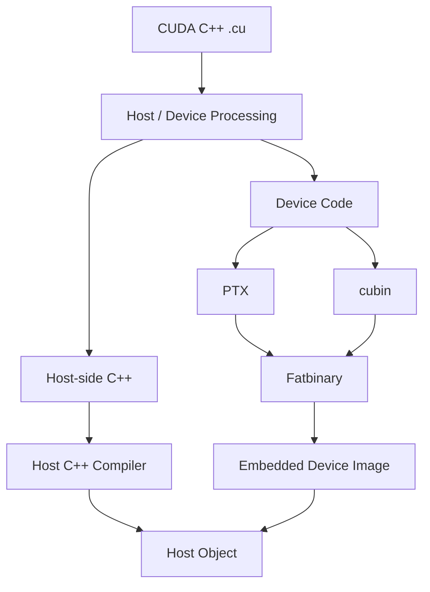
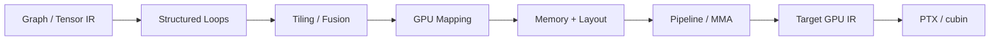
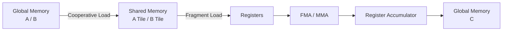

# GPU Kernel 编译与 Lowering


在[CUDA 编程模型](post.html?slug=cuda_programming)和[CUDA 执行与内存模型](post.html?slug=cuda_execution_model)中，已经回答了：

```text
GPU 怎样执行 CUDA Kernel？
```

本文换一个角度：

> Compiler 怎样从高层算法构造出一个高性能 CUDA Kernel？

先把本章会大量出现的缩写提前对齐：

- IR：Intermediate Representation，中间表示，用来承载优化/Lowering 的统一语义。
- IR Lowering：把高层语义逐步转换到更低层表示的过程（例如：高层循环 -> GPU 映射 IR -> 目标指令）。
- CUDA Compiler：把 CUDA C++ 编译到 PTX / cubin 这一类 GPU 目标。
- AI GPU Compiler：从计算图或算子图直接选择/生成 Kernel 的编译链，覆盖算子融合、调度、shape 约束等。
- nvcc：CUDA 官方编译器驱动，负责分离 host/device 代码并触发后续 PTX/NVPTX 处理。
- ptxas：负责 PTX 到 SASS 的设备端代码生成与优化器。
- LLVM NVPTX：LLVM 的 NVPTX 后端，常用于前端不完全走 nvcc 的场景。
- PTX：面向 NVIDIA GPU 的虚拟指令集（Virtual ISA），尚不是某个具体 SM 架构的最终机器指令。
- SASS：面向具体 GPU 架构的最终机器指令表示。
- cubin：已针对特定 GPU 架构生成的可执行设备二进制。
- Fatbinary：包含 PTX 和/或多个 cubin 的打包镜像，运行期按设备选择合适镜像。
- NVVM：NVIDIA 与 LLVM 生态交汇的编译中间层，靠近 GPU 后端语义。
- NVGPU：MLIR 生态中的 NVIDIA 特化 GPU 方言，表达 warp/group/mma 等硬件相关语义。
- Tensor IR / Linalg：用于表达张量与线性代数结构的中间表示层，便于后续 tiling、fusion、mapping。

GPU Compiler 的核心任务并不是简单地：

```text
CPU Instruction
      ↓
GPU Instruction
```

而是逐步回答：

1. 哪些迭代可以并行？
2. 输出空间怎样 Tiling？
3. Tile 怎样映射到 Block？
4. Block 内工作怎样映射到 Warp？
5. Warp 内工作怎样映射到 Thread / Lane？
6. 哪些数据应该放到 Shared Memory？
7. 哪些数据应该保存在 Register？
8. 哪里需要 Barrier？
9. 如何保证 Global Memory Coalescing？
10. 如何避免 Shared Memory Bank Conflict？
11. 是否能够使用 Tensor Core / MMA？
12. 是否值得做 Async Copy？
13. 软件流水应该有多少 Stage？
14. 动态 Shape 和 Tail Tile 怎么处理？
15. 当前方案会消耗多少 Register / Shared Memory？
16. Occupancy 是否足够？
17. Fusion 后收益是否大于额外资源开销？

这些问题并不是独立的。

例如：

```text
更大的 Tile
      ↓
更多数据复用
      ↓
更少 Global Memory Traffic
```

但同时：

```text
更大的 Tile
      ↓
更多 Shared Memory
更多 Registers
      ↓
更低 Resident Blocks
```

所以 GPU 编译本质上是：

```text
多个强耦合决策的联合优化问题
```

---

# 1. 先区分两条完全不同的“GPU 编译链”

讨论 GPU Compiler 时，很容易把两个概念混在一起。

---

## 1.1 CUDA C++ 源码编译

输入：

```cpp
__global__ void kernel(...) {
    ...
}
```

这是：

```text
CUDA C++ → GPU Code
```

主要由：

```text
nvcc
LLVM NVPTX
ptxas
CUDA Driver
```

这一类组件处理。

---

## 1.2 AI Compiler / Tensor Compiler

输入可能是：

```text
MatMul
Softmax
Attention
Conv
Tensor Expression
```

例如：

```text
PyTorch / JAX / Tensor IR
```

然后编译器自己决定：

```text
Tiling
Fusion
GPU Mapping
Memory Promotion
Tensor Core
Pipeline
```

最后才生成：

```text
CUDA / PTX / cubin
```

所以：

```text
CUDA Compiler
```

解决的是：

```text
已有 GPU Kernel
如何生成目标机器代码
```

而：

```text
AI GPU Compiler
```

更大的问题是：

```text
如何首先构造出一个好的 GPU Kernel
```

---

# 2. CUDA C++ 到 GPU Machine Code

一个 `.cu` 文件通常同时包含：

```text
Host Code
+
Device Code
```

例如：

```cpp
__global__ void kernel(...) {
    ...
}

int main() {

    ...

    kernel<<<grid, block>>>(...);

    ...
}
```

可以把 `nvcc` 的整体流程简化成：



核心关系可以压缩成：

```text
CUDA C++
   ↓
Device Compilation
   ↓
PTX and/or cubin
   ↓
Fatbinary
   ↓
Embedded into Host Program
```

---

# 3. PTX、SASS、cubin 和 Fatbinary

这几个名词非常容易混。

---

## 3.1 PTX

PTX 可以理解成：

```text
NVIDIA Virtual ISA
```

它不是某一代 GPU 最终直接执行的机器码。

例如抽象地：

```text
CUDA C++
   ↓
PTX
```

PTX 保留一定的虚拟 ISA 层语义，之后还能针对具体 GPU 架构进一步生成目标代码。

---

## 3.2 SASS

最终 NVIDIA GPU 实际执行的是：

```text
Target-specific Machine Instructions
```

通常称：

```text
SASS
```

概念上：

```text
PTX
 ↓
Target Code Generation
 ↓
SASS
```

---

## 3.3 cubin

`cubin` 是：

```text
CUDA Binary
```

其中保存针对具体 GPU Architecture 生成的 Device Binary。

因此：

```text
PTX
```

更像：

```text
Virtual ISA
```

而：

```text
cubin
```

是：

```text
target-specific device binary
```

---

## 3.4 Fatbinary

为了让同一个程序支持多个 GPU Target，可以把：

```text
PTX
+
一个或多个 cubin
```

放进：

```text
Fatbinary
```

运行时根据设备选择合适的 code image。

如果只有兼容 PTX：

```text
PTX
   ↓
CUDA Driver JIT
   ↓
Target Machine Code
```

也可以在运行时生成对应设备代码。

所以不要把：

```text
PTX
```

误认为：

```text
最终 GPU Machine Code
```

---

# 4. 从高层算子到 CUDA Kernel

AI Compiler 输入通常不是：

```cpp
__global__ void ...
```

而是：

```text
matmul(A, B)

softmax(X)

attention(Q, K, V)
```

它必须逐渐降低抽象层次。

典型过程：



不同编译器的 Pass 名字和 IR 不完全相同。

但抽象层次基本都在发生：

```text
What to compute

        ↓

How to partition work

        ↓

Where data lives

        ↓

Which threads cooperate

        ↓

Which hardware instructions execute it
```

---

# 5. MLIR 中的一条 NVIDIA GPU Lowering 路径

如果使用 MLIR，一种典型 NVIDIA GPU 路径可以抽象成：

```text
Tensor / Linalg / Structured IR
             ↓
       Loop / Vector IR
             ↓
        GPU Mapping
             ↓
        GPU Dialect
             ↓
      GPU / Vector / NVGPU
             ↓
          NVVM
             ↓
        LLVM NVPTX
             ↓
           PTX
             ↓
          cubin
```

这里每层职责不同。

---

## 5.1 GPU Dialect

GPU Dialect 可以表达类似：

```text
Kernel
Grid
Block
Thread ID
Address Space
Barrier
GPU Module
```

它解决：

```text
“程序已经并行化之后，
怎样表达 GPU 执行模型？”
```

特别需要注意：

> GPU Dialect 本身不等于自动把任意串行程序并行化。

在进入目标 lowering 之前，前面的优化已经需要建立合理的并行结构。

---

## 5.2 NVGPU

`NVGPU` 更靠近 NVIDIA 特定硬件能力。

例如可以表达：

```text
Async Copy
ldmatrix
MMA
mbarrier
Warpgroup MMA
```

因此可以理解成：

```text
Generic GPU / Vector IR
        ↓
NVIDIA-aware GPU IR
```

---

## 5.3 NVVM

NVVM 已经非常靠近 NVIDIA Backend：

```text
NVVM Intrinsics
NVIDIA Address Spaces
Barrier
Shuffle
MMA
Target-specific Operations
```

然后继续交给：

```text
LLVM NVPTX
```

最终生成 PTX / Device Binary。

因此一条典型思路是：

```text
High-level Tensor

        ↓

Target-independent Optimization

        ↓

GPU Mapping

        ↓

NVIDIA-specific Optimization

        ↓

NVVM / NVPTX
```

---

# 6. 从 MatMul 三重循环开始

矩阵乘法：

```text
C[M, N] = A[M, K] × B[K, N]
```

最直接的循环：

```text
for m in [0, M)
  for n in [0, N)
    for k in [0, K)
      C[m, n] +=
          A[m, k] * B[k, n]
```

首先注意不同循环轴的性质不同。

---

## 6.1 M / N

不同：

```text
C[m, n]
```

通常彼此独立。

因此：

```text
M / N
```

很适合映射到 GPU 并行空间。

---

## 6.2 K

Reduction 通常译为“归约”或“规约”：把一组输入通过同一种聚合运算合并成更少的结果。
求和、最大值、最小值和乘积都是常见 Reduction。通用并行实现见[CUDA 并行原语与性能分析](post.html?slug=cuda_parallel_primitives)；这里把它放回 MatMul 的索引语义中理解。

固定一个输出位置 `(m,n)` 后，会先得到 `K` 个部分乘积：

```text
p0 = A[m,0] * B[0,n]
p1 = A[m,1] * B[1,n]
...
p(K-1) = A[m,K-1] * B[K-1,n]
```

它们最终通过加法合并成一个输出元素：

```text
C[m,n] =
    p0 + p1 + ... + p(K-1)
  = Σ A[m,k] * B[k,n]
```

`k` 在计算期间不断变化，但结果中不再保留 `k` 这个下标：

```text
输入 / 迭代索引：m, n, k
输出索引：       m, n
被聚合掉的轴：         k
```

因此 `M/N` 是输出轴：不同 `(m,n)` 通常对应互相独立的输出元素；
`K` 是 Reduction 轴：不同 `k` 产生的值共同贡献给同一个
`C[m,n]`。

若一个线程按顺序累加这些部分乘积，就会形成 loop-carried dependence：

```text
acc(k+1) = acc(k) + A[m,k] * B[k,n]
```

下一次迭代必须读取上一次的累加结果。正因为所有 `k` 都写向同一逻辑输出，不能像
`M/N` 那样把每个 `k` 简单映射成一个完全无关的线程，然后让它们无同步地写
`C[m,n]`。因此不能简单认为：

```text
M / N / K 三个循环都能直接映射成互相独立的线程
```

Reduction 轴通常需要：

```text
Thread-local Accumulation

或

Warp / Block Reduction
```

- Thread-local Accumulation：一个线程拥有一个或多个 `C[m,n]`，沿 `K`
  循环把部分和保存在寄存器中，最后只写一次结果；
- Warp / Block Reduction：把 `K` 分给多个 Lane 或 Thread，各自先计算 partial
  sum，再通过 Warp Shuffle 或 Shared Memory + Barrier 合并；
- 跨 Block 拆分 `K`：还需要额外 Kernel 合并 partial sum，或使用 Atomic。
  Atomic 能避免数据竞争，但会引入竞争、执行顺序和浮点可复现性问题。

树形 Reduction 依赖运算满足适合重结合的语义。整数加法、max 等通常容易并行组合；浮点加法
并不严格满足结合律，改变累加树可能改变低位结果。编译器必须遵守当前浮点语义、确定性要求
和允许的误差，不能仅因为树形 Reduction 更快就无条件重排。

---

# 7. Tiling

如果：

```text
1 Thread → 1 C Element
```

那么每个 Thread 计算：

```text
C[m,n]
```

需要反复读取：

```text
A[m,k]
B[k,n]
```

大量相邻线程会重复读取相同 A / B 数据。

因此 GEMM 最关键的优化是：

```text
Tiling
```

把输出空间分成：

```text
BM × BN
```

的 Tile。

```text
C Matrix

┌─────────────┬─────────────┐
│ BM × BN     │ BM × BN     │
│ Block Tile  │ Block Tile  │
├─────────────┼─────────────┤
│ BM × BN     │ BM × BN     │
│ Block Tile  │ Block Tile  │
└─────────────┴─────────────┘
```

一个 Block 负责一个 Tile。

---

# 8. 多层 Tiling

高性能 GEMM 通常不只有一层 Tile。

```text
Grid

└── Block Tile
      BM × BN

      └── Warp Tile
            WM × WN

            └── Thread / Lane Fragment
                  TM × TN
```

Reduction 轴也被分块：

```text
K

├── BK
├── BK
├── BK
└── Tail
```

最终 Kernel 结构：

```text
for each K tile:

    cooperative load A tile
    cooperative load B tile

            ↓

        shared memory

            ↓

    warp / thread fragments

            ↓

      FMA / MMA

            ↓

register accumulators
```

---

# 9. 为什么 Tiling 有效

考虑一个：

```text
BM × BN
```

的 C Tile。

需要：

```text
A tile:
BM × BK

B tile:
BK × BN
```

如果把这些数据加载到 Shared Memory：

```text
Global
  ↓
A Tile / B Tile
  ↓
Shared
```

Block 内很多线程会反复复用它们。

于是：

```text
Global Memory Traffic
```

显著下降。

从本质上看，Tiling 做的是：

```text
Spatial / Temporal Reuse
        ↓
更高 Arithmetic Intensity
```

这也是 GEMM 能够从 Memory-Bound 逐渐转向 Compute-Bound 的核心原因。

---

# 10. Parallel Mapping

Tiling 后必须决定：

```text
哪个硬件层级负责哪个 Tile？
```

一个常见映射：

```text
Grid

└── Block
      │
      └── BM × BN Output Tile

            └── Warp
                  │
                  └── WM × WN Subtile

                        └── Lane
                              │
                              └── Register Fragment
```

例如逻辑索引：

```text
block_m =
    blockIdx.y * BM

block_n =
    blockIdx.x * BN
```

然后：

```text
warp_id
```

决定 Block Tile 中哪个 Warp Subtile。

最后：

```text
lane_id
```

决定 Warp 内各线程持有哪些 fragment。

因此 GPU Mapping 实际上建立了一整套映射：

```text
Tensor Coordinates

      ↓

Block Coordinates

      ↓

Warp Coordinates

      ↓

Lane Coordinates

      ↓

Register Layout
```

---

# 11. Memory Promotion

最朴素 GEMM：

```cpp
for (int k = 0; k < K; ++k) {

    acc +=
        A[row * K + k]
        *
        B[k * N + col];
}
```

每次都从 Global Memory 获取数据。

Memory Promotion 会把一个 Tile：

```text
Global Memory
      ↓
Shared Memory
```

然后：

```text
Shared Memory
      ↓
Registers
```

形成：



一个完整 Tile 生命周期通常是：

```text
1. 分配 Shared Tile

2. Threads 协作 Global Load

3. 越界位置 Mask / Zero Fill

4. Barrier / Async Dependency

5. 从 Shared 读取 Fragment

6. Compute

7. 确认消费者完成

8. 下一 K Tile 覆盖 Shared Buffer
```

因此：

> Memory Promotion 不是简单把某条 Load 的 Address Space 从 Global 改成 Shared。

它同时引入：

```text
Data Movement
Synchronization
Layout
Lifetime
Resource Allocation
```

---

# 12. Cooperative Load 与 Coalescing

把 A / B Tile 搬入 Shared 时，还要决定：

```text
每个 Thread 负责加载哪些元素？
```

错误映射可能：

```text
Thread 0 → address 0
Thread 1 → address 100
Thread 2 → address 200
```

产生非常差的 Global Access Pattern。

正确设计更希望：

```text
一个 Warp 的 Lane
      ↓
连续 / 集中的 Global Addresses
```

例如：

```text
Lane0  → A[offset + 0]
Lane1  → A[offset + 1]
Lane2  → A[offset + 2]
...
```

于是：

```text
Tiling
```

和：

```text
Thread Mapping
```

不能独立优化。

因为不同 Thread Mapping 会直接改变：

```text
Memory Coalescing
```

---

# 13. Shared Memory Layout

数据搬进 Shared 后，又出现第二个布局问题：

```text
Bank Conflict
```

假设逻辑 Tile：

```text
A[BM][BK]
```

直接 row-major 放入 Shared 可能导致后续某个 Warp-level read 出现严重 Bank Conflict。

因此 Compiler 可能改变物理布局：

```text
Logical Tile
     ↓
Padding
Swizzle
Permutation
     ↓
Physical Shared Layout
```

例如：

```text
Logical:

[row][col]
```

最终地址：

```text
physical_col =
    swizzle(row, col)
```

于是：

```text
Logical Layout
   ≠
Physical Layout
```

这在现代高性能 GPU Compiler 中非常重要。

---

# 14. Layout 不只是“数据排版”

当 Kernel 使用 Tensor Core 后，Layout 还决定：

```text
哪个 Lane 持有哪些矩阵元素
```

例如一个 MMA Fragment 可能分布在：

```text
Lane 0 Registers
Lane 1 Registers
Lane 2 Registers
...
Lane31 Registers
```

因此现代 GPU Compiler 中的 Layout 往往同时描述：

```text
Tensor Coordinate

        ↓

Memory Address

        ↓

Warp

        ↓

Lane

        ↓

Register
```

这也是为什么：

```text
Layout Propagation
```

成为 Triton、MLIR GPU、各种 AI Compiler 中非常核心的问题。

一个 Layout Conversion 可能意味着：

```text
Register Shuffle
Shared Memory Round Trip
Permutation
Extra Instructions
```

所以 Layout 选择错误可能让原本高效的 Tensor Core 计算被数据重排成本抵消。

---

# 15. Fusion

AI Compiler 中另一个非常重要的优化是：

```text
Kernel Fusion
```

假设：

```text
MatMul
  ↓
Bias
  ↓
ReLU
```

如果分成三个 Kernel：

```text
MatMul
   ↓
Global Store

Bias
   ↓
Global Store

ReLU
   ↓
Global Store
```

中间数据反复经过 Global Memory。

如果融合：

```text
MatMul
   ↓
Register Accumulator
   ↓
Bias
   ↓
ReLU
   ↓
Global Store
```

可以显著减少：

```text
Kernel Launch
+
Global Memory Round Trip
```

---

## 15.1 Fusion 也不是越多越好

Fusion 会扩大 Kernel：

```text
更多 Live Values
      ↓
更多 Registers
```

或者：

```text
更多 Temporary Tiles
      ↓
更多 Shared Memory
```

最终可能导致：

```text
Occupancy 下降
Register Spill
Instruction Cache Pressure
```

因此：

```text
Fusion Benefit
```

必须和：

```text
Resource Pressure
```

一起考虑。

这也是 AI Compiler Cost Model 很困难的原因之一。

---

# 16. Tensor Core 与 MMA Lowering

普通矩阵乘法的基本操作：

```text
acc += a * b
```

通常对应：

```text
FMA
```

现代 NVIDIA GPU 还有专门的矩阵乘加硬件。

抽象上：

```text
D = A × B + C
```

称为：

```text
MMA
Matrix Multiply-Accumulate
```

Tensor Core 就是执行这类矩阵运算的重要硬件单元。

---

# 17. 不是看到 MatMul 就能直接变成 Tensor Core

编译器必须同时匹配：

```text
Data Type

M × N × K Shape

Input Layout

Transpose

Alignment

Leading Dimension

Fragment Distribution

Accumulator Type

Tail Tile Strategy

Architecture Capability
```

因此真正流程更像：

```text
MatMul

 ↓

Tile

 ↓

Warp / Warpgroup Mapping

 ↓

Fragment Layout

 ↓

MMA Legality Check

 ↓

MMA / WGMMA
```

如果某个条件不满足：

```text
Fallback
```

可能是：

```text
Vector FMA

Scalar FMA

Library Kernel

Another Kernel Variant
```

而不是强行使用 Tensor Core。

---

# 18. Warp-Level MMA

一种常见层级：

```text
Block Tile

└── Warp Tile

      └── Warp-level MMA
```

Warp 中不同 Lane：

```text
Lane 0
Lane 1
...
Lane31
```

各自持有 A / B Fragment 的一部分和 Accumulator 的一部分。

因此从逻辑上：

```text
A Matrix Fragment
```

实际上可能被分布为：

```text
Lane 0 Registers
Lane 1 Registers
Lane 2 Registers
...
```

然后 Warp 协作执行一次 MMA。

这里的 Register Layout 是：

```text
Target-specific
```

不应该把它当作高层 IR 的跨架构稳定 ABI。

---

# 19. Warpgroup MMA

更新的 NVIDIA GPU 还提供更大协作范围的矩阵操作。

可以抽象为：

```text
Multiple Warps
     ↓
Warpgroup
     ↓
Matrix Operation
```

这进一步改变了：

```text
Thread Mapping
Synchronization
Register Ownership
Shared Memory Layout
Pipeline
```

所以 Compiler 中更好的设计通常是：

```text
High-level Matrix Operation
        ↓
Target-specific Lowering
```

而不是在很高层就把：

```text
Lane 17 Register 3
```

这种目标细节硬编码进 IR。

---

# 20. Async Copy

普通 Tiled Kernel：

```text
Load Tile 0
     ↓
Wait
     ↓
Compute Tile 0
     ↓
Load Tile 1
     ↓
Wait
     ↓
Compute Tile 1
```

Load 和 Compute 基本串行。

若内存延迟较长，当前 Warp 可能无法继续；调度器可以运行其他就绪 Warp，但没有足够独立工作时，计算单元仍可能闲置。

Async Copy 的目标是让：

```text
下一 Tile 的数据搬运
```

和：

```text
当前 Tile 的计算
```

发生重叠。

## 20.1 Ampere 的 `cp.async` 与 Hopper 的 TMA

普通 Global → Shared 搬运往往生成“加载到通用寄存器，再写入 Shared”的指令。Ampere（`sm_80`）引入的 `cp.async` 可以直接搬运小块数据，减少数据中转占用；线程仍需要生成地址并提交指令。多个请求可提交为拷贝组，稍后等待所需组完成，或者将完成事件关联到 `mbarrier`。`mbarrier` 是 Shared Memory 中维护阶段和完成条件的硬件屏障状态。[PTX 的异步拷贝与完成组](https://docs.nvidia.com/cuda/parallel-thread-execution/index.html#data-movement-and-conversion-instructions-cp-async)

Hopper（`sm_90`）进一步引入 TMA（Tensor Memory Accelerator）：一个线程可以提交较大的搬运请求，由专门的硬件单元执行，并将 Global → Shared 的完成进度通知给事务屏障。这与 Tensor Core 的矩阵计算是不同能力；搬运与计算能否重叠还取决于数据依赖和可用资源。Blackwell 等后续目标需要按具体指令支持继续选择，不能只根据产品代际套用完全相同的 Kernel。[Hopper 的 TMA](https://docs.nvidia.com/cuda/hopper-tuning-guide/index.html#tensor-memory-accelerator)

在 C++ 中可以使用 `cuda::memcpy_async` 表达拷贝，再由实现按架构和参数选择路径；它不是“只要调用就必定生成 TMA”。其 Barrier 重载在满足 Shared Barrier、Global → Shared、16 字节对齐等条件时可使用 Hopper 的 Bulk Copy，而旧目标或不适合硬件路径的参数可能使用其他实现。拆分到达、等待和一个具体 Kernel 见[CUDA 编程模型第 6.4 节](post.html?slug=cuda_programming)。

## 20.2 Tensor Map 与多维 Tile

TMA 包含连续一维 Bulk Copy，也包含用 Tensor Map 描述符的多维 Tensor Copy，后者可支持最多五维。Tensor Map 记录全局内存基址、维度、Stride、Tile 形状及可选 Swizzle 等布局信息，通常由 Host 通过 `cuTensorMapEncodeTiled` 等接口构造；设备端提交 Tile 坐标后，硬件按描述符生成地址。这减轻了线程逐元素做多维索引计算的负担，但不等于可以搬运任意不规则指针集合。

例如按行存储的矩阵 `A[M][N]`，可用描述符记录元素类型、行间距和一个 `32 × 32` Tile。加载位于 `(row, col)` 的 Tile 时，硬件按行间距取得各行片段，而不是误把它们当作一段连续的 1024 个元素。若启用了 Shared Memory Swizzle，消费者也必须按对应布局读取；不能仍使用旧的线性下标。

普通一维 Bulk Copy 与多维 Tensor Copy 的对齐要求不同。以基础多维 Tensor 路径为例，全局基址要求 16 字节对齐、字节 Stride 要是 16 的倍数，Shared 目的地址要求 128 字节对齐；Swizzle 模式还可能提高对齐要求。Tensor Map 的编码必须成功，类型、边界填充和布局也必须匹配目标，不能照抄一维拷贝的对齐承诺。[TMA 的描述符与对齐约束](https://docs.nvidia.com/cuda/cuda-programming-guide/04-special-topics/async-copies.html#using-tma-to-transfer-multi-dimensional-arrays)

## 20.3 Lowering 时保留同步与完成语义

Compiler 不能只把 `copy` 换成一条异步指令，还必须保留它何时可被消费、何时可覆盖源或目的 Buffer 的信息。

| 高层信息 | Lowering 必须保留的约束 |
|---|---|
| 源、目的与布局 | 地址空间、有效范围、对齐及 Tensor Map / Swizzle 的对应关系 |
| 提交者与协作组 | 哪些线程发起请求，哪些线程到达或等待，是否会重复写同一范围 |
| 完成条件 | 对应拷贝组，或 Barrier 的到达次数与预期事务字节数 |
| Stage 与 Buffer | 等待的是哪一轮，是否还有未结束的读取或搬运 |
| 指令目标 | Compute Capability、PTX 与工具链支持，必要时保留普通搬运版本 |

Hopper 的事务屏障同时维护线程到达和异步事务记账；Global → Shared TMA 的记账单位是字节，阶段只有在两项完成条件都满足后才能结束。这里的事务字节数不是 Coalescing 的内存事务个数，也不能仅用一个“已发起拷贝”的 Boolean 替代。[事务 Barrier 的完成规则](https://nvidia.github.io/cccl/unstable/libcudacxx/extended_api/synchronization_primitives/barrier.html)

---

# 21. Double Buffering

最简单的 Software Pipeline 是双缓冲：

```text
Shared Buffer 0
Shared Buffer 1
```

流程：

```text
Prologue

Load Tile 0 → Buffer 0
```

然后：

```text
Iteration 0:

Compute Buffer 0
      ||
Load Tile 1 → Buffer 1
```

下一轮：

```text
Iteration 1:

Compute Buffer 1
      ||
Load Tile 2 → Buffer 0
```

形成：

```text
Buffer 0
   ↕
Buffer 1
```

交替使用。

---

# 22. Software Pipeline

进一步可以有多个 Stage。

例如：

```text
Time ────────────────────────────────>

Tile 0:
Load ───── Compute ─────────

Tile 1:
      Load ───── Compute ─────────

Tile 2:
            Load ───── Compute ───────
```

这样：

```text
Memory Pipeline
```

和：

```text
Compute Pipeline
```

能够同时工作。

典型结构：

```text
Prologue
   ↓
Fill Pipeline

Steady State
   ↓
Load Future Tile
+
Compute Current Tile

Epilogue
   ↓
Drain Remaining Stages
```

Compiler 必须正确生成全部三个阶段。

---

# 23. Pipeline 越深并不一定越好

假设：

```text
每个 Tile Shared Memory = S
```

Pipeline：

```text
N Stages
```

大致需要：

```text
N × S
```

的 Buffer 空间。

更多 Stage：

```text
更好 Latency Hiding
```

但同时：

```text
更多 Shared Memory
+
更长 Live Range
+
更多 Registers
+
更低 Occupancy
```

所以：

```text
Pipeline Depth
```

同样是一个需要搜索的参数。

---

# 24. Async Copy 的正确性

## 24.1 数据到达与槽位复用是两种条件

Async Copy 会引入新的依赖问题。

不能：

```text
开始 Async Load
      ↓
马上读取 Buffer
```

而必须保证：

```text
Async Load
      ↓
Completion / Wait
      ↓
Consumer
```

同样，在覆盖 Buffer 之前：

```text
Consumer
      ↓
Done
      ↓
Reuse Buffer
```

否则会发生：

```text
Read-before-ready
```

或者：

```text
Overwrite-before-consume
```

所以软件流水优化不仅是 Schedule 问题，也是：

```text
Memory Dependence
+
Synchronization
+
Buffer Lifetime
```

问题。

双缓冲只是提供两个槽位，不会自动保护它们。生产者等待 `empty` 后才写入槽位，消费者等待 `full` 后才读取；全部消费者结束读取后再通知 `empty`。`full` 不能代替 `empty`，否则下一轮搬运可能覆盖当前轮仍在使用的数据。

Warp Specialization（Warp 专职分工）可以让部分 Warp 负责提交搬运，其他 Warp 消费 Tile，但 Barrier 的到达计数必须匹配实际协议，不是固定填 `blockDim.x`。例如只要求一个生产者到达、消费者按阶段变化等待的协议，应与“全部线程都 arrive”的协议区分。环形槽位复用还要跟踪 Phase 或 Parity（阶段奇偶标记），不能把上一轮已经完成的阶段当成这一轮的数据就绪。[CUTLASS 的流水线状态与通知协议](https://docs.nvidia.com/cutlass/latest/media/docs/pythonDSL/cute_dsl_api/pipeline.html)

## 24.2 拷贝组与事务屏障不能混用

Ampere 的原始 `cp.async.commit_group` / `cp.async.wait_group` 管理调用线程提交的非 Bulk 拷贝组。`wait_group 0` 等待此前已提交的组全部完成；若允许保留更新的若干未完成组，Compiler 必须证明当前消费者用的是已完成的旧 Stage。一个线程等待自己的请求完成，并不代表其他线程的数据都已经搬完；跨线程消费还需合适的同步，或者改用正确关联全部请求的 Barrier。

TMA 的 Global → Shared 可以通过事务 Barrier 通知完成。使用低层接口时，需要将实际提交字节数登记到本阶段，且不能在登记前让最后一次线程到达提前结束阶段；高层 API 自动记账时也不能重复登记。Tail Tile 缩小了实际搬运量，却仍登记完整 Tile 的字节数，会让等待无法完成；填充模式等路径则要按所用指令的实际事务记账规则计算，不能一律只数有效元素。

Shared → Global 的 TMA Store 使用 Bulk Async Group，而不是上述加载屏障。`cp.async.bulk.wait_group.read` 等待搬运结束读取 Shared 源数据，可以用于确认源 Buffer 可复用；它不等价于目标 Global 数据已写完并向其他消费者发布。反向拷贝组也不能交给 `cp.async.wait_group` 等待，两套组是不同机制。[TMA 加载与存储的完成协议](https://docs.nvidia.com/cuda/cuda-programming-guide/04-special-topics/async-copies.html#using-tma-to-transfer-one-dimensional-arrays)

## 24.3 Proxy Fence 与异步消费者

Proxy 在这里指硬件内存访问路径，不是网络代理。线程的普通 Shared Memory 访问走 Generic Proxy，而 TMA 等异步操作通过 Async Proxy 访问；不能只凭“线程都到齐了”推断不同路径之间的数据顺序已经建立。

例如全部线程先写 Shared Tile，再由一个线程启动 TMA Store，需要使这些写入对异步引擎可见。典型顺序是每个写入线程执行对应的 `fence.proxy.async.shared::cta`，再通过 Block 同步汇合，最后由提交者启动搬运。Fence 建立跨路径的顺序，Block Barrier 汇合线程的工作，两者各自承担不同任务；任意删掉一个都可能破坏协议。C++ 可通过 `<cuda/ptx>` 中的 `cuda::ptx::fence_proxy_async` 包装接口表达它。[PTX Proxy Fence](https://docs.nvidia.com/cuda/parallel-thread-execution/index.html#parallel-synchronization-and-communication-instructions-membar-fence)

TMA 写入 Shared 后，通过正确关联的事务 Barrier 等待该阶段完成，可按其完成语义消费数据，不需要机械地在每一次读取前再加一个 Proxy Fence。若接下来是异步矩阵指令消费 Tile，还需满足该矩阵指令自己的布局、Fence、提交和完成协议；TMA 完成只说明输入已到达，不能说明矩阵计算已完成。复用 Tile 前要确认所有硬件消费者都不再读取它，而不是只确认线程已经提交了指令。

---

# 25. Tail Tile

假设：

```text
M = 1000
BM = 128
```

那么：

```text
7 × 128 = 896
```

最后一个 Block：

```text
896 ~ 1023
```

只有：

```text
896 ~ 999
```

是合法元素。

因此：

```text
Tail Tile
```

必须特殊处理。

---

## 25.1 Masked Load

例如：

```cpp
float value =
    row < M
        ? input[row]
        : 0.0f;
```

Reduction 时越界 Lane 可以填：

```text
Identity Element
```

例如求和使用：

```text
0
```

Max Reduction 则可能需要：

```text
-∞
```

---

## 25.2 Masked Store

输出：

```cpp
if (row < M && col < N)
    C[row * N + col] = value;
```

只提交有效结果。

---

## 25.3 Padding

也可以在更高层：

```text
M
 ↓
Pad to Multiple of Tile
```

换取：

```text
Simpler Kernel
```

但代价是：

```text
额外 Memory
+
额外 Compute
```

---

## 25.4 Remainder Kernel

另一种方案：

```text
Main Kernel

处理完整 Tile

        +

Tail Kernel

处理剩余区域
```

优点：

```text
Main Path 没有复杂 Mask
```

代价：

```text
额外 Kernel Launch
```

---

后续关于动态 Shape、资源模型、自动调优与验证的内容见[GPU Compiler 工程实践](post.html?slug=gpu_compiler_engineering)。

相关原始文档：[MLIR GPU Dialect](https://mlir.llvm.org/docs/Dialects/GPU/)、[NVGPU Dialect](https://mlir.llvm.org/docs/Dialects/NVGPU/)、[NVVM Dialect](https://mlir.llvm.org/docs/Dialects/NVVMDialect/)；其他后端可对照 [ROCDL Dialect](https://mlir.llvm.org/docs/Dialects/ROCDLDialect/)、[LLVM AMDGPU 后端](https://llvm.org/docs/AMDGPUUsage.html)与 [SPIR-V 规范](https://registry.khronos.org/SPIR-V/specs/unified1/SPIRV.html)。
