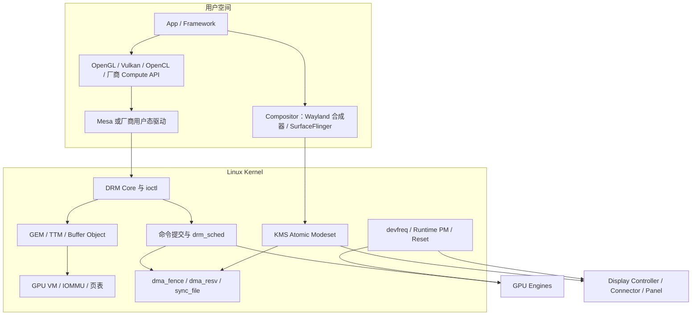
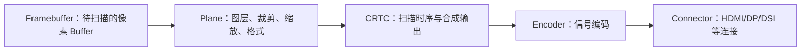
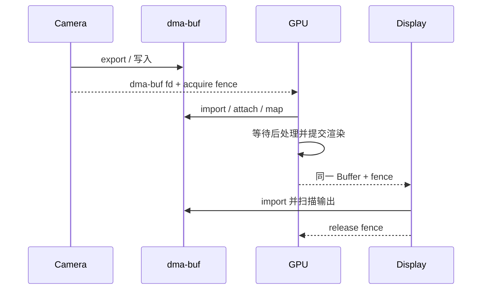

# Linux GPU 驱动：DRM/KMS、显存、调度与同步

GPU 驱动同时服务计算和显示，但两条路径解决的问题不同：计算路径关心 Buffer、GPU 虚拟
地址、命令提交和完成；显示路径关心屏幕模式、图层扫描输出与逐帧原子更新。Linux DRM
子系统为它们提供共同的用户态接口和内核框架。

# 1. 从应用到硬件的分层



图中的箭头表示主要的控制或数据流，不代表每次操作都严格调用下一个方框。例如合成器既
会通过 KMS 提交显示状态，也可能调用 OpenGL ES 或 Vulkan，借助 GPU 把多个图层合成为一个
新的 Buffer。

## 1.1 用户空间：描述工作并生成设备命令

**App / Framework** 是图形或计算工作的发起者。App 可以是游戏、桌面程序或计算程序；
Framework 则可能是浏览器渲染引擎、GUI 工具包、游戏引擎或机器学习运行时。它们通常描述
“绘制哪些对象”或“执行哪个计算”，而不直接操作 GPU 寄存器。

**OpenGL、Vulkan、OpenCL 与 Compute API** 是应用和用户态驱动之间的编程接口。OpenGL
主要以状态机方式描述图形渲染；Vulkan 显式暴露命令缓冲、同步和资源生命周期，可用于图形
与计算；OpenCL 及厂商计算接口面向通用并行计算。API 调用不是 GPU 可以直接执行的指令，
还需要用户态驱动把它翻译为目标设备认识的形式。

**UMD（User-Mode Driver，用户态驱动）** 实现上述 API 的设备相关部分。Mesa 是 Linux
常用的开源图形栈集合，其中包含多个 GPU 的 OpenGL/Vulkan 用户态驱动；硬件厂商也可以
提供自己的 UMD。UMD 会管理 API 状态，把 shader 或计算 kernel 编译成设备 ISA，组织
pipeline 状态和 command buffer，然后通过 DRM 文件描述符及 `ioctl` 把资源和任务交给
内核。这里的 shader/kernel 是在 GPU 上运行的程序，pipeline 是渲染阶段及其配置，
command buffer 是按设备格式连续编码的一批 GPU 命令，设备 ISA 则是特定 GPU 真正执行的
机器指令。

**Compositor（合成器）** 收集不同应用提交的窗口或图层 Buffer，决定它们在屏幕上的位置、
裁剪、缩放和叠放关系，再生成最终显示内容。Wayland 是应用与合成器通信的一套协议，
“Wayland 合成器”才是实际服务进程；SurfaceFlinger 是 Android 的系统合成服务。合成器
可以使用 GPU 完成复杂合成，也可以让显示控制器的硬件 Plane 直接扫描多个图层，最后通过
KMS 提交显示配置。

## 1.2 内核空间：隔离资源并安排硬件工作

**DRM（Direct Rendering Manager）Core** 是 Linux 内核的图形设备公共框架，负责设备
节点、文件级上下文、对象生命周期以及通用的渲染和显示接口。`ioctl` 是对设备文件发出
控制请求的系统调用：用户态传入请求编号和参数，DRM Core 先完成公共检查，再把设备相关
操作交给具体 GPU 驱动。它与传输连续字节流的 `read()`/`write()` 用途不同。

**Buffer Object（BO）** 是驱动管理的一块 GPU 可访问存储，可保存纹理、渲染目标、张量或
命令。**GEM（Graphics Execution Manager）** 提供 BO、进程私有 handle、映射和共享等
通用机制；handle 只是当前 DRM 文件中查找对象的整数标识，不是 GPU 地址。
**TTM（Translation Table Manager）** 擅长在系统内存与显存等不同存储域之间完成放置、
迁移和回收。GEM 与 TTM 是 DRM 中的两套内存管理框架，驱动也可以让 GEM 对象使用 TTM
后端；因此图中的 GEM、TTM 和 BO 既不是三块内存，也不是所有驱动都必须依次经过的三层。

**GPU VM（GPU Virtual Memory）** 为进程或 context 提供 GPU 虚拟地址空间，GPU 页表负责
把命令中的 GPU 虚拟地址转换到系统内存页或显存页。**IOMMU** 位于系统互连一侧，为设备的
DMA 地址提供转换和隔离；DMA 指设备无需 CPU 逐字节搬运即可直接访问内存。GPU 自带 MMU
与平台 IOMMU 可能串联，也可能只使用其中一部分，具体取决于芯片。context 是一组相互关联
的 GPU 执行状态和地址空间，不等同于 Linux 进程，一个进程可以创建多个 context。

**Command Submission（命令提交）** 把 command buffer、所引用的 BO、GPU VM、执行 context
和依赖关系组合成一次 job。**`drm_sched`** 是 DRM 提供的软件 GPU 调度器辅助框架，可按
实体、优先级和依赖选择 job，再交给驱动的硬件队列或固件调度器；它不是所有 GPU 驱动都
必须使用的唯一调度器。

**`dma_fence`、`dma_resv` 与 `sync_file`** 共同表达异步任务的先后关系，但用途不同：
`dma_fence` 表示某次 GPU/DMA 工作的完成时间点，`dma_resv` 保存与一个共享 Buffer 相关的
读写 fence，`sync_file` 则把 fence 包装成文件描述符，便于用户态或其他进程传递。Fence
解决“何时可以继续”，不负责分配 Buffer，也不等同于保护 CPU 数据结构的互斥锁。

**KMS（Kernel Mode Setting）** 是 DRM 的显示控制部分。这里的 mode 指分辨率、刷新率和
扫描时序；Plane 表示一个待扫描图层，CRTC 表示一条扫描输出管线，Connector 表示显示端点。
Atomic Modeset 会先把这些对象的新状态作为整体校验，再一次提交，避免逐项修改留下不可
显示的中间状态。它处理的是扫描输出，不负责把 shader 编译成 GPU 指令。

**`devfreq`、Runtime PM 与 Reset** 分别处理设备频率、空闲电源状态和故障恢复。`devfreq`
根据负载与策略调整 GPU 频率，Runtime PM 在设备空闲时关闭可停用的时钟或电源域，Reset
则在 GPU hang 等故障后重建可继续工作的硬件与软件状态。三者都会影响延迟，但解决的是
不同问题。

## 1.3 硬件端点：执行命令与扫描显示

**GPU Engine** 是能够消费某类命令的硬件执行引擎，常见类型包括 graphics/render、compute、
copy 以及 video encode/decode。不同 engine 可能并行工作，也可能共享执行单元、缓存或
内存带宽；图中的复数并不保证任意任务都能同时执行。

**Display Controller（显示控制器）** 按固定时序从 framebuffer（供扫描输出的像素 Buffer）
读取像素并送往显示链路，通常独立于执行 shader 的 3D/compute engine。**Connector** 是
DRM 对 HDMI、DisplayPort、DSI 等显示端点的抽象，记录连接状态和可用模式；**Panel** 是
实际面板设备。GPU 已经渲染完一个 Buffer，不代表显示控制器已经停止扫描它，因此渲染完成
和显示释放需要分别同步。

这种分层的基本边界是：用户态驱动理解高级 API 和设备 ISA，内核驱动保护跨进程共享的
资源并控制硬件访问，GPU engine 执行命令，显示控制器消费最终像素。具体分工因硬件和驱动
而异，不能假设所有命令都由内核逐条解析，也不能把显示扫描等同于 GPU 渲染。

# 2. DRM 设备节点与权限边界

常见 DRM 节点包括：

- `/dev/dri/cardN`：primary node，包含显示控制等受权限保护的操作；
- `/dev/dri/renderDN`：render node，面向渲染/计算提交，不提供 KMS master 操作；

应用通常通过 libdrm 或更高层用户态驱动发 ioctl。Render node 让普通进程无需取得显示
控制权即可使用 GPU，但仍必须依赖驱动的 per-file context、GPU page table 和命令接口实现
进程隔离。设备节点权限只是第一层，不足以替代驱动对地址、对象和命令的校验。

DRM master/lease 用于控制谁能配置显示资源。桌面 compositor 或 Android 显示服务通常是
显示控制者，普通渲染进程只生产 Buffer，不能任意改变其他应用正在使用的屏幕模式。

# 3. KMS：显示对象与 Atomic Commit

## 3.1 五类核心对象



- Plane 引用 framebuffer，并描述源/目标矩形、旋转、alpha 等属性；硬件支持多少 overlay
  plane 取决于显示控制器。
- CRTC 代表一条扫描输出管线，名字来自历史 CRT controller，但仍沿用至今。
- Encoder 把像素流转换成连接所需信号；Connector 表示物理或逻辑显示端点，并提供连接
  状态、支持模式和 EDID 等信息。

这些是内核对象模型，不代表芯片里一定存在一一同名的硬件模块。驱动会把通用属性映射到
真实寄存器和带宽限制。

## 3.2 为什么需要 Atomic Modesetting

一次画面更新可能同时改变多个 plane、CRTC mode 和 connector 路由。若逐项立即写硬件，
中间状态可能不可用或产生撕裂。Atomic KMS 把新状态先组装并检查，再作为一个 commit 应用：

```text
读取/创建 atomic state
  → 设置 plane/CRTC/connector 属性
  → atomic_check：格式、缩放、路由、带宽、时钟是否合法
  → 准备 Buffer 与 fence
  → atomic_commit
  → vblank 附近更新硬件
  → completion / out-fence
```

`atomic_check` 必须只验证并计算状态，不能提前做不可回滚的硬件修改。即使 check 通过，
commit 阶段仍可能遇到热拔插、超时或设备错误，驱动需要有明确恢复路径。

## 3.3 VBlank 与 Page Flip

显示控制器周期性扫描 framebuffer。VBlank 是一帧扫描结束到下一帧有效扫描开始附近的
区间，page flip 通常选择在合适边界切换 framebuffer，避免屏幕上半部分来自旧帧、下半
部分来自新帧。

VBlank event 表达显示状态已经到达某个时序点，不等于 GPU 渲染已经完成；渲染完成要由
输入 fence 保证。反之，GPU 完成也不表示该 Buffer 已经不再被屏幕扫描，复用还要等待
显示侧 release/out fence。

# 4. Buffer Object、GEM 与 TTM

## 4.1 Buffer Object 解决什么

GPU 需要访问 command buffer、texture、render target 和 tensor。内核以 Buffer Object
管理这些存储的大小、页、放置、映射、共享和生命周期。用户态通常持有 per-file handle，
handle 不是物理地址，也不能跨进程直接复用。

GEM 是 DRM 中通用的内存管理对象与 handle/mmap/export 框架。TTM 在此基础上擅长管理多个
memory domain 和对象迁移，例如 system RAM 与离散 GPU VRAM。集成 GPU 共享系统内存，
独立 GPU 常有本地显存；驱动可以使用 GEM helpers、TTM 或自己的后端组合，不能简单说
“GEM 属于核显、TTM 属于独显”。

## 4.2 Placement、Pin 与 Eviction

```text
创建 BO
  → 选择 system / VRAM / protected 等 placement
  → 建立 CPU 或 GPU 映射
  → 提交前 pin 或保证驻留
  → 内存压力下 eviction / migration
  → 最后一个引用释放
```

Pin 能阻止对象在硬件使用期间迁移，却会减少可回收空间；长期 pin 大量 Buffer 会造成
显存碎片和分配失败。Eviction 需要等待相关 fence，并可能把数据搬到较慢内存，所以 GPU
“执行”延迟中可能混有 residency 管理成本。

## 4.3 CPU 映射与 Cache Coherency

CPU mmap 一个 BO 后，缓存策略可能是 cached、write-combined 或 uncached，取决于内存类型
与架构。集成 GPU 的系统内存也不能一概视为“天然无需同步”：CPU/GPU 是否硬件一致、
DMA API、cache maintenance 和 fence 可见性必须分别满足。

`dma_fence` 保证任务顺序和完成，cache coherence 保证内存值的可见性；有序但未做必要的
cache 同步仍可能读到旧数据，缓存一致但任务尚未结束也仍不能提前读取。

# 5. dma-buf：跨设备共享 Buffer

dma-buf exporter 创建并管理 Buffer，importer 通过 fd 取得对同一 Buffer 的引用。常见链路：



Attach 表示某设备成为 importer，map attachment 为该设备建立 DMA scatter-gather 映射。
fd 跨进程传递后，各进程共享存储但拥有自己的 fd/handle 生命周期。关闭一个 fd 不会在
其他引用仍存在时立即销毁 Buffer。

零拷贝意味着不复制有效载荷，不等于没有 IOMMU 映射、cache maintenance、格式转换或同步
等待。Importer 还必须检查 format、modifier、stride 和访问方向是否兼容。

# 6. dma_fence、dma_resv 与 sync_file

## 6.1 Fence 表示什么

`dma_fence` 表示某个异步 DMA/GPU 操作最终会完成的时间点。它可以被等待、轮询或注册
callback；signal 只表示该任务达到完成条件，不能携带任意大量结果数据。

`sync_file` 把 fence 包装成文件描述符，便于跨进程和用户态 API 传递。Android 的
acquire/release fence 及 DRM atomic 的 in/out fence 都可与这一机制衔接。

## 6.2 dma_resv 解决隐式同步

Buffer Object 常带 `dma_resv`，记录与该对象相关的 fence。新的 reader/writer 可查询此前
访问并建立依赖。概念上：

```text
旧 writer fence ─┐
旧 reader fences ─┼→ 新访问等待规则 → 新 fence 写回 reservation
                  ┘
```

隐式同步让只传 Buffer fd 的旧接口也能排序，但依赖不够直观，容易产生过度等待。显式同步
把 in-fence/out-fence 放进提交接口，调用者能更明确地构造依赖图。两种模式可能共存，驱动
必须避免漏等、循环依赖和在持有 reservation lock 时发生不允许的等待。

## 6.3 Fence 不能解决什么

- Fence 不能保证硬件会成功；完成可能带 error，hang/reset 后也要 signal 依赖者；
- Fence 不是互斥锁，不能保护普通 CPU 数据结构；
- 等待带 timeout 不等于任务已取消；
- 创建 fence 后必须保证最终 signal，否则会让整个 Buffer 链永久阻塞；
- 只看最长 fence wait 无法判断慢在前置依赖、硬件执行还是完成中断未处理。

# 7. GPU 虚拟地址与页表

用户态得到 BO handle 后，通常还要把 BO 映射到某个 GPU virtual address（GPU VA）。每个
process/context 可以拥有独立 GPU address space：

```text
Command 中的 GPU VA
  → GPU page table
  → system page / VRAM page
  → memory controller
```

GPU VM 隔离防止一个 context 访问另一个 context 的 Buffer。IOMMU 可能参与系统侧设备
地址转换，独立 GPU 也可能有自己的 MMU；二者怎样组合取决于平台。

现代接口可能把 VM_BIND 与 EXEC 分开：先建立长期 GPU VA 映射，再多次提交引用这些地址的
命令。这减少重复绑定，却使 unbind、eviction、page fault 和并发提交的锁与 fence 关系更
复杂。驱动必须防止命令执行期间映射被拆除。

GPU page fault 可能表示按需映射，也可能是越界、use-after-free、错误地址空间或硬件 hang
后的次生故障。诊断要保留 context、engine、fault VA、访问类型、页表状态和提交序号。

# 8. Command Submission 与调度

## 8.1 从 ioctl 到硬件队列

```text
用户态构建 command buffer
  → submit ioctl
  → 查找 BO/context/VM
  → 验证依赖与地址
  → 建立 job 和 output fence
  → drm_sched / 驱动调度器
  → hardware ring / queue
  → GPU 执行
  → IRQ 或轮询确认完成
  → signal fence
```

驱动可能按 engine 建队列，例如 graphics、compute、copy/video。多个 context 的 job 根据
优先级、依赖和时间片进入硬件；是否能真正并行取决于架构资源和 firmware scheduler。

## 8.2 抢占、公平与优先级

高优先级不能突破所有依赖，也不能保证正在运行的长 kernel 可立即停止。抢占粒度可能是
command、thread group、wave 或更粗层次。细粒度抢占改善交互延迟，却增加保存/恢复状态和
硬件复杂度。

调度器要防止单个 context 饿死其他任务，同时避免过度切换破坏 cache 和吞吐。优先级只能
作为策略输入，用户态不能借它绕过资源限制或构造无限工作量。

## 8.3 Timeout、Hangcheck 与 Reset

Job 长时间未完成可能因为死循环 shader、页故障、总线错误、firmware 卡死或完成中断丢失。
Hangcheck 先确认硬件是否有进展，再按驱动能力尝试：

```text
停止新提交
  → 收集寄存器、ring、VM fault 与 firmware dump
  → preempt / engine reset / full GPU reset
  → 恢复硬件与页表
  → 对受影响 fence 报错并唤醒等待者
  → 允许后续任务继续或隔离故障 context
```

Reset 不能只把寄存器清零。若等待者永远收不到 error fence，用户空间会继续卡死；若未重建
上下文和映射就恢复提交，则可能造成第二次故障。Reset storm 还会掩盖最初现场，应在首次
异常时保存足够证据并限制重试。

# 9. 中断、并发与生命周期

GPU IRQ handler 常读取并清除完成/故障状态，把耗时处理放到 threaded IRQ、workqueue 或
调度器回调。必须处理：

- IRQ 与 submit 同时访问 ring/context；
- close/remove 与仍在执行的 job；
- reset 与正常 completion 竞争 signal 同一 fence；
- hot-unplug 后用户态仍持有 fd；
- runtime suspend 与新提交、IRQ、定时器竞争。

对象引用计数只能保证内存尚在，不自动保证硬件还能访问；锁能保护 CPU 状态，也不自动
停止 DMA。安全销毁通常需要“禁止新提交 → 等待或取消任务 → 停止硬件访问 → 同步 IRQ/
work → 解除映射 → 释放对象”的顺序。

# 10. Power、Thermal 与内存带宽

Runtime PM 在空闲时关闭 GPU block 或时钟，devfreq 根据负载选择频率，thermal framework
在温度超限时施加 cooling state。频率决策还受电压域、共享总线和内存控制器约束：

```text
队列负载 / deadline
  → GPU devfreq
  → clock + regulator
  → 执行时间与功耗
  → thermal pressure
  → 可用最高频率
```

GPU utilization 高不一定是 ALU 饱和，也可能在等显存或依赖。只提高核心频率对内存带宽
瓶颈帮助有限。Runtime PM autosuspend 太激进会频繁启停增加延迟，太保守又会增加待机功耗。

# 11. Android 图形与计算怎样接入

Android Gralloc 根据 width、height、format 和 usage 分配 GraphicBuffer/AHardwareBuffer；
BufferQueue 在 producer/consumer 间传递 handle，SurfaceFlinger 与 HWC 选择 GPU 合成或显示
overlay。底层可能通过 dma-buf 共享 Buffer，并用 sync_file fence 表达生产、合成和显示
完成。

Android 名词与 DRM 名词并非一一对应：Surface 是生产端接口，BufferQueue 是队列协议，
AHardwareBuffer 是可共享 Buffer 抽象，dma-buf 是内核共享机制，DRM framebuffer 是 KMS
扫描对象。把它们都叫“显存”会丢失所有权、格式和同步边界。

端侧推理使用 GPU compute 时也会走用户态编译、BO/VM、command submission 和 fence，
只是通常不进入 KMS。若结果还要交给相机或显示，才通过 AHardwareBuffer/dma-buf 把两条
链连接起来。

# 12. 分层诊断清单

## 12.1 画面卡顿

1. 应用是否按时生产 Buffer；
2. acquire fence 在等 CPU、GPU 还是其他设备；
3. GPU job 在依赖队列、调度队列还是硬件执行；
4. SurfaceFlinger/HWC 是否因格式、缩放或带宽退回 GPU 合成；
5. atomic commit 是否等待 vblank、mode lock 或显示 fence；
6. GPU/DDR 频率、thermal 和 memory reclaim 是否同期变化。

## 12.2 显存增长或分配失败

1. 按进程、dma-buf exporter、BO placement 与 heap 分类；
2. 检查 fd、GEM handle、framebuffer、VM mapping 和 fence 引用谁仍持有；
3. 区分真实容量不足、VRAM eviction 抖动、CMA/连续内存碎片和 IOMMU map 失败；
4. 检查屏幕关闭、应用退出或 reset 后资源是否回到基线。

## 12.3 GPU Hang

1. 保存第一次 timeout 的 job、context、engine 和 fence 序号；
2. 读取 fault address、页表、firmware/ring 与硬件 progress counter；
3. 判断命令无进展、内存 fault、依赖未 signal 还是 IRQ 丢失；
4. 对照用户态驱动和内核驱动 Build ID；
5. 验证 reset 是否唤醒等待者并恢复后续任务；
6. 用最小 workload、不同频率和关闭并发建立可证伪假设。

# 参考资料

1. [Linux Kernel Documentation: DRM Internals](https://docs.kernel.org/gpu/drm-internals.html)
2. [Linux Kernel Documentation: KMS](https://docs.kernel.org/gpu/drm-kms.html)
3. [Linux Kernel Documentation: GEM](https://docs.kernel.org/gpu/drm-mm.html)
4. [Linux Kernel Documentation: TTM](https://docs.kernel.org/gpu/drm-mm.html#ttm)
5. [Linux Kernel Documentation: DMA-BUF](https://docs.kernel.org/driver-api/dma-buf.html)
6. [Linux Kernel Documentation: DRM Scheduler](https://docs.kernel.org/gpu/drm-mm.html#gpu-scheduler)
7. [Linux Kernel Documentation: GPU VM Bind Locking](https://docs.kernel.org/gpu/drm-vm-bind-locking.html)
8. [Android Open Source Project: BufferQueue and Gralloc](https://source.android.com/docs/core/graphics/arch-bq-gralloc)
9. [Android Open Source Project: Synchronization framework](https://source.android.com/docs/core/graphics/sync)
