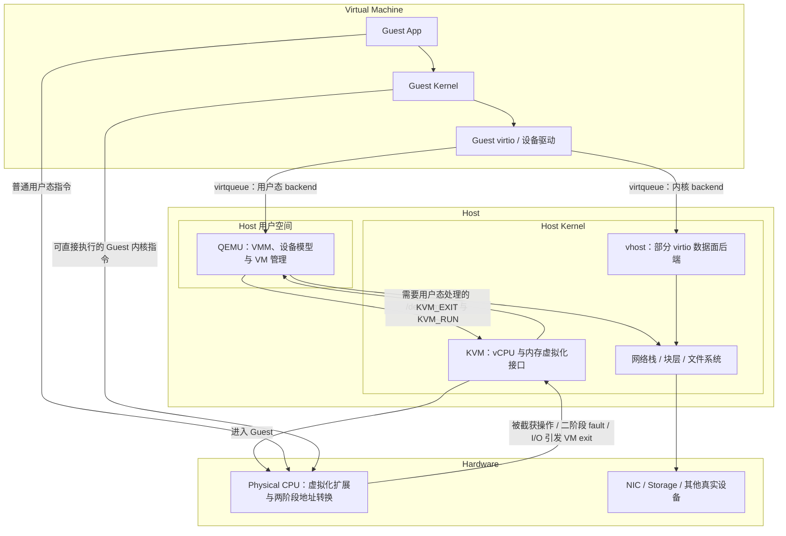
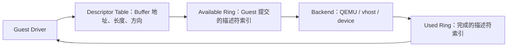

# Linux 虚拟化：KVM、QEMU、virtio 与设备直通

虚拟化的目标不是“模拟一台更慢的计算机”，而是在隔离多个 Guest 的同时，让大部分普通
指令直接在真实 CPU 上执行，只在需要宿主管理资源或模拟设备时退出到虚拟机监控器。

# 1. 先建立整体结构



图中的箭头表达主要控制流或 I/O 路径，不表示 Guest 的每条指令都会依次调用 KVM 和 QEMU。
QEMU 通过 `KVM_RUN` 启动 vCPU 后，大量 Guest 指令直接由物理 CPU 执行；只有硬件判定需要
宿主管理的事件才产生 VM exit。

## 1.1 Guest、Host 与虚拟机边界

**Guest** 是虚拟机内部的软件环境，包含 **Guest App**、**Guest Kernel** 及其驱动。
Guest App 与普通 Linux 应用一样运行在 Guest 用户态，通过系统调用请求 Guest Kernel；
Guest Kernel 管理自己看到的进程、页表、文件系统和设备。它虽然在 Guest 内拥有内核权限，
却不能绕过 Host 访问任意物理内存或硬件，因为 CPU 虚拟化扩展仍由宿主侧控制。

**Guest 设备驱动** 面向虚拟机看到的设备。它可以是模拟真实网卡、磁盘控制器的原生驱动，
也可以是 `virtio-net`、`virtio-blk` 等半虚拟化驱动。半虚拟化表示 Guest 知道自己使用的是
为虚拟化设计的接口，以更简单的共享内存协议换取更少的寄存器模拟和 VM exit；这不等于
Guest 与 Host 失去隔离。

**Host** 是实际拥有 CPU、内存和设备的宿主系统。图中把 Host 用户空间与 Host Kernel
分开，是因为 QEMU 是普通用户态进程，而 KVM、vhost、网络栈和块层位于宿主内核。Guest
中看到的“物理地址”和“网卡”仍是虚拟机视角的资源，最终必须由 Host 映射到真实资源。

**Hypervisor** 与 **VMM（Virtual Machine Monitor）** 常被宽泛地混用。按这篇文章的分层，
KVM 提供依赖硬件辅助的内核虚拟化机制，QEMU 负责完整虚拟机的用户态管理与设备模型；两者
协作形成常说的 KVM/QEMU 虚拟化栈。因此不能把“KVM”“QEMU”和“整个 Hypervisor”当成
三个完全等价的名称。

## 1.2 QEMU、KVM、vCPU 与 VM Exit

**QEMU** 在此处是 Host 上的 VMM 进程。它创建虚拟机和 vCPU、分配 Guest RAM、加载固件，
提供虚拟 PCI 总线及网卡、磁盘等设备模型，并处理迁移、快照和管理接口。固件是 Guest
操作系统启动前执行的初始化软件；设备模型则是对设备寄存器、队列、中断及状态机的实现，
不代表 QEMU 必须用软件解释 Guest 的每条 CPU 指令。

**KVM（Kernel-based Virtual Machine）** 是 Linux 内核中的虚拟化子系统，并通过
`/dev/kvm`、VM fd 和 vCPU fd 上的 `ioctl` 向 QEMU 等 VMM 提供接口。它配置 Guest CPU
状态、内存槽、二阶段地址转换和中断虚拟化，并在 `KVM_RUN` 期间控制 vCPU 进入或离开
Guest。KVM 是内核机制，QEMU 是它的一个主要用户，两者不是同一个程序。

**vCPU（virtual CPU）** 是 Guest 看到的逻辑处理器。QEMU/KVM 中每个 vCPU 通常由一个
Host 线程承载：该线程调用 `KVM_RUN` 后，物理 CPU 装载对应 Guest 寄存器状态并执行；退出
Guest 后，同一线程继续在 KVM 或 QEMU 中处理原因。vCPU 因而仍受 Host 调度器、CPU affinity
（绑定范围）和 NUMA（处理器与内存的距离关系）放置影响，并不永久独占某个物理核心。

**CPU 虚拟化扩展** 提供受控执行 Guest 的硬件模式，例如 x86 VMX/SVM、Arm EL2 与 RISC-V
H 扩展。普通算术、分支及大部分内存访问可以直接执行；被配置为截获的敏感操作、部分 I/O
或异常会让 CPU 从 Guest 切回 Host，这次硬件控制转移称为 **VM exit**。进入 KVM 并不保证
一定返回 QEMU：KVM 能在内核处理的事件可以处理后直接重新进入 Guest，只有设备模拟等需要
用户态参与的原因才由 `KVM_RUN` 以 `KVM_EXIT_*` 形式返回 QEMU。

图中的 **fault** 特指可能需要宿主管理的二阶段地址转换 fault 等事件，不应理解成 Guest
里的每次缺页都必然退出到 QEMU。普通 Guest 虚拟地址缺页可以由 Guest Kernel 自己处理；
当 Guest 物理地址尚未建立有效 Host 映射或违反二阶段权限时，才需要 KVM/Host 介入。

**两阶段地址转换** 先由 Guest 页表把 Guest Virtual Address 转为 Guest Physical Address，
再由 Host 控制的 EPT、NPT 或 stage-2 页表转为 Host Physical Address。CPU 会缓存组合后的
转换结果，因此地址隔离并不意味着每次访存都执行一次软件模拟。

## 1.3 virtio、virtqueue、vhost 与真实 I/O

**virtio** 是一组面向虚拟设备的标准接口，定义设备能力、配置空间、状态和队列协议。
Guest 中的 virtio 驱动是 frontend，Host 一侧处理请求的是 backend；backend 可以位于
QEMU、vhost 内核模块、独立的 vhost-user 进程或支持 virtio 的硬件中。

**virtqueue** 是 frontend 与 backend 交换请求的共享内存队列。Guest 驱动把 Buffer 地址、
长度和读写方向写成 descriptor，加入可用队列并在必要时通知 backend；backend 完成网络或
块 I/O 后写回完成队列并通知 Guest。共享队列传递的是请求描述，真正的数据是否复制、经过
哪些地址转换以及何时产生中断，仍取决于具体 backend 和设备。

**vhost** 把部分 virtio backend 数据面放到 Host Kernel 或专用后端中。以 vhost-net 为例，
内核 worker 可以直接消费 virtqueue 并衔接 Host 网络栈，减少每个数据包都唤醒 QEMU 的
开销。这里的“数据面”指高频收发请求，“控制面”则包括设备创建、协商、配置和生命周期；
使用 vhost 后，控制面通常仍由 QEMU 负责。

图中的 **Host 网络栈、块层和文件系统** 是虚拟 I/O 的实际宿主后端。例如虚拟磁盘可能
落到一个 Host 文件，也可能直达块设备；虚拟网卡可能接入 tap、bridge 后再到物理 NIC。
tap 是把二层网络帧交给用户态的虚拟网卡，bridge 在多个网络端口之间转发二层帧。
**Physical Device** 是最终执行 DMA 或外部传输的真实网卡、NVMe 等设备；DMA 表示设备
无需 CPU 逐字节搬运便可直接读写内存。并非所有 I/O 都必须经过图中每一层：第 6 章介绍的
VFIO 直通会绕过大部分 QEMU 设备数据面，而纯软件模拟则会更多地停留在 QEMU 中。

把两条主线连起来后，CPU 路径是“QEMU 调用 `KVM_RUN` → 物理 CPU 执行 Guest → VM exit
进入 KVM → 必要时返回 QEMU”；virtio I/O 路径则是“Guest 驱动提交 virtqueue → QEMU 或
vhost backend → Host I/O 子系统 → 真实设备 → 完成通知 Guest”。后续章节分别展开这些
阶段的边界条件。

# 2. KVM 与 QEMU 怎样分工

KVM 通过 `/dev/kvm` 向用户态提供 ioctl 接口。QEMU 大致按以下层次创建虚拟机：

```text
open /dev/kvm
  → KVM_CREATE_VM
  → 注册 Guest memory slots
  → KVM_CREATE_VCPU
  → mmap vCPU run shared area
  → 循环调用 KVM_RUN
```

`KVM_RUN` 进入 Guest。若 Guest 能直接安全执行，CPU 不必返回 QEMU；发生需要处理的事件时，
控制回到 KVM。KVM 能在内核中完成的事件可直接处理，用户态设备模拟等事件会作为
`KVM_EXIT_*` 返回 QEMU。

QEMU 负责进程生命周期、机器类型、固件加载、设备模型、镜像和管理接口。没有 KVM 时，
QEMU 也能使用软件翻译执行 Guest，但性能模型完全不同。因此“QEMU 慢”与“KVM 退出多”
必须用实际加速模式和 profile 区分。

# 3. vCPU、VM Exit 与调度

## 3.1 哪些事件会退出 Guest

具体条件由架构和 KVM 配置决定，常见包括：

- Guest 访问被截获的特权寄存器或指令；
- 访问需要用户态模拟的 MMIO/PIO；
- 二阶段地址转换 fault；
- 外部中断、定时器或调试事件；
- hypercall；
- Guest 主动 halt，或 Host 需要调度其他任务。

一次 exit 可能需要保存 Guest 状态、切换到 Host、处理事件、再恢复 Guest。减少不必要 exit
很重要，但 exit 数量不是唯一指标：一次复杂的设备模拟可能比多次轻量 exit 更昂贵。

## 3.2 vCPU 线程并不独占物理 CPU

每个 vCPU 通常是普通宿主线程，仍受 CFS/EEVDF、实时调度、cpuset、NUMA 和抢占影响。
当 runnable vCPU 数远大于物理 CPU 时，会产生 overcommit；Guest 看到的“CPU 被偷走”
可能表现为 steal time 和尾延迟。

vCPU pinning 可以提高缓存局部性和时延可预测性，但也会减少宿主调度自由度。还要同时
考虑 QEMU I/O thread、vhost worker、IRQ 和内存 NUMA 位置，不能只固定 vCPU。

## 3.3 虚拟定时器与中断

Guest 需要定时器、核间中断和设备中断。硬件辅助能减少中断注入开销，但中断仍可能跨过：

```text
真实设备 IRQ
  → Host IRQ handler
  → vhost/QEMU 完成处理
  → 标记虚拟中断
  → KVM 注入 Guest vCPU
  → Guest IRQ handler
```

MSI/MSI-X、x86 APIC/Arm GIC/RISC-V IMSIC 等实现细节不同。排查延迟时应区分物理中断到达、
Host 调度、注入等待和 Guest handler 执行。

# 4. Guest 内存与两阶段地址转换

## 4.1 三种地址

```text
Guest Virtual Address（GVA）
    ↓ Guest 页表
Guest Physical Address（GPA）
    ↓ Host/KVM 控制的第二阶段页表
Host Physical Address（HPA）
```

x86 常把第二阶段机制称为 EPT 或 NPT，ARM64 称 stage-2，RISC-V H 扩展也定义两阶段转换。
CPU 可以把两阶段遍历结果缓存在 TLB 中，因此正常内存访问不需要每次进入 KVM。

## 4.2 Memory Slot 与缺页

QEMU 向 KVM 注册 GPA 区间及对应用户态虚拟地址。Guest 第一次访问某页时，可能经由宿主
缺页分配匿名页、映射文件后备页，或建立 KVM 二阶段映射。于是 Guest 的一次 major fault
和 Host 的一次 fault 不是同一事件；内存 balloon、swap、KSM、userfaultfd 和迁移还会
改变路径。

## 4.3 Huge Page、NUMA 与内存锁定

Huge page 能降低页表和 TLB 压力，但也提高连续内存、迁移和碎片管理成本。Guest vCPU 在
Node 0 而内存落在 Node 1 会产生远端访问；只配置 vCPU affinity 而忽略 memory binding，
通常得不到稳定 NUMA 性能。

锁住全部 Guest 内存可避免宿主 swap 引发不可预测延迟，却会降低系统弹性，并需要正确设置
资源上限。内存策略要根据密度、时延与可恢复性取舍。

# 5. 虚拟设备与 virtio

## 5.1 全设备模拟为何昂贵

模拟真实硬件寄存器可让未修改 Guest 驱动运行，但每次寄存器访问都可能触发 exit，设备模型
还要复现复杂硬件语义。virtio 改为让 Guest 使用虚拟化友好的半虚拟化驱动，双方通过共享
内存队列交换描述符。

## 5.2 Virtqueue 的基本结构

virtio split ring 可概念化为：



Guest 可以把多个 Buffer 串成 descriptor chain，提交后通过 notify/kick 提醒 backend；
backend 完成后更新 used ring，并按需通知 Guest。Batching、event suppression 和 packed
ring 可以减少通知与缓存抖动，但要求双方严格遵守共享内存顺序和设备规范。

## 5.3 virtio-net 与 virtio-blk

virtio-net 把网络包 Buffer 放进发送/接收 virtqueue；多队列可让不同 vCPU 并行处理。
virtio-blk 以请求头、数据区和状态组成链，表达读、写、flush、discard 等操作。虚拟块设备
返回完成并不自动强于宿主文件系统和真实磁盘的持久性，flush/FUA 必须贯穿所有层。

## 5.4 vhost 把什么移进内核

纯 QEMU virtio 数据面需要唤醒用户态进程。vhost 让内核 worker 直接处理部分 virtqueue，
减少用户态切换和数据路径开销；vhost-net、vhost-scsi 和 vhost-vsock 面向不同设备。

vhost 不是“整个虚拟机都进内核”：控制面、设备配置与生命周期仍由 QEMU 管理。vhost-user
则通过共享内存和 Unix socket 把 backend 放到独立用户态进程，常用于高性能网络与存储。

# 6. IOMMU、VFIO 与设备直通

设备直通让 Guest 更直接地控制真实 PCIe 设备。VFIO 把设备访问安全地暴露给用户态，
IOMMU 把设备 DMA 限制在授权页表内：

```text
Guest Driver
  → 虚拟/直通设备寄存器
  → Physical Device DMA with IOVA
  → IOMMU translation
  → Guest 对应的 Host pages
```

如果没有可靠 IOMMU 隔离，失控设备可以 DMA 到宿主任意内存。隔离粒度还受 IOMMU group、
PCIe ACS 和拓扑影响，同一 group 内设备不能想当然地安全拆分。

直通减少设备模拟开销，但会带来设备独占、复位能力、中断重映射、迁移和错误隔离问题。
SR-IOV 让一个物理功能创建多个虚拟功能，提高共享能力，但 PF/VF 管理和资源隔离仍依赖
具体设备。新的内核接口逐步使用 IOMMUFD 表达用户态 I/O 地址空间；维护旧方案时还会看到
legacy VFIO container/group 模型，应按目标内核接口判断。

# 7. Live Migration 怎样保持一致

迁移需要复制虚拟机内存、vCPU 状态和设备状态。Pre-copy 通常先在 Guest 运行时多轮复制
内存并追踪 dirty pages，最后短暂停机复制剩余脏页与 CPU/设备状态：

```text
全量复制
  → Guest 继续写入
  → 多轮复制 dirty pages
  → stop-and-copy
  → 目标恢复执行
```

若写脏速度接近网络复制速度，pre-copy 可能不收敛。Post-copy 先迁移最小状态并在目标运行，
缺页时从源端拉取页面，能缩短前置复制但把网络故障暴露到运行期。设备必须有可序列化、
版本兼容的状态；直通设备通常更难迁移。

迁移正确性不仅是“能启动”，还包括 Guest 时钟、未完成 I/O、中断、网络连接和持久化顺序。
源/目标 CPU 特性差异也会限制可迁移性，因此生产环境常向 Guest 暴露一组稳定 CPU model，
而不是全部宿主特性。

# 8. 性能与故障定位

## 8.1 先按层拆时间

```text
Guest application
  → Guest kernel / driver
  → vCPU runnable 与 Host 调度
  → VM exit / KVM
  → QEMU、vhost 或直通设备
  → Host filesystem/network/block
  → physical device
```

常用证据包括：

- Guest 内的 perf、ftrace、iostat、网络统计；
- Host 的 `perf kvm`、KVM tracepoints、QEMU 日志和线程 CPU 时间；
- vCPU steal time、run queue、NUMA miss、major fault；
- virtqueue 深度、kick/interrupt 数、vhost worker 调度；
- 宿主块层、网络栈和真实设备延迟。

Guest 看到 I/O 慢不代表 virtio 是根因，也可能是 Host writeback、设备队列或 vCPU 长时间未
被调度。反过来，Host 设备利用率不高也可能因为 Guest 单队列、过小请求或通知过于频繁。

## 8.2 常见边界

- CPU pinning 不能消除共享 LLC、内存带宽和 IRQ 干扰；
- huge page 不能修复不合理 NUMA 放置；
- busy polling 能降低部分唤醒延迟，但会持续占用 CPU；
- 多队列只有 Guest、backend 和物理设备都能并行时才有效；
- 直通减少软件层次，却让迁移、观测和故障恢复更困难；
- 平均吞吐正常时仍需检查 P95/P99、stop-the-world 管理操作和宿主内存回收。

# 9. 一条可操作的练习路径

1. 用 QEMU + KVM 启动最小 Linux Guest，确认 `/dev/kvm` 与加速模式；
2. 对比 emulated NIC 与 virtio-net 的 exit、吞吐和 CPU；
3. 在 Guest 做顺序/随机块 I/O，对照 Host 文件与块层 trace；
4. 改变 vCPU 数、pinning 和 NUMA memory policy，记录尾延迟；
5. 用 KVM tracepoint 找一次 MMIO exit，从 Guest 驱动追到 QEMU 设备模型；
6. 观察 virtqueue kick、完成通知和 vhost worker；
7. 做一次保存/恢复或迁移，核对 vCPU、内存和设备状态。

# 参考资料

1. [Linux Kernel Documentation: KVM API](https://docs.kernel.org/virt/kvm/api.html)
2. [Linux Kernel Documentation: Virtio](https://docs.kernel.org/driver-api/virtio/virtio.html)
3. [Linux Kernel Documentation: VFIO](https://docs.kernel.org/driver-api/vfio.html)
4. [Linux Kernel Documentation: IOMMUFD](https://docs.kernel.org/userspace-api/iommufd.html)
5. [QEMU Documentation: System Emulation](https://www.qemu.org/docs/master/system/index.html)
6. [Arm: Armv8-A Virtualization](https://developer.arm.com/-/media/Arm%20Developer%20Community/PDF/Learn%20the%20Architecture/Armv8-A%20virtualization.pdf)
7. [RISC-V Privileged Architecture: Hypervisor Extension](https://docs.riscv.org/reference/isa/priv/hypervisor.html)
