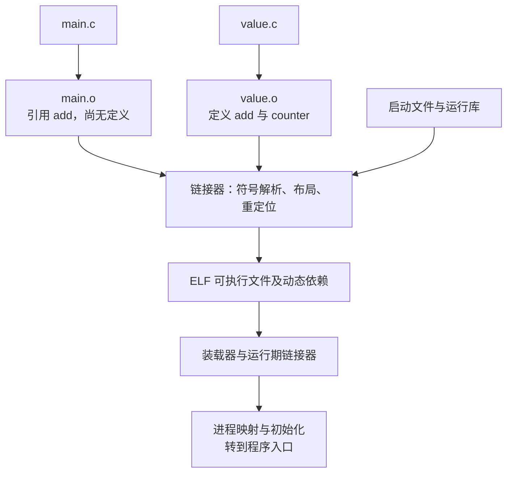
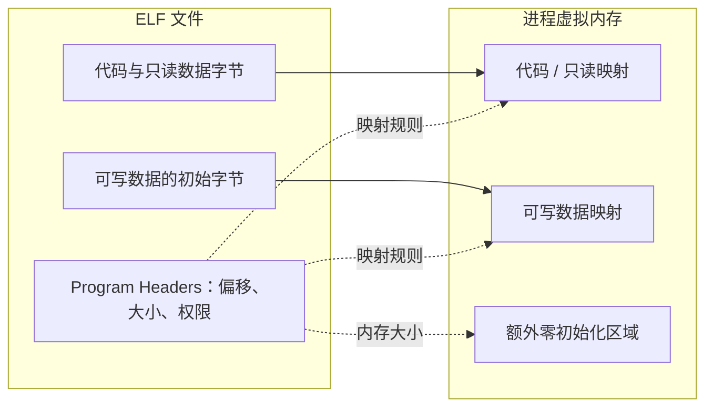

# 目标文件、链接与装载

编译器为一个源文件生成机器指令时，其他文件中的函数地址通常还没确定。目标文件
因此不仅保存代码，还保存符号、重定位、分组和展开信息；链接器完成跨文件组合，
装载器再把结果映射为进程中的代码和数据。下面用 Linux ELF、Clang 与 LLVM 工具沿着
这条路径观察，ARM64 部分只生成和检查目标文件，不要求在本机执行 ARM64 程序。

# 1. 从两个源文件开始

完整示例在 [compiler-lab/linking](../tools/compiler-lab/linking/value.c)。
`value.c` 定义一个全局对象和一个函数：

```c
int counter = 40;
int add(int n) { return counter + n; }
```

`main.c` 在另一个翻译单元引用它：

```c
#include <stdio.h>
int add(int);
int main(void) { printf("%d\n", add(2)); }
```

后续命令从仓库根目录执行，将生成物放在 `/tmp/elf-lab`：

```bash
mkdir -p /tmp/elf-lab
clang -O2 -c tools/compiler-lab/linking/value.c -o /tmp/elf-lab/value.o
clang -O2 -c tools/compiler-lab/linking/main.c -o /tmp/elf-lab/main.o
clang /tmp/elf-lab/main.o /tmp/elf-lab/value.o -o /tmp/elf-lab/demo
/tmp/elf-lab/demo
```

输出为 42。main.o 不包含 add 的函数体，却可以先完成编译；只有最终组合程序时才需要
解析这个外部引用。使用 Clang Driver 链接还会安排启动文件、运行库和系统库，不能
简单用一条 `ld.lld main.o value.o` 替代而忽略这些依赖。



# 2. 符号表与重定位各自记录什么

## 2.1 定义、引用、绑定与可见性

```bash
llvm-readobj --file-headers --sections --symbols --relocations /tmp/elf-lab/main.o
llvm-readobj --symbols --relocations /tmp/elf-lab/value.o
llvm-nm /tmp/elf-lab/main.o /tmp/elf-lab/value.o
```

普通本地编译产生的 `.o` 通常是 `ET_REL`，可重定位目标文件。main.o 中 add 是未定义
符号，value.o 中它是函数定义，counter 是数据定义。符号还带有名字、类型、绑定、可见性、
所属 section、相对位置和大小等信息，不是一张只存“名字和最终地址”的表。

Binding 区分 Local、Global、Weak 等关系；Visibility 则描述符号对外暴露及可抢占规则。
源文件中写一个函数声明，不会把另一文件的机器码复制进来；C++ 名字改编也会参与最终
符号匹配，所以签名或语言链接不一致可能在此阶段表现为找不到符号。

## 2.2 重定位是待完成的地址计算

编译 main.o 时 add 的最终位置未知，对调用点先留下相应机器代码和重定位记录。记录
通常需要说明修改位置、目标符号、重定位类型及 Addend，加数。具体计算可能依赖符号
地址 S、修改点位置 P、加数 A，或 GOT/PLT 的位置。

例如 PC-relative 计算常涉及 `S + A - P`，但不能把这个式子套到所有 relocation：
有的需要页面对齐、取低位、缩放或范围检查；ELF REL 与 RELA 对 Addend 的存放方式也
不同。链接器会根据目标 ABI 将结果编码进指令或数据，超出分支范围时还可能需要跳板。
重定位不是“重新编译整个函数”，也不总是把绝对地址直接写进代码。

# 3. 文件中的 Section 与内存中的 Segment

Section，节，适合编译、链接和调试工具组织内容；Segment，段，是装载视角的映射范围，
由 Program Headers 描述。一个 `PT_LOAD` 可以覆盖多个 section，同一个文件并不是
“每个 section 分配一张独立内存页”。

| 内容 | 文件里的典型位置 | 执行时的含义 |
|---|---|---|
| 机器指令 | `.text` | 通常进入可执行映射 |
| 字符串和只读表 | `.rodata` | 通常进入只读映射 |
| 非零初值的全局对象 | `.data` | 初始字节来自文件，运行期允许修改 |
| 零初始化对象 | `.bss`，通常为 NOBITS | 文件不必保存全部零字节，内存仍需要空间 |
| 链接所需符号和重定位 | `.symtab`、`.rela.*` 等 | 部分由静态链接器消费，未必保留到运行期 |
| 动态查找信息 | `.dynsym`、动态重定位、`.dynamic` | 运行期链接器解析外部引用 |
| 栈展开信息 | `.eh_frame` 等 | 在相应地址范围恢复调用帧 |

```bash
llvm-readobj --program-headers --sections /tmp/elf-lab/demo
```

`p_filesz` 表示段在文件中占用的字节，`p_memsz` 表示映射所需的内存字节；后者可能更大，
例如尾部要补零的区域。`.bss` 不占等量文件数据，不意味着运行时免费，也不意味着
section 本身没有大小。



# 4. 静态库是归档，不是完整程序

```bash
llvm-ar rcs /tmp/elf-lab/libvalue.a /tmp/elf-lab/value.o
clang /tmp/elf-lab/main.o /tmp/elf-lab/libvalue.a -o /tmp/elf-lab/archive-demo
/tmp/elf-lab/archive-demo
```

`.a` 是多个目标文件的归档。链接器按符号需求提取成员，通常不是把全部成员逐个复制。
示例把这个库静态纳入程序，但 printf 等系统依赖仍可动态链接，不等于整个程序使用了
`-static`。

把引用者放在依赖库之前，是便于理解和移植的链接顺序。循环库依赖、不同链接器的
归档处理及 `--start-group/--end-group` 需要按实际需求处理；不能把顺序错误当成编译器
没有生成函数。

仅靠全局构造函数注册插件的归档成员，可能没有显式符号引用而未被提取。
`--whole-archive` 可强制纳入成员，但也会增加体积；成员被提取后，`--gc-sections` 仍是
另一层删除规则。是否需要显式保留，要结合注册表、section 和链接脚本一起判断。

# 5. 共享库、SONAME 与查找路径

```bash
clang -O2 -fPIC -shared tools/compiler-lab/linking/value.c \
  -Wl,-soname,libvalue.so -o /tmp/elf-lab/libvalue.so

clang /tmp/elf-lab/main.o -L/tmp/elf-lab -lvalue \
  '-Wl,-rpath,$ORIGIN' -o /tmp/elf-lab/shared-demo

llvm-readobj --dynamic-table --needed-libs /tmp/elf-lab/shared-demo
/tmp/elf-lab/shared-demo
```

SONAME 是共享对象提供给链接依赖记录使用的名字；可执行文件通常在 `DT_NEEDED` 中
记录这个逻辑依赖。`-L` 主要影响链接时搜索，不会自动成为程序运行时搜索目录。
示例把库放在程序同一目录，用 `$ORIGIN` 表示可执行文件所在目录；命令中的单引号
防止 Shell 提前展开它。

常见链接器会把这里的路径写成 RUNPATH。它与环境变量、系统缓存和默认目录共同影响
查找；RUNPATH 主要用于对应对象的直接依赖，不应假定它会无条件传递给整条依赖链。
安全执行模式等情况也会限制环境变量的效果。
[Linux 动态链接器的查找规则](https://man7.org/linux/man-pages/man8/ld.so.8.html)

共享库和常见 PIE 都可能是 `ET_DYN`，不能只靠这个类型字段断言文件一定是库。
同一 ABI 下也应区分 SONAME、磁盘文件名和完整路径；仅把新文件重命名为旧 SONAME，
不能证明它仍提供兼容的符号、对象布局和调用约定。

# 6. PIC、GOT 与 PLT

## 6.1 为什么地址要多经过一层

PIC 是 Position-Independent Code，位置无关代码；PIE 是位置无关可执行文件。它们让
代码能适应不同装载位置，但不意味着程序不再需要重定位。

GOT，Global Offset Table，全局偏移表，为部分地址引用提供可更新的间接槽位；PLT，
Procedure Linkage Table，过程链接表，为外部调用提供相应跳转路径。具体引用是否需要
它们，取决于可见性、可抢占性、目标指令和链接器放宽，不是“所有全局变量必走 GOT，
所有函数必走 PLT”。

## 6.2 在 ARM64 中分清地址与内容

```bash
clang -target aarch64-linux-gnu -O2 -fPIC -S \
  tools/compiler-lab/linking/value.c -o /tmp/elf-lab/value-aarch64.s
clang -target aarch64-linux-gnu -O2 -fPIC -c \
  tools/compiler-lab/linking/value.c -o /tmp/elf-lab/value-aarch64.o
llvm-readobj --relocations /tmp/elf-lab/value-aarch64.o
```

对可抢占 counter 的一次访问，核心指令可表现为：

```asm
adrp x8, :got:counter
ldr  x8, [x8, :got_lo12:counter]
ldr  w8, [x8]
add  w0, w8, w0
ret
```

ADRP 与下一条 LDR 一起找到 GOT 槽位，第一次 LDR 取出 counter 的实际地址，第二次
LDR 才读取 counter 的整数内容。目标文件中可看到
`R_AARCH64_ADR_GOT_PAGE` 与 `R_AARCH64_LD64_GOT_LO12_NC` 之类的重定位。
这和 LLVM IR 中“`@counter` 是地址，Load 才取得值”对应。

若符号绑定允许本地直达，编译器或链接器可能减少间接访问；若外部定义可被替换，
就不能未经证明直接把当前定义当成唯一目标。AArch64 的页面寻址、缩放和范围由
[AAELF64](https://github.com/ARM-software/abi-aa/blob/main/aaelf64/aaelf64.rst) 规定，
不能把 x86 的 relocation 名称和编码规则套过去。

## 6.3 延迟绑定不等于每次重新链接

某些 PLT 路径可以在第一次调用时经过动态解析器，之后通过已更新的槽位直接到达
目标；立即绑定则在更早的装载阶段完成相关解析。`-fno-plt`、`-z now` 和链接器放宽
会改变具体序列，但函数地址解析、跳转和函数体执行仍是不同步骤。

ASLR 依赖装载位置随机化，PIC/PIE 使相应映射可行；GOT/PLT 的间接性本身不是完整
安全机制。RELRO 和绑定时机等还会影响重定位后哪些区域可以改写。

# 7. 符号抢占、Weak 与 COMDAT

## 7.1 外部可见不代表本地定义不可替换

`override.c` 定义另一个同名函数：

```c
int add(int n) { return 1000 + n; }
```

```bash
clang -O2 -fPIC -shared tools/compiler-lab/linking/override.c \
  -o /tmp/elf-lab/liboverride.so
LD_PRELOAD=/tmp/elf-lab/liboverride.so /tmp/elf-lab/shared-demo
```

在本例普通动态链接配置中，输出从 42 变成 1002。环境变量只作用于这次命令。
这说明外部引用的实际解析结果可能不同于某个源文件中看到的定义，优化器不能在
不满足绑定前提时随意用本地函数体替换调用。

隐藏可见性、`-Bsymbolic`、语义抢占相关编译选项和可执行文件的符号规则，会改变
哪些引用能够被替换。这些都是契约选择，不是“打开某个优化就无条件更快”；需要
动态替换、插件或地址身份的系统尤其要检查行为。

## 7.2 Weak 选择和 ODR 等价不同

强/弱定义规则帮助链接器在候选定义之间选择；C++ inline、模板等实体还带有 ODR，
One Definition Rule，单一定义规则，要求跨单元定义符合语言规定的等价性。
LLVM 的 `weak_odr`、`linkonce_odr` 允许优化器利用这种保证，不是替违反 ODR 的程序
选择一个“看起来能用”的结果。

COMDAT 为一组相关 section 提供选择关系。运行以下例子，两个源文件都引用同一个
inline 函数的地址，因此各自可能发射一份函数：

```bash
clang++ -O2 -c tools/compiler-lab/linking/left.cpp -o /tmp/elf-lab/left.o
clang++ -O2 -c tools/compiler-lab/linking/right.cpp -o /tmp/elf-lab/right.o
llvm-readobj --symbols --section-groups /tmp/elf-lab/left.o

clang++ /tmp/elf-lab/left.o /tmp/elf-lab/right.o \
  tools/compiler-lab/linking/inline-main.cpp -o /tmp/elf-lab/inline-demo
/tmp/elf-lab/inline-demo
```

程序检查两处取得的 inline 函数地址相同并返回 0。组选择需要保留与该份代码关联的
数据和重定位关系。它与 ICF，Identical Code Folding，相同代码折叠，不是同一种机制：
COMDAT 根据组与符号契约选择，ICF 则尝试识别并折叠内容等价的输出实体，地址身份
和目标语义会限制能够安全合并的范围。

# 8. LTO 在链接路径中重新进入编译器

```bash
clang -O2 -flto=thin -fuse-ld=lld \
  tools/compiler-lab/linking/main.c tools/compiler-lab/linking/value.c \
  -o /tmp/elf-lab/thinlto-demo
```

启用 LTO 后，部分 `.o` 的内容可能是 LLVM Bitcode，而不是普通本机 ELF 指令。
链接器先获取符号解析、保留和可抢占等信息，LTO 再据此做跨模块优化并生成本机
目标，最后完成布局与重定位。文件后缀没有保证内容格式。

因此“看到两个源文件就可以随意内联”仍不成立：外部引用、可见性、地址身份和
动态替换契约都会影响可用事实。ThinLTO 的 Summary、Import 和后端分工见
[LLVM 中的 LTO 与 ThinLTO](post.html?slug=llvm_review)。

# 9. 从 ELF 入口到 main

普通 Linux 动态可执行文件的 Program Headers 可能包含 `PT_INTERP`，指向所用动态
链接器。系统和运行期链接器共同建立映射、加载依赖、处理动态重定位和初始化，再
沿启动代码进入 C/C++ main；内核不会把 `main` 这个 C 符号当成通用 ELF 入口。

```text
ELF entry / 启动代码
→ 运行库启动与初始化协议
→ main
→ 正常退出及清理
```

依赖库构造与程序初始化有规定的装载关系，但不能由此推断任意两个 C++ 全局对象
都具有你想要的初始化先后次序。`dlopen` 还会在运行期引入新的加载、符号和生命周期
问题；卸载之后继续持有函数指针，更不是链接成功就能保证安全的操作。

最终进程中的代码、只读数据、可写数据、TLS、堆和线程栈各自有不同来源。
`程序文件大小`、`映射虚拟地址空间`、`驻留物理内存` 和 `运行期分配量` 不是同一个指标。

# 10. 按阶段定位失败

| 现象 | 先检查什么 |
|---|---|
| 声明或类型检查失败 | 预处理、语言模式、include、AST 与 ABI 声明 |
| `undefined reference` | 精确符号名、对象是否提供定义、归档是否被提取、语言链接 |
| 重复定义 | 强符号冲突、ODR、COMDAT 与 common 等约束 |
| relocation 溢出或目标不兼容 | 架构、代码模型、分支范围、PIC 与链接布局 |
| 程序启动找不到共享库 | `DT_NEEDED`、SONAME、RUNPATH、依赖库自身的查找路径 |
| `dlopen`/调用时符号缺失 | 动态导出、符号版本、装载命名空间和查找时机 |
| 崩溃在异常或采样展开 | 最终 `.eh_frame`、PC 范围、栈状态与 ABI |
| `.text` 变小但文件变大 | 对齐、跳板、重定位、展开表、只读数据与链接垃圾回收 |

用 `llvm-readobj` 观察结构、`llvm-nm` 观察符号、`llvm-objdump` 观察指令，再把结果与
编译和链接命令对应起来。直接 strip 文件可能删掉定位问题需要的信息，不应在保留
原始制品之前就把它当成解决方案。

相关资料：[LLD 的使用与 LTO](https://lld.llvm.org/)、[ELF 文件格式](https://man7.org/linux/man-pages/man5/elf.5.html)、
[Linux 动态链接器](https://man7.org/linux/man-pages/man8/ld.so.8.html)、
[AArch64 ELF ABI](https://github.com/ARM-software/abi-aa/blob/main/aaelf64/aaelf64.rst)。
